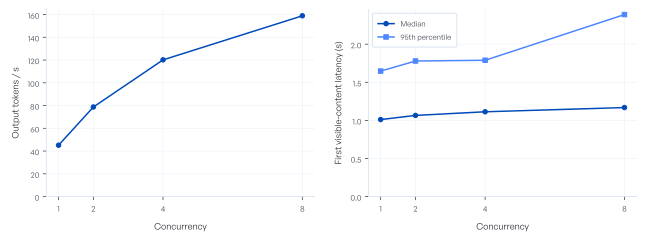

**English** · [中文](README.md)

# NVIDIA DGX Spark GB10 Testing Suite

A reusable performance study for inference engineers, organized as **hardware → operators and communication → inference engine → user-visible service**. Model and experiment indexes connect protocols, code, data, figures and conclusions. Read or recompute the published results offline, or run new bounded experiments on your own endpoint or GPUs.

## 1. Background and scope

DGX Spark integrates a Blackwell GPU, an Arm CPU and unified memory in the GB10 platform. Inference performance depends on arithmetic precision, memory access, model structure, inter-node communication, engine scheduling and the public serving path. A peak hardware specification cannot be directly converted into model generation speed or user latency.

This project studies those layers separately: establish compute and memory baselines, measure operators and communication, inspect engine prefill/decode, then measure API latency, throughput, cache reuse and mixed traffic. Every conclusion is tied to a configuration, workload, unit and evidence table. Specifications, measurements and cost assumptions remain distinct.

| Current study object | Recorded configuration |
| --- | --- |
| Hardware | Two NVIDIA DGX Spark / GB10 nodes, each with 128 GB LPDDR5x unified memory; two-node tensor parallelism |
| Served model | `qwen/qwen3.8-flash-next-abliterated`, accessed through Infron |
| Weights | [dealignai/Qwen3.8-Flash-Next-ABLITERATED-NVFP4](https://huggingface.co/dealignai/Qwen3.8-Flash-Next-ABLITERATED-NVFP4/tree/be794b990578ef3031eccf9f28e675a289a09ee9), pinned revision `be794b990578ef3031eccf9f28e675a289a09ee9` |
| Engine | SGLang 0.5.21; NVFP4 / `modelopt_fp4`; TP=2; MTP enabled; total context limit 262,144 tokens |
| Study period and records | October 14–19, 2026; [complete study](experiments/qwen3.8-flash-next-abliterated/2026-10-19-completion/reports/report.en.md); [measurement records](experiments/qwen3.8-flash-next-abliterated/2026-10-19-completion/README.en.md) |
| Objective | Serving performance and resource behavior. Task datasets supply inputs; answers are not scored and model capabilities are not ranked. |

This is a custom engineering study, not an MLPerf-certified submission. H200 is an architectural/specification reference, without a matched measured workload. Economic results are scenarios under explicit assumptions.

## 2. Experimental plan

### Measurement layers

| Layer / tests | Controls and method | Main outputs |
| --- | --- | --- |
| GPU arithmetic | GEMM by precision, shape, scale and implementation; numerical validation; dense and sparse peak conventions separated | TFLOP/s, elapsed time, precision and valid conditions |
| GPU memory access | Working-set size and read/write/copy patterns; logical-byte accounting; GB10 unified memory is not HBM | GB/s and size-response curves |
| Operators and system contention | Operator shapes, parallelism, CPU contention and sustained workloads | Operator latency, resource and temperature time series |
| Two-node communication and overlap | Matching rank pairs; collective type, message size and compute/communication combinations | Algorithm bandwidth, bus bandwidth, latency and overlap benefit |
| Engine internals | Native SGLang requests, forced-length probes, phase timers and GPU traces; profiled results kept separate | Prefill, decode, native cache counts and stage times |
| Public model service | Complete streaming responses; concurrency 1/2/4/8; closed-loop and independent arrivals separated; paired short/long traffic | First-token and visible-content latency, total latency, throughput, completion, rejection and errors |
| Cache and stability | Prefix overlap, repeated access, retention, competition and periodic reuse; native counts or complete counter windows | Observed hit ratios, latency change and reuse stability |
| Economics and architecture | US$10,000 two-node purchase; explicit electricity, utilization and price assumptions; H200 aligned by resource function | 1/3/5-year ownership cost, payback conditions and ROI scenarios |

### Workloads and data sources

- **Fixed task bank:** 10 items each from MMLU-Pro, MATH-500, GSM8K, IFEval, HumanEval+ and MBPP+, for 60 inputs spanning knowledge, mathematics, instruction and code formats. Sampling records, sources and terms are in [data and provenance](docs/data-and-provenance.en.md) and [experiment protocols](experiments/qwen3.8-flash-next-abliterated/2026-10-14_17-dual-spark/protocols/).
- **Length matrix:** input and output tiers of 1K, 2K, 4K, 8K, 16K, 32K, 64K, 128K and 256K, where 1K=1,024 tokens. Filter by input + output ≤262,144, including template overhead and boundary cases. A full 256K input cannot coexist with positive output. An output cap, a natural completion and a qualified forced-length response are different observations.
- **Business inputs:** eight shapes cover different input/output ratios. The full report explains each workload's meaning, context, measurement purpose and example input/output.
- **Cache inputs:** designed prefix overlap of 0%/25%/50%/75%/90%/100%. These are content-design ratios, **not measured cache-hit rates**. Retention, competition and periodic reuse have separate protocols.
- **Synthetic hardware inputs:** fixed matrix shapes, memory working sets and communication messages. Native very-long generation can include repeated whitespace and only supports capacity/scheduling conclusions.

### Evidence and statistical rules

Requests are the unit for latency; complete continuous blocks for capacity; a matched condition/round across both ranks for communication; pairs for cache and interference. Retries, rejections, failures and missing observations have separate counts. A later success never replaces an earlier outcome. Capacity is total output tokens divided by total block wall time within a matched cohort, rather than an average of unrelated rates.

Each dated batch records the model, weight revision, engine settings, seeds, plan, actual output and SHA-256 manifest. SSE receipt times are not exact GPU token clocks. Public, native-engine and hardware measurements are not pooled. Small repeat counts do not establish robust p99 or universal service guarantees. See [methods](docs/methodology.en.md) and the [metric dictionary](docs/metrics.en.md).

## 3. How to read this project

The **complete performance study** is organized by GPU compute, memory, communication, engine stages, public serving, caching, sustained performance and economics. Start with the [abstract and findings](experiments/qwen3.8-flash-next-abliterated/2026-10-19-completion/reports/report.en.md#section-01), then follow each topic through definitions, workloads, figures and applicability.


| Your goal | Suggested reading order |
| --- | --- |
| Assess the deployment quickly | [Findings and applicability](experiments/qwen3.8-flash-next-abliterated/2026-10-19-completion/conclusions.en.md) → full-report abstract, service results and conclusions |
| Assess experimental validity | [Model index](models/README.en.md) → [protocols](experiments/qwen3.8-flash-next-abliterated/2026-10-14_17-dual-spark/protocols/) → [methods](docs/methodology.en.md) → [metrics](docs/metrics.en.md) → associated data tables |
| Explore figures and interactive cost calculations | Download [English HTML](experiments/qwen3.8-flash-next-abliterated/2026-10-19-completion/reports/report.en.html) or [中文 HTML](experiments/qwen3.8-flash-next-abliterated/2026-10-19-completion/reports/report.zh.html) |
| Share or print | [English PDF](experiments/qwen3.8-flash-next-abliterated/2026-10-19-completion/reports/report.en.pdf) / [中文 PDF](experiments/qwen3.8-flash-next-abliterated/2026-10-19-completion/reports/report.zh.pdf); [release downloads](https://github.com/InfronAI/NVIDIA-DGX-Spark-GB10-TestingSuits/releases) |
| Read directly on GitHub | [English Markdown](experiments/qwen3.8-flash-next-abliterated/2026-10-19-completion/reports/report.en.md) / [中文 Markdown](experiments/qwen3.8-flash-next-abliterated/2026-10-19-completion/reports/report.zh.md) |
| Recompute published results | Offline steps below → [quickstart](docs/quickstart.en.md) |
| Rerun or add a model | Execution examples below → [reproduction](docs/reproduction.en.md) → [contributing](docs/contributing.en.md) |

Each HTML report is a standalone file with embedded figures and calculation scripts. Download and open it in a browser; GitHub's file page displays source rather than executing HTML. Reading reports needs no Python installation, GPU, SSH or API credentials.

**Principal observations:** matched short prompts at concurrency 1→8 yield **45.1→158.9 tokens/s**, with first-content p95 **1.65→2.39 s**. Native fixed output reaches **260,096 tokens**. All arrivals and outcomes are recorded for five mixed-request pairs; four support complete-pair effects, and pair five retains three local rejections. Denominators, exclusions and interpretation limits appear in Section 05.



## 4. Download and install

The repository is currently private and requires repository access. Use **Code → Download ZIP**, extract it and enter the project root, or clone with Git to retain revision history:

```bash
git clone https://github.com/InfronAI/NVIDIA-DGX-Spark-GB10-TestingSuits.git
cd NVIDIA-DGX-Spark-GB10-TestingSuits
python3 -m venv .venv
source .venv/bin/activate
python -m pip install -e .
sparkbench --help
```

Python **3.10+** is required. The base package installs HTTPX and NumPy, not CUDA, drivers or model weights. On Windows, activate with `.venv\Scripts\Activate.ps1`; GPU execution targets Linux GB10. To inspect the first published release, run `git switch --detach v0.1.0` after cloning and before installation; `main` contains later updates. Install from this repository rather than assuming a similarly named PyPI package is equivalent.

Optional report dependencies: `python -m pip install -e '.[reports]'`. Existing HTML/PDF files need none of them. WeasyPrint's native system libraries must be installed for your platform. The portable `summarize` command generates derived tables; it does not automatically rebuild the full historical report.

Rebuilding Chinese figures also requires a Chinese font on the operating system; the renderer includes PingFang SC and Noto Sans CJK SC fallbacks.

## 5. Offline use and numerical reproduction

Run from the repository root:

```bash
sparkbench list
sparkbench validate
sparkbench summarize experiments/qwen3.8-flash-next-abliterated/2026-10-14_17-dual-spark --output outputs/summary
sparkbench matrix --context 262144 > outputs/length-matrix.json
sparkbench analyze-completion experiments/qwen3.8-flash-next-abliterated/2026-10-19-completion --output outputs/completion
python -m unittest discover -s tests -v
```

| Command | Behavior / output |
| --- | --- |
| `list` | Lists models and registered experiments so you can select a batch |
| `validate` | Checks model/experiment links, bilingual documents and artifact SHA-256 without API calls |
| `summarize` | Reconstructs capacity from published continuous-block tables into `summary.json` and `capacity.csv`; no new model responses |
| `analyze-completion` | Recomputes October 19 usage, lengths, complete interference pairs and cache-counter windows into JSON/CSV without model calls |
| `matrix` | Emits the context-constrained length design and exclusions; a design is not completed coverage |
| Unit tests | Validate configuration, streaming, statistics and mock-service behavior; not GPU performance acceptance |

Numerical reproduction checks whether saved data yield the same statistics. A new endpoint run produces new requests, costs and environment-dependent evidence. Historical service orchestration, GPU trace collection and source/billing reconciliation are not all reproduced by one CLI command; see [code and evidence scope](docs/data-and-provenance.en.md).

## 6. Test your own serving endpoint

Copy the configuration and set your own `base_url` and `model`. For OpenAI-compatible serving, `base_url` includes `/v1`, and the model name must be accepted by that endpoint's catalog. An Infron alias may differ from a native SGLang served-model name.

```bash
cp configs/serving.example.json configs/serving.local.json
# Edit serving.local.json: defaults are 6 inputs, concurrency 1, output cap 128 tokens.
# Securely inject SPARKBENCH_API_KEY locally; do not put credentials in configuration or Git.
sparkbench serve --config configs/serving.local.json --workloads configs/smoke-workloads.jsonl
# The preceding command only previews. Execute into a fresh directory after reviewing it:
sparkbench serve --config configs/serving.local.json --workloads configs/smoke-workloads.jsonl --output outputs/my-serving-run --execute
```

`serve` saves a plan, per-request/per-attempt receipts and `summary.json`. It does not persist full prompts or completions by default. Independent fixed arrivals are illustrated in `configs/arrival.example.json`. The native interface uses `configs/native.example.json` and requires `input_ids` verified against the matching tokenizer. These commands do not automatically configure gateway routes, query production databases or start remote profilers.

Explicit transient Cloudflare HTTP failures receive bounded retries. Unknown outcomes after timeouts/disconnections are not blindly replayed. A `STOP` file in the output directory stops new dispatch while in-flight requests drain under finite timeouts. Always use a new output directory. See [reproduction](docs/reproduction.en.md) for configuration and monitoring details.

## 7. Test GB10 hardware and two-node communication

Install the project on Linux GB10 nodes with a matching CUDA/PyTorch environment already available. NVFP4 additionally needs a compatible FlashInfer/CUTLASS backend. Model weights and system installers are not bundled. Historical measured algorithms and the newly packaged adapters have different validation scopes; CPU/mock-service checks do not certify arbitrary CUDA environments.

```bash
sparkbench hardware --mode base
# After previewing, execute on a node reserved for the test:
sparkbench hardware --mode base --output outputs/base-run --execute
sparkbench hardware --mode extensions --output outputs/extensions-run --execute
# Run separately on both nodes; replace 192.0.2.10 with node0's test-network address.
sparkbench hardware --mode collectives --rank 0 --master-addr 192.0.2.10 --output outputs/nccl-r0 --execute
sparkbench hardware --mode collectives --rank 1 --master-addr 192.0.2.10 --output outputs/nccl-r1 --execute
```

`overlap` uses the same two-node launch pattern; `soak` runs sustained work. Communication depends on the installed stack and `NCCL_*` settings: verify the actual transport in NCCL logs. The runner does not install drivers, stop inference services or change power/clock policy. Reserve at least 16 GiB or 15% memory; cool at 85°C and resume below 75°C for 30 seconds, with a 600-second cooling limit. Collective arms terminate at the threshold and require a new paired run. `STOP_GPU` stops later submissions. See [reproduction](docs/reproduction.en.md) for parameters and scope.

## 8. Layout, contribution and licensing

```text
models/          Model identity, pinned weights, experiment indexes
experiments/     Per-run protocols, tables, conclusions and bilingual reports
src/sparkbench/  Configuration, streaming clients, statistics, monitoring and CLI
benchmarks/gb10/ CUDA/library measurements and local guards
configs/         Credential-free configuration and workload examples
docs/            Bilingual methods, metrics, reproduction and contribution guides
reference/       Historical implementation text, not production controllers
provenance/      Import sources and file hashes
outputs/         Local new runs, separate from published historical evidence
```

Add models with an identity manifest and dated experiment directory. Record the environment, plan, raw/derived-data lineage and supported conclusions; provide both language versions and artifact hashes. Run `sparkbench validate` and unit tests before submission. Do not commit credentials, local environments or model weights. Formats are documented in [contributing](docs/contributing.en.md).

Original software uses [MIT](LICENSE). Models, datasets and third-party components retain their own terms; see [NOTICE](NOTICE.md).
