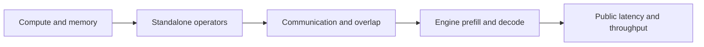

[中文](methodology.zh.md)

# Methods and evidence layers

## Four measurement layers

Hardware controls include precision, shape, working set, access pattern, parallelism and implementation. Serving controls include input, output cap, concurrency, arrivals, prefix reuse and inference configuration. Cross-layer observations guide attribution; GPU utilization alone does not prove compute saturation.

## Statistical units

Requests measure waiting time; complete continuous blocks measure capacity. Two matching ranks and one condition/round form one collective trial. Cache and profiling comparisons use pairs. Tokens, devices and telemetry points are not independent experimental repetitions.

Capacity = summed output tokens / summed complete-block wall time in the same cohort. Failures, rejections, missing counts and interruptions are separate. Selecting complete continuous blocks may favor good periods; this is not overall availability.95% intervals resample predefined blocks/prompt clusters; fewer than two clusters yield no interval. Small repeats do not establish robust p99.

## Length and cache

1K=1024 tokens. Nine input/output tiers span1K–256K; combinations are filtered by total context262144. A256K input cannot coexist with positive output at this limit. Output caps, natural completion and fixed-length qualification are distinct. Tokenize the complete chat template.

Designed prefix overlap is not a hit rate. Match native cached-token usage or complete counter windows. First access need not mean physically empty cache. Test idle retention, competition/eviction, recovery and periodic reuse separately. Latency alone cannot establish cache TTL or cache keys.

## Timing and guards

CUDA events surround specified library-call sequences. Profiled and unprofiled observations remain separate. Never subtract absolute clocks across processes. Integrate telemetry only over valid adjacent samples; do not bridge gaps. Independent GPU workloads cool at85°C and resume below75°C for30s; collective arms terminate at the limit rather than indefinitely stalling one rank inside a collective. Driver protections are unchanged.

## Method references

- [NVIDIA LLM benchmarking](https://developer.nvidia.com/blog/llm-benchmarking-fundamental-concepts/)
- [MLPerf Inference rules](https://github.com/mlcommons/inference_policies/blob/master/inference_rules.adoc)
- [SGLang benchmarking/profiling](https://docs.sglang.io/docs/developer_guide/benchmark_and_profiling)
- [vLLM bench serve](https://docs.vllm.ai/en/v0.31.0/cli/bench/serve/)
- [NCCL-tests bandwidth definitions](https://github.com/NVIDIA/nccl-tests/blob/master/doc/PERFORMANCE.md)

This is a custom study, not an MLPerf-certified submission. Pinned experiment archives define versions and evidence.
