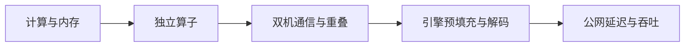

[English](methodology.en.md)

# 测量方法与证据层级

## 四层实验

硬件实验控制精度、矩阵形状、工作集、访存模式、线程并行度和算子路径；服务实验控制输入、输出上限、并发、到达过程、前缀复用和推理配置。跨层证据帮助定位限制，单独的GPU利用率不证明计算饱和。

## 统计单位

请求用于等待时间；完整连续区组用于容量；相同条件与轮次的两rank构成一次集合通信试验；冷／热或剖析／非剖析以配对为单位。不能把词元、两个节点或重复采样点当独立实验重复。

容量 = 同组完整区组输出词元总和 ÷ 同组区组墙钟总和。失败、拒绝、缺失计数与中断单列。对连续、完整区组的选择会偏向较好时段，不能替代总体服务可用率。95%置信区间按预定义区组/题目聚类重采样，少于两组不生成区间；少量重复不报告稳健p99。

## 长度与缓存

1K=1024词元。输入和输出各有1K至256K九档；262144上下文下按两者之和筛选，256K输入＋非零输出不能同时成立。输出上限、自然结束长度、固定长度达标分别保存。聊天模板也计入输入分词。

共享前缀设计比例不是命中率。以匹配请求的原生cached_tokens或完整服务计数器窗口核验缓存；首次访问不一定是物理空缓存。空闲保留、竞争驱逐、恢复和周期复用分开测试。没有计数器不能仅凭延迟下降推断缓存TTL或键。

## 计时与保护

CUDA事件包围明确的库调用序列；剖析与无剖析结果分别保存。不同进程的绝对时钟不能直接相减。监控按相邻有效样本积分，缺口不插值为持续负载。独立GPU任务85°C退避，低于75°C持续30秒恢复；集合通信遇到热限终止配对，不能让单rank在未完成collective中无限等待。原生驱动保护不修改。

## 主要方法依据

- [NVIDIA LLM benchmarking](https://developer.nvidia.com/blog/llm-benchmarking-fundamental-concepts/)
- [MLPerf Inference rules](https://github.com/mlcommons/inference_policies/blob/master/inference_rules.adoc)
- [SGLang benchmark/profiling](https://docs.sglang.io/docs/developer_guide/benchmark_and_profiling)
- [vLLM bench serve](https://docs.vllm.ai/en/v0.31.0/cli/bench/serve/)
- [NCCL-tests bandwidth definitions](https://github.com/NVIDIA/nccl-tests/blob/master/doc/PERFORMANCE.md)

这是自定义研究，未申报MLPerf认证。版本与证据以实验中的固定归档为准。
