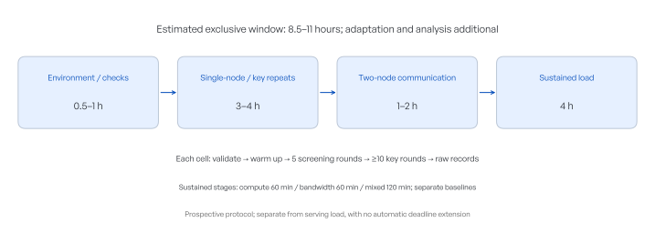

# NVIDIA DGX Spark: GPU, Two-Node System and Model Inference Test Plan

**Protocol version: 2026-10-16. Serving and GPU/system performance; no model-answer scoring, with numerical kernel validation required. Hardware completion has a separately bounded execution window.**

## 01 · Target, deployment and study boundaries

Test `qwen/qwen3.8-flash-next-abliterated` on Infron, served by two NVIDIA DGX Spark nodes with tensor parallelism of two, NVFP4 mixed precision and multi-token prediction enabled. Measure waiting, throughput and resources across input size, generation, concurrency and prefix reuse.

| Item | Setting |
| --- | --- |
| Weights | [dealignai/Qwen3.8-Flash-Next-ABLITERATED-NVFP4](https://huggingface.co/dealignai/Qwen3.8-Flash-Next-ABLITERATED-NVFP4/tree/be794b990578ef3031eccf9f28e675a289a09ee9); pinned revision `be794b990578ef3031eccf9f28e675a289a09ee9` |
| Engine | SGLang 0.5.21; 262,144-token context; 8,192-token prefill chunks; 48 engine running slots; MTP uses the EAGLE path, 3 steps, 1 branch and 4 draft tokens |
| Request path | Fixed Infron route `infron/cn`, cross-provider fallback disabled; streaming, temperature zero |
| Client boundary | At most eight global in-flight requests; this experiment cap does not establish maximum hardware capacity |
| Serving time and cost | Original cumulative US$500 budget; deadline 2026-10-16 12:40:53 China Standard Time |
| Observations | Raw client streams, upstream usage and matched bills, plus authenticated SparkDash telemetry |
| Fixed deployment | MTP remains enabled; no service restart or on/off crossover |

Detailed model and hardware specifications and actual progress are in the [performance report](../reports/report.en.html). Planned counts are not completed counts.

#### SGLang launch and resolved settings

Configuration recorded (UTC): 2026-10-14T09:08:19.004649+00:00。 Launch arguments and resolved engine values are distinguished below; values not explicitly passed come from the engine configuration snapshot.

| Item | Recorded value |
| --- | --- |
| SGLang version | `0.5.21` |
| Runtime entrypoint | `/home/benchmark/Projects/qwen38/.sglang/bin/python3 -m sglang.launch_server` |
| Ranks and served name | `tp_size=2; nnodes=2; node_rank=0 / 1; served_model_name=qwen38-flash` |
| Listener and distributed initialization | `host=0.0.0.0; port=8000; dist_init_addr=192.0.2.10:5000` |
| Prefill and running requests | `chunked_prefill_size=8192; max_prefill_tokens=16384; max_running_requests=48` |
| KV pages and eviction | `page_size=64; kv_cache_dtype=auto; disable_radix_cache=false; radix_eviction_policy=lru` |
| Scheduling and CUDA Graph | `schedule_policy=fcfs; schedule_conservativeness=1.0; disable_overlap_schedule=false; enable_mixed_chunk=false; disable_cuda_graph=false` |
| Compute backends | `attention_backend=flashinfer; sampling_backend=flashinfer; moe_runner_backend=flashinfer_cutlass; moe_a2a_backend=none; --fp4-gemm-backend flashinfer_cutlass` |
| MTP launch / resolved value | `--speculative-algorithm NEXTN → speculative_algorithm=EAGLE; num_steps=3; eagle_topk=1; num_draft_tokens=4` |
| Output parsers | `reasoning_parser=qwen3; tool_call_parser=qwen3_coder` |
| Metrics and cache reporting | `enable_metrics=true; enable_cache_report=false` |
| Other resolved settings | `trust_remote_code=true; random_seed=523471992` |


Node 0 launch command (credential redacted); node 1 uses the same arguments with `--node-rank 1`.

```bash
MODEL_PATH=/home/benchmark/.cache/huggingface/hub/
MODEL_PATH+=models--dealignai--Qwen3.8-Flash-Next-ABLITERATED-NVFP4/
MODEL_PATH+=snapshots/be794b990578ef3031eccf9f28e675a289a09ee9/
/home/benchmark/Projects/qwen38/.sglang/bin/python3 -m sglang.launch_server \
  --model-path "$MODEL_PATH" \
  --served-model-name qwen38-flash \
  --api-key '[REDACTED]' \
  --quantization modelopt_fp4 \
  --fp4-gemm-backend flashinfer_cutlass \
  --tp 2 \
  --nnodes 2 \
  --node-rank 0 \
  --dist-init-addr 192.0.2.10:5000 \
  --page-size 64 \
  --context-length 262144 \
  --mem-fraction-static 0.75 \
  --reasoning-parser qwen3 \
  --speculative-algorithm NEXTN \
  --speculative-num-steps 3 \
  --speculative-eagle-topk 1 \
  --speculative-num-draft-tokens 4 \
  --tool-call-parser qwen3_coder \
  --trust-remote-code \
  --host 0.0.0.0 \
  --port 8000 \
  --enable-metrics
```

Prefix reuse and per-request reporting are separate settings: `disable_radix_cache=false` permits reuse, while `enable_cache_report=false` means per-request cache usage reporting was not enabled in this configuration.

Node 0 configuration and command · Node 1 command

The integrated study covers GB10 hardware, standalone operators, the two-node system and model serving. The hardware completion segment has its own executable manifest and bounded window; ratings and prior network records do not count as new microbenchmark results. Serving cost, deadline and frozen requests retain their definitions; GPU work uses a separate exclusive device window.

## 02 · Layered measurement and metric definitions

System performance reflects computation, data supply, cross-device coordination and request scheduling. Four measurement layers are used: hardware microbenchmarks, standalone operators, the two-node system and end-to-end model serving. Each fixes its workload and timing boundary before matched conditions support interpretation. Hardware tests use synthetic tensors; public prompts supply serving loads. Operator numerical checks establish implementation correctness, separately from model-answer scoring.


Study layers and evidence links | Schematic. Arrows indicate interpretive dependencies, not completed tests or directly subtractable timings.

| Layer | Measurement boundary | Supported scope |
| --- | --- | --- |
| GPU hardware | Device arithmetic and memory access | Achievable ceiling at a specified precision, size and state |
| Standalone operators | Separate preparation, kernel execution and synchronization | Implementation efficiency, shape sensitivity and data-movement cost |
| Two-node system | CPU/GPU cooperation, collectives and sustained load | Contention, communication cost and retained performance |
| Model serving | Client through Infron to the two nodes and back | Waiting, throughput, cache reuse and cost on the actual path |


GB10 uses shared LPDDR5X unified memory. Its 128GB is not an exclusively allocatable GPU pool; 256GB across two nodes is not one shared address space. The 273GB/s memory rating is per node; 1PFLOP/s is a sparse-FP4 rating. Efficiency comparisons must match precision, sparsity, clocks and traffic definitions. GPU L1/L2 caches count memory accesses; serving prefix caches count reused input tokens. They are reported separately. [NVIDIA](https://docs.nvidia.com/dgx/dgx-spark/hardware.html)

### Concepts needed to read hardware results

| Concept | Definition and measurement relevance |
| --- | --- |
| CUDA cores and Tensor Cores | CUDA cores execute general parallel arithmetic; Tensor Cores accelerate specific matrix operations. FP32/FP16/FP8/FP4 identify numeric formats; fewer bits do not guarantee faster execution for every task. |
| Matrix multiplication and M, N, K | GEMM means general matrix multiplication: A is M×K, B is K×N and output is M×N. Shape affects parallelism and reuse and must accompany precision. |
| GPU kernels and CUDA Graphs | A kernel is a program executed on the GPU; a stream orders work. CUDA Graphs replay captured dependencies and can reduce repeated host submission overhead. |
| L1/L2, shared memory and unified memory | L1/L2 are hardware caches; CUDA shared memory is on-chip block-local storage; GB10 unified memory is CPU/GPU-shared system memory. Their capacity, latency and access rules differ. |
| RDMA and GPU-direct paths | RDMA lets NICs remotely access registered memory; a GPU-direct path additionally requires evidence of NIC access to GPU buffers. An ordinary RDMA test does not establish that path. |
| NCCL collectives | NCCL is a GPU communication library. AllReduce combines inputs and gives each rank the result; AllGather collects every rank’s shard; ReduceScatter combines inputs and distributes result shards. |


### Model-serving metrics


Timing boundaries: first generated and first visible content are recorded separately, particularly with reasoning enabled.

| Dimension | Primary measures | Required context |
| --- | --- | --- |
| Waiting and completion | Visible TTFT, completion time; median and p95 where samples permit | Request count, unique prompts, complete blocks, realized output |
| Aggregate capacity | Actual generated tokens/s and complete requests/s | Same blocks and measurement windows; do not sum per-request speeds |
| Goodput | Complete requests jointly meeting visible-wait and estimated-token-time thresholds / duration | Waiting starts at planned arrival and includes queuing; rejected arrivals remain in the denominator |
| Threshold sensitivity | Visible wait 1 / 2 / 5 / 10 s × estimated token time 20 / 50 / 100 ms | Analytical thresholds, not commercial service commitments |
| Cache and integrity | Reported cache volume, cap hits, missing visible content and repetitive-output flags | Cache-field coverage; a complete stream is not necessarily a useful answer |
| Internal resources | GPU activity, memory, temperature, sensor power, estimated system power, queues and slots | Matched workload windows and coverage; estimated versus outlet-metered power |
| Cost | Matched paid API fees, cost per response and blended cost per generated token | Retain upstream generation and billing counts separately |

Input targets are checked with the full template to within 1%. Baseline and business output stops naturally; the length extension uses natural stopping and checks original output against 98–100% of cap. Retain all early-ending responses outside the attained-length subset. Business cells with 12 calls and cache cells with six pairs support medians, ranges and diagnostic comparisons, not robust p99.

Primary capacity comparisons use uninterrupted complete blocks with valid counts. All attempts remain available for reliability analysis. Reasoning comparisons pair prompt and round and use cluster resampling for uncertainty. Three rounds do not establish broad reproducibility. Do not collapse different workload shapes into a single speed claim.


| Cache metric | Definition and interpretation |
| --- | --- |
| Input-prefix overlap | Longest common token prefix over the full chat template / probe input length. A controlled input property. |
| Per-request token-cache fraction | Sum of cached input tokens / sum of input tokens for requests with valid fields, accompanied by field coverage / complete responses. |
| Fraction of requests with a hit | Requests with cached tokens >0 / requests with valid cache fields. A small template hit counts; it does not imply full-input reuse. |
| Window token-cache fraction | Endpoint cached-counter delta / prompt-counter delta; check freshness, resets, identity and receipt agreement. Count the head endpoint once. |
| Paired waiting change | Seed visible TTFT minus repeat TTFT; positive means the repeat was faster. Relative changes are separate. Network, order and load may contribute; this is not isolated causal acceleration. |
| Retention, competition and recovery | Compare cache fractions by actual idle gap; compare post-pressure with baseline for cache loss and extra waiting, then examine recovery. Findings apply only to tested pressure and intervals. |
| Temporal stability and coverage | Report valid / all windows, observed span, token-weighted mean, range and SD for at least three valid windows. Missing or reset intervals are neither zero-filled nor connected. |

### GPU and system metrics


| Metric | Definition, unit and boundary |
| --- | --- |
| Compute throughput | Dense GEMM ≈2MNK/t; TFLOP/s = FLOP/s / 10¹². State input/accumulator precision and conversion inclusion. Sparse effective-operation counts are separate. |
| Memory bandwidth | Effective bandwidth = (read + written bytes)/t; copy normally counts 2N bytes. Preserve a tool’s one-way payload convention. Physical traffic requires valid counters. |
| Memory access and cache | Dependent-access latency = chain time/accesses; specify cache, translation-cache and clock state. L1/L2 hit rates retain counter-specific access denominators. |
| Execution and launch | CUDA events measure device time; a host monotonic clock measures submission and synchronized elapsed time. Separate graph instantiation, first execution and replay. |
| Concurrency and overlap | Concurrency gain is a throughput ratio at matched total work; overlap benefit = (serial−overlapped time)/serial time. Retain per-task latency. |
| Communication | algbw = tool-defined message bytes/t; AllReduce busbw = algbw×2(n−1)/n; other operations use their formulas. Distinguish GB/s from Gb/s. |
| Sustained performance | Ten-minute-window throughput / that stage’s post-warmup baseline; separate compute, bandwidth and mixed workloads. Do not mix unlike work. |
| Energy and efficiency | Energy E=∫P(t)dt in J; efficiency = work/E. Separate chip, estimated system and outlet-metered boundaries; dynamic energy subtracts a matched idle baseline. |
| Numerics and reliability | Validation errors, valid/invalid rounds, observed duration, new driver faults, allocation failures and throttle reasons. Short error-free tests do not estimate MTBF. |
| Roofline | Arithmetic intensity I=operations/bytes at the same memory level; reference ceiling min(P,B×I). P and B use matched measured or explicitly rated ceilings; interpret proximity with execution traces. |


### Statistics for hardware experiments

Use independent rounds or paired blocks as statistical units; report all samples, valid denominators, medians, interquartile ranges and 95% intervals. Key paired comparisons use round-cluster resampling with raw round points. Five-round screens are descriptive; ten rounds still do not guarantee precise intervals. Calculate ratios within paired rounds before aggregation. Randomize conditions within fixed stages and separate cold/warm-cache and first-touch tests. Microbenchmarks do not estimate serving tails; few rounds cannot support robust p99. A >5% decline lasting two ten-minute windows is an investigation flag, assessed with clocks, temperatures and work, not a hardware-failure verdict. Preserve timing and intrusive profiling runs separately.

### Layered memory, compute and interconnect comparison protocol

GB10 uses unified LPDDR5x memory and has no HBM. Report logical read/write GB/s for GB10 and specified HBM3e bandwidth for H200. GB/s is decimal bytes; divide Gb/s by eight. GiB working sets are binary. Keep specifications separate from measurements and never fill unmeasured values with zero.

| Comparison | Fixed condition and metric | Interpretation boundary |
|---|---|---|
| Memory rates | Contiguous 8 GiB per node; copy/triad ten rounds each, native read/write five; median and observed range | Logical bytes, not physical DRAM counters; native read includes dependent accumulation |
| Core floating-point compute | 8192³ GEMM; FP32/TF32 allowed/FP16/BF16 ten rounds, FP8/NVFP4/2:4 sparse five; scalar FP32 uses 256 threads, eight chains, four blocks per SM | Count 2MNK; identify dense-equivalent sparse work; no selection of scan maxima; FP64 unmeasured |
| Instance transfer | One GPU rank per node; 1 GiB AllReduce/AllGather/ReduceScatter, ten paired trials using the slower rank | Separate algorithm and NCCL bus bandwidth; historical host-buffer RDMA Write stays separate |
| Scale-up | No external GPU NVLink on this deployment; H200 SXM NVLink specified per GPU, bidirectional aggregate | Internal GB10 NVLink-C2C is not a GPU-to-GPU link; aggregate is not one-way measurement |
| Scale-out | Verify physical QSFP port, logical RoCE devices and NCCL logs; 200 Gb/s line rate alongside measured collectives | Two logical interfaces are not two physical ports; identify actual GPU Direct RDMA state |
| H200 comparison | Per-GPU H200 SXM specifications; DGX H200 NICs as a separately scoped system example | No H200 measurements; approximate dense Tensor Core rates as half rounded sparse specifications; no token-rate, efficiency or payback ratio |

Use archived data and official sources without adding workload or changing budgets/deadlines. Define units and layers before specification tables, fixed-condition results, plots and deployment implications. Archive source URLs, retrieval times and hashes in the appendix. A future matched H200 experiment must match model, quantization/precision, input/output, concurrency and cache conditions, with wall-power measurements.

## 03 · GPU and two-node system experiments

This protocol defines ten integrated hardware/system modules including environment verification. The completion-segment manifest below freezes executable scope, repeats and guards. Historical interrupted observations remain separate from new confirmation rounds. GPU experiments require an isolated window rather than resource contention with serving tests.

| Module | Conditions and controls | Primary outputs |
| --- | --- | --- |
| Hardware and software baseline | Record chip, compute capability, CPU topology, memory, NIC, driver, CUDA, libraries, compiler target, power policy and background processes on both nodes; probe tool and counter support. | Configuration parity, supported fields, environment hashes |
| CUDA-core arithmetic | FP32 multiply-add: independent operations versus dependency chains; 128/256/512-thread blocks and varying parallel work. Inspect compiled code for eliminated work. | GFLOP/s, dependency latency, achieved occupancy |
| Tensor Core matrix arithmetic | Native TF32/FP16/BF16/FP8/NVFP4 where supported; square sizes 1,024/2,048/4,096/8,192; small-batch M=1/8/32/128/512 with N=K=4,096 or 8,192. Separate dense and supported 2:4 sparse paths. | TFLOP/s, latency, numerical error; separate packing/quantization cost |
| Memory bandwidth | Read, write, copy and vector triad; total working sets 256MiB/1GiB/4GiB/8GiB; contiguous and strided access. Verify L2 is exceeded and count both reads and writes. | Effective GB/s, physical traffic, bandwidth saturation |
| Hardware caches, shared memory and latency | Double working sets from 4KiB to 1GiB; dependent randomized pointer chasing, streaming/reuse/competing access; conflict-free versus conflicting shared-memory access. Refine transition regions. | Access ns, L1/L2 hit denominators, shared-memory bandwidth/conflicts |
| CPU–GPU unified-memory cooperation | Record allocation types and supported placement policies; CPU/GPU first-touch versus reuse; CPU memory-stream load at 0/1/4/10/20 threads with compute-only controls. Pin and record heterogeneous CPU cores. | First-touch time, retained GPU bandwidth, clocks and shared power |
| Launch, synchronization and concurrency | Paired ordinary launches and CUDA Graphs; 1/2/4/8 streams; serialized versus overlapping compute/copy. Measure empty kernels and useful work separately. | Host-submit μs, device μs, synchronization waits, concurrency gain |
| Representative standalone operators | Matrix-vector, reduction, Softmax, RMSNorm and compatible attention kernels on fixed synthetic shapes, dtypes and layouts. Separate prefill/decode shapes; normalization/reduction sizes range from 1K to 256K elements. | Operator time, traffic, arithmetic intensity, reference error |
| Two-node communication and overlap | NCCL AllReduce/AllGather/ReduceScatter, powers of two from 8B to 1GiB; one GPU rank per node. Pair standalone communication with compute overlap; record NIC, route, algorithm, protocol and buffer type. | μs, algorithm/bus GB/s, effective overlap, correctness |
| Power, thermal steady state and reliability | After stable baselines: 60 minutes compute, 60 minutes bandwidth and 120 minutes mixed load. Establish a baseline for each stage and compare ten-minute windows; target 1-second telemetry and retain actual refresh periods. | Throughput retention, temperature, clocks, energy, errors/throttle reasons |


### Experimental units, replication and selection

The experimental unit is node × workload shape × dtype × cache/concurrency state × round. Freeze the executable list and seed20261016 before each stage. Both nodes run107base conditions×10rounds and146extension conditions/800rounds. Extensions normally use five rounds; predeclared4,096-square andM=1/128,N=K=4,096low-precision matrices and empty launches use ten. Collectives use ten paired-rank rounds; overlap comparisons use five complete four-arm rounds. Densified cache-transition or anomaly scans are subsequent exploratory work and cannot replace original samples.

Batch inner iterations for at least one second per timing sample to resolve microsecond operations; inner iterations are not independent replicates. Freeze supported dtypes/layouts before running and retain reasons for unsupported cells. Keep the default power policy, log actual clocks and avoid changing the serving driver or global power configuration. This segment fixes installed libraries and explicit backends without tuning searches. Later tuning requires separate search and confirmation data. Hardware five-to-ten-round summaries primarily show medians and observed ranges; time repeats do not establish device-population confidence intervals.

### Warmup, thermal state and numerical correctness

Record initialization, compilation, allocation, algorithm selection, packing and quantization separately. Warm up for at least five minutes, then assess three consecutive 60-second windows: throughput variation ≤3% and a range of mean temperatures ≤2°C define operational steady state for this study. If unmet within 15 minutes, label the run non-steady and retain slower windows. These are experimental criteria, not vendor acceptance limits. Cache reuse, first touch and large-working-set bandwidth use explicit buffer lifecycles so warm cache hits cannot masquerade as external-memory bandwidth.

Report maximum absolute/relative error and normalized root-mean-square error, with tolerances frozen by dtype, reduction length and official validation rules before execution. Check low-precision kernels against high-precision computation on identical quantized inputs, and separately quantify error against original unquantized inputs. Incorrect results remain failures and are excluded from valid-performance summaries. Occupancy, Tensor-pipeline activity and overall GPU activity retain distinct meanings.

### Unified-memory, counter and communication controls

Cap total allocations at the smaller of 70% of preflight available memory and available memory minus max(16GiB,15% of physical memory), rechecking before each allocation. Record driver allocation limits, OS page cache and process residency separately; do not seek capacity by exhausting system memory. Pair CPU memory and compute pressure and inspect clocks, temperature and power to explain shared-resource competition; unified-memory access is not automatically PCIe migration.

For NCCL retain rank mapping, message conventions, transport path, NIC and versions; run only sizes from 8B–1GiB satisfying dtype/rank divisibility. GPU-direct RDMA requires buffer and runtime evidence; otherwise label unverified or host-staged. Separate logical-interface results are not additive aggregate bandwidth. Separate profiling from timed runs; absent counters cannot support inferred cache hits or peak utilization.

[NVIDIA DGX Spark hardware](https://docs.nvidia.com/dgx/dgx-spark/hardware.html) · [Unified-memory reporting limits](https://docs.nvidia.com/dgx/dgx-spark/known-issues.html) · [CUTLASS architecture and dtype support](https://github.com/NVIDIA/cutlass) · [nvbandwidth methodology](https://github.com/NVIDIA/nvbandwidth) · [NCCL communication metrics](https://github.com/NVIDIA/nccl-tests/blob/master/doc/PERFORMANCE.md) · [Nsight timing, counters and roofline](https://docs.nvidia.com/nsight-compute/ProfilingGuide/index.html)


### Independent engine prefill and decode experiment

This experiment calls the native SGLang endpoint on the inference host, excluding the public network, Cloudflare and the Infron gateway from its timing path. Weights and two-node tensor parallelism are unchanged, with MTP enabled. The separate window is limited to two hours and concurrency eight under the existing cumulative US$500 API budget. Direct-origin calls generate no Infron API bill. These observations are not pooled with public-endpoint requests.

| Experiment | Work and repeats | Measurement scope |
| --- | --- | --- |
| Prefill | 1K/8K/32K/64K/128K/250,000 inputs, one output; C=1 with C=4/8 at shorter inputs; three rounds per condition | Scheduler prefill start-to-finish; includes chunk scheduling gaps, not pure GPU time |
| Decode | 1K/8K/32K inputs × C=1/2/4/8, plus 64K/128K at C=1; fixed 256 outputs; three rounds | Output rate from API-process first token to completion, MTP acceptance length and verify count |
| Prefix reuse control | 8K/32K, three initial/immediate-repeat pairs each, one output | Validate actual cached tokens; does not measure retention |
| GPU timelines | 8K input, 128 output, C=1; both ranks capture prefill and four decode scheduler steps | GPU activity intervals, NCCL-named kernels and MTP draft/verify stages; profiled data stay separate from normal rate estimates |


The manifest contains 78 blocks and 231 formal requests, plus two pilot/profile requests. Combinations exceeding concurrency × (input + output) = 262,144 are excluded. Seeded synthetic order records are tokenized with the installed model tokenizer to exact token-ID lengths, bypassing chat templates. Temperature is zero and EOS is ignored to fix output length. This controlled engine workload does not represent natural-chat length or MTP acceptance. Conditions are shuffled within each round; requests use distinct early prefixes, with hits verified from returned fields.

Authorized deadline (UTC+08:00): 2026-10-16T15:38:46.533935+08:00

Do not subtract absolute timestamps across processes. Prefill uses scheduler-local start/finish differences; decode uses API-process first-token/finish differences. GPU timelines are diagnostic; ordinary rates come from unprofiled blocks.

### Hardware completion segment: scope, admission and completion criteria

This separately recorded segment implements the instruction to finish outstanding measurements. The resumed queue has a fixed eight-hour load window ending at 2026-10-17 06:19:00 China Standard Time, plus thirty minutes for service restoration by 06:49:00. Completed public-serving and independent-engine arms remain closed. There are no new API requests; the cumulativeUS$500 ceiling remains. The resident condition requires zero running/queued inference requests; the unloaded condition follows the dedicated stop/restoration protocol below. Historical interrupted observations are separate from new confirmation rounds.

| Layer | Frozen conditions and repeats | Acceptance and limits |
| --- | --- | --- |
| Base compute, bandwidth and operators |107conditions×10rounds per node;2,140planned condition-rounds total |At least one accumulated CUDA-event second per timing; pre/post validation; explicit guard skips |
| Scalar FP32 |128/256/512threads; blocks1/4/8timesSMcount;1dependent or8independent chains;32,768FMAs per thread;5rounds |Fixed arithmetic work, archived FFMA assembly; theoretical residency is distinct from measured active occupancy |
| Hardware access and shared memory |Pointer spans4KiB–1GiB in powers of two,128-byte spacing, full random cycles, ca/cg hints; shared strides1/2/4/8/16/32;5rounds |Carry pointer state across calls; report dependent-access timing without inferring hit rates; memory guard prevails |
| Data supply and managed memory |Native read/write256MiB/1GiB/4GiB/8GiB; first/repeat CPU/GPU access to256MiB managed allocation;5rounds |Logical bytes differ from physical DRAM traffic; allocation, ordering and first touch are explicit |
| CPU/GPU contention |0/1/4/10/20pinned worker processes, memory-stream versus CPU-compute controls;5rounds |Compare with the same-round zero-contention baseline; retain core sets; workers are not inference concurrency |
| Launch and streams |Empty ordinary/graph launch10rounds;1/2/4/8streams, serial/parallel5rounds |Each pair holds matrix count fixed; changing stream count changes total work |
| Low precision and sparsity |FP8E4M3,NVFP4,FP16/BF16structured2:4;14original matrix shapes;5rounds generally,10for4,096square andM=1/128,N=K=4,096 |Installed backend and numerical checks gate timing; packing/compression separate; NVFP4 uses exactly representable unity-scale operands |
| Extensions total |146conditions and800planned condition-rounds per node |Unsupported, memory-infeasible and invalid conditions do not enter valid performance denominators |
| Two-node collectives |AllReduce/AllGather/ReduceScatter,8B–1GiB powers of two,10rounds;840planned paired trials |Use slower-rank device interval; ranks are not two independent repeats |
| Compute/communication overlap |8KiB/8MiB/64MiB×2,048/4,096square×compute-only/communication-only/serial/overlap×5rounds;120paired trials |Compute differences only from complete same-round four-arm groups; no model scaling claim |
| Sustained load |Five-minute matched-work baseline per phase, then60mincompute,60minbandwidth,120minmixed |Mixed work alternates compute/bandwidth with separate rates; ten-minute windows relative to own baseline; both nodes require complete terminal receipts |

Compilation, initialization, support probes, counter profiling and preparation are outside formal timing. Stage sources and manifests are hashed before execution; native kernels must pass GPU numerical checks before timing. Failure, guard skip, unsupported and unsent states remain separate. Failed Nsight counter access retains raw errors without changing system permissions or estimating absent cache/pipeline counters.

Neither resource condition locates capacity by exhausting memory. Worksets such as4/8GiB retain resident guard skips and are measured in the independent unloaded matrix. Wall energy and annual reliability are not established by this segment. Subsequent independent mixed sustained work uses automatic thermal backoff: at 85°C or a missing temperature reading, stop submitting GPU work; resume after remaining below 75°C for 30 continuous seconds. A backoff is limited to 600 seconds, after which the run ends and service is restored. Manual stop, leases and fixed deadlines remain effective during cooling. Driver/hardware thermal management is unchanged. Stops include available memory belowmax(16GiB,15%physical), telemetry older than15seconds, renewed inference activity,90-second lease expiry and the fixed deadline. Each completed phase archives evidence and updates bilingualMarkdown/HTML/PDF offline.

Authorization and scope · Base manifest · Extension manifest and source hashes

### Independent hardware condition: temporary model unload and service restoration

Mixed sustained work uses an independent continuation window: retain completed 60-minute compute and bandwidth phases, rerun only 120 minutes of mixed work with a fresh warmup and five-minute baseline. Separate attempts by execution process ID; exclude the interrupted mixed baseline and short samples from continuation statistics. Apply the thermal-backoff policy and monitor driver thermal, hardware-slowdown and power-limit reasons; unsupported/missing values remain unknown. Completion of all phases does not establish four uninterrupted hours. Original budgets and deadlines remain unchanged.

In the authorized dedicated window, stop both SGLang inference processes to release model weights and engine reservations. Retain the driver, hardware, clock policy and global power settings. Resident and unloaded models are separate resource conditions with separate timing rounds. They run sequentially, so time, memory pressure and system caches can change together; differences describe the overall condition rather than a single causal mechanism.

| Item | Design and acceptance |
| --- | --- |
| Base matrix | 107 conditions × 10 rounds per node; independent warmup and the same matrix, including large GEMMs and 4/8GiB working sets; memory protection remains active |
| Extended operators | 146 conditions and 800 planned condition-rounds per node; numerical validation before rate inclusion; unsupported backends reported separately |
| Two-node system | 84 collective conditions × 10 paired rounds; 120 four-arm compute/communication trials; two ranks constitute one observation |
| Sustained work | 60-minute compute, 60-minute bandwidth and 120-minute alternating mixed phases; a separate five-minute matched baseline for each |
| Time boundary | Stop hardware load at 06:19:00 China Standard Time, 17 October 2026; reserve 30 minutes for restoration by 06:49:00. |
| Before shutdown | No other study GPU children; no running or queued inference requests; capture original arguments, environment, working directory and core engine configuration |
| Restoration | Independent per-node custodians retain launch state in memory; completion, failure, 90-second lease expiry or deadline stops owned GPU children and launches the original service |
| Acceptance | Exact original arguments, environment and working directories on both nodes; matching model path, version, TP, quantization, context, MTP and cache configuration; healthy origin with zero running/queued requests |
| Scope | Hardware microbenchmarks only, no additional public model load or API charges; earlier serving and independent-engine results retained |

Sources, raw data, phase receipts and restoration evidence are stored in `hardware_unloaded_confirmed_20261016/`; resident evidence remains in `hardware_completion_20261016/`. Archived evidence determines actual valid coverage, performance and restoration outcomes.


### Thermal-backoff measurement boundaries

Cooling occurs at CUDA submission boundaries in independent sustained work, without freezing the process or making one collective rank sleep independently. CUDA-event compute rates exclude cooling waits. Effective throughput separately divides counted work by the entire phase wall time, including the other mixed workload, validation and cooling. Target phase durations and fixed deadlines are not automatically extended; actual elapsed time is reported. Preserve cooling events, durations and recovery counts separately. Cooling events from incomplete timed calls remain raw evidence and are not completed performance samples.

### Finite queue and automatic failure retry

Only the remaining two-node 120-minute mixed phase resumes. Completed 60-minute compute/bandwidth phases and validated matrix, operator and communication conditions are not replayed. Every mixed attempt gets independent warmup and a five-minute baseline. Interrupted attempts retain distinct execution IDs; their durations and sample denominators are not pooled with a successful attempt.

At most three complete attempts are allowed. Transient connection/telemetry failures, expired leases or a single cooling timeout may retry after 30/120 seconds only after both test processes exit, original serving configuration is verified restored and the fixed remaining window is sufficient. Read-only or idempotent control operations retry at most five times. Launch locks and persistent receipts reconcile unknown outcomes without duplicating load. Numerical failures, memory guards, unknown errors and restoration/configuration problems require review. A later user pause takes priority and is never cleared automatically. Exhausted attempts or time leave an incomplete result, never a success claim.

Completion requires both nodes to finish, serving configuration to be restored, raw evidence to be archived and bilingual reports to pass validation. The queue creates no new public model requests; the cumulative API cap remains US$500.


### Hardware-counter observability recheck

After sustained work finishes, both-node service restoration is verified and the engine is idle, recheck the previously permission-denied fixed counter probe once per node. Diagnose one FP32 FMA thread block, with a 90-second limit, collecting active-warp occupancy, L2 sector hit rate and DRAM read/write bytes. Invoke Nsight Compute administratively as documented by NVIDIA, without changing driver permission policy; clock and cache controls remain none. Admit below 75°C; stop this probe at 85°C, on unavailable temperature or on an explicit stop. This single diagnostic establishes counter accessibility, not large-matrix or model cache hits, physical bandwidth utilization or compute efficiency. Preserve the original error and recheck outcome separately; unresolved counters remain missing rather than estimated.

[NVIDIA counter-permission guidance](https://developer.nvidia.com/ERR_NVGPUCTRPERM) · Diagnostic protocol and receipts


If a diagnostic fails during CUDA initialization or allocation, preserve the original error and perform one follow-up with explicit error names using the same kernel. A standalone run verifies probe operation only and is excluded from formal timing. The follow-up retains the90-second per-node limit, temperature conditions and fixed deadline. Report a field only when the call succeeds and that field has a value; n/a remains missing, and partially readable fields do not establish complete counter coverage.


## 04 · Model workloads and length space

Tokens are model text-counting units. Input targets include the chat template; output parameters specify a ceiling. Always report realized input, realized output and the fraction reaching the cap. Do not treat an output cap as completed work.

| Workload | Composition | Purpose |
| --- | --- | --- |
| Natural bank | Ten prompts each from MMLU-Pro, MATH-500, GSM8K, IFEval, HumanEval+ and MBPP+; 60 total | Compare concurrency and reasoning with fixed material |
| Length matrix | Ordinary prose; input 512 / 8,192 / 32,768; output caps 128 / 512 / 2,048 | Separate input-processing and generation pressure |
| Business shapes | Triage, rewriting, drafting, summarization, analysis, extraction, code editing and conversation | Check practical input/output shapes |
| Prefix reuse | Inputs 8,192 / 32,768; target shared prefixes 0 / 25 / 50 / 75 / 90 / 100% | Observe repeated-input latency and available cache fields |

The bank uses ten input-length strata per suite and one fixed sample per stratum, seeded by `20261014-performance-v2`. Repetitions do not add unique prompts. Business records are synthetic and contain no customer data. Sources and illustrative inputs/outputs are in report section 02.


Business shapes: target input versus output cap; realized generation is measured separately.


### Length coverage: feasibility from 1K to 256K

**1K = 1,024 tokens.** Input and output each use nine tiers: 1/2/4/8/16/32/64/128/256K. Input includes the complete chat template; output denotes a requested cap, with actual generation recorded separately. The 262,144-token context is shared by input and output, so neither 256K input plus 1K output nor 1K input plus 256K output fits.

Of 81 design cells, 63 fit with a 1K margin; 128K+128K has no margin and is a boundary; 17 exceed context. Execution selects 21 axis/diagonal cells plus 254K→1K and 1K→254K near-boundary probes. “Length eligible” does not establish gateway output limits, available memory or runtime feasibility.


Length feasibility | Dots mark selected conditions; colors express context arithmetic, not completed measurements. The 254K near-boundary probes are separate.

| Group | Input → output cap | Calls | Purpose |
| --- | --- | --- | --- |
| Input axis | 1–128K → 1K | 24 | Hold output cap to examine input processing and initial waiting. |
| Output axis | 1K → 2–128K | 13 | Hold input; three calls per cell through 8K output, one from 16K. |
| Balanced lengths | 2／4／8／16／32／64K → same | 12 | Observe joint input/generation growth; high tiers are single probes. |
| Near boundary | 254K → 1K；1K → 254K | 2 | One call per cell, conditionally admitted; no tail percentiles. |
| Long prefixes | 64／128K → 1K | 36 | 0/50/100% target overlap; three seed/probe pairs per cell. |
| Business anchors | below | 32 | One warmup plus three measurements per shape; natural EOS. |
| Repeated blocks | 1K → 4K；32K → 1K | 178 | Concurrency 1/4, three blocks of 8/20 calls per cell, plus ten warmups. |
| Parameter calibration | 1K → 1K | 2 | The same short-answer instruction with natural EOS and ignored EOS. |


The 299 added calls are reallocated from the original 3,000-call soak allowance; soak becomes at most one hour / 2,701 calls. The global 8,171 actual attempts, US$500, 2026-10-16 12:40:53 China-time deadline and concurrency ≤8 remain unchanged. Finish the current business/cache blocks, prioritize length expansion, then run arrivals and soak.

#### Representative points for the eight business shapes


| Shape / length | Context | Typical input → illustrative output |
| --- | --- | --- |
| Batch ticket triage<br>4K → 1K | Route several tickets, producing a classification list. | Input: 20 tickets; output: [{id, category, reason}, …] |
| Document rewriting<br>4K → 4K | Rewrite similar information volume while preserving structure. | Input: operations procedure; output: customer-guide sections. |
| Long-form drafting<br>1K → 8K | Expand a brief into a handbook, emphasizing generation. | Input: launch goals and constraints; output: preparation, execution and recovery. |
| Long-document summary<br>32K → 1K | Compress retrieved material or logs into concise findings. | Input: one month of records; output: key events and actions. |
| Evidence analysis<br>32K → 8K | Long evidence plus detailed reasoning stresses input and output. | Input: ticket batches; output: trends, evidence and alternatives. |
| Batch extraction<br>8K → 1K | Convert documents to structured lists, without constrained decoding. | Input: orders; output: [{order_id, amount, status}, …] |
| Code editing<br>16K → 4K | Several functions supply context for a patch and explanation. | Input: billing module; output: idempotency patch and explanation. |
| Multi-turn assistant<br>16K → 2K | History plus follow-up retains a multi-message chat structure. | Input: ticket history + next-step question; output: actions. |


Outputs above illustrate form. Synthetic long output uses varied identifiers, dates and records; classification is not required to generate a 256K answer. Existing short business workloads remain baselines; new anchors are separate cohorts, not one averaged score.

#### Admission and interpretation

Fixed-length mode verifies forwarded ignore_eos=true and max_tokens, requiring upstream output to reach 98–100% of cap. Tiers escalate in a fixed protective order, so order and time effects may be confounded. After fixed-output calibration fails, unsent conditions use natural stopping; an unqualified preceding output tier blocks escalation. Input-axis cells have three calls and output probes ≥16K have only one: neither supports steady-throughput or p95/p99 claims. Representative blocks enter capacity comparisons only after completeness, length and count checks.

Before dispatch, verify full input + cap ≤262,144 and a conservative concurrency × request budget ≤262,144. The latter is an experiment guard, not measured KV capacity. Admission estimates 120 seconds + cap×0.08 seconds + input/300 seconds per request, plus 300 seconds drain reserve per block; 0.08 seconds is a policy assumption. Monitoring and cost guards remain; early stopping and skips are retained. Long-prefix seeds/probes each have isolated counter windows; three pairs per cell do not establish long-term retention.

### Alignment with SGLang and vLLM benchmark methods

The serving engine is SGLang 0.5.21; vLLM 0.31.0 is a methodology reference. The table separates upstream tool design from this experiment’s rules; it is not an engine performance comparison.

| Reference | Implementation and interpretation |
| --- | --- |
| [SGLang: benchmark layers](https://docs.sglang.io/docs/developer_guide/benchmark_and_profiling) | Online serving includes HTTP, scheduling and generation. This study additionally includes Infron and the public route; offline-engine or single-batch kernel measurements do not replace service latency. |
| [SGLang: sample count](https://docs.sglang.io/docs/developer_guide/benchmark_and_profiling) | The guide recommends at least five times maximum concurrency. New repeat blocks use 8/20 calls at concurrency 1/4, with three blocks each. Block variation is still checked; count alone does not establish steady state. |
| [SGLang 0.5.21: EOS](https://github.com/sgl-project/sglang/blob/v0.5.21/python/sglang/benchmark/serving.py) · [vLLM 0.31.0: EOS](https://docs.vllm.ai/en/v0.31.0/cli/bench/serve/) | The tools have different EOS defaults, so settings are explicit. Compare natural stopping with ignore_eos=true and verify the forwarded request and upstream output count. Only verified fixed outputs enter length-controlled comparisons. |
| [vLLM: arrival / goodput](https://docs.vllm.ai/en/v0.31.0/cli/bench/serve/) | Record arrivals, client concurrency and goodput separately. Preserve scheduled arrival, dispatch, first fragment and completion; include queuing and rejection in user waiting and offered load. Current arrivals are Poisson; bursty arrivals are future work. |
| [SGLang: shared prefixes](https://docs.sglang.io/docs/developer_guide/bench_serving) | Shared prefixes are controlled inputs; observed hits require valid fields or counter deltas over isolated windows. Natural tasks and synthetic long output remain separate populations. |


Reference documents and source snapshots retain versions and SHA-256 hashes. Framework commands are references; one collector preserves route, budget and evidence consistency. Source archive

In the public-API length experiment’s output-control calibration, the client sent ignore_eos=true, the saved forwarded request lacked that field, and actual generation was two tokens. That public-API arm therefore has no evidence of effective EOS-enforced fixed output; the separate native-engine arm verifies its own fixed-output mode. Unsent length groups use natural stopping with unchanged inputs, caps, concurrency and budget. Reaching 98–100% of cap denotes realized-length attainment, not disabled EOS. Short outputs, non-attainment and unexecuted cells remain separate; attained-only cohorts do not represent all requests. Execution mode and evidence

## 05 · Serving matrix and request budget

| Test | Conditions and repetition | Planned calls / cap |
| --- | --- | ---: |
| Calibration | Two calls for each of six materials; verify stream events and count semantics | 12 |
| Natural-bank concurrency | 60 prompts × concurrency 1 / 2 / 4 / 8 × 3 rounds; reasoning disabled, output cap 1,024 | 720 |
| Length and prefill | General matrix 1,296; reference shapes 108; one-output-token input-processing probes 36 | 1,440 |
| Reasoning | 60 prompts × concurrency 1 / 4 × 3 rounds with low; reuse the natural-bank none baseline | 360 |
| Context boundary | Increasing lengths at concurrency one and four; one overflow probe, subject to capacity checks | 37 |
| Request reuse | Ten prompts × three history lengths × first, identical repeat and appended-suffix requests | 90 |
| Business and prefix ratio | 192 business measurements + 16 warmups; 72 prefix measurements + 72 warmups | 352 |
| Crossed cache and stability diagnostics | Business cross 72; idle retention 36; pressure/recovery 24; periodic reuse 28 | 160 |
| Independent arrivals and interference | Up to 1,600 arrivals across five rates; up to 400 mixed-workload calls | 2,000 |
| Length and long-output extension | 49 axis/diagonal, 2 boundary, 36 prefix, 32 business, 178 repeat-block and 2 calibration calls | 299 |
| Sustained operation | Up to one hour or 2,701 arrivals, whichever comes first | 2,701 |

Core calls total 2,659. Including business and conditional extensions, the logical-call ceiling is 8,171. All actual attempts, including retries, remain capped at 8,171; retries therefore reduce available calls in later conditional stages. Budget, deadline, resource guards or entry gates can reduce execution. Unused allowance does not expand the matrix.

The general length matrix has 36 conditions, each with four warmups and 32 measured calls in four blocks of eight. Three reference-shape conditions also have four warmups and 32 measurements each. Block order is seeded in advance; report revisions never replay existing sends.

## 06 · Prefix-cache reuse and stability

| Design | Rule | Purpose |
| --- | --- | --- |
| Business concurrency | Eight shapes at concurrency one and four | Compare interaction with light batching |
| Business repetition | Twelve measurements per cell, in three blocks of four; one additional warmup per cell | Limited between-block replication, without labeling one continuous run as multiple rounds |
| Material matching | Same underlying material across arms, distinct early identifiers, retained source hashes | Reduce content differences and exact-prefix carryover; still inspect actual cache fields |
| Order | Sixteen warmups, then 48 measurement blocks shuffled with a fixed seed | Distribute order effects; no claim that each block is at steady state |
| Cache repetition | Two inputs × six overlap targets × six independent pairs | Six measured calls and six paired warmups per cell |
| Cache parameters | Serial warm/measure pairs, both with none, temperature zero, output cap 256, concurrency one | Remove output-budget differences as an additional explanation |
| Cache interpretation | Separate target overlap, tokenized overlap and reported cache-hit fraction | Identical input does not guarantee residency or 100% cache hits |


Prefix design: dark regions are common input, light regions are changed suffixes; these are not measured hit rates.

No cache flush or service configuration change. A nominal zero may still share template tokens; record realized overlap. Input overlap is a design condition; observed hits require fields or validated node counters.

#### Cache diagnostics: scope and samples

The existing 144-call, two-length/six-overlap design is retained. The following 160 diagnostics are added. Arrows denote target input → output cap; temperature is zero and reasoning is disabled, with identical generation settings within each reuse pair.

| Calls | Test | Conditions and meaning |
| --- | --- | --- |
| 72 | Business × reuse × concurrency | Triage 512→64, dialogue 8,192→512, summary 32,768→128; concurrency 1/4; four independent prefixes per condition, each with seed, 50% overlap and exact repeat. |
| 36 | Idle retention | 8,192/32,768 input × nominal waits 0/30/300 s × three independent prefixes × seed/probe. Each prefix receives one terminal probe. |
| 24 | Competition and recovery | Three independent 8,192-token anchors: seed → baseline repeat → four distinct 32,768-token distractors → post-pressure repeat → recovery repeat. |
| 28 | Periodic-reuse stability | Four 8,192-token prefixes; four seeds, then six repeat rounds at concurrency four, spaced 120 s apart; planned span ten minutes. |
| 0 | Cache under sustained load | Reuse arrival and soak tests; approximately 60-second valid windows align cache fraction, TTFT and occupancy. No extra generation calls. |


The three crossed shapes represent short input, conversation and long documents. The other five retain their original performance measurements, without extrapolated cache findings. Concurrency arms use independent prefixes; 50%/100% probe order alternates. A seed is a fresh-prefix reference, not proof of an empty engine cache. Actual idle time runs from seed completion to probe dispatch; zero denotes no intentional wait, with telemetry overhead retained. Timing deviations, retries, telemetry gaps and counter mismatches are flagged and excluded from cache attribution.


Cache sequence: business reuse, idle retention, pressure/recovery and periodic observation.

**Execution and attribution.** Append diagnostics after the original 352 business/prefix calls under the same ledger, concurrency cap and deadline. Independent prefixes prevent probes from refreshing another idle-delay arm. Prompts and token-prefix counts are fixed before sending. Four independent prefixes per business cell and three per retention cell support diagnostics, not p99 claims. The 50%/100% probe order alternates across conditions; order effects are not interpreted as pure cache benefit.

**Counter validation.** Read cumulative prompt, cached and output counters for head endpoint port 8000 from authenticated SparkDash; do not sum tensor-parallel workers. Each boundary requires two advancing, fresh timestamps with equal counters and no running/queued requests, at most ten seconds old. Deltas must be nonnegative, cached ≤ prompt, and prompt/output deltas must each agree with request usage within max(8 tokens, 0.1%). This is a dashboard-reported block token-cache fraction, not a per-request hit fraction.

**Timing and stability.** Measure idle time from seed completion to probe dispatch. The zero-delay arm has no intentional wait but retains boundary-sampling overhead. Exclude cache attribution when delay overshoots by over 30 s, intervening input activity is observed, retries occur, blocks resume partially or counters fail checks. Periodic rounds retain scheduled and actual timing; ten-minute periodic reuse is not continuous saturation. Sustained runs use approximately 60-second nonoverlapping windows. Gaps over 15 s or counter resets split the series. With at least three valid windows, report dispersion along with actual span, token-weighted mean, range, SD and workload composition. Do not extrapolate retention observations into a service TTL or bounded distractor pressure into cache capacity.

## 07 · Independent arrivals and sustained serving

Fixed-concurrency tests replenish completed requests, so slower responses also slow subsequent submissions. Independent-arrival tests use seeded random arrival times that do not depend on prior completion, exposing queuing, rejection and waiting targets.

| Item | Execution rule |
| --- | --- |
| Reference rate | Choose a natural-bank condition with three complete rounds and no failures or integrity flags; use completions / total block time. Without an eligible reference, do not force the extension |
| Offered rates | 0.25 / 0.50 / 0.75 / 1.00 / 1.25 times reference; at most 320 arrivals and ten minutes per rate |
| Client admission | At most eight in flight, queue length 32 and queue wait five seconds; distinguish local rejection from service failure |
| Short/long interference | Five isolated/mixed pairs, matched short material and arrival times; add long inputs in the mixed arm. Run only when the reference and 180-second arrival-window constraints hold |
| Entry to sustained testing | At least 30 formal completions at a rate, no failure, local rejection or integrity flag, and no guard trigger; an execution gate, not production certification |
| Sustained rate | 60% of the highest rate passing entry gates; stop at one hour, 2,701 arrivals or the original deadline, whichever comes first |

“Up to one hour” is the time allocation limit, not an observed-duration claim. Report actual arrival duration, drain duration and counts. Health gates and latency-qualification fractions are separate; an error-free run does not automatically satisfy every service target.

## 08 · Execution order, time and resource limits

### Model-serving stages

Execute core tests, business/prefix tests, cache diagnostics, length and long-output expansion, independent arrivals/interference, then sustained operation. Check terminal receipts before each handover. Before sending, record the request and reserved expense; preserve the raw stream, counts, timing and request ID.

At the original budget, deadline or attempt ceiling, stop adding sends and retain in-flight results. Stale monitoring, memory exhaustion or unresolved request outcomes trigger guards; independent mixed work backs off on temperature and terminates only if cooling times out. Only confirmed Cloudflare errors use the existing bounded retry policy; unknown outcomes require receipt review before any replay.

### Exclusive GPU window and resource budget

Serving experiments retain the frozen requests, concurrency ≤8, 8,171 actual attempts, cumulative US$500 limit and 2026-10-16 12:40:53 China Standard Time deadline. Hardware work is budgeted in device-hours, not API calls, and does not automatically extend that deadline. The resumed hardware queue has a separate fixed eight-hour load window ending at 2026-10-17 06:19:00 CST, with restoration due by 06:49:00; public model queues remain closed.

| Stage | Estimated wall time | Entry and completion conditions |
| --- | --- | --- |
| Environment and correctness preflight | 0.5–1 h | Resolve support and retain configuration/checks; excludes dependency adaptation |
| Single-node suite and key second-node checks | 3–4 h | No serving requests or competing GPU processes; use frozen conditions |
| Two-node communication | 1–2 h | Both nodes available; validate network and buffer paths |
| Sustained operation | 4 h | 60 min compute + 60 min bandwidth + 120 min mixed; stage-specific baselines |
| Total | 8.5–11 h | Excludes tool adaptation, analysis and reporting; 12–24h extension separate |




GPU experiment sequence | Proposed schedule; serving and exclusive hardware load occupy separate windows, with baselines for each sustained stage.

Before hardware execution, create an activation record with time, configuration hashes and actual conditions. Drain serving requests before saturation; resident and unloaded conditions follow separate admission rules. The unloaded condition uses the dedicated service-stop/restoration protocol without pooling resident statistics. Preserve start, terminal and validation records for each round; resolve unknown outcomes before resuming, bound retries of transient tool failures and retain originals. Numerical errors, driver faults and memory pressure are not retried indefinitely. Use supported device protection limits and stop the active load on hardware protection, insufficient memory headroom or lost monitoring.

### Independent completion experiments on 17 October 2026

This batch addresses evidence gaps while retaining historical failures, natural stops and interrupted segments. Requests and sustained windows from different dates are not pooled. The user removed both cumulative financial and new-reservation ceilings; actual charges remain reconciled per request. This supersedes earlier monetary caps. Maximum concurrency remains 8. The independent execution window is 08:21–20:21 China Standard Time on 17 October 2026, followed by a 30-minute service-restoration reserve.

| Additional arm | Fixed work | Statistical and completion definition |
| --- | --- | --- |
| Native fixed output and balanced lengths | 16 requests: one 1K calibration; 1K input with 8K/16K/32K output at three repeats each; 64K/128K/254K output at one repeat; balanced 16K/32K/64K input/output | Exact input/output counts and terminal state; end tokens ignored, so repetition or whitespace may result; single boundary probes have no tail-percentile claim |
| GPU profiles across conditions | 1K/C1, 32K/C1 and 8K/C4, three profiled/unprofiled pairs each; 36 requests | Identical input, alternating order, cache flushed before each arm; separate profiled timings and interval-union GPU activity |
| Long-prefix reuse | 64K input, three independent first/reuse pairs; six requests | Native cached-token counts and engine first-token latency; immediate reuse only |
| Complete public blocks | Three C4 reference blocks of 60 requests, plus 20 affected-condition requests and one route pilot | Independent dated requests and billing; historical success rates remain unchanged |
| Long/short interference | Five isolated/mixed pairs, 400 requests including warmup | New reference blocks select arrival rate; compare matched short-request streams; report gated-out pairs as unexecuted |
| Continuous service | One independent 3,600-second window, fixed arrivals capped at 600 requests | Retain local queues/rejections and full denominators; never join interrupted windows into one hour; inspect five-minute windows |
| FP64 and hardware counters | Two nodes, three matrix sizes, five rounds each; three compute and three memory profiles per node | Exclusive maintenance, numerical validation and available-counter checks; restore the original configuration afterward |

Confirmed monitoring backoff or Cloudflare failures allow at most three independent attempts of a complete block; continuous-hour attempts are likewise capped at three, with interrupted data retained separately. Native requests have at most three attempts. Confirmed Cloudflare failures have at most five retries with fixed backoff and preserved attempt records. Unknown outcomes require receipt review before resending. At 85°C, execution backs off; resumption requires temperatures below 75°C for 30 seconds, with cooling limited to 600 seconds. Native, public-serving and exclusive hardware arms run sequentially to avoid interference. Matched H200 measurements and outlet energy remain unavailable without the required equipment; specifications and estimates do not replace measurements.

## 09 · Evidence and attribution rules

Bind each conclusion to configuration, workload, window, eligible samples and raw paths. Validate numerical or request integrity before matched-condition statistics and mechanistic interpretation. Run GPU saturation and serving in separate windows; GPU activity, a network rate or prefix hits alone do not prove a unique bottleneck.

| Question | Required evidence chain | Interpretation boundary |
| --- | --- | --- |
| Does compute limit serving? | Matched-dtype ceiling → same-shape operators → actual execution trace | Sparse FP4 ratings are not a dense BF16 denominator |
| Does bandwidth/cache limit serving? | Beyond-cache work → traffic/hits → controlled contention | Hardware and prefix caches have separate counters |
| What is communication cost? | Path/buffers → collective curves → compute-overlap trace | Do not add independently measured paths or infer model speedup without a one-node control |
| Is performance sustained? | Matched baseline → window throughput → thermal/clock/limit reasons | Four hours do not establish annual availability or MTBF |
| Are cost findings transferable? | Observed output → matched charges/power scope → utilization sensitivity | Separate estimated power and outlet energy; ROI is a scenario |


Report states distinguish pending, observed, controlled-comparison evidence, unverified mechanism and inapplicable/unsupported. Unsupported states require device/tool evidence; pending values are not zero. Show short-run achievable and sustained values together rather than selecting only the fastest run. Freeze executable conditions after verifying code, commands and tolerances; the live stage manifests and numerical validation gates determine executable coverage.

## 10 · Report structure, deliverables and reproduction

The report follows the outline below. Each result chapter states conditions and valid coverage before figures, tables and interpretation. Pending hardware chapters retain evidence status and scope; actual records will populate results without hypothetical performance curves.

| Chapter | Contents |
| --- | --- |
| 01 | Study summary, target and deployment |
| 02 | Layered methods and workloads |
| 03 | Metric definitions and statistics |
| 04 | Experiment coverage and evidence status |
| 05 | GPU compute, memory and operators |
| 06 | Two-node communication and cooperation |
| 07 | Model-serving performance and caching |
| 08 | Sustained operation and node resources |
| 09 | Integrated bottleneck analysis and evidence limits |
| 10 | API cost, ownership and investment return |
| 11 | Overall conclusions and next work |
| 12–14 | Appendices: metric dictionary, supplementary statistics, code/data paths |


Annual ownership cost and 1 / 3 / 5-year investment returns extrapolate short-run throughput under explicit assumptions and are labeled separately. Device lifetime, sold demand, channel costs and long-term availability are not realized findings from this short experiment. Validate them next with real workload distributions, repeated periods and outlet-metered power.

Method references: [NVIDIA GenAI-Perf metrics](https://docs.nvidia.com/deeplearning/triton-inference-server/user-guide/docs/perf_benchmark/genai-perf-README.html) and [MLPerf scenarios](https://github.com/mlcommons/inference_policies/blob/master/inference_rules.adoc). Concepts are borrowed; no official certification is claimed. Execution sources: core schedule, [business/cache manifest](business/manifest.json), extension rules.


[Frozen cache supplement](cache_diagnostics/manifest.json) · Per-request design parameters.

The [length manifest](length_expansion/manifest.json) amends the original soak allowance to one hour / 2,701 calls; all other global limits remain. The report defines workload and metrics before coverage, realized-length audit, performance, resources, economics and conclusions. Natural EOS, fixed length, single boundary probes and repeat blocks remain separate populations. See the methodology record.

Hardware protocol and tool references: [NVIDIA DGX Spark hardware](https://docs.nvidia.com/dgx/dgx-spark/hardware.html) · [Unified-memory reporting limits](https://docs.nvidia.com/dgx/dgx-spark/known-issues.html) · [CUTLASS architecture and dtype support](https://github.com/NVIDIA/cutlass) · [nvbandwidth methodology](https://github.com/NVIDIA/nvbandwidth) · [NCCL communication metrics](https://github.com/NVIDIA/nccl-tests/blob/master/doc/PERFORMANCE.md) · [Nsight timing, counters and roofline](https://docs.nvidia.com/nsight-compute/ProfilingGuide/index.html)

GPU/system protocol manifest · Official-source snapshots and hashes
