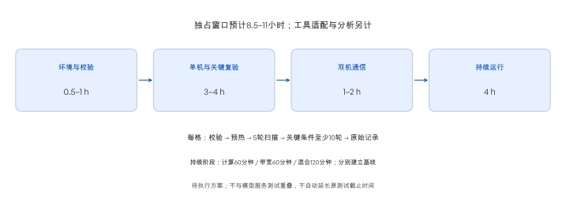

# NVIDIA DGX Spark：GPU、双机系统与模型推理测试计划

**方案版本：2026-10-16。服务性能与GPU系统测评；模型答案不评分，数值内核必须校验。硬件补测采用独立有界执行窗口。**

## 01 · 对象、部署与研究边界

测试 Infron 上的 `qwen/qwen3.8-flash-next-abliterated`，采用两台 NVIDIA DGX Spark、两路张量并行、NVFP4 混合精度和开启的多词元预测。核心目标是测量不同输入、生成量、并发与前缀复用条件下的等待、吞吐和资源消耗。

| 项目 | 本轮设置 |
| --- | --- |
| 权重来源 | [dealignai/Qwen3.8-Flash-Next-ABLITERATED-NVFP4](https://huggingface.co/dealignai/Qwen3.8-Flash-Next-ABLITERATED-NVFP4/tree/be794b990578ef3031eccf9f28e675a289a09ee9)；固定版本 `be794b990578ef3031eccf9f28e675a289a09ee9` |
| 引擎与配置 | SGLang 0.5.21；上下文上限262,144词元；预填充分块8,192；引擎48运行槽；MTP采用EAGLE路径，预测步数3、分支1、草稿词元4 |
| 请求路径 | Infron固定供应商路由 `infron/cn`，关闭跨供应商回退；流式输出，温度0 |
| 客户端边界 | 全局在途请求不超过8；上限约束的是本次实验，不能据此宣称测得硬件最大容量 |
| 模型服务时间与费用 | 沿用累计US$500预算；截至2026年10月16日12:40:53（北京时间） |
| 观测 | 客户端原始响应流、源站用量和账单记录，结合认证SparkDash双节点监控 |
| 模型服务固定配置 | 本轮保持MTP开启；不安排服务重启或开关对照 |

模型、硬件详细参数及实际测试进度见[性能报告](../reports/report.zh.html)。计划数量不是完成数量。

#### SGLang启动与生效参数

配置记录时间（UTC）：2026-10-14T09:08:19.004649+00:00。 下表区分进程启动参数与引擎解析后的生效值；未显式传入的值来自引擎配置快照。

| 项目 | 记录值 |
| --- | --- |
| SGLang版本 | `0.5.21` |
| 运行入口 | `/home/benchmark/Projects/qwen38/.sglang/bin/python3 -m sglang.launch_server` |
| 节点与服务名 | `tp_size=2; nnodes=2; node_rank=0 / 1; served_model_name=qwen38-flash` |
| 服务与分布式初始化 | `host=0.0.0.0; port=8000; dist_init_addr=192.0.2.10:5000` |
| 预填充与并发 | `chunked_prefill_size=8192; max_prefill_tokens=16384; max_running_requests=48` |
| KV缓存页与回收策略 | `page_size=64; kv_cache_dtype=auto; disable_radix_cache=false; radix_eviction_policy=lru` |
| 调度与CUDA Graph | `schedule_policy=fcfs; schedule_conservativeness=1.0; disable_overlap_schedule=false; enable_mixed_chunk=false; disable_cuda_graph=false` |
| 计算后端 | `attention_backend=flashinfer; sampling_backend=flashinfer; moe_runner_backend=flashinfer_cutlass; moe_a2a_backend=none; --fp4-gemm-backend flashinfer_cutlass` |
| MTP启动值／生效值 | `--speculative-algorithm NEXTN → speculative_algorithm=EAGLE; num_steps=3; eagle_topk=1; num_draft_tokens=4` |
| 输出解析器 | `reasoning_parser=qwen3; tool_call_parser=qwen3_coder` |
| 指标与缓存字段 | `enable_metrics=true; enable_cache_report=false` |
| 其他生效配置 | `trust_remote_code=true; random_seed=523471992` |


节点0启动命令（认证值已遮盖）；节点1使用相同参数，`--node-rank 1`。

```bash
MODEL_PATH=/home/benchmark/.cache/huggingface/hub/
MODEL_PATH+=models--dealignai--Qwen3.8-Flash-Next-ABLITERATED-NVFP4/
MODEL_PATH+=snapshots/be794b990578ef3031eccf9f28e675a289a09ee9/
/home/benchmark/Projects/qwen38/.sglang/bin/python3 -m sglang.launch_server \
  --model-path "$MODEL_PATH" \
  --served-model-name qwen38-flash \
  --api-key '[REDACTED]' \
  --quantization modelopt_fp4 \
  --fp4-gemm-backend flashinfer_cutlass \
  --tp 2 \
  --nnodes 2 \
  --node-rank 0 \
  --dist-init-addr 192.0.2.10:5000 \
  --page-size 64 \
  --context-length 262144 \
  --mem-fraction-static 0.75 \
  --reasoning-parser qwen3 \
  --speculative-algorithm NEXTN \
  --speculative-num-steps 3 \
  --speculative-eagle-topk 1 \
  --speculative-num-draft-tokens 4 \
  --tool-call-parser qwen3_coder \
  --trust-remote-code \
  --host 0.0.0.0 \
  --port 8000 \
  --enable-metrics
```

缓存复用开关与缓存用量字段开关是两个参数：`disable_radix_cache=false` 表示允许前缀复用，`enable_cache_report=false` 表示该配置未启用逐请求缓存用量字段。

节点0配置与命令 · 节点1命令

总体研究同时覆盖GB10硬件、独立算子、双机系统与模型服务。GPU实测按模型驻留与模型卸载两个资源条件分段执行，实际覆盖以归档记录为准；配置规格与历史网络记录不作为新增微基准结果。服务实验的费用、截止时间与执行清单保持原定义；GPU独占阶段按单独设备时间窗口安排。

## 02 · 分层测量与指标定义

系统性能由计算、数据供给、跨设备协作与请求调度共同决定。本方案设置四个测量层级：硬件微基准、独立算子、双机系统、端到端模型服务。每一层固定自己的工作量与计时边界，再利用匹配条件建立解释链。硬件实验使用合成张量；公开题集只用于服务工作负载。算子数值校验属于实现正确性检查，与模型答案评分无关。


研究层级与证据衔接｜示意图。箭头表示解释依赖，不表示已经完成的测试或可直接相减的耗时。

| 层级 | 测量边界 | 可回答的范围 |
| --- | --- | --- |
| GPU硬件 | 设备端运算与内存访问 | 特定精度、规模与状态下的可实现上限 |
| 独立算子 | 数据准备、内核执行、同步分别计时 | 实现效率、形状敏感性与数据搬运代价 |
| 双机系统 | CPU/GPU协同、集合通信与持续负载 | 资源竞争、通信代价及性能保持 |
| 模型服务 | 客户端经Infron至双节点再返回响应 | 真实路径的等待、吞吐、缓存与费用 |


GB10采用共享LPDDR5X统一内存；128GB不等于GPU独占可分配容量，双机256GB也不是单个共享地址池。273GB/s是每节点标称内存带宽；1PFLOP/s是稀疏FP4规格。效率比较必须匹配精度、稀疏性、频率和数据流量口径。GPU的L1/L2缓存以字节访问计数；推理前缀缓存以输入词元复用计数，两者分别统计。 [NVIDIA](https://docs.nvidia.com/dgx/dgx-spark/hardware.html)

### 理解硬件结果所需的概念

| 概念 | 定义与测量意义 |
| --- | --- |
| CUDA核心与Tensor Core | 前者执行通用并行运算，后者加速特定矩阵乘加。FP32／FP16／FP8／FP4分别描述数值格式；位数较少不等于任意任务必然更快。 |
| 矩阵乘法与M、N、K | GEMM指通用矩阵乘法。A为M×K、B为K×N，输出为M×N。矩阵形状改变并行度与数据复用，须与精度一起报告。 |
| GPU内核与CUDA Graphs | 内核是一次在GPU执行的程序；执行流组织有序任务。CUDA Graphs复用事先记录的任务依赖，可能减少CPU重复提交开销。 |
| L1/L2、共享内存与统一内存 | L1/L2是硬件缓存；CUDA共享内存是线程块使用的片上空间；GB10统一内存是CPU/GPU共享的系统内存。三者容量、延迟和访问规则不同。 |
| RDMA与GPU直接路径 | RDMA允许网卡远程读写注册内存；GPU直接路径还需确认网卡实际访问GPU缓冲区。普通RDMA测试本身不证明GPU直接通信。 |
| NCCL集合通信 | NCCL是GPU通信库。AllReduce聚合后把结果发给各节点；AllGather收集各节点分片；ReduceScatter聚合后把不同结果分片交给各节点。 |


### 模型服务指标


时间边界：正文首字和首个生成片段分别记录，特别是开启思考时。

| 维度 | 主指标 | 必须同时报告 |
| --- | --- | --- |
| 等待与完成 | 正文首字延迟、完成时间，中位数及有足够样本时的95分位 | 请求数、独立题目数、完整区组数、实际输出 |
| 系统处理能力 | 实际生成词元/s、完整请求/s | 同一组区组、相同时间窗口；不把单请求速度相加 |
| 服务达标 | 同时满足正文等待与估算平均词元耗时的完整请求数／测量时长 | 正文等待从计划到达起算，含排队；拒绝保留在到达分母 |
| 阈值敏感性 | 正文等待1／2／5／10秒 × 平均词元耗时20／50／100毫秒 | 多组分析门槛，不作为商业服务承诺 |
| 缓存与完整性 | 服务报告缓存量、输出触顶、正文缺失、异常循环候选 | 缓存字段覆盖；完整流不等于合格答案 |
| 内部资源 | GPU活跃度、内存、温度、传感器功率、估算整机功率、队列与槽位 | 同负载时间窗、监控覆盖率；估算功率与插座实测分开 |
| 费用 | 同请求实付API费、单位响应费用、单位生成量综合费用 | 原始生成计数与账单计数分别保存 |

输入长度按完整模板核验，目标误差不超过1%。1K按1,024词元计算，模板及特殊词元不从上下文预算中扣除。基础和业务负载自然结束；新增长度组按第04节采用自然结束并核验源站实际输出。所有提前结束均保留，未达到98%上限的结果不进入长度达成子集。业务12次和缓存六对用于诊断，报告中位数、范围及样本数，不给稳定99分位结论。

主要容量比较纳入连续、完整、计数有效的区组；同时保留全部尝试用于可靠性分析。思考对照按题目和轮次配对，用成簇重采样描述不确定性；只有三轮时不把窄区间当作充分复现。不同负载不合并成一个“总速度”。


| 缓存指标 | 定义与判定 |
| --- | --- |
| 输入前缀重合比例 | 完整聊天模板的最长公共词元前缀长度／探测输入长度。属于受控输入结构。 |
| 逐请求缓存词元比例 | 仅在字段有效的请求中，已缓存输入词元总数／输入词元总数；同时给出字段覆盖数／完整请求数。 |
| 有命中的请求比例 | 有效字段中缓存词元>0的请求数／有效字段请求数；模板少量命中也计入，不代表整段输入复用。 |
| 窗口缓存词元比例 | 同一服务窗口的累计缓存量增量／累计输入量增量；检查新鲜度、计数复位、服务标识及与请求计数的一致性，只取头节点一次。 |
| 配对等待收益 | 首次正文首字延迟−重复请求正文首字延迟，正值表示重复请求更快；另列相对变化。网络、执行顺序和负载可能共同影响，不直接称为缓存因果加速。 |
| 保留、竞争与恢复 | 按实际空闲间隔比较缓存比例；竞争后与立即复测相比，观察比例下降和等待增加；再次重复观察恢复。只对已施加的压力与时长成立。 |
| 时间稳定性与覆盖 | 报告有效窗口数／全部窗口数、实际跨度、词元加权平均、范围及至少3个有效窗口时的标准差；监控缺失、复位不补零或跨段相连。 |

### GPU与系统指标


| 指标 | 定义、单位与边界 |
| --- | --- |
| 计算吞吐 | 稠密GEMM约2MNK/t；TFLOP/s=FLOP/s÷10¹²。注明输入／累加精度与是否计入转换。稀疏另列有效运算口径。 |
| 内存带宽 | 有效带宽=(读字节+写字节)/t；复制的有效流量通常为2N字节。工具的单向载荷带宽保留原定义。物理流量以有效计数器为准。 |
| 内存访问与缓存 | 依赖访问延迟=链式访问时间/次数；明确缓存、地址转换缓存与时钟状态。L1/L2命中率按计数器原定义和访问分母报告。 |
| 执行与启动 | CUDA事件记录设备端时间；主机单调时钟记录提交及含同步的总时间。Graph实例化、首次执行与重放分别报告。 |
| 并发与重叠 | 并发收益=总工作量相同条件下的吞吐比；重叠收益=(串行耗时−重叠耗时)/串行耗时。保留每任务延迟。 |
| 通信 | algbw=工具定义的消息字节/t；AllReduce busbw=algbw×2(n−1)/n，其他操作使用各自公式。单位GB/s和Gb/s不混用。 |
| 持续性能 | 每阶段10分钟窗口吞吐/同阶段预热后基线；分别报告计算、带宽和混合负载。不同工作量的速度不可混合求保持率。 |
| 能量与能效 | 能量E=∫P(t)dt，单位J；能效=工作量/E。芯片、估算整机、插座实测三种边界分开；动态能量另减同边界空闲基线。 |
| 数值与可靠性 | 校验误差、有效／无效轮次、实际观测时长、新出现的驱动异常、内存分配失败及降频原因。短时无错误不外推平均故障间隔。 |
| 性能上限图 | 运算强度I=运算量/同层级字节流量；参考上限min(P,B×I)。P、B来自相同精度与状态的实测或明确标注的规格；接近上限需结合执行轨迹解释。 |


### 硬件实验的统计规则

统计以独立轮次或配对区组为单位，报告全部样本、有效分母、中位数、四分位距及95%区间；关键配对比较采用轮次成簇重采样，并给出各轮原始点。5轮扫描以描述性统计为主；10轮也不保证高精度区间。比率先在配对轮内计算再汇总。固定阶段之间随机化条件顺序，冷／热缓存及首次访问实验单列。短时微基准不报告服务尾延迟；少量轮次不报告稳健p99。稳态性能下降超过5%且持续两个10分钟窗口标为复核信号，结合温度、频率和负载验证，不能直接判为硬件故障。细粒度剖析有额外开销，计时结果与剖析结果分开保存。

### 内存、计算与互连的分层对照协议

本机GB10采用LPDDR5x统一内存，不配置HBM；内存实测使用逻辑读写GB/s，H200对照列HBM3e官方带宽。GB/s使用十进制字节，Gb/s除8换算为GB/s，工作集GiB使用二进制。官方峰值与实测分列，未测不填0。

| 对照项 | 固定条件与指标 | 解释边界 |
|---|---|---|
| 内存速率 | 单节点、连续8 GiB工作集，复制/三元运算各10轮，原生读/写各5轮；中位与观测范围 | 程序逻辑字节速率，不是物理DRAM计数器；原生读取含依赖累加 |
| 核心浮点计算 | GEMM固定8192³，FP32/TF32 allowed/FP16/BF16各10轮，FP8/NVFP4/2:4稀疏各5轮；通用FP32另用256线程、8独立链、4倍SM线程块条件 | 按2MNK计数；稀疏注明稠密等效；不从规模扫描挑最大值；FP64未测 |
| 实例间传输 | 实例定义为每节点一个GPU rank；1 GiB AllReduce/AllGather/ReduceScatter各10次配对，较慢rank时间 | 算法带宽与NCCL总线带宽分列；历史主机缓冲区RDMA Write另列，不混合轮次 |
| Scale-up | 本机无外部GPU NVLink；H200 SXM列每GPU双向合计NVLink规格 | 不将GB10内部NVLink-C2C当作卡间链路；不把双向合计当作单方向实测 |
| Scale-out | 核验物理QSFP端口、逻辑RoCE接口及NCCL日志；列200 Gb/s端口线速和实测集合通信 | 两个逻辑接口不相加为两个物理端口；明确GPU Direct RDMA实际状态 |
| H200对照 | 单颗H200 SXM官方内存/计算/互连规格，DGX H200网卡作为独立整机示例 | 没有H200实测；稠密Tensor Core值由官方稀疏值除2近似换算，不推导词元速率、能效或回本倍数 |

该对照使用已归档数据和官方资料，不增加负载、不改变既定预算或截止时间。报告先定义单位与层级，再给规格对照、固定条件实测、图表及部署含义；原始来源、下载时间与散列写入附录。后续H200同场测试必须匹配模型、量化/精度、输入输出、并发和缓存条件，并测量整机墙上功耗。

## 03 · GPU与双机系统实验

本节定义十个硬件与系统模块，包括环境核验。实际执行范围、重复和保护限制由下述硬件补测批次清单冻结；既有中断结果与本批确认测量分段保存。GPU实验使用独立窗口，不与模型负载同时争用资源。

| 模块 | 条件与对照 | 主要输出 |
| --- | --- | --- |
| 硬件与软件基线 | 记录两节点芯片、计算能力、CPU拓扑、内存、网卡、驱动、CUDA、库版本、编译目标、功耗策略和后台进程；确认传感器、计数器及工具支持。 | 配置一致性、可观测字段、环境散列 |
| CUDA核心计算 | FP32乘加：独立运算与依赖链对照；线程块128／256／512；改变并行工作量。检查编译结果，避免被优化掉的循环。 | GFLOP/s、依赖延迟、实际活跃线程占比 |
| Tensor Core矩阵计算 | 原生支持的TF32／FP16／BF16／FP8／NVFP4；方阵边长1,024／2,048／4,096／8,192；小批量M=1／8／32／128／512，N=K=4,096或8,192。稠密与支持的2:4稀疏分开。 | TFLOP/s、耗时、数值误差；打包／量化开销另列 |
| 内存带宽 | 读、写、复制、向量三元运算；256MiB／1GiB／4GiB／8GiB总工作集；连续与步长访问。核验超出二级缓存，统计读写总字节。 | 有效GB/s、实际内存流量、带宽饱和点 |
| 硬件缓存、共享内存与延迟 | 4KiB至1GiB工作集倍增扫描；独立随机指针链、连续／重复访问与竞争访问；共享内存无冲突／冲突对照。转折点加密测量。 | 访问ns、L1/L2命中分母、共享内存带宽与冲突 |
| CPU–GPU统一内存协同 | 记录分配类型与支持的驻留策略；CPU／GPU首次访问和重复访问对照；CPU内存流负载0／1／4／10／20线程，并以CPU计算负载作对照。固定核心集合并记录异构核心。 | 首次访问耗时、GPU带宽保持率、频率与共享功耗 |
| 启动、同步与并发 | 普通启动与CUDA Graphs配对；1／2／4／8条执行流；计算与搬运串行／重叠。空内核与有用计算分别测量。 | CPU提交μs、GPU执行μs、同步等待、并发收益 |
| 代表性独立算子 | 矩阵向量乘、归约、Softmax、RMSNorm及兼容注意力内核；合成张量固定形状、类型与布局。预填充／解码形状分组，归一化和归约规模从1K至256K元素。 | 算子时间、数据流量、运算强度及参考结果误差 |
| 双机通信与重叠 | NCCL AllReduce／AllGather／ReduceScatter，8B至1GiB按2的幂扫描；每节点1个GPU进程。单独通信与计算重叠配对；记录网卡、路由、算法、协议和缓冲区类型。 | μs、算法／总线GB/s、有效重叠、结果校验 |
| 功耗、热稳态与可靠性 | 稳定基线后，计算密集60分钟、带宽密集60分钟、混合负载120分钟；每阶段先校准自身基线，再比较10分钟窗口。1秒目标采样，保留实际刷新周期。 | 吞吐保持率、温度、频率、能量、错误／降频原因 |


### 实验单元、重复与选择规则

实验单元是“节点 × 工作负载形状 × 数据类型 × 缓存／并发状态 × 轮次”。执行清单与种子20261016在阶段开始前冻结；两节点均执行完整基础矩阵107条件×10轮和扩展矩阵146条件／800轮。扩展一般每条件5轮，预先指定的4,096方阵、M=1／128且N=K=4,096的低精度矩阵以及空内核启动各10轮。集合通信每条件10个双rank配对轮次，重叠对照每组5个完整四臂轮次。扫描后加密的缓存转折点或异常条件属于后续探索，不能替代原样本。

同一轮内批量迭代累计至少1秒，提高微秒计时的分辨率；轮内迭代不充当独立重复。支持的精度与布局在运行前冻结，不支持的条件保留原因。固定默认功耗策略，记录自然频率，不改变服务驱动或全局功耗配置。本批固定已安装库和明确后端，不开展算法调优搜索；后续调优须另设搜索与独立确认数据。硬件5–10轮主要报告中位数与观测范围，不将时间重复当成设备总体置信区间。

### 预热、热状态与数值正确性

首次初始化、编译、内存分配、算法选择、打包与量化分别记录。稳定测量先预热至少5分钟，再比较连续三个60秒窗口：吞吐变动不超过3%、平均温度跨度不超过2°C作为本实验的稳态操作标准；15分钟仍未满足则记录未稳态，不丢弃较慢窗口。该规则是实验判定，不是厂商验收标准。缓存复用、首次访问和大工作集带宽各用明确的缓冲区生命周期，不能把预热后缓存命中当作外部内存带宽。

浮点计算报告最大绝对误差、相对误差和归一化均方根误差；容差按数据类型、归约长度和官方校验规则在执行前冻结。低精度内核先对照同一量化输入的高精度计算，再单独报告相对于未量化输入的误差。正确性不通过的结果保留为失败，不进入有效性能汇总。线程占比、Tensor管线活跃度与GPU整体活跃度分别解释。

### 统一内存、计数器与通信控制

总分配量不超过预检可用内存扣除max(16GiB,物理内存的15%)后的余量，并限制在预检可用内存的70%以内；每次分配前重新检查。实际驱动分配上限、系统页缓存和进程驻留量单独记录，不以触发系统内存耗尽寻找边界。CPU内存压力与CPU计算压力配对，结合频率、温度和功耗解释共享资源竞争；不把统一内存访问一概解释为PCIe数据迁移。

NCCL记录rank映射、消息口径、实际传输路径、网卡及版本；8B–1GiB只运行满足数据类型和rank整除规则的尺寸。GPU直接RDMA须有缓冲区类型与运行日志证据，否则标为未确认或主机中转。两个逻辑接口的单独结果不能相加为聚合带宽。诊断采样与正式计时分开；原始计数器缺失时不估算缓存命中或理论峰值利用率。

[NVIDIA DGX Spark 硬件规格](https://docs.nvidia.com/dgx/dgx-spark/hardware.html) · [统一内存与监控限制](https://docs.nvidia.com/dgx/dgx-spark/known-issues.html) · [CUTLASS架构与精度支持](https://github.com/NVIDIA/cutlass) · [nvbandwidth测量方法](https://github.com/NVIDIA/nvbandwidth) · [NCCL通信指标定义](https://github.com/NVIDIA/nccl-tests/blob/master/doc/PERFORMANCE.md) · [Nsight计时、计数器与Roofline](https://docs.nvidia.com/nsight-compute/ProfilingGuide/index.html)


### 引擎内部预填充与解码：独立实验

本实验直接调用推理节点本机的SGLang原生接口，将公网、Cloudflare与Infron网关移出计时路径。使用相同权重与双节点张量并行配置，MTP保持开启。独立窗口最长2小时、并发上限8，累计API预算仍为US$500；直接源站调用不产生Infron API账单。此实验不与前述公网请求合并统计。

| 实验 | 工作量与重复 | 测量含义 |
| --- | --- | --- |
| 预填充 | 1K／8K／32K／64K／128K／250,000输入，输出1；并发1，并在较短输入增加并发4／8；每条件3轮 | 读取调度器预填充起止时间；分母含分块调度间隙，不称为纯GPU时间 |
| 解码 | 1K／8K／32K输入×并发1／2／4／8，另加64K／128K单并发；输出固定256；每条件3轮 | 接口进程首词元到结束的生成速率、MTP接受长度与验证次数 |
| 前缀复用对照 | 8K／32K，各3组首次请求与立即重复，输出均为1 | 以实际缓存词元确认命中；不测长期保留 |
| GPU时间线 | 8K输入、128输出、并发1；双节点分别捕获预填充与4个解码调度步 | 记录GPU活动区间、NCCL命名内核、MTP草稿／验证阶段；剖析数据与常规速度测量分开 |


清单共78组、231条正式请求，另有2条预检／剖析请求。并发×（输入＋输出）超过262,144的组合排除。使用固定种子的合成订单记录，经实际模型分词器生成精确长度的token ID；不经过聊天模板。温度为0，忽略结束词元以固定输出长度。因此这是可控的引擎负载，不代表自然对话的输出长度或MTP接受率。每轮随机化条件顺序；不同请求具有不同的早期前缀，是否命中仍以返回字段核验。

授权截止时间（北京时间）：2026-10-16T15:38:46.533935+08:00

指标计算不跨进程相减绝对时间戳。预填充使用调度器内部起止差；解码使用接口进程内部首词元至结束差。GPU时间线只作路径诊断，常规性能来自未启用剖析的区组。

### 硬件补测批次：范围、准入与完成标准

本批依据继续补齐未完成项目的指令执行，采用独立目录与固定截止时间：续测负载截止2026-10-17 06:19:00、服务恢复截止2026-10-17 06:49:00（北京时间）；固定8小时负载窗口，另留30分钟恢复。已完成的公网模型服务及独立引擎实验保持关闭；本批不新增API请求，累计US$500费用上限不变。驻留条件要求引擎运行和排队请求为零；卸载条件按下述停服及恢复协议执行。旧中断数据保留历史分段，不混入新确认轮次。

| 实验层 | 冻结条件与重复 | 验收与限制 |
| --- | --- | --- |
| 基础计算、带宽与算子 | 每节点107条件×10轮，共2,140个计划条件轮次 | 每次计时至少累计1秒CUDA事件区间；前后校验；逐条件记录保护跳过 |
| 通用FP32计算 | 128／256／512线程；1／4／8倍SM数量的线程块；1依赖链／8独立链；每线程32,768次乘加；每格5轮 | 固定总乘加数，保存FFMA汇编；理论驻留上限与实际活跃线程不同 |
| 硬件访问与共享内存 | 指针地址跨度4KiB–1GiB倍增，128字节间距，完整随机环，ca／cg提示；共享地址步长1／2／4／8／16／32；每格5轮 | 指针跨调用保存位置；记录依赖访问耗时，不从曲线反推命中率；可用内存保护优先 |
| 数据供给与统一内存 | 256MiB／1GiB／4GiB／8GiB原生读写；256MiB管理内存的CPU／GPU首次和重复访问；每格5轮 | 有效字节与DRAM事务分开；分配类型、顺序和首次触碰均留档 |
| CPU与GPU竞争 | 固定核心0／1／4／10／20个工作进程，内存流与CPU计算对照；每格5轮 | 与同轮零竞争基线配对，记录核心集合；进程数量不是GPU并发请求数 |
| 启动与执行流 | 空内核普通／CUDA Graphs各10轮；1／2／4／8流，串行／并行各5轮 | 同一配对保持相同矩阵数量；改变流数时总工作量另列 |
| 低精度与稀疏 | FP8 E4M3、NVFP4、FP16／BF16 2:4稀疏；14个原定矩阵形状；一般5轮，4,096方阵及M=1／128、N=K=4,096各10轮 | 固定已安装后端；先验证支持和数值结果；打包／压缩单列；NVFP4使用单位尺度可精确表示输入 |
| 扩展合计 | 每节点146条件、800个计划条件轮次 | 未通过支持、内存或数值门槛的条件不进入有效性能统计 |
| 双节点集合通信 | AllReduce／AllGather／ReduceScatter，8B–1GiB倍增，每格10轮，共840次计划配对试验 | 较慢rank设备区间作为一次双节点试验；两rank不充当两次重复 |
| 计算／通信重叠 | 8KiB／8MiB／64MiB×2,048／4,096方阵×计算单独／通信单独／串行／重叠×5轮，共120次计划配对试验 | 同一轮四臂齐全才计算配对差值；不据此宣称模型双机加速 |
| 持续负载 | 每阶段先采集5分钟自身基线，再执行计算60分钟、带宽60分钟、混合120分钟 | 混合为计算／带宽交替，分别计速；每10分钟窗口相对自身基线；两节点均有完整终态才称完成 |

编译、初始化、支持探测、计数器剖析及数据准备均置于正式计时之外。程序和条件清单在阶段启动前记录散列；所有新内核必须通过实际GPU数值校验才可计时。失败、保护跳过、不支持、未发送分别统计。Nsight计数器访问失败时保留原始错误，不更改系统权限、不估造缓存或管线数据。

两个资源条件均不以触发内存耗尽寻找边界。4／8GiB等条件在驻留时超出余量则保留为跳过，在卸载后的独立矩阵中重新测量。插座电量和全年可靠性不属于本批已建立的证据。后续独立混合持续负载启用自动温度退避：温度达到85°C或温度读数缺失时暂停提交GPU工作；低于75°C连续稳定30秒后自动恢复。单次退避最多600秒，超时则结束本轮并恢复服务；手动停止、租约和固定截止在退避期间继续生效。驱动与硬件自身热保护保持原样。停止条件包括可用内存低于max(16GiB,物理内存15%)、监控超过15秒不新鲜、推理重新活跃、90秒租约过期及固定截止。每阶段结束归档原始数据并离线更新双语Markdown／HTML／PDF。

本批授权与执行范围 · 基础清单 · 扩展清单及源码散列

### 独立硬件条件：临时卸载模型与服务恢复

混合持续负载采用独立补测窗口：保留已完成的计算60分钟和带宽60分钟，只重新运行混合120分钟，重新预热并建立5分钟基线。按执行进程标识分隔中断与补测记录，旧混合基线和短时样本不并入补测。温度采用上述自动退避规则，同时采集驱动热降频、硬件限速和功率限制原因；不支持或缺失保留为未知，不作未触发处理。各阶段完成不等于连续4小时无中断运行；API预算不变，硬件续测采用本节固定窗口。

本阶段在已授权的专用窗口临时停止两节点 SGLang 推理进程，释放模型权重及引擎预分配内存。驱动、硬件、时钟与全局功耗策略保持不变。模型驻留与模型卸载是两个资源条件；结果分别报告，不合并计时轮次。两组先后执行，时间、内存压力与系统缓存可能同时变化，因此只比较整体资源条件，不能把差值解释为某一机制的独立因果效应。

| 项目 | 设计与判定 |
| --- | --- |
| 基础矩阵 | 每节点107条件×10轮；卸载后重新预热并执行同一矩阵，补齐大矩阵与4/8GiB工作集；内存保护仍生效 |
| 扩展算子 | 每节点146条件、800计划条件轮次；数值验证通过后才计入速率，后端不支持项单列 |
| 双机系统 | 84集合通信条件×10配对轮次；120次四臂计算／通信重叠试验；两个rank视为一次测量 |
| 持续负载 | 计算60分钟、带宽60分钟、交替混合120分钟；每阶段另计5分钟同负载基线 |
| 时间边界 | 2026-10-17 06:19:00北京时间停止硬件负载，预留30分钟在2026-10-17 06:49:00前恢复服务 |
| 停服前核验 | 两节点无本研究的其他GPU负载；服务无运行或排队请求；捕获原启动参数、环境、工作目录及核心引擎配置 |
| 恢复机制 | 每节点独立恢复进程持有原始启动状态；测量完成、异常、90秒控制租约丢失或截止时，先停止本研究GPU进程，再按原配置启动服务 |
| 恢复验收 | 两节点启动参数、环境、工作目录逐项一致；模型路径、版本、TP、量化、上下文、MTP、缓存等核心配置一致；源站健康且运行／排队计数为零 |
| 数据边界 | 只使用硬件微基准；不新增公网模型负载或API费用。保留原模型服务与独立引擎测量结果 |

原始数据、代码、阶段回执和恢复证明保存于 `hardware_unloaded_confirmed_20261016/`；驻留条件证据保留于 `hardware_completion_20261016/`。实际有效覆盖、性能和恢复结果以归档证据为准。


### 温度退避的统计口径

退避在独立持续负载的CUDA工作提交边界进行，不采用进程冻结，也不在集合通信中让单个rank独自等待。常规计算速率按CUDA事件区间计量，冷却等待不进入该区间；实际吞吐另以该类已计量有效工作量除以整个阶段墙钟时长，包含混合阶段另一类工作、校验和退避。阶段时长及固定截止不因退避而自动延长；实际执行时长据实报告。单列退避事件、时长和恢复次数，未完成计时单元的冷却事件保留原始记录，不算作已完成性能样本。

### 有限队列与失败自动重试

本次续测只运行尚未完成的双节点混合120分钟。计算60分钟、带宽60分钟和已验证的矩阵、算子及通信条件不重放。每次混合尝试独立预热并采集5分钟基线；中断尝试保留独立执行标识，不与成功尝试合并时长或统计分母。

最多3次完整尝试。连接、监控短暂失效、租约过期或单次温度退避超时，仅在确认两节点测试子进程退出、推理服务按原配置恢复且剩余固定窗口足够后，分别退避30／120秒再试。控制链路的只读或幂等操作最多重试5次。启动操作通过锁和持久回执核对未知结果，不重复建立负载。数值校验失败、内存保护、未知错误及服务恢复或配置异常转入复核；手动暂停立即优先，之后不自动清除。三次尝试或固定窗口耗尽时保留未完成状态，不宣称测试成功。

结束条件为：双节点目标负载完成、原服务配置恢复核验、原始数据归档以及双语报告验证全部通过。该队列不新增公网模型请求，累计API预算仍为US$500。


### 硬件计数器可观测性复核

持续负载结束、双节点服务恢复核验通过且引擎空闲后，对此前权限拒绝的固定计数器探针各复核一次。每节点只诊断一个线程块的FP32乘加内核，最多90秒；记录活跃warp占比、L2访问命中率及DRAM读写字节。按NVIDIA说明以管理员身份调用Nsight Compute，保持驱动权限配置不变，时钟与缓存控制均设为none。温度低于75°C才准入；达到85°C、温度不可读或收到停止指令即终止本探针。此单次诊断只验证计数器是否可访问，不代表大矩阵或模型工作负载的缓存命中、物理带宽利用率和计算效率。原权限错误及复核结果分别保留；复核仍不可用时报告缺失，不估算数值。

[NVIDIA计数器权限说明](https://developer.nvidia.com/ERR_NVGPUCTRPERM) · 复核协议与回执


诊断调用若在CUDA初始化或分配阶段失败，保留原错误，并以相同内核进行一次带详细错误名称的复核；单独执行只验证探针可运行，不进入正式性能计时。复核仍限每节点90秒，保留相同温度及固定截止边界。只有成功返回且字段有数值时才报告该字段；n/a保留缺失，不把部分字段可读称为完整计数器覆盖。


## 04 · 模型工作负载与长度空间

词元是模型处理文本的计数单位。输入目标包含聊天模板；输出参数是允许生成的上限。报告必须同时给出实际输入、实际输出和触顶比例，不能把输出上限当作实际工作量。

| 负载组 | 组成 | 用途 |
| --- | --- | --- |
| 自然题库 | MMLU-Pro、MATH-500、GSM8K、IFEval、HumanEval+、MBPP+各10条，共60条 | 在相同材料上比较并发和思考档位 |
| 长度矩阵 | 普通文本材料；输入512／8,192／32,768，输出上限128／512／2,048 | 分别观察输入处理与生成负担 |
| 业务形态 | 分类、改写、起草、摘要、分析、字段提取、代码修改、多轮助理 | 检查现实任务形式的输入／输出比例 |
| 前缀复用 | 输入8,192／32,768；目标共享0／25／50／75／90／100% | 测量重复输入条件下的延迟及可观察缓存量 |

自然题库按输入长度分为十层，每层固定抽取一题；种子为 `20261014-performance-v2`。重复同一题不增加独立题目数。业务记录为本地合成材料，不使用客户数据；完整来源、典型输入与示意输出见报告第02节。


业务形状：横轴为目标输入，纵轴为输出上限；实际生成量另行统计。


### 长度覆盖：从 1K 到 256K 的可行域

**1K = 1,024词元。** 输入和输出分别设置1／2／4／8／16／32／64／128／256K九档。输入按完整聊天模板计数，输出是请求上限；实际生成量单独记录。当前262,144词元上下文由输入和输出共用，因此不能执行256K输入再加1K输出，也不能执行1K输入加256K输出。

81个设计格中，63格在预留1K后满足长度条件；128K＋128K只有零余量，列为边界；17格超出上下文。只挑选21个轴线／对角线条件执行，并增加254K→1K、1K→254K两个近边界探针。63格“长度可行”不代表网关输出上限、可用内存或时限已经验证。


长度可行域｜圆点表示本轮选定条件，颜色表示上下文算术约束；不表示实测完成。254K近边界探针另列。

| 负载组 | 输入→输出上限 | 调用数 | 测量目的 |
| --- | --- | --- | --- |
| 输入轴线 | 1–128K → 1K | 24 | 保持输出上限，观察输入处理与首字等待。 |
| 输出轴线 | 1K → 2–128K | 13 | 保持输入；≤8K每格3次，≥16K每格1次。 |
| 平衡长度 | 2／4／8／16／32／64K → 同档 | 12 | 观察输入和生成共同增长；高档是单次探针。 |
| 近边界 | 254K → 1K；1K → 254K | 2 | 每格1次，条件满足才发起；不报告尾分位。 |
| 长前缀 | 64／128K → 1K | 36 | 0／50／100%目标重合；每格3对首次／复测。 |
| 业务锚点 | 见下表 | 32 | 八类各1次预热＋3次测量，自然结束。 |
| 重复区组 | 1K → 4K；32K → 1K | 178 | 并发1／4，每格3组×8／20次；另有10次预热。 |
| 参数校准 | 1K → 1K | 2 | 同一短答要求分别采用自然结束与忽略结束词元。 |


新增共299次，全部从原持续运行的3,000次额度中调配；持续运行改为最多1小时／2,701次。全局8,171次实际尝试、US$500、2026-10-16 12:40:53北京时间截止和并发≤8均不变。执行优先级为完成当前业务／缓存区组，再做长度扩展，最后安排独立到达和持续运行。

#### 八类业务在长度空间中的代表点


| 业务／长度 | 背景 | 典型输入→示意输出 |
| --- | --- | --- |
| 批量工单分类<br>4K → 1K | 多工单合并分流；记录变多时输出分类列表。 | 输入：20张工单；输出：[{id, category, reason}, …] |
| 文档改写<br>4K → 4K | 接近等量的信息重写，保留原文结构。 | 输入：运维流程；输出：客户操作指南章节。 |
| 长文起草<br>1K → 8K | 简报扩展为手册，生成阶段占比较大。 | 输入：上线目标与约束；输出：准备、执行、恢复流程。 |
| 长文摘要<br>32K → 1K | 检索材料或日志压缩成少量结论。 | 输入：一个月记录；输出：关键事件与待办。 |
| 证据分析<br>32K → 8K | 长材料加长解释，同时施加输入与生成负担。 | 输入：多批工单；输出：趋势、证据与替代解释。 |
| 批量字段提取<br>8K → 1K | 文档转结构化列表；没有启用约束解码。 | 输入：多份订单；输出：[{order_id, amount, status}, …] |
| 代码修改<br>16K → 4K | 多函数上下文对应补丁与说明。 | 输入：账单模块；输出：幂等检查补丁及说明。 |
| 多轮助理<br>16K → 2K | 历史消息加追问，保留多消息聊天结构。 | 输入：历史工单＋下一步怎么做；输出：操作建议。 |


以上输出是格式示意。长输出合成材料使用变化的编号、日期与业务记录，不要求分类任务产生256K答案。原有八类短负载保留为基线；新代表点与基线分组展示，不混合成一个业务平均分。

#### 进入条件与解释边界

固定长度模式先核验转发的 ignore_eos=true 和 max_tokens，并要求源站实际生成达到上限的98%–100%。长度档按递增顺序保护性执行，顺序与时间效应可能混杂；未通过固定输出校准时，未发送条件采用自然结束；上一个输出档未达长度时不升级下一档。输出上限为1K的输入轴线每格3次，≥16K输出探针每格仅1次，不能据此给出稳定吞吐或95／99分位。代表区组通过完整性、实际长度与计数检查后才比较吞吐。

发送前检查完整输入＋输出上限≤262,144，以及并发×单请求预算≤262,144的保守占用包络；后者是本实验保护规则，不是引擎KV容量测量。时间准入按每请求120秒＋输出上限×0.08秒＋输入／300秒估算，区组结束再留300秒排空；0.08秒只是准入假设。保留原监控与费用保护，实际提前结束和未执行原因均记录。长前缀首次／复测分别采集隔离计数窗口，每格仅3对，不能证明长期保留。

### 与 SGLang、vLLM 官方评测方法的对应

实际推理引擎为 SGLang 0.5.21；vLLM 0.31.0 仅作为测量方法参照。下表区分官方工具的设计与本实验采用的规则，不构成两个引擎的性能比较。

| 方法依据 | 本实验的实现与解释 |
| --- | --- |
| [SGLang: benchmark layers](https://docs.sglang.io/docs/developer_guide/benchmark_and_profiling) | 在线服务测试包含 HTTP、调度和生成。本次再包含 Infron 与公网路径；离线引擎或单批算子结果不能直接代替该服务延迟。 |
| [SGLang: sample count](https://docs.sglang.io/docs/developer_guide/benchmark_and_profiling) | 官方建议请求数至少为最大并发的5倍。新增重复区组在并发1／4时分别用8／20次，重复3组；仍检查区组间变化，不仅凭样本数认定稳态。 |
| [SGLang 0.5.21: EOS](https://github.com/sgl-project/sglang/blob/v0.5.21/python/sglang/benchmark/serving.py) · [vLLM 0.31.0: EOS](https://docs.vllm.ai/en/v0.31.0/cli/bench/serve/) | 两个工具的默认结束词元处理不同，显式固定参数。先比较自然结束与 ignore_eos=true，并检查转发请求和源站实际生成量；仅通过核验的固定输出进入长度受控比较。 |
| [vLLM: arrival / goodput](https://docs.vllm.ai/en/v0.31.0/cli/bench/serve/) | 独立到达、客户端并发和达标吞吐分别记录。保留计划到达、实际发送、首片段和结束时间；排队与拒绝纳入用户等待及到达分母。当前采用泊松到达，突发到达作为后续扩展。 |
| [SGLang: shared prefixes](https://docs.sglang.io/docs/developer_guide/bench_serving) | 共享前缀作为可控输入；实际命中来自有效字段或隔离窗口的计数增量。自然业务与合成长输出分开，不用一种材料代表全部生成行为。 |


方法与源代码快照均保留版本和 SHA-256。框架命令只作为参照，本轮使用统一采集器保证同一路由、预算和证据格式。 源码及文档清单

公网API长度实验的输出控制校准中，请求携带 ignore_eos=true，但保存的源站转发请求没有该字段，实际仅生成2个词元。因此，该公网API实验没有已生效的固定输出模式证据；原生引擎独立实验另行核验其固定输出模式。未发送的长度组采用自然结束，保持原输入、输出上限、并发和预算；达到上限98%–100%表示实际长度达成，不表示结束词元被禁用。短输出、未达成与未执行分别保留，不能把筛选后的达成样本推广到全部请求。 执行模式与证据

## 05 · 模型测试矩阵与调用预算

| 测试 | 条件与重复 | 调用计划／上限 |
| --- | --- | ---: |
| 接口校准 | 六类材料各两次；核对流式事件与计数语义 | 12 |
| 自然题库并发 | 60条 × 并发1／2／4／8 × 3轮；关闭思考、输出上限1,024 | 720 |
| 长度与预填充 | 通用矩阵1,296次；形状参照108次；单词元输出的输入处理探针36次 | 1,440 |
| 思考档位 | 60条 × 并发1／4 × 3轮，增加low档；none基线复用自然题库结果 | 360 |
| 上下文边界 | 并发1与4下逐档长输入；单次越界探针；受内存与上下文检查约束 | 37 |
| 请求复用 | 10条 × 三档历史长度 × 首次、完全重复、追加后缀三种请求 | 90 |
| 业务与共享前缀 | 192次业务测量＋16次预热；72次前缀测量＋72次预热 | 352 |
| 缓存交叉与稳定性诊断 | 业务交叉72次；空闲保留36次；竞争恢复24次；周期复用28次 | 160 |
| 独立到达与混合干扰 | 五档速率最多1,600个到达；长短混合最多400次 | 2,000 |
| 长度与长输出扩展 | 轴线49次、近边界2次、长前缀36次、业务32次、重复区组178次、校准2次 | 299 |
| 持续运行 | 最多1小时或2,701次到达，先达到者结束 | 2,701 |

核心测试合计2,659次。计入业务及条件扩展后，逻辑调用计划上限为8,171次；包含重试的实际尝试总上限仍为8,171次，因此重试会相应减少后续条件测试的可用次数。费用、截止、资源保护或进入条件可能使执行数量更少。剩余额度不用于临时扩大矩阵。

长度通用矩阵共有36个条件，每格4次预热、32次正式请求；正式请求拆成4个区组，每组8次。三个形状参照条件同样各4次预热、32次正式请求。区组顺序预先随机化；已有请求不因报告修订而重发。

## 06 · 前缀缓存复用与稳定性

| 设计项 | 规则 | 作用 |
| --- | --- | --- |
| 业务并发 | 八类场景各测并发1与4 | 比较交互与轻度批处理 |
| 业务重复 | 每格12次正式请求，分3个区组、每组4次；每格另有1次预热 | 提供有限的跨区组重复，避免把12次连续请求当作多轮 |
| 材料匹配 | 两档并发使用配对材料；开头使用独立标识，记录材料散列 | 减少内容差异及跨条件完整前缀复用；仍须观察实际缓存字段 |
| 顺序 | 完成16次预热后，48个测量区组按固定种子随机化 | 分散执行顺序影响；不声称每个区组已经达到稳态 |
| 缓存重复 | 两档输入 × 六档共享比例 × 六个独立前缀对 | 每格六次测量，另有六次配对预热 |
| 缓存参数 | 每对先预热后测量；均使用none、温度0、输出上限256、并发1 | 避免输出预算不同成为额外解释 |
| 缓存解释 | 分开报告目标共享比例、分词后实际重合比例、字段报告命中比例 | 目标共享100%也不能保证缓存驻留或命中100% |


共享前缀设计：深色为共同输入部分，浅色为变化后缀；这不是实测命中率。

不清空服务缓存、不改变服务配置。0%组仍可能共享聊天模板；记录实际重合量。共享比例是实验输入，实际命中需要字段或通过校验的节点计数。

#### 缓存专项：覆盖范围与样本

原有两档长度、六档共享比例的144次对照保留，另增加以下160次诊断。箭头为目标输入→输出上限，均使用温度0、关闭思考；同一复用对的生成参数保持一致。

| 调用数 | 测试 | 条件与含义 |
| --- | --- | --- |
| 72 | 业务 × 复用 × 并发 | 工单分类512→64、多轮助理8,192→512、摘要32,768→128；并发1／4；各4个独立前缀，每个首次、50%共享、100%重复。 |
| 36 | 空闲保留 | 8,192／32,768输入 × 名义等待0／30／300秒 × 3个独立前缀 × 首次与探测。每个前缀只做一次终点探测。 |
| 24 | 竞争与恢复 | 3个独立8,192词元锚点；首次→立即复测→4个独立32,768词元干扰请求→锚点复测→再次复测。 |
| 28 | 周期复用稳定性 | 4个8,192词元前缀；预热4次后，并发4，每120秒复测一轮，共6轮；计划跨度10分钟。 |
| 0 | 持续负载中的缓存变化 | 复用独立到达与持续运行测试，按约60秒有效窗口统计缓存比例、首字延迟和缓存占用，不额外发请求。 |


三类交叉业务覆盖短输入、中长会话和长文档；其余五类业务仍保留原有性能测量，不外推缓存结论。不同并发使用独立前缀，50%／100%探测顺序交替；首次请求只是新前缀参照，不保证底层缓存为空。空闲实际间隔从首次响应完成到探测发送；0秒表示不主动等待，监控边界采样仍有开销。计划偏差、重试、监控缺口和计数不匹配单独标记，不纳入缓存归因。


缓存专项顺序：业务复用、空闲保留、竞争恢复与周期观察。

**执行与归因规则。** 专项追加在原352次业务与前缀测试之后，仍使用同一预算台账、并发限制和截止时间。独立前缀用于避免前一次探测刷新后一次等待组；所有请求和最长公共前缀计数在发送前固定。业务各格只有4个独立前缀，保留组每格3个，结论限于诊断，不报告99分位。50%与100%复测顺序在条件间交替，不将顺序影响解释为纯缓存收益。

**节点计数校验。** 从认证SparkDash读取头节点8000端口的累计输入、缓存和输出计数；不将张量并行工作节点再相加。每个边界需要两个时间戳推进、计数相同且无运行／排队请求的新鲜采样；采样距节点采集时间不超过10秒。区组增量须非负，缓存增量不超过输入增量，输入与输出增量分别与请求用量相差不超过 max(8词元, 0.1%)。只将此结果称为面板报告的区组缓存词元比例；没有逐请求字段时，不输出请求命中率。

**时间与稳定性判定。** 空闲间隔按首次完成到复测发送实算；0秒组不主动等待，但保留边界采样开销。超过目标30秒、区间有其他输入活动、重试、部分区组恢复或计数不合格的条件不纳入缓存归因。周期测试以预定时刻调度，记录实际迟到；10分钟周期复用不是连续饱和测试。持续运行按约60秒不重叠窗口统计；新鲜采样间隔超过15秒或计数复位即分段，不跨空档连线。只有3个以上有效窗口才描述离散程度；报告实际跨度、词元加权均值、范围、标准差及各窗口负载构成。保留时长不外推为服务TTL，有限竞争量不外推为缓存容量。

## 07 · 独立到达与服务持续运行

固定并发测试等待旧请求结束后补充新请求；响应变慢时，发送节奏也会随之变慢。独立到达测试按固定种子产生随机到达时刻，不依赖上一个请求的完成时间，用于检查排队、拒绝和等待目标。

| 项目 | 执行规则 |
| --- | --- |
| 参考速率 | 从自然题库中选择完成三轮、无失败和完整性标记的条件，以完整响应数／区组总时长计算；无合格条件则不强行进入扩展 |
| 到达速率 | 参考速率的0.25／0.50／0.75／1.00／1.25倍；每档最多320个到达、最多10分钟 |
| 客户端接纳 | 全局在途最多8；本地队列最多32，排队最多5秒；本地拒绝与服务端失败分开 |
| 长短干扰 | 5组孤立／混合对照；短请求材料和到达时间配对，混合条件加入长输入；只有参考条件和180秒到达窗口满足约束时执行 |
| 进入持续运行 | 某档至少30个正式完整响应、无失败、本地拒绝或完整性标记，且未触发保护；这是执行门槛，不是生产服务认证 |
| 持续速率 | 满足门槛的最高到达速率的60%；最多1小时、2,701次或原截止时间，先到即止 |

“最多1小时”是本轮时间分配上限，不是实测时长承诺。报告给出实际到达时长、排空时长和请求数。持续运行的健康门槛与延迟达标比例分开报告，不能把“无错误”直接写成“满足所有服务目标”。

## 08 · 执行顺序、时间与资源边界

### 模型服务阶段

按“核心测试 → 业务与共享前缀 → 缓存专项诊断 → 长度与长输出扩展 → 独立到达与混合干扰 → 持续运行”执行，阶段结束后核对回执，再进入下一阶段。每次发送前记录请求和费用预留，完整保留原始响应流、计数、时间与请求标识。

历史冻结批次达到其当时预算、截止或总尝试上限即停止新增发送并保留在途结果；监控不新鲜、内存不足或无法核实的请求状态触发保护；独立混合持续负载按温度退避，冷却超时才结束本轮。仅已确认的Cloudflare错误按现有有界策略重试；未知结果先核对，不重复发送。

### GPU独占窗口与资源预算

历史模型服务批次使用原冻结请求、并发≤8、8,171次实际尝试、累计US$500及2026年10月16日12:40:53北京时间截止。硬件测试按设备占用小时计量，不加入API调用分母，也不自动延长上述期限。硬件续测依据最新继续指令采用固定8小时负载窗口，于北京时间2026年10月17日06:19:00停止负载、06:49:00前恢复服务；该窗口只用于硬件，不恢复公网模型队列。

| 阶段 | 预计墙钟时间 | 前置与完成条件 |
| --- | --- | --- |
| 环境与正确性预检 | 0.5–1 h | 识别工具支持，保存配置与校验；时间不含依赖适配 |
| 单机与第二节点关键复验 | 3–4 h | 确认无推理请求和竞争GPU进程，按固定条件清单执行 |
| 双机通信 | 1–2 h | 两节点同时可用，验证实际网络与缓冲区路径 |
| 持续运行 | 4 h | 计算60分钟＋带宽60分钟＋混合120分钟；逐阶段基线 |
| 总计 | 8.5–11 h | 另计工具适配、分析与报告；12–24小时扩展单列 |




GPU实验顺序｜示意排程；模型服务测量与独占硬件负载分时执行，持续阶段有自身基线。

硬件阶段正式开始前生成带时间、配置散列和实际条件的激活记录。高负载前确认推理请求排空；模型驻留批次对内存受限条件记录跳过；卸载模型的批次使用已获授权的独立停服与恢复窗口，比较时保留各自资源条件。每轮保存开始、完成和校验记录；未知终态先核查，瞬态工具失败有界重试并保留原失败，数值错误、驱动故障和内存压力不无限重试。保护阈值取设备支持值，遇硬件保护、系统内存余量不足或监控失效即停止当前负载。

### 2026年10月17日独立补充实验

本批次针对报告证据缺口开展，保留历史失败、自然结束和分段记录，不合并日期不同的请求或持续窗口。费用上限已按用户指令取消，实际账单仍逐请求核对；该修订覆盖此前的累计金额与新增预留限制。最大并发仍为8。独立执行窗口为北京时间2026年10月17日08:21至20:21，之后预留30分钟恢复服务。

| 补充项 | 固定工作量 | 统计与完成定义 |
| --- | --- | --- |
| 原生固定输出与等长输入输出 | 16条请求；含1K校准、1K输入→8K/16K/32K输出各3轮、64K/128K/254K输出各1轮，以及16K/32K/64K等长输入输出 | 核验精确输入、输出计数与终态；忽略结束词元，可能产生重复或空白文本；单次边界探针不报告尾分位 |
| 多场景GPU剖析 | 1K/并发1、32K/并发1、8K/并发4，各3对剖析与无剖析请求，共36条 | 同输入、交替顺序、每臂前清空缓存；剖析与无剖析时间分列，GPU活动采用区间并集 |
| 长前缀复用 | 64K输入，3个独立前缀首次/立即复用，共6条 | 原生实际缓存词元及引擎首词元延迟；只判断即时复用 |
| 公网完整区组 | 并发4参考组3×60条，另20条受影响条件；路线预检1条 | 新日期独立请求与账单；不回填历史成功率 |
| 长短请求干扰 | 5个配对，孤立/混合共400条（含预热） | 用新参考组确定到达速率，配对比较短请求；未满足准入条件的配对明确列为未运行 |
| 连续服务 | 独立3600秒窗口，固定到达序列最多600条 | 保留本地排队/拒绝和完整分母；中断窗口不拼接为一小时；按5分钟窗口观察变化 |
| FP64矩阵与硬件计数器 | 双节点三种矩阵规模各5轮；计算、访存各3次计数器剖析 | 独占停服后执行，数值校验后统计；记录可用计数器与工具限制，完成后恢复原配置 |

已确认的监控退避或Cloudflare失败，允许完整区组最多三次独立尝试；连续小时最多三次独立尝试，中断数据保留且不拼接。 原生请求最多3次尝试；公网已确认的Cloudflare失败按固定退避策略最多重试5次，保留每次记录。未知结果先核对，不重复发送。温度达到85°C触发退避，恢复前要求低于75°C持续30秒，冷却等待最多600秒。源站原生实验、公开服务实验与独占硬件实验依次执行，避免负载相互污染。H200同负载结果与插座电量因设备缺失仍为不可测项，不以规格或估算替代实测。

## 09 · 证据链与归因规则

每个结论绑定配置、工作负载、时间窗口、有效样本和原始路径。先检验数值或请求完整性，再形成同条件统计，最后讨论机制。GPU饱和实验与模型服务分时执行；单项GPU活跃度、网络速率或前缀命中不能直接证明唯一瓶颈。

| 问题 | 需要的证据链 | 解释边界 |
| --- | --- | --- |
| 算力是否限制服务 | 同精度矩阵上限→同形状算子→真实执行轨迹 | 稀疏FP4规格不能作为稠密BF16分母 |
| 带宽／缓存是否限制服务 | 超缓存工作集→实际流量／命中→受控竞争 | 硬件缓存与前缀缓存分别计数 |
| 双机通信代价 | 路径与缓冲区→集合通信曲线→计算重叠轨迹 | 独立逻辑接口结果不能相加；没有单机对照不报模型加速比 |
| 性能是否持续稳定 | 同负载基线→分窗吞吐→热／频率／限制原因 | 4小时不外推全年可用性或平均故障间隔 |
| 成本是否可迁移 | 实际产出→对应费用与功率边界→利用率敏感性 | 估算整机功率与插座电量分开；ROI为情景 |


报告状态使用“待测、已观测、支持受控比较、机制待验证、不适用／不支持”。进入不支持状态须有设备或工具证据；待测项不填零。性能总表同时列短时可实现值与持续值，避免挑选单次最快结果作为唯一结论。执行代码、命令和容差完成核验后才冻结正式运行清单；实际执行以阶段清单、源码散列和数值校验门槛为准。

## 10 · 报告结构、交付与复现

报告按照下表组织，所有结果章节先给出条件与有效覆盖，再提供图表、表格和解释。硬件待测章节保留状态及可回答范围；测量完成后由真实记录填充，不绘制假想性能曲线。

| 章节 | 内容 |
| --- | --- |
| 01 | 研究摘要、对象与部署 |
| 02 | 分层方法与工作负载 |
| 03 | 指标定义与统计方法 |
| 04 | 实验覆盖与证据状态 |
| 05 | GPU计算、内存与算子 |
| 06 | 双机通信与系统协同 |
| 07 | 模型服务性能与缓存 |
| 08 | 持续运行与节点资源 |
| 09 | 综合瓶颈分析与证据边界 |
| 10 | 费用、持有成本与投资回报 |
| 11 | 整体结论与后续工作 |
| 12–14 | 附录：完整指标、补充统计、代码与数据路径 |


年度设备成本和1／3／5年投资回报由短时吞吐和明确假设推算，单独标注。设备寿命、真实售出量、渠道费用和长期可用性未经本轮长期观察，不写成已实现的收益。后续优先用真实业务分布、多时段重复和插座功率测量校验这些假设。

方法参考：[NVIDIA GenAI-Perf指标](https://docs.nvidia.com/deeplearning/triton-inference-server/user-guide/docs/perf_benchmark/genai-perf-README.html)、[MLPerf场景定义](https://github.com/mlcommons/inference_policies/blob/master/inference_rules.adoc)。本测试借鉴其概念，不是官方认证结果。执行依据：核心请求清单、[业务与缓存清单](business/manifest.json)、扩展阶段规则。


[缓存专项固定请求清单](cache_diagnostics/manifest.json) · 逐请求设计参数。

长度扩展采用 [固定清单](length_expansion/manifest.json) 中的分配规则；该补充将原持续运行上限改为1小时／2,701次，其余基础协议保持不变。模型与框架方法证据见 研究记录。

硬件方案与工具依据：[NVIDIA DGX Spark 硬件规格](https://docs.nvidia.com/dgx/dgx-spark/hardware.html) · [统一内存与监控限制](https://docs.nvidia.com/dgx/dgx-spark/known-issues.html) · [CUTLASS架构与精度支持](https://github.com/NVIDIA/cutlass) · [nvbandwidth测量方法](https://github.com/NVIDIA/nvbandwidth) · [NCCL通信指标定义](https://github.com/NVIDIA/nccl-tests/blob/master/doc/PERFORMANCE.md) · [Nsight计时、计数器与Roofline](https://docs.nvidia.com/nsight-compute/ProfilingGuide/index.html)

GPU与系统协议清单 · 官方资料快照与散列
