# NVIDIA DGX Spark: Two-Node System and Inference Performance Evaluation

**Serving, hardware, collective and independent engine experiments reflect actual completed coverage.**

Data snapshot (UTC): 2026-10-19 06:13:52 UTC

<a id="section-01"></a>

## 01 · Research background, abstract and findings

Large-language-model inference depends on computation, memory supply, device coordination and request scheduling. A peak arithmetic rating or single-request generation rate does not characterize serving across input lengths, concurrency and cache conditions. This study measures `qwen/qwen3.8-flash-next-abliterated` on two NVIDIA DGX Spark / GB10 nodes through Infron, connecting hardware resources to user-visible responses through layered evidence.

Synthetic tensors, fixed-length native-engine requests, public prompts and business text serve distinct experimental roles. Device timing, engine-stage timing and public responses are analyzed separately. Repeated fixed conditions retain correctness checks, sample sizes and incomplete coverage. Metric and arrival definitions draw on NVIDIA guidance and MLPerf scenario concepts; this is a custom study, not a certified benchmark submission. [NVIDIA](https://developer.nvidia.com/blog/llm-benchmarking-fundamental-concepts/) · [MLPerf](https://github.com/mlcommons/inference_policies/blob/master/inference_rules.adoc)

### Runtime environment, SDKs and launch configuration

This is the inference-service environment verified on October 19, 2026, matching across both NVIDIA DGX Spark / GB10 nodes. System SDK packages and libraries in the service Python environment are identified separately.

| Component / model | Version on both nodes |
| --- | --- |
| GPU model / architecture | NVIDIA GB10 / Blackwell; SM 12.1 |
| GPU driver | 580.178.04 |
| OS / kernel | Ubuntu 24.04.5 LTS / 7.0.0-1019-nvidia aarch64 |
| CUDA Toolkit / nvcc | 13.0.3-1 / 13.0.88-1 |
| CUDA Runtime / PyTorch CUDA | 13.0.96-1 / 13.0 |
| cuBLAS (system package) | 13.1.1.3-1 |
| NCCL / cuDNN | 2.29.7 / 9.20.0.48 |
| Python / SGLang | 3.12.3 / 0.5.21 |
| PyTorch / Transformers | 2.13.0 / 5.12.1 |
| FlashInfer / Triton | 0.6.18 / 3.7.1 |
| safetensors | 0.8.0 |
| ModelOpt (installed) | 0.47.0 |
| UCX (system package) | 1.16.0+ds-5ubuntu1 |
| Nsight Compute / Nsight Systems | 2025.3.1.4-1 / 2025.3.2.474-253236389321v0 |

The weight configuration records ModelOpt 0.46.0 at quantization time, separately from the installed version. The full inventory is in `protocols/environment.json`.

**Deployed launch arguments**, with variables for credentials, addresses and installation paths:

```bash
export NCCL_SOCKET_IFNAME=enp1s0f1np1,enP2p1s0f1np1
export SGLANG_HOST_IP="${NODE_IP}"
"${SGLANG_PYTHON}" -m sglang.launch_server \
  --model-path "${MODEL_PATH}" \
  --served-model-name qwen38-flash \
  --api-key "${SGLANG_API_KEY}" \
  --quantization modelopt_fp4 \
  --fp4-gemm-backend flashinfer_cutlass \
  --tp 2 \
  --nnodes 2 \
  --node-rank "${NODE_RANK}" \
  --dist-init-addr "${NODE0_IP}:5000" \
  --page-size 64 \
  --context-length 262144 \
  --mem-fraction-static 0.75 \
  --reasoning-parser qwen3 \
  --speculative-algorithm NEXTN \
  --speculative-num-steps 3 \
  --speculative-eagle-topk 1 \
  --speculative-num-draft-tokens 4 \
  --tool-call-parser qwen3_coder \
  --trust-remote-code \
  --host 0.0.0.0 \
  --port 8000 \
  --enable-metrics
```

`NODE_RANK` is 0 or 1; `NODE_IP` is the local node address and `NODE0_IP` is node 0 on the interconnect. `SGLANG_PYTHON` selects the service virtual environment, `MODEL_PATH` selects the pinned weights, and the operator supplies `SGLANG_API_KEY`. The requested NEXTN algorithm resolves to EAGLE: context 262,144, TP=2, three prediction steps and four draft tokens.

### Test domains, items and principal findings

The table summarizes completed measurements and supporting analyses. Domain links lead to detailed results; compute and memory-bandwidth ranges span the two node medians under fixed conditions. Prompt banks are workloads, not answer-quality tests.

<div id="study-overview"></div>


| Test domain | Tests covered | Principal finding and scope |
| --- | --- | --- |
| [GPU compute](#section-06) | Scalar FP32; FP32/TF32-allowed/FP16/BF16/FP8/NVFP4 matrices; structured sparsity. | **8,192**³ dense matrices: BF16 **94.08–94.34**, FP8 **191.88–192.64 TFLOP/s**. Rates depend on shape, data and library path. |
| [Memory and CPU/GPU sharing](#section-06) | Contiguous/strided access, pointer chasing, shared/managed memory and CPU contention. | **8 GiB** contiguous copy: **223–227 GB/s**, counting reads plus writes. CPU contention can reduce GPU data supply; this is not physical DRAM traffic. |
| [Operators and execution](#section-06) | Normalization, softmax, reduction, attention; launches, CUDA Graphs and streams. | Per-size latency baselines are established. Serial/parallel time ratios span **0.95–1.25×**; benefits depend on the tested condition. |
| [Two-node communication](#section-07) | RDMA; AllReduce/AllGather/ReduceScatter; serial versus overlapped compute and communication. | **1 GiB** AllReduce bus bandwidth: **21.81 GB/s**; **840** collective and **120** overlap trials. NCCL GPU-direct networking was disabled. |
| [Engine stages](#section-08) | Prefill (input processing), decode (generation), queues and two-node GPU timelines. | At concurrency one, prefill is **2,427–3,354 tokens/s** and decode with **256** outputs is **49.8–60.2 tokens/s**. Synthetic inputs; timings include engine scheduling. |
| [Public serving and arrivals](#section-08) | **60** prompts from six datasets; concurrency **1/2/4/8**, reasoning settings, open arrivals and goodput. | Short prompts, concurrency **1→8**: **45.1→158.9 tokens/s**, first-content p95 **1.65→2.39 s**. Higher arrival rates cause queue rejections. |
| [Lengths and business shapes](#section-08) | **1K**–**256K** length design space; eight business shapes, input/output ratios and realized lengths. |Native fixed output reaches **260,096 tokens**; the October 19 supplement adds **8/8** public conditions, with natural-stop lengths reported separately.|
| [Prefix cache and retention](#section-08) | Six prefix-sharing ratios; first/repeat, idle retention, pressure/recovery and periodic reuse. | **32K** inputs with a nominal **300 s** wait: **91.7%** cached-token fraction; six **8K** periodic rounds were about **100%**. These windows do not establish long-term hit rates. |
| [Sustained work and thermals](#section-09) | Separate compute, bandwidth and mixed phases; clocks, temperature, power, cooling and retention. | Both nodes completed **60/60/120 minutes**. Mixed-phase cooling occupied **16.4% / 6.0%** (nodes **0/1**). Cooling affects wall-clock throughput; phases do not establish four-hour continuous serving. |
| [Observability and attribution](#section-06) | Client/engine/node telemetry, GPU profiling, hardware-cache and memory-counter diagnostics. | Timing boundaries are separated. Counters are partly readable; representative physical-memory traffic is missing, so a unique model bottleneck is not established. |
| [H200 reference](#section-10) | Compute, memory supply/capacity, device links, network and power compared by function. | H200 has higher specified memory bandwidth and different link/power boundaries. This is an official-specification reference without matched H200 inference measurements. |
| [Cost and investment return](#section-11) | Paid API charges; **US$10,000** hardware, electricity, self-use/sales and **1/3/5**-year returns. | For short prompts at concurrency eight and **75%** productive utilization, self-use payback is **5.48 years**, five-year ROI **-8.7%**; sales at twice the blended API reference give **2.65-year** payback. Other operating costs are excluded. |


Additional native-engine result: fixed output has been validated through **260,096 tokens**. Public natural-stop data remain a separate cohort; native results do not replace end-to-end measurements.


### Independent measurements on 2026-10-19


| Scope | Qualified evidence | Interpretation |
| --- | --- | --- |
| Public output caps | **8/8** | One natural-stop observation for each of eight formerly unsent conditions. |
| Long/short interference | **5/5** | All arrivals and outcomes recorded; 4 pairs support a complete-pair effect estimate, with 3 local rejections retained. |
| 64K zero designed overlap | **3/3** | Two requests per pair; actual reuse comes from attributable counter windows. |


The native engine demonstrated fixed output up to **260,096 tokens**. Public requests stop naturally, so the eight output-cap conditions do not establish fixed long-output attainment. Across qualified pairs, mixed/isolated short-request waiting is **1.18–3.37×** at the median and **4.54–14.68×** at p95. Dates remain separate and earlier failures are retained.


<a id="section-02"></a>

## 02 · Experimental system and deployment

### Model identity and weight provenance


| Item | Definition and scope |
| --- | --- |
| Public model identifier | qwen/qwen3.8-flash-next-abliterated |
| Weight repository and revision | [Weights published by dealignai](https://huggingface.co/dealignai/Qwen3.8-Flash-Next-ABLITERATED-NVFP4/tree/be794b990578ef3031eccf9f28e675a289a09ee9)；`be794b990578ef3031eccf9f28e675a289a09ee9` |
| Declared base and modification | The author declares Qwen/Qwen3.8-Flash-Next as the base and a weight-level abliteration modification. This provenance statement is not evidence of behavioral or quality changes in this study. |
| Internal architecture identifier | Qwen4ExpForConditionalGeneration / qwen4_exp；Internal class names differ from the public model name and are preserved verbatim. |
| Text-network structure | **48** layers, hidden dimension **2,560**; **512** routed experts with **10** selected per token; **36** linear-attention and **12** full-attention layers. Expert counts are not parameter counts; verified total/active parameter counts are unavailable. |
| Quantization scope | The card specifies NVFP4 W4A4 for routed experts (four-bit weights and activations); attention, shared experts and excluded modules are not all four-bit. Quantizer metadata identifies ModelOpt 0.46.0 / NVFP4. |
| Modalities and context | The source includes text and vision components; only text input and streamed text output are tested. The configured context ceiling is **262,144 tokens**, accommodating input and generation; it is not a demonstrated serving limit. |
| Provenance verification boundary | Model card, configuration, tokenizer and chat template are archived; the baseline node path points to this repository revision. All weight shards were not independently rehashed. The card records qwen-community-license-1.0. |


[Pinned model configuration](https://huggingface.co/dealignai/Qwen3.8-Flash-Next-ABLITERATED-NVFP4/blob/be794b990578ef3031eccf9f28e675a289a09ee9/config.json) · [Local provenance manifest and hashes](../../2026-10-14_17-dual-spark/protocols/sources.json)

### Endpoint and data scope at a glance


| Hardware | Specification |
| --- | --- |
| Nodes and chip | **2** × NVIDIA DGX Spark / GB10 Grace Blackwell |
| CPU per node | **20** Arm cores: **10** × Cortex-X925 + **10** × Cortex-A725 |
| GPU per node | Blackwell; **6,144** CUDA cores; fifth-generation Tensor Cores |
| Unified memory | **128 GB** LPDDR5x per node; **256 GB** physical capacity across two nodes |
| Memory bandwidth per node | **273 GB/s**；**256**-bit |
| Rated compute peak per node | Up to **1 PFLOP/s** (FP4 with sparsity) |
| Network interfaces | ConnectX-**7**: rated **200 Gb/s**; Ethernet: **10** GbE |
| Power ratings per node | GB10 thermal design power **140 W**; power supply **240 W** |


[NVIDIA hardware specifications](https://docs.nvidia.com/dgx/dgx-spark/hardware.html) · [NVIDIA networking specifications](https://www.nvidia.com/en-us/products/workstations/dgx-spark/)

| Core inference settings | Value |
| --- | --- |
| Platform endpoint | POST `https://api.example.invalid/v1/chat/completions` |
| Model and route | `qwen/qwen3.8-flash-next-abliterated`；`infron/cn`；cross-provider fallback disabled |
| Engine and parallelism | SGLang **0.5.21**；two nodes, tensor parallelism = **2** |
| Software environment | PyTorch 2.13.0 · Transformers 5.12.1 |
| Configuration verification | 2026-10-19 · Matched node versions and configuration/tokenizer hashes |
| Quantization and loading dtype | NVFP4 / `modelopt_fp4`；`dtype=auto`；`kv_cache_dtype=auto` |
| Compute backends | Attention: FlashInfer; mixture of experts: FlashInfer CUTLASS |
| Context and prefill chunk | **262,144**-token context ceiling (input + output); **8,192**-token prefill chunks |
| Running slots and memory allocation | Maximum running requests **48**; static memory allocation fraction **0.75** |
| Multi-token prediction (MTP) | Enabled; EAGLE path; **3** steps, **1** branch, **4** draft tokens |
| Prefix cache and scheduling | RadixCache enabled; overlapping scheduling enabled |
| Test request settings | Temperature **0**; streaming; reasoning effort none / low; client concurrency **1 / 2 / 4 / 8** |


Recorded node configuration


The current environment and complete launch command appear in Section 1; Appendix C retains the detailed deployment-parameter verification.

### Experimental materials and scope


| Material / scope | Definition in this study |
| --- | --- |
| Natural prompt bank | Six public datasets, ten prompts each: **60** unique inputs used as performance workloads. |
| Controlled serving loads | **1K**–**256K** input/output design space, eight business shapes, prefix ratios and retention diagnostics; realized coverage is in section 05. |
| Engine and hardware | **231** formal native-engine requests; two-node compute, memory, operators, communication and segmented sustained loads. |
| Reference and economics | H200 official specifications provide an architectural reference; purchase price, electricity and utilization define cost scenarios. |

<a id="section-03"></a>

## 03 · Experimental design, materials and workloads

System performance reflects computation, data supply, cross-device coordination and request scheduling. Four measurement layers are used: hardware microbenchmarks, standalone operators, the two-node system and end-to-end model serving. Each fixes its workload and timing boundary before matched conditions support interpretation. Hardware tests use synthetic tensors; public prompts supply serving loads. Operator numerical checks establish implementation correctness, separately from model-answer scoring.

<!--STUDY_LAYERS-->

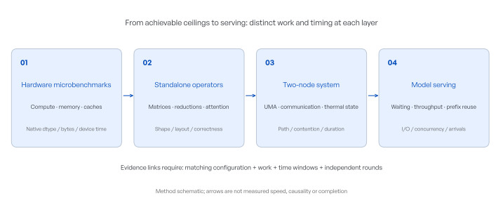

Figure 03-01 | Study layers and evidence links | Schematic. Arrows indicate interpretive dependencies, not completed tests or directly subtractable timings.

| Layer | Measurement boundary | Supported scope |
| --- | --- | --- |
| GPU hardware | Device arithmetic and memory access | Achievable ceiling at a specified precision, size and state |
| Standalone operators | Separate preparation, kernel execution and synchronization | Implementation efficiency, shape sensitivity and data-movement cost |
| Two-node system | CPU/GPU cooperation, collectives and sustained load | Contention, communication cost and retained performance |
| Model serving | Client through Infron to the two nodes and back | Waiting, throughput, cache reuse and cost on the actual path |


GB10 uses shared LPDDR5X unified memory. Its 128 GB is not an exclusively allocatable GPU pool; 256 GB across two nodes is not one shared address space. The 273GB/s memory rating is per node; 1PFLOP/s is a sparse-FP4 rating. Efficiency comparisons must match precision, sparsity, clocks and traffic definitions. GPU L1/L2 caches count memory accesses; serving prefix caches count reused input tokens. They are reported separately. [NVIDIA](https://docs.nvidia.com/dgx/dgx-spark/hardware.html)

### Concepts needed to read hardware results

| Concept | Definition and measurement relevance |
| --- | --- |
| CUDA cores and Tensor Cores | CUDA cores execute general parallel arithmetic; Tensor Cores accelerate specific matrix operations. FP32/FP16/FP8/FP4 identify numeric formats; fewer bits do not guarantee faster execution for every task. |
| Matrix multiplication and M, N, K | GEMM means general matrix multiplication: A is M×K, B is K×N and output is M×N. Shape affects parallelism and reuse and must accompany precision. |
| GPU kernels and CUDA Graphs | A kernel is a program executed on the GPU; a stream orders work. CUDA Graphs replay captured dependencies and can reduce repeated host submission overhead. |
| L1/L2, shared memory and unified memory | L1/L2 are hardware caches; CUDA shared memory is on-chip block-local storage; GB10 unified memory is CPU/GPU-shared system memory. Their capacity, latency and access rules differ. |
| RDMA and GPU-direct paths | RDMA lets NICs remotely access registered memory; a GPU-direct path additionally requires evidence of NIC access to GPU buffers. An ordinary RDMA test does not establish that path. |
| NCCL collectives | NCCL is a GPU communication library. AllReduce combines inputs and gives each rank the result; AllGather collects every rank’s shard; ReduceScatter combines inputs and distributes result shards. |


### Benchmarks: sources, task forms and use in this study

Six public benchmarks form the fixed prompt bank; length, business and cache workloads add controlled system conditions. The original benchmarks evaluate model answers. This study uses their prompts as repeatable inputs and measures waiting time, actual generation, throughput and node resources. Benchmark names identify input provenance, not completion of their full capability evaluations.

| Benchmark and original purpose | Input construction and performance use | Example of a selected task |
| --- | --- | --- |
| [MMLU-Pro](https://github.com/TIGER-AI-Lab/MMLU-Pro)<br>Multiple-choice knowledge and reasoning across 14 subjects; normally evaluated by answer accuracy. | Question and original choices, without few-shot worked examples. Supplies short inputs with specialist terms and option lists. | Choose the winding required by DC machines from the supplied options.<br>`mmlu_11888` |
| [MATH-500](https://huggingface.co/datasets/HuggingFaceH4/MATH-500/blob/6e4ed1a2a79af7d8630a6b768ec859cb5af4d3be/README.md)<br>A 500-problem subset of MATH covering algebra, geometry, number theory and other topics; the original task evaluates mathematical correctness. | Keeps problem text and mathematical notation, requesting a final answer in \boxed{}. Probes output length and waiting for mathematical generation. | Count integer solutions of an absolute-value inequality.<br>`math_386` |
| [GSM8K](https://github.com/openai/grade-school-math)<br>Grade-school word problems involving multi-step arithmetic; normally evaluated by the final numeric answer. Uses main/test. | Keeps the word problem and asks for a solution ending with a ####-marked answer. Combines narrative text with arithmetic steps. | Calculate a person’s age from multiplicative relationships among three ages.<br>`gsm_1104` |
| [IFEval](https://arxiv.org/abs/2311.07911)<br>Instruction-Following Evaluation uses verifiable language, format, length and keyword constraints; the original task checks compliance. | Uses the original instructions, retaining language and format constraints. Observes response shape and actual generation volume. | Write a poem about Yoda entering another universe, using Persian only.<br>`ifeval_1477` |
| [HumanEval+](https://github.com/evalplus/evalplus/blob/v0.3.1/README.md)<br>Python function generation; “+” denotes additional EvalPlus correctness-test inputs. The original task checks generated programs by execution. | Keeps signatures, documentation and in-prompt examples; requests a complete Python code block. Measures streamed function generation. | Implement largest_divisor(n), returning the largest divisor smaller than n.<br>`HumanEval_24` |
| [MBPP+](https://github.com/evalplus/evalplus/blob/v0.3.1/README.md)<br>Basic Python programming tasks, using the 378-task EvalPlus version with expanded tests. The original task checks functional correctness. | Keeps task descriptions and in-prompt assertion examples; requests a complete Python code block. Supplies shorter code-generation inputs. | Implement a function returning the smaller of two numbers, matching the supplied assertion.<br>`Mbpp_404` |


Examples paraphrase selected tasks; requests use the exact frozen prompts. Reference solutions and hidden tests are excluded, while examples and assertions already in the prompt remain. HumanEval+ and MBPP+ extended tests are not executed, and “+” adds no generation requests here. Accuracy, instruction-compliance rates and code-test pass rates are not calculated.

### Data versions, sample sizes and length distributions

Source size refers to the archived version or test split; the candidate frame contains prompts eligible for selection; selected counts are unique prompts. Tokens are tokenizer units, not words or characters. Lengths below use this model’s tokenizer and count prompt content only; actual API input also includes the chat template and role markers.

| Pinned data source and version | Source → candidates → selected | Content tokens: min / median / max |
| --- | --- | --- |
| [MMLU-Pro](https://huggingface.co/datasets/TIGER-Lab/MMLU-Pro/tree/b189ec765aa7ed75c8acfea42df31fdae71f97be)<br>Revision: `b189ec765aa7` | **12,032 → 1,400 → 10** | **70 / 166 / 386** |
| [MATH-500](https://huggingface.co/datasets/HuggingFaceH4/MATH-500/tree/6e4ed1a2a79af7d8630a6b768ec859cb5af4d3be)<br>Revision: `6e4ed1a2a79a` | **500 → 500 → 10** | **36 / 64 / 188** |
| [GSM8K](https://huggingface.co/datasets/openai/gsm8k/tree/740312add88f781978c0658806c59bc2815b9866)<br>Revision: `740312add88f` | **1,319 → 1,319 → 10** | **46 / 76.5 / 112** |
| [IFEval](https://github.com/google-research/google-research/blob/0a1b0fe7298a58bca6dcb47112379d829bc0c0a5/instruction_following_eval/data/input_data.jsonl)<br>Revision: `0a1b0fe7298a` | **541 → 541 → 10** | **24 / 43.5 / 83** |
| [HumanEval+](https://github.com/evalplus/evalplus/releases/tag/v0.3.1)<br>EvalPlus 0.3.1<br>SHA-256: `42526ec0e7d5` | **164 → 164 → 10** | **77 / 153 / 315** |
| [MBPP+](https://github.com/evalplus/evalplus/releases/tag/v0.3.1)<br>EvalPlus 0.3.1<br>SHA-256: `b54e76275524` | **378 → 378 → 10** | **55 / 72.5 / 144** |


Version cells show the first 12 characters of a commit or data-file SHA-256. Links identify the source; complete revisions and local file hashes are in the [source manifest](../../2026-10-14_17-dual-spark/protocols/sources.json). EvalPlus 0.3.1 identifies the retrieval package; each dataset file is separately pinned by its hash.

<!--DATASET_PROFILE-->

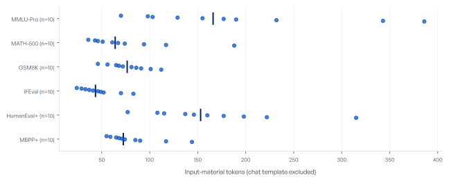

Figure 03-02 | Prompt-bank lengths | Each point is one fixed prompt, ten per suite; vertical marks show medians. The 60 prompts span 24–386 content tokens and primarily characterize short inputs. Separate length workloads measure long-input behavior.

### Sampling method and comparison scope

The candidate pool contains 4,302 items. MMLU-Pro contributes 100 items from each of 14 subjects, selected from its 12,032-item test split, yielding 1,400 candidates. The other five suites use the full versions or test splits listed above. Within each suite, candidates are sorted by content-token length and divided into ten nearly equal-count strata. A SHA-256 ranking of the fixed seed `20261014-performance-v2`, suite and item ID selects one per stratum. The result is ten per suite, 60 total, without using model outputs.

The selected MMLU-Pro items cover engineering, math, physics, chemistry, health, economics, computer science and law: two each for physics and economics, one each for the others. MATH-500 selections cover five of its seven source topics. Length stratification preserves variation in prompt size, but ten items per suite do not support subject rankings or generalization to the full suites. Equal suite counts also do not represent production traffic shares.

The same 60 prompts run for three rounds at each concurrency level 1/2/4/8, giving 720 planned measurements. Low-reasoning-budget arms add three rounds at concurrency 1/4, or 360 planned measurements. Repetitions compare performance without increasing unique prompts. The natural-bank output cap is 1,024 tokens; generation may stop earlier. Suite comparisons therefore include actual output lengths and cap-hit fractions. When content, output volume and cache state vary together, latency differences cannot be attributed solely to question difficulty.

[Fixed 60 prompts](../../2026-10-14_17-dual-spark/protocols/protocol/workloads.jsonl) · [Selection rules](../../2026-10-14_17-dual-spark/protocols/protocol/workload_manifest.json) · Source-size and sample audit

### Complementary workloads: length, business and caching

The short-prompt bank does not cover long contexts, long generation or cache retention by itself. The controlled workloads below add these conditions. Counts are planned calls, including the relevant warmups, calibration or controls; Section 05 and the results report actual completion. Here 1K = 1,024 tokens and output length is a generation cap.

| Workload and material source | Construction and planned scale | Added performance scope |
| --- | --- | --- |
| Length and long output: Project Gutenberg’s War and Peace prose and locally generated business records | Nine input/output tiers: 1/2/4/8/16/32/64/128/256K. Of 81 combinations, 63 retain safety margin, one is exactly on the boundary and 17 exceed it. Selected axes, diagonals, near-limit and related conditions total 299 extension calls. | Separates input-processing wait from sustained generation, recording output attainment. The 256K context is shared by input and output; both cannot simultaneously reach 256K. |
| Eight business shapes: generated tickets, orders, operations records, code and multi-turn messages | Triage, rewriting, drafting, summarization, analysis, extraction, code patching and dialogue. Each has 12 measurements plus one warmup at concurrency 1/4: 192 measurements + 16 warmups = 208 calls. | Compares response and capacity across input/output ratios. Synthetic scenario proportions do not represent production traffic. |
| Prefix ratios: synthetic records with shared beginnings and varied suffixes | 8K/32K inputs × 0/25/50/75/90/100% shared prefixes × six independent pairs; one warmup and one probe per pair = 144 calls. Together with business shapes: 352 calls. | Target overlap controls the shared input prefix; service counters establish actual cache reuse. These are reported separately. |
| Cache retention and stability: independently generated business prefixes and competing requests | Business cross-cases: 72; idle retention: 36; competition/recovery: 24; periodic reuse: 28; 160 calls, accounted separately from the 144 prefix-ratio calls. | Observes reuse after idle gaps, other requests and repeated access using counter windows and latency. Short diagnostics do not establish long-term stability. |


Long-text source: [Project Gutenberg](https://www.gutenberg.org/ebooks/2600.txt.utf-8), with [archived corpus hash](../../2026-10-14_17-dual-spark/protocols/plans/corpus_provenance.json). Section 03 gives selected length pairs, business input/output examples, cache intervals and concurrency controls. Appendix C lists all code and data paths. GPU compute, memory and communication use the separate system benchmarks in Sections 06–07 and are counted separately from these model-request workloads.

### Model-serving experiments and materials

Each condition fixes input, output cap, reasoning effort and concurrency. The natural bank has three rounds and the length matrix four blocks per cell; seeded orders are saved before execution. Baseline and expanded loads retain natural stopping; realized lengths are verified against upstream counts and rates use actual work.

Fixed-concurrency tests replenish completed requests to compare capacity. Independent-arrival tests schedule requests at predetermined random times to observe queues and rejections. Both keep at most eight requests in flight. Counts, order and stop conditions are in the test plan.

<!--SYSTEM_MAP-->

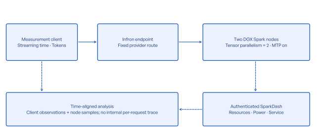

Figure 03-03 | Measurement path | The client reaches the two-node service through Infron; telemetry is time-aligned. Client latency includes network and service waiting.

### Alignment with SGLang and vLLM benchmark methods

The serving engine is SGLang 0.5.21; vLLM 0.31.0 is a methodology reference. The table separates upstream tool design from this experiment’s rules; it is not an engine performance comparison.

| Reference | Implementation and interpretation |
| --- | --- |
| [SGLang: benchmark layers](https://docs.sglang.io/docs/developer_guide/benchmark_and_profiling) | Online serving includes HTTP, scheduling and generation. This study additionally includes Infron and the public route; offline-engine or single-batch kernel measurements do not replace service latency. |
| [SGLang: sample count](https://docs.sglang.io/docs/developer_guide/benchmark_and_profiling) | The guide recommends at least five times maximum concurrency. New repeat blocks use 8/20 calls at concurrency 1/4, with three blocks each. Block variation is still checked; count alone does not establish steady state. |
| [SGLang 0.5.21: EOS](https://github.com/sgl-project/sglang/blob/v0.5.21/python/sglang/benchmark/serving.py) · [vLLM 0.31.0: EOS](https://docs.vllm.ai/en/v0.31.0/cli/bench/serve/) | The tools have different EOS defaults, so settings are explicit. Compare natural stopping with ignore_eos=true and verify the forwarded request and upstream output count. Only verified fixed outputs enter length-controlled comparisons. |
| [vLLM: arrival / goodput](https://docs.vllm.ai/en/v0.31.0/cli/bench/serve/) | Record arrivals, client concurrency and goodput separately. Preserve scheduled arrival, dispatch, first fragment and completion; include queuing and rejection in user waiting and offered load. Current arrivals are Poisson; bursty arrivals are future work. |
| [SGLang: shared prefixes](https://docs.sglang.io/docs/developer_guide/bench_serving) | Shared prefixes are controlled inputs; observed hits require valid fields or counter deltas over isolated windows. Natural tasks and synthetic long output remain separate populations. |


Reference documents and source snapshots retain versions and SHA-256 hashes. Framework commands are references; one collector preserves route, budget and evidence consistency. Source archive

Public length-extension requests retain natural stopping: calibration did not forward ignore_eos upstream. Reaching 98%–100% of a cap establishes realized length for that request only. The native-engine experiment separately verifies fixed output in section 08.

### Experimental material and length construction

The earlier tables in this chapter document the six public benchmarks, pinned versions, selection rules and length distribution of the 60 prompts. The following describes control of input length, output caps and prefix structure beyond that short-prompt bank.

Length-control material is ordinary prose from Project Gutenberg’s War and Peace, sampled at fixed offsets with distinct leading identifiers to reduce cross-request prefix reuse. Source and SHA-256 are retained. This isolates length effects without claiming a real business demand distribution. Business amendments use locally generated orders, tickets, operations records and code, with no actual customer content. [Project Gutenberg](https://www.gutenberg.org/ebooks/2600.txt.utf-8) · [Natural selection manifest](../../2026-10-14_17-dual-spark/protocols/protocol/workload_manifest.json) · [Long-text provenance and hash](../../2026-10-14_17-dual-spark/protocols/plans/corpus_provenance.json)

### Length coverage: feasibility from 1K to 256K

**1K = 1,024 tokens.** Input and output each use nine tiers: 1/2/4/8/16/32/64/128/256K. Input includes the complete chat template; output denotes a requested cap, with actual generation recorded separately. The 262,144-token context is shared by input and output, so neither 256K input plus 1K output nor 1K input plus 256K output fits.

Of 81 design cells, 63 fit with a 1K margin; 128K+128K has no margin and is a boundary; 17 exceed context. Execution selects 21 axis/diagonal cells plus 254K→1K and 1K→254K near-boundary probes. “Length eligible” does not establish gateway output limits, available memory or runtime feasibility.

<!--LENGTH_DOMAIN-->

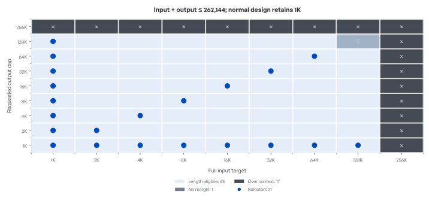

Figure 03-04 | Length feasibility | Dots mark selected conditions; colors express context arithmetic, not completed measurements. The 254K near-boundary probes are separate.

| Group | Input → output cap | Calls | Purpose |
| --- | --- | --- | --- |
| Input axis | **1–128K** → **1K** | **24** | Hold output cap to examine input processing and initial waiting. |
| Output axis | **1K** → **2–128K** | **13** | Hold input; three calls per cell through **8K** output, one from 16K. |
| Balanced lengths | **2／4／8／16／32／64K** → same | **12** | Observe joint input/generation growth; high tiers are single probes. |
| Near boundary | **254K** → **1K**；**1K** → **254K** | **2** | One call per cell, conditionally admitted; no tail percentiles. |
| Long prefixes | **64／128K** → **1K** | **36** | **0/50/100%** target overlap; three seed/probe pairs per cell. |
| Business anchors | below | **32** | One warmup plus three measurements per shape; natural EOS. |
| Repeated blocks | **1K** → **4K**；**32K** → **1K** | **178** | Concurrency 1/4, three blocks of **8/20 calls** per cell, plus ten warmups. |
| Parameter calibration | **1K** → **1K** | **2** | The same short-answer instruction with natural EOS and ignored EOS. |


The extension fixes 299 calls across axes, diagonals and near-boundary combinations; sections 05 and 08 report realized coverage and attainment.

#### Representative points for the eight business shapes


| Shape / length | Context | Typical input → illustrative output |
| --- | --- | --- |
| Batch ticket triage<br>4K → 1K | Route several tickets, producing a classification list. | Input: 20 tickets; output: [{id, category, reason}, …] |
| Document rewriting<br>4K → 4K | Rewrite similar information volume while preserving structure. | Input: operations procedure; output: customer-guide sections. |
| Long-form drafting<br>1K → 8K | Expand a brief into a handbook, emphasizing generation. | Input: launch goals and constraints; output: preparation, execution and recovery. |
| Long-document summary<br>32K → 1K | Compress retrieved material or logs into concise findings. | Input: one month of records; output: key events and actions. |
| Evidence analysis<br>32K → 8K | Long evidence plus detailed reasoning stresses input and output. | Input: ticket batches; output: trends, evidence and alternatives. |
| Batch extraction<br>8K → 1K | Convert documents to structured lists, without constrained decoding. | Input: orders; output: [{order_id, amount, status}, …] |
| Code editing<br>16K → 4K | Several functions supply context for a patch and explanation. | Input: billing module; output: idempotency patch and explanation. |
| Multi-turn assistant<br>16K → 2K | History plus follow-up retains a multi-message chat structure. | Input: ticket history + next-step question; output: actions. |


Outputs above illustrate form. Synthetic long output uses varied identifiers, dates and records; classification is not required to generate a 256K answer. Existing short business workloads remain baselines; new anchors are separate cohorts, not one averaged score.

#### Admission and interpretation

Fixed-length mode verifies forwarded ignore_eos=true and max_tokens, requiring upstream output to reach 98–100% of cap. Tiers escalate in a fixed protective order, so order and time effects may be confounded. After fixed-output calibration fails, unsent conditions use natural stopping; an unqualified preceding output tier blocks escalation. Input-axis cells have three calls and output probes ≥16K have only one: neither supports steady-throughput or p95/p99 claims. Representative blocks enter capacity comparisons only after completeness, length and count checks.

Before dispatch, verify full input + cap ≤262,144 and a conservative concurrency × request budget ≤262,144. The latter is an experiment guard, not measured KV capacity. Admission estimates 120 seconds + cap×0.08 seconds + input/300 seconds per request, plus 300 seconds drain reserve per block; 0.08 seconds is a policy assumption. Monitoring and cost guards remain; early stopping and skips are retained. Long-prefix seeds/probes each have isolated counter windows; three pairs per cell do not establish long-term retention.

### Short-workload baselines for the eight business shapes

Input/output ratio is defined prospectively as target input tokens divided by the output-token cap. It controls experimental shape, but generation may end early; realized input/output ratios are reported separately. Each shape has 12 measurements and one warmup at each of concurrency one and four: 208 calls total. Each condition has three blocks of four measurements, in a fixed randomized order. Concurrency arms share source material but use distinct early identifiers to reduce prefix carryover. This sample supports diagnostics, not stable tail estimates.

| Shape | Input target → output cap | Nominal ratio | Context and interpretation |
| --- | --- | --- | --- |
| Ticket triage | **512 → 64** | **8:1** | Short request and answer for routing; emphasizes waiting over generation. |
| Balanced rewriting | **2,048 → 2,048** | **1:1** | Similar input/output budgets for rewriting; examines decode occupancy. |
| Short brief, long draft | **512 → 2,048** | **0.25:1** | A brief expands into long-form drafting; examines output cost. |
| Long-document summary | **32,768 → 128** | **256:1** | Long material compressed into a short summary; emphasizes prefill and first-fragment waiting. |
| Long-document analysis | **32,768 → 2,048** | **16:1** | Long input plus extensive analysis; combines prefill and decode pressure. |
| Structured extraction | **2,048 → 128** | **16:1** | Text to short JSON for extraction; no JSON mode or native tool API is enabled. |
| Code editing | **8,192 → 512** | **16:1** | Code context with a focused patch; medium/long input followed by short output. |
| Multi-turn assistant | **8,192 → 512** | **16:1** | Follow-up assistance with history; uses multiple actual chat messages. |


<!--SHAPES-->

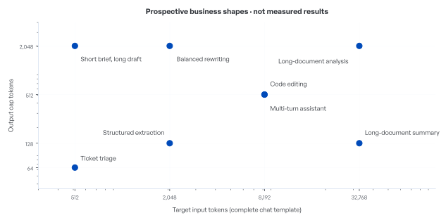

Figure 03-05 | Business-shape design | Target input and output caps on logarithmic axes. These are prospective conditions; realized output is reported in the results after execution.

### Typical input/output examples

The following are shortened teaching examples. Outputs illustrate format and are **not measured model answers**. Actual prompts contain length-controlled generated records; complete prompts and responses remain in per-request evidence.


| Shape | Typical input excerpt | Illustrative output excerpt |
| --- | --- | --- |
| Ticket triage | The customer paid but access reset failed. Classify the ticket. | {"category":"access","reason":"Access failed after payment"} |
| Balanced rewriting | Rewrite the operations note as a customer guide, preserving steps and constraints. | Step 1: verify the order identifier. Step 2: check payment status… |
| Short brief, long draft | Expand the launch brief into a handbook covering preparation, execution and recovery. | Preparation: confirm owners, rollback version and alert rules… |
| Long-document summary | Summarize the long operational record in five bullets with dates and unresolved issues. | 1. Access restoration remains open. 2. Order payment was verified… |
| Long-document analysis | Analyze operational records for trends, evidence, alternative explanations and next steps. | Access incidents cluster after payment; distinguish permission synchronization from client state… |
| Structured extraction | Order INV-204: USD 120, paid. Return the four-field JSON object. | {"order_id":"INV-204","amount":120,"currency":"USD","status":"paid"} |
| Code editing | Patch the billing module to avoid processing an invoice twice after a timeout. | if invoice_id in processed_ids:<br>    return existing_result |
| Multi-turn assistant | History: payment succeeded, access reset failed. Follow-up: what should operations do next? | Verify order and payment status, check permission synchronization, and update the customer. |


### Cache ratios: controlled input versus observed reuse

The amendment crosses input lengths 8,192 and 32,768 with target shared-prefix fractions 0/25/50/75/90/100%, using six independent pairs per cell: 72 pairs and 144 calls. Each pair executes a warmup and then a measurement serially, both with a 256-token cap and the same generation parameters. Exact longest common prefixes are computed over the full tokenized chat template. A nominal zero may still share template tokens, so realized overlap is recorded.

| Overlap target | Business context | Input variation and illustrative output |
| --- | --- | --- |
| 0% | Unrelated new tickets | Warm: ticket A. Measure: distinct record B. Output: summary of B. |
| 25% | Small common rules, mostly dynamic data | Same initial rules + different order details. Output: new order actions. |
| 50% | Common knowledge and user context of similar size | Same first half + a new second half. Output: new-context summary. |
| 75% | Long shared knowledge, several customer inquiries | Same knowledge body; final ticket differs. Output: current-ticket advice. |
| 90% | Large common material with short personalization | Retain most prefix tokens, replace trailing records. Output: updated summary. |
| 100% | Repeat access to identical input | Repeat identical full input. Output: summary of the same material; generation still executes. |


<!--CACHE_DESIGN-->

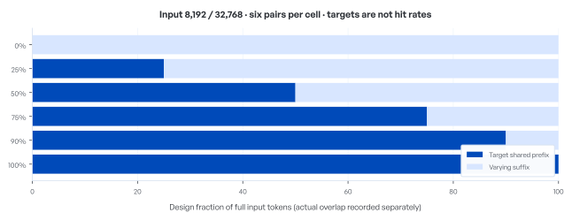

Figure 03-06 | Prefix-control design | Dark blue is the target shared portion and light blue the varying portion; this describes input construction, not an achieved cache-hit rate.

Prefix overlap describes input similarity; actual cache hits require service fields and are not imputed when missing.

### GPU and system controls

An exclusive window covers compute, memory, caches, scheduling and standalone operators; the second node repeats key conditions and both run collectives. Freeze versions, dtypes, layouts, memory state and power policy. The base matrix uses ten rounds per condition; extensions use five generally and ten for predeclared key conditions. Pair ordinary/graph launches, serial/overlapped work and CPU memory/compute interference. Retain correctness and profiling separately. Section 03 of the test plan gives full conditions, steady-state rules and scheduling.


### 2026-10-19: length, interference and cache protocol

Both nodes are measured in a dedicated window. The public path is Infron → Cloudflare → frozen-request forwarding proxy → SGLang. Only registered payloads are admitted, and both arms use the same path. Model, quantization and engine launch configuration match the archived deployment; the new date remains a separate experiment.


| Component | Fixed count | Controls |
| --- | --- | --- |
| Route preflight | 1 | 32-token cap; verify actual route and source parameters. |
| Public lengths | 8 | One observation for each formerly unsent input/output condition. |
| Interference warmup | 320 | 5 pairs × 2 arms × 32 short inputs; all inputs prewarmed with matching output parameters. |
| Measured short requests | 320 | 5 × 2 × 32; identical prompts and full Poisson schedules within each pair, nominal rate 0.12/s. |
| Mixed-arm long requests | 40 | Eight per pair; 32K inputs, 128-token caps, uniformly distributed over the short-request horizon. |
| Cache controls | 6 | Three independent pairs of 64K inputs; early unique markers set designed prefix overlap to 0%. |

The plan fixes **695 logical requests**. Warmup, retries and measurements are separate. Arm order alternates; short/long client workers are limited to 4/2 within the authorized total ceiling 8. All 32 short arrivals are retained without truncation. The local queue holds at most 32 requests. A 5-second expiration threshold is checked on dequeue, so observed waiting before rejection can exceed 5 seconds; rejection remains an outcome. Thermal backoff starts at 85°C and resumes below 75°C after30 stable seconds.


<a id="section-04"></a>

## 04 · Metric definitions and statistics

| Metric | Meaning and scope |
| --- | --- |
| Visible-content TTFT | Seconds from sending to the first visible content fragment; the user’s initial wait. |
| First-generated latency | Send to the first reasoning, content or tool fragment; may precede visible content. |
| End-to-end latency | Seconds from sending to the end of the complete response stream. |
| Estimated time per output token | (Completion time − first-generated latency) / (generated tokens − 1); includes stream-finalization overhead, not exact inter-token timing. |
| Aggregate generation throughput | Generated tokens in eligible blocks / total block duration, in tokens/s. |
| Goodput | Complete requests meeting wait and generation-speed thresholds / measurement duration. Waiting includes client queuing from planned arrival; rejected arrivals remain in the denominator. |
| Length and cache | Record input, actual output, output cap, token-prefix overlap and reported cached tokens separately; a cap is not realized output. |
| Node resources | GPU activity, memory, temperature, power and service state aligned to the same load windows; estimated system power is not outlet-metered power. |


<!--MEASUREMENT-->

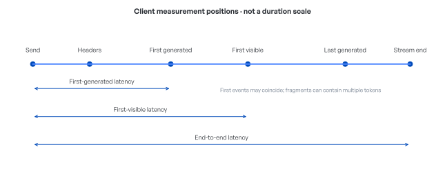

Figure 04-01 | Timing boundaries | First generated and first visible content can differ; distances are not measured durations.

The median describes a typical response; roughly 95% of samples fall at or below p95. Throughput and latency comparisons use the same uninterrupted complete blocks, with warmups separate; failures remain in reliability statistics. Request and block counts are both reported. Repeated prompts do not increase the unique-prompt count. Business cells with 12 calls and cache cells with six pairs are diagnostic, not robust p99 estimates.

Token rates use verified upstream generation counts; costs use matched actual bills. Missing counts, cache fields and telemetry remain missing. Appendix A provides the complete metric dictionary and statistical details.

Streaming uses server-sent events (SSE). An event can contain several tokens, particularly with multi-token prediction: event spacing describes client delivery, not exact engine inter-token latency. The length extension additionally reports actual-output/cap attainment, full-input error, qualified counts and actual work per block.

#### Cache metrics: input structure, observed reuse and stability


| Cache metric | Definition and interpretation |
| --- | --- |
| Input-prefix overlap | Longest common token prefix over the full chat template / probe input length. A controlled input property. |
| Per-request token-cache fraction | Sum of cached input tokens / sum of input tokens for requests with valid fields, accompanied by field coverage / complete responses. |
| Fraction of requests with a hit | Requests with cached tokens >0 / requests with valid cache fields. A small template hit counts; it does not imply full-input reuse. |
| Window token-cache fraction | Endpoint cached-counter delta / prompt-counter delta; check freshness, resets, identity and receipt agreement. Count the head endpoint once. |
| Paired waiting change | Seed visible TTFT minus repeat TTFT; positive means the repeat was faster. Relative changes are separate. Network, order and load may contribute; this is not isolated causal acceleration. |
| Retention, competition and recovery | Compare cache fractions by actual idle gap; compare post-pressure with baseline for cache loss and extra waiting, then examine recovery. Findings apply only to tested pressure and intervals. |
| Temporal stability and coverage | Report valid / all windows, observed span, token-weighted mean, range and SD for at least three valid windows. Missing or reset intervals are neither zero-filled nor connected. |


### GPU and system measurement boundaries

Compute uses operations at the specified precision per device time; bandwidth separates useful read/write bytes from physical traffic. Hardware caches count accesses, while prefix caches count input tokens. Kernel, host-submit, collective and public-serving times are separate and cannot be subtracted across experiments. Sustained performance uses a same-workload warm baseline; efficiency uses integrated energy at a matching boundary. Appendix A defines formulas, units and numerical checks.

Use independent rounds or paired blocks as statistical units; report all samples, valid denominators, medians, interquartile ranges and 95% intervals. Key paired comparisons use round-cluster resampling with raw round points. Five-round screens are descriptive; ten rounds still do not guarantee precise intervals. Calculate ratios within paired rounds before aggregation. Randomize conditions within fixed stages and separate cold/warm-cache and first-touch tests. Microbenchmarks do not estimate serving tails; few rounds cannot support robust p99. A >5% decline lasting two ten-minute windows is an investigation flag, assessed with clocks, temperatures and work, not a hardware-failure verdict. Preserve timing and intrusive profiling runs separately.


### Additional metric definitions and inclusion rules


| Metric | Definition and boundary |
| --- | --- |
| Arrival-to-visible wait | Client receipt of first visible text minus scheduled arrival; includes client scheduling, queuing and verified retries. |
| Median/p95 waiting | Linear-interpolation sample quantiles of 32 short requests per arm. The p95 estimate is tail-sensitive; no p99 claim is made. |
| Interference ratio | Mixed-arm median wait divided by matched isolated-arm median wait, only after all short requests, payloads and arrival schedules match. |
| Cached-token fraction | Source cached-token increment / input-token increment. Both boundaries must be idle; monotonic request, input and output counters must reconcile with the block. |
| Realized generation | completion_tokens from the original source usage. Public usage, billed usage and requested output cap remain distinct. |
| Replication unit | Five paired blocks. The 32 correlated requests within a block are not32 independent experiments. Pair results and ranges are reported without a pooled pseudo-replication confidence interval. |

Responses require normal termination, a stream-end marker, source usage and a reconciled counter window. Missing windows are unavailable; zero reuse is reported only with a valid denominator.


<a id="section-05"></a>

## 05 · Realized coverage and analysis samples

### Independent denominators for the 2026-10-19 supplement


| Scope | Qualified/planned | Definition |
| --- | --- | --- |
| Public output caps | **8/8** | One natural-stop observation for each of eight formerly unsent conditions. |
| Long/short interference | **5/5** | All arrivals and outcomes recorded; 4 pairs support a complete-pair effect estimate, with 3 local rejections retained. |
| 64K zero designed overlap | **3/3** | Two requests per pair; actual reuse comes from attributable counter windows. |

The selected attempts include **692** submitted requests, **692** complete source-usage records and **3 local queue rejections**: **695/695** observed logical outcomes. Four pre-isolation probes and any further bounded attempts remain separate. The historical 299-request completion rate is not backfilled. Its one incomplete response belonged to the 32K-input/8K-output-cap condition, independently repeated on October 17 with identical inputs and caps (**4/4** complete). October 19 covers the other eight formerly unsent conditions. The mapping is in `protocols/gap-resolution.json`.


Fixed lists are qualified by date; historical missing observations are not backfilled. Valid completion of fixed experiments, unexecuted conditions and incomplete observations are counted separately; no single overall completion percentage is calculated. A complete response does not establish answer correctness, target-length attainment or a production service objective.

<!--WORKFLOW-->

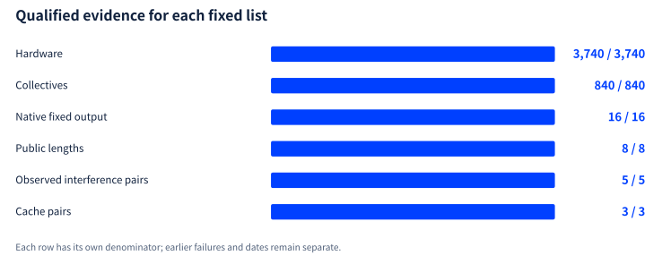

Figure05-01 | Qualified evidence by fixed list, with separate denominators.

### Initial public batches: outcomes and count definitions

| Initial public batch | Design count and meaning | Logical requests sent | Complete / expected boundary outcome | Incomplete outcomes |
| --- | --- | --- | --- | --- |
| Interface and measurement calibration | **12** (Fixed plan) | **12** | **12** | **0** |
| Natural workloads and concurrency scaling | **720** (Fixed plan) | **720** | **718** | **2** |
| Input/output length matrix | **1,440** (Fixed plan) | **1440** | **1435** | **5** |
| Paired reasoning budgets | **360** (Fixed plan) | **360** | **360** | **0** |
| Long context and boundaries | **37** (Fixed plan) | **37** | **36** | **1** |
| Prefix caching | **90** (Fixed plan) | **90** | **90** | **0** |
| Business shapes and cache-ratio amendment | **512** (Fixed plan) | **512** | **507** | **5** |
| Open arrivals and mixed workloads | **2,000** (Conditional cap) | **783** | **783** | **0** |
| Length expansion and sustained operation | **3,000** (Conditional cap) | **929** | **925** | **4** |


Logical requests are deduplicated by planned sample; retry attempts are retained separately. Original batch outcomes are preserved rather than backfilled with later successes. The 2,000-call open-arrival and 3,000-call length/soak counts are conditional ceilings, not mandatory sample totals. The separate public-length list fixes **299 calls**, with unsent/incomplete records below. The independent additional one-hour run has ended.

Hardware work is excluded from API-request denominators. Section 06 lists the batch scope, phase status and constrained conditions; execution manifests and status records remain separate.

Independent engine experiment: 78 archived analyzable blocks and 231 formal requests, plus two pilot/profile requests and four GPU traces across both ranks. These direct-origin observations do not enter public-API request or cost denominators; definitions and results are in section 08.

### Coverage of the independent completion experiments

The additional experiments started on 17 October 2026. Status: Execution ended; delivered with actual coverage. Each batch retains its own requests, dates and denominators. New measurements do not rewrite earlier failures or success rates. Financial expenditure has no preset ceiling; actual charges are still reconciled per request.

| Additional scope | Evidence acquired | Definition |
| --- | --- | --- |
| Fixed long output | **16 / 16** | Native engine; includes one calibration, then output-axis and balanced-length requests |
| Profiling pairs | **9 / 9** | Three input/concurrency conditions, three profiled/unprofiled pairs each |
| 64K cache | **6 / 6** | First and immediate reuse for three independent prefixes |
| Complete public responses | **1028** | Independent reference blocks, affected conditions, mixed-length interference and a one-hour run |
| FP64 GEMM | **30 / 30** | Two nodes, three sizes, five rounds per cell |
| Representative counters | **12** | Compute/memory profiles returning valid counters |


### Current evidence and interpretation limits


| Scope | Current evidence | Boundary |
| --- | --- | --- |
| Public lengths | 2026-10-19: 8/8 | Original 299-row outcomes retained; new date analyzed separately. |
| Interference | 5/5 observed; 4/5 effect-eligible | Effect ratios only for complete pairs. |
| 64K low-reuse windows | 2026-10-19: 3/3 | Actual reuse requires counters, not the design ratio alone. |
| Continuous public service | 3,600.1s; 599/600 | Separate October 17 hour; not all-day availability. |
| H200, wall energy and physical counters | Not measured | Equipment/instrument limits; retain specifications and measurement boundaries. |


## 06 · GPU compute, memory and operators

**Resource conditions and comparison.** The resident condition retains model weights and serving processes. The unloaded condition stops both inference processes in a dedicated window, retaining the driver, clock policy and hardware. Each is warmed independently and runs the same base matrix with separate valid-round counts. Time and memory state change together; differences describe the overall resource condition, not an isolated causal cache, clock or chip effect.

| Node | Resource condition | Planned rounds | Archived valid timings | Memory-guard skips |
| --- | --- | --- | --- | --- |
| 0 | Model resident | **1070** | **684** | **386** |
| 0 | Model unloaded | **1070** | **1070** | **0** |
| 1 | Model resident | **1070** | **990** | **80** |
| 1 | Model unloaded | **1070** | **1070** | **0** |


Service restoration: verified; both nodes retain their original arguments, environment, working directory and core engine configuration.

This segment adds independent time-round evidence: 107 base conditions per node with ten rounds each, plus scalar FP32 FMA, random pointer chasing, shared and managed memory, CPU contention, multiple streams and supported low-precision/2:4 sparse GEMM. Results are checked before and after timing; guard skips and unsupported conditions are excluded from performance denominators. The original 49 valid records remain historical observations outside these repeats.

| Node | Suite | Planned rounds | Archived valid | Guard skips | Unsupported | Failed | Pending |
| --- | --- | --- | --- | --- | --- | --- | --- |
| 0 | Base matrix | **1070** | **1070** | **0** | **0** | **0** | **0** |
| 0 | Extensions | **800** | **800** | **0** | **0** | **0** | **0** |
| 1 | Base matrix | **1070** | **1070** | **0** | **0** | **0** | **0** |
| 1 | Extensions | **800** | **800** | **0** | **0** | **0** | **0** |


8 records with invalid API calls or validation boundaries are audited separately and excluded from performance samples and valid coverage. Raw records and exclusion evidence remain in the analysis summary.

**Definitions.** TFLOP/s is trillions of floating-point operations per second; GEMM counts 2MNK. Sparse 2:4 data retain nonzero work separately; plots use dense-equivalent work. Logical GB/s counts requested reads/writes, not physical DRAM traffic. CUDA-event intervals include host-submission gaps, also affecting pointer-access nanoseconds; these are not intrinsic single-load latency. Summaries use condition-round medians and observed ranges; inner iterations and two devices are not a large independent device sample.

<!--HARDWARE_UNLOADED_COMPUTE-->

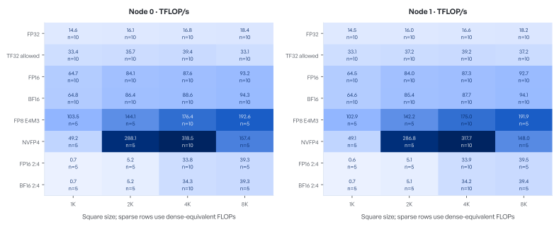

Figure 06-01 | Precision and size | Cells show measured median TFLOP/s; blanks indicate no valid archived data. FP8, NVFP4 and sparse rows have explicit operand distributions and library paths; cross-row differences are not precision-only causal effects.

Precision-by-node statistics for key shapes are in Appendix B; the figure retains the size trend.


### Independent operators and call boundaries

Reduction, Softmax and RMSNorm use the installed PyTorch library; RMSNorm includes library output allocation. Attention forces Flash SDPA with BF16,16heads,128dimensions per head and no causal mask, comparing full-length and single queries. These fixed synthetic tensors are not complete model prefill or decode. The **1M**-element add compares ordinary submission with graph replay at equal work.

<!--HARDWARE_UNLOADED_OPERATORS-->

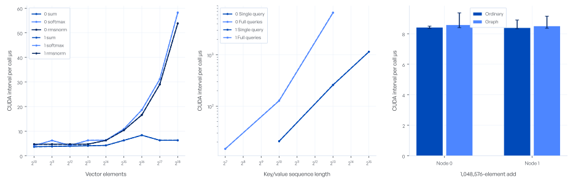

Figure 06-02 | Operator scale and launch mode | Condition-median CUDA intervals; add-operation error bars show observed ranges. Attention uses a logarithmic latency axis.

### Scalar compute, data supply and resource contention

Scalar FP32 uses explicit FMA instructions to compare one dependent chain with eight independent chains, holding per-thread FMA work fixed while varying blocks and parallelism; assembly is archived. Pointer chasing creates a complete random cycle with 128-byte spacing and ca/cg cache hints, where each load depends on the previous result. Shared memory varies address stride within a warp. CPU controls use 0/1/4/10/20 pinned worker processes with memory-streaming and compute controls. Each serial/parallel stream pair preserves the same matrix count.

<!--HARDWARE_UNLOADED_MEMORY-->

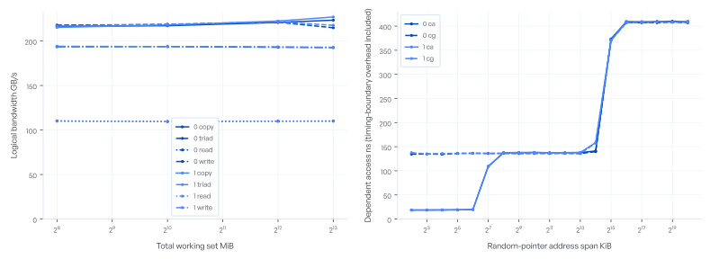

Figure 06-03 | Data-supply curves | Logical read/write bandwidth on the left and dependent random-access time on the right. Address span is not physical DRAM traffic; a curve transition alone does not establish cache capacity or hit rate.

| Experiment | Node-condition groups | Valid rounds | Interpretation |
| --- | --- | --- | --- |
| Scalar FP32 FMA | **36** | **180** | Per-condition CSV gives workload-specific units and resource boundaries |
| Shared-memory strides | **12** | **60** | Per-condition CSV gives workload-specific units and resource boundaries |
| Empty-kernel launch | **4** | **40** | Per-condition CSV gives workload-specific units and resource boundaries |
| Multiple streams | **16** | **80** | Per-condition CSV gives workload-specific units and resource boundaries |
| CPU contention | **18** | **90** | Per-condition CSV gives workload-specific units and resource boundaries |
| Managed first/repeat access | **2** | **10** | Per-condition CSV gives workload-specific units and resource boundaries |


<!--HARDWARE_UNLOADED_FMA-->

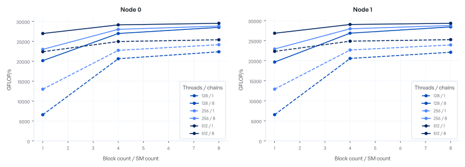

Figure 06-04 | Scalar FP32 parallelism | Fixed per-thread work with varied block size, block count and dependency chains; median rates are not Tensor Core peaks.

<!--HARDWARE_UNLOADED_CONTENTION-->

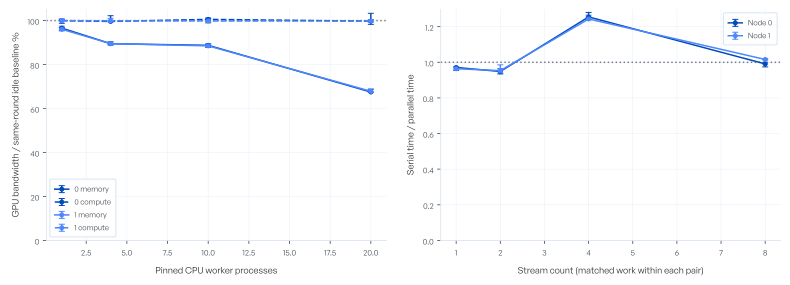

Figure 06-05 | Contention and streams | Left: same-node, same-round ratios to the zero-contention baseline. Right: matched-work serial/parallel time. Points are paired-ratio medians; bars are observed ranges.

<!--HARDWARE_UNLOADED_LAUNCH_SHARED-->

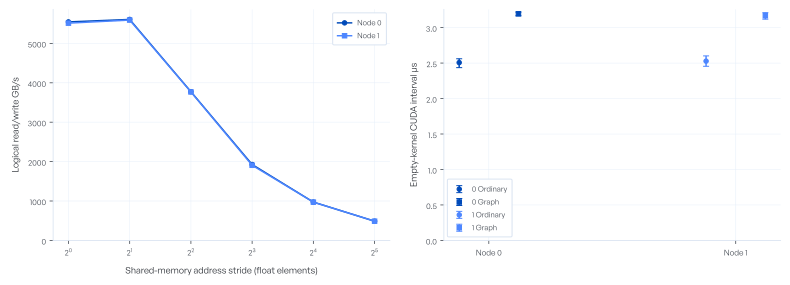

Figure 06-06 | Shared memory and launch | Strides change address mapping; bank-conflict counts require hardware counters. Launch intervals include repeated host-submission gaps, not isolated instruction latency.

<!--HARDWARE_UNLOADED_MANAGED-->

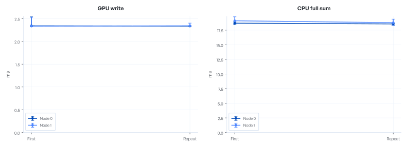

Figure 06-07 | Managed-memory access order | CPU initialization, two GPU writes, then two full CPU sums within the same allocation per round. CPU sums include reduction work and are not pure migration latency.

| Node | Observation | Result | Conditions |
| --- | --- | --- | --- |
| 0 | Highest scalar-FP32 condition median | **29529.7 GFLOP/s** | **512** threads, **8**×SM blocks, **8** chains; **5 rounds** |
| 0 | CPU-contention retention range | **67.49–100.55%** | Condition-median ratios across 8 conditions; see figure for ranges |
| 0 | Matched-work multi-stream ratio range | **0.95–1.25**× | Condition-median ratios across 4 conditions; see figure for ranges |
| 1 | Highest scalar-FP32 condition median | **29341.2 GFLOP/s** | **512** threads, **8**×SM blocks, **8** chains; **5 rounds** |
| 1 | CPU-contention retention range | **67.82–100.00%** | Condition-median ratios across 8 conditions; see figure for ranges |
| 1 | Matched-work multi-stream ratio range | **0.95–1.24**× | Condition-median ratios across 4 conditions; see figure for ranges |


NVFP4 uses exactly representable E2M1 operands with explicit block maxima and unity scales, validating packed values before GEMM. This isolates arithmetic error and does not represent production weight quantization or MoE kernel performance. Quantization/packing and sparse compression times are saved separately, as are diagnostic traces and unprofiled timing. Hardware counters are reported separately for the representative kernels below. Physical DRAM-byte fields are unavailable and are not replaced with zeros.

[Per-record data, condition summaries and guard states](../../2026-10-14_17-dual-spark/data/hardware/summary.json) · [Valid timing CSV](../../2026-10-14_17-dual-spark/data/hardware/measurements.csv). Memory-guard skips with resident models do not establish unsupported hardware. Resident and unloaded results are separate conditions; rounds are not pooled and differences are not attributed to one hardware mechanism.

<!--REVIEW_NODE_PARITY-->

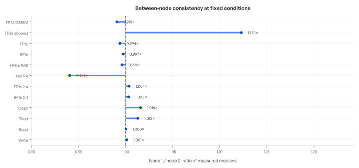

Figure 06-08 | Node consistency | Node 1 median / node 0 median for fixed 8192³ matrices and 8 GiB access. Ratios describe these two tested devices, not population variability.

### Additional FP64 matrix measurements

After unloading the model, CUDA double-precision GEMM counts a multiply-add as two operations. Inputs are exactly representable signed binary fractions. Nine entries spanning rows/columns are checked against a CPU double-precision reference every round; only validated rounds enter the table.

| Node | M=N=K | n | TFLOP/s median [range] |
| --- | --- | --- | --- |
| 0 | **1024** | **5** | **0.4130** [0.4107–0.4157] |
| 0 | **4096** | **5** | **0.4254** [0.4246–0.4254] |
| 0 | **8192** | **5** | **0.4280** [0.4280–0.4281] |
| 1 | **1024** | **5** | **0.4086** [0.4048–0.4097] |
| 1 | **4096** | **5** | **0.4246** [0.4246–0.4250] |
| 1 | **8192** | **5** | **0.4276** [0.4276–0.4277] |


<!--GAP_FP64-->

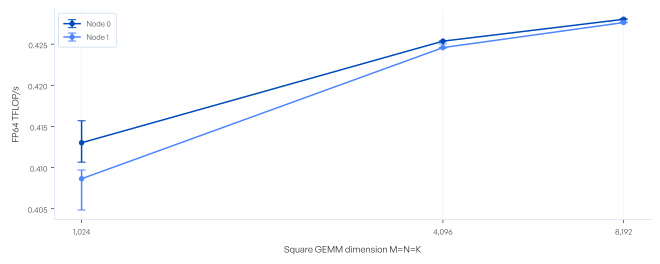

FP64 size effects | Points are five-round medians, with observed ranges; these do not predict low-precision model throughput.

### Hardware counters for representative kernels

| Node / kernel | Metric | n | Median [range] | Unit |
| --- | --- | --- | --- | --- |
| 0 / fma | Profiled kernel duration | **3** | **936896.000** [936672.000–937504.000] | ns |
| 0 / fma | L2 sector hit percentage | **3** | **15.690** [7.020–17.090] | % |
| 0 / fma | SM throughput percentage of peak | **3** | **99.030** [99.020–99.040] | % |
| 0 / fma | Active warp percentage | **3** | **46.340** [46.340–46.350] | % |
| 0 / triad | Profiled kernel duration | **3** | **3831552.000** [3800544.000–3865088.000] | ns |
| 0 / triad | L2 sector hit percentage | **3** | **0.010** [0.010–0.020] | % |
| 0 / triad | SM throughput percentage of peak | **3** | **2.740** [2.690–2.740] | % |
| 0 / triad | Active warp percentage | **3** | **88.920** [88.470–92.660] | % |
| 1 / fma | Profiled kernel duration | **3** | **938752.000** [937888.000–939232.000] | ns |
| 1 / fma | L2 sector hit percentage | **3** | **18.230** [18.000–45.320] | % |
| 1 / fma | SM throughput percentage of peak | **3** | **99.030** [99.020–99.040] | % |
| 1 / fma | Active warp percentage | **3** | **46.340** [46.340–46.350] | % |
| 1 / triad | Profiled kernel duration | **3** | **3999008.000** [3891552.000–4325664.000] | ns |
| 1 / triad | L2 sector hit percentage | **3** | **0.020** [0.010–0.070] | % |
| 1 / triad | SM throughput percentage of peak | **3** | **2.590** [2.390–2.650] | % |
| 1 / triad | Active warp percentage | **3** | **87.300** [84.800–90.130] | % |


The compute kernel uses eight independent FMA chains per thread and four blocks per SM; the memory kernel uses a **768 MiB** three-array working set. Administrative Nsight Compute captures one selected kernel without changing global driver permissions, clocks or cache control. Counters describe these kernels, not average model cache behavior. The current interface advertises no physical DRAM-byte metric, so a model Roofline requiring that count remains unsupported.

<a id="section-07"></a>

## 07 · Two-node communication and cooperation

### Device data exchange: port, RDMA and collectives

One GPU communication process (rank) runs per node over ConnectX-7/RoCE. The active physical port specifies **200 Gb/s**=**25 GB/s** in one direction; two logical interfaces share it. RDMA measurements use host buffers; NCCL measurements use GPU collectives, each with its own work definition. Functionally aligned H200 interconnect references are consolidated in section 10.

| Transfer / operation | Message size | Rounds | Median rate | Measurement conditions |
| --- | --- | --- | --- | --- |
| RDMA Write / roceP2p1s0f1 | **8 MiB** | **3** | **13.629 GB/s** (**109.03 Gb/s**) | 2026-10-14; host-memory buffers, one logical path |
| RDMA Write / rocep1s0f1 | **8 MiB** | **3** | **13.617 GB/s** (**108.94 Gb/s**) | 2026-10-14; host-memory buffers, one logical path |
| all_gather | **1 GiB** | **10** | **19.930 GB/s** | 2026-10-16; two GPU ranks, bus metric |
| all_reduce | **1 GiB** | **10** | **21.815 GB/s** | 2026-10-16; two GPU ranks, bus metric |
| reduce_scatter | **1 GiB** | **10** | **20.946 GB/s** | 2026-10-16; two GPU ranks, bus metric |


RDMA Write uses ib_write_bw, one QP and one-way **8 MiB** messages, with three repeats per logical path. Its --report_gbits output is divided by eight for GB/s. This separate historical host-buffer test neither substitutes for nor adds to GPU collectives. Current NCCL logs confirm RoCE through NET/IB and explicitly report GPU Direct RDMA Disabled; a GPU-direct RDMA path is not claimed.

<!--HARDWARE_H200_NETWORK-->

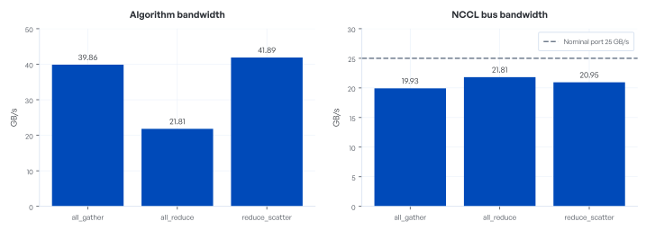

1 GiB collectives | Algorithm bandwidth counts the defined full input/output tensor. NCCL bus factors for two ranks are 1 for AllReduce and 1/2 for AllGather/ReduceScatter. Algorithm GB/s may exceed 25 without exceeding a 200 Gb/s physical link. Bus bandwidth is not a NIC hardware-counter reading; the dashed line is only a nominal line-rate reference.

First RDMA path · Second RDMA path · [Fixed conditions and provenance](../../2026-10-14_17-dual-spark/data/h200-comparison.json) · [Official-source snapshot index](../../2026-10-14_17-dual-spark/protocols/h200-sources.json).This segment has 840 archived valid two-rank paired trials. Each rank pair is one observation using the slower rank. Algorithm bandwidth is defined message bytes divided by time; bus bandwidth uses NCCL's correction, never summing ranks. Message size is full input for AllReduce/ReduceScatter and full output for AllGather. The original 434 trials are retained separately.

<!--HARDWARE_UNLOADED_COLLECTIVE-->

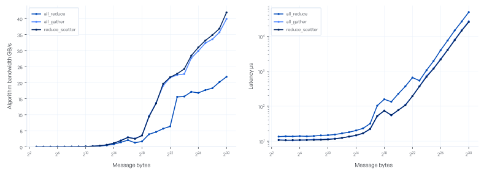

Figure 07-01 | Collective size curves | Algorithm bandwidth and latency are shown separately for three operations; both nodes must pass memory admission.

| Operation | Message bytes | Paired rounds | Median latency μs | Algorithm GB/s | Bus GB/s |
| --- | --- | --- | --- | --- | --- |
| all_gather | **8** | **10** | **10.89** | **0.001** | **0.000** |
| all_gather | **8,192** | **10** | **13.46** | **0.608** | **0.304** |
| all_gather | **8,388,608** | **10** | **374.38** | **22.408** | **11.204** |
| all_gather | **67,108,864** | **10** | **2245.77** | **29.882** | **14.941** |
| all_gather | **1,073,741,824** | **10** | **26937.75** | **39.860** | **19.930** |
| all_reduce | **8** | **10** | **13.49** | **0.001** | **0.001** |
| all_reduce | **8,192** | **10** | **18.02** | **0.454** | **0.454** |
| all_reduce | **8,388,608** | **10** | **539.32** | **15.555** | **15.555** |
| all_reduce | **67,108,864** | **10** | **3993.42** | **16.805** | **16.805** |
| all_reduce | **1,073,741,824** | **10** | **49220.55** | **21.815** | **21.815** |
| reduce_scatter | **8** | **10** | **10.74** | **0.001** | **0.000** |
| reduce_scatter | **8,192** | **10** | **13.51** | **0.606** | **0.303** |
| reduce_scatter | **8,388,608** | **10** | **368.19** | **22.784** | **11.392** |
| reduce_scatter | **67,108,864** | **10** | **2165.91** | **30.984** | **15.492** |
| reduce_scatter | **1,073,741,824** | **10** | **25631.79** | **41.891** | **20.946** |


### Controlled compute/communication overlap

Hold one BF16 GEMM and one AllReduce fixed, measuring compute-only, communication-only, serial combination and two-stream overlap. Work is matched for each message/matrix pair. Serial/overlapped time above one means this synthetic combination finishes sooner; below one means overlap is slower. It is not a two-node model speedup.

| Message bytes | Square size | Paired rounds | Serial / overlap | Observed range |
| --- | --- | --- | --- | --- |
| 8,192 | **2048** | **5** | **1.059** | **1.001–1.113** |
| 8,192 | **4096** | **5** | **1.020** | **1.011–1.029** |
| 8,388,608 | **2048** | **5** | **1.168** | **1.093–1.193** |
| 8,388,608 | **4096** | **5** | **1.035** | **1.020–1.094** |
| 67,108,864 | **2048** | **5** | **1.023** | **1.016–1.027** |
| 67,108,864 | **4096** | **5** | **1.096** | **1.071–1.122** |


<!--HARDWARE_UNLOADED_OVERLAP-->

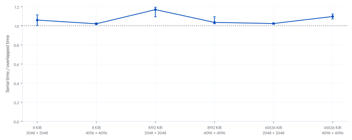

Figure 07-02 | Overlap benefit | Median within-round four-arm ratios with observed ranges; above one indicates shorter time for this workload.

[Current statistics and sources](../../2026-10-14_17-dual-spark/data/hardware/summary.json) · [NCCL bandwidth definitions](https://github.com/NVIDIA/nccl-tests/blob/master/doc/PERFORMANCE.md). Transport is verified from this segment’s NCCL logs; interface names alone do not establish a GPU Direct path.

<a id="section-08"></a>

## 08 · From engine stages to serving performance

Service, hardware and engine observations from October 14–17 retain their own dates and denominators. Results labeled 2026-10-19 are independent measurements; they do not rewrite historical success rates or pool with earlier capacity estimates.


This section first defines and measures engine stages, then examines public-endpoint experience and input/cache effects. Prefill processes input; decode generates output. Workloads and timing boundaries differ, so results inform interpretation without subtracting times across experiments.

### Independent engine prefill and decode experiment

This experiment calls the native SGLang endpoint on the inference host, excluding the public network, Cloudflare and the Infron gateway from its timing path. Weights and two-node tensor parallelism are unchanged, with MTP enabled. Concurrency is capped at eight; direct-origin calls are outside Infron API billing. These observations are not pooled with public-endpoint requests.

| Experiment | Work and repeats | Measurement scope |
| --- | --- | --- |
| Prefill | **1K**/**8K**/**32K**/**64K**/**128K**/**250,000** inputs, one output; C=**1** with C=**4/8** at shorter inputs; three rounds per condition | Scheduler prefill start-to-finish; includes chunk scheduling gaps, not pure GPU time |
| Decode | **1K**/**8K**/**32K** inputs × C=**1/2/4/8**, plus **64K**/**128K** at C=**1**; fixed **256** outputs; three rounds | Output rate from API-process first token to completion, MTP acceptance length and verify count |
| Prefix reuse control | **8K**/**32K**, three initial/immediate-repeat pairs each, one output | Validate actual cached tokens; does not measure retention |
| GPU timelines | **8K** input, **128** output, C=**1**; both ranks capture prefill and four decode scheduler steps | GPU activity intervals, NCCL-named kernels and MTP draft/verify stages; profiled data stay separate from normal rate estimates |


The manifest contains 78 blocks and 231 formal requests, plus two pilot/profile requests. Combinations exceeding concurrency × (input + output) = 262,144 are excluded. Seeded synthetic order records are tokenized with the installed model tokenizer to exact token-ID lengths, bypassing chat templates. Temperature is zero and EOS is ignored to fix output length. This controlled engine workload does not represent natural-chat length or MTP acceptance. Conditions are shuffled within each round; requests use distinct early prefixes, with hits verified from returned fields.

#### Timing definitions and validation

| Metric | Definition and scope |
| --- | --- |
| Scheduler prefill duration | prefill_finished_time − forward_entry_time within the scheduler process; includes chunk gaps and excludes the initial admission queue. |
| Prefill processing rate | Σ(input − cached tokens) / (last prefill finish − first prefill start) in the same block; overlapping request durations are not summed. |
| Per-request decode rate | (actual output − 1) / (engine E2E − engine TTFT), cross-checked against native decode_throughput; includes scheduling, result delivery and MTP execution. |
| Concurrent decode-window throughput | Σ(actual output − 1) / (last finish − first token), timed in one API process; staggered prefill admission can remain within this window. |
| MTP acceptance length and rate | Installed acceptance length = completed output tokens / verify count; acceptance rate = correct drafts / proposed drafts. Their denominators differ; acceptance length is neither a speedup nor an actual per-captured-step output count. |
| GPU activity decomposition | Union kernel/copy intervals separately per rank, then split NCCL-only, other-only and overlap. Nested annotations and cross-rank durations are not added. |


Scheduler and API-process absolute timestamp conversions have different offsets; intervals are computed only within one process clock domain. Three-block medians and observed min/max ranges describe repeatability, without tail-percentile or confidence-interval claims. Retracted requests require separate analysis and are excluded from this timing decomposition.

#### Independent rate measurements

The archive contains 78 analyzable blocks and 231 formal requests; 0 failed timing validation.

<!--ENGINE_INTERNAL_RATES-->

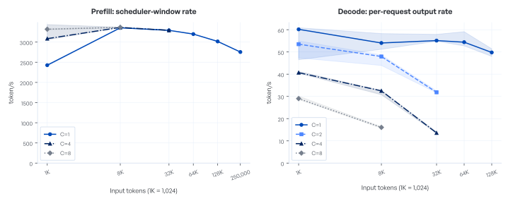

Figure 08-01 | Engine-stage rates | Left: scheduler prefill-window rate. Right: per-request decode rate. Shading is the observed block range, not a confidence interval.

| Input tokens | Concurrency | Blocks / requests | Median prefill s | Window rate tokens/s | Cached tokens |
| --- | --- | --- | --- | --- | --- |
| 1,024 | **1** | **3 / 3** | **0.422** | **2,427.4** | **0** |
| 1,024 | **4** | **3 / 12** | **0.915** | **3,084.9** | **0** |
| 1,024 | **8** | **3 / 24** | **2.059** | **3,318.9** | **0** |
| 8,192 | **1** | **3 / 3** | **2.442** | **3,354.2** | **0** |
| 8,192 | **4** | **3 / 12** | **4.837** | **3,363.7** | **0** |
| 8,192 | **8** | **3 / 24** | **4.861** | **3,366.1** | **0** |
| 32,768 | **1** | **3 / 3** | **9.957** | **3,290.8** | **0** |
| 32,768 | **4** | **3 / 12** | **12.351** | **3,291.9** | **0** |
| 65,536 | **1** | **3 / 3** | **20.491** | **3,198.3** | **0** |
| 131,072 | **1** | **3 / 3** | **43.462** | **3,015.8** | **0** |
| 250,000 | **1** | **3 / 3** | **90.787** | **2,753.7** | **0** |


| Input tokens | Concurrency | Blocks / requests | Per request tokens/s | Concurrent window tokens/s | Median MTP acceptance length |
| --- | --- | --- | --- | --- | --- |
| 1,024 | **1** | **3 / 3** | **60.2** | **60.2** | **3.71** |
| 1,024 | **2** | **3 / 6** | **53.5** | **107.0** | **3.74** |
| 1,024 | **4** | **3 / 12** | **40.7** | **144.9** | **3.61** |
| 1,024 | **8** | **3 / 24** | **29.0** | **206.6** | **3.58** |
| 8,192 | **1** | **3 / 3** | **54.0** | **54.0** | **3.32** |
| 8,192 | **2** | **3 / 6** | **48.0** | **93.2** | **3.44** |
| 8,192 | **4** | **3 / 12** | **32.5** | **86.2** | **3.46** |
| 8,192 | **8** | **3 / 24** | **16.1** | **81.1** | **3.37** |
| 32,768 | **1** | **3 / 3** | **55.1** | **55.1** | **3.41** |
| 32,768 | **2** | **3 / 6** | **31.9** | **38.0** | **3.18** |
| 32,768 | **4** | **3 / 12** | **13.6** | **29.0** | **3.37** |
| 65,536 | **1** | **3 / 3** | **54.4** | **54.4** | **3.41** |
| 131,072 | **1** | **3 / 3** | **49.8** | **49.8** | **3.12** |


Across measured C=1 input lengths, median per-request decode rates range from 49.8 to **60.2 tokens**/s. This range applies to synthetic records and fixed output; it does not substitute for public-endpoint capacity or arbitrary business generation rates.


<!--REVIEW_DECODE_GRID-->

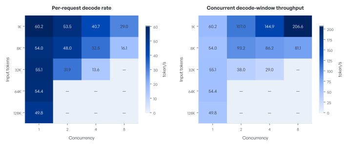

Figure 08-02 | Decode length × concurrency | Each cell summarizes three blocks; gray cells are unmeasured and panels use independent scales. Output is fixed at 256 tokens; more concurrency need not increase aggregate throughput at longer inputs.

#### Immediate prefix-reuse prefill control

| Input | Pairs | Repeated-input cached-token fraction | Initial / repeated median prefill s | Median paired duration ratio |
| --- | --- | --- | --- | --- |
| 8,192 | **3** | **0.00%** | **2.4343 / 2.4507** | **0.99** |
| 32,768 | **3** | **75.00%** | **9.9719 / 2.5517** | **3.91** |


Cache fraction uses total actual repeated-input tokens as its denominator; duration ratios are calculated per pair before taking the median. Fixed initial-then-repeat order retains order effects. Three immediate repeats do not establish long-term cache stability, and their ratios are not model compute speedups.

Reported cached-token fractions were **0%** for immediate **8K** repeats and **75%** for **32K** repeats. Identical input does not guarantee full reuse. These observations apply to the tested lengths, one-token output and current cache state; they do not establish universal cache rules or retention.

#### GPU-stage and communication activity

<!--ENGINE_GPU_TIMELINE-->

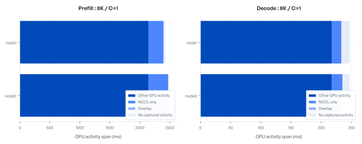

Figure 08-03 | Per-rank GPU activity | Each bar covers its own captured GPU activity span. Profiling adds overhead and explains paths only; other activity may include communication without NCCL kernel names.

| Rank / stage | Activity span ms | Busy union ms | NCCL-only ms | Overlap ms |
| --- | --- | --- | --- | --- |
| node0 / decode | **247.07** | **235.38** | **17.68** | **0.05** |
| node0 / prefill | **2,489.51** | **2,472.72** | **325.91** | **0.02** |
| node1 / decode | **247.42** | **233.38** | **15.80** | **0.03** |
| node1 / prefill | **2,423.98** | **2,395.04** | **246.97** | **0.00** |


| Rank / capture stage | Internal phase | Matched executions | Mean GPU-correlated span ms |
| --- | --- | --- | --- |
| node0 / decode | MTP draft | **4** | **10.575** |
| node0 / decode | Target-model verify | **4** | **44.100** |
| node0 / decode | Draft-state extension | **4** | **6.150** |
| node0 / prefill | Target-model prefill | **1** | **2,401.288** |
| node0 / prefill | Draft-state extension | **1** | **87.003** |
| node1 / decode | MTP draft | **4** | **10.692** |
| node1 / decode | Target-model verify | **4** | **44.079** |
| node1 / decode | Draft-state extension | **4** | **6.159** |
| node1 / prefill | Target-model prefill | **1** | **2,332.348** |
| node1 / prefill | Draft-state extension | **1** | **87.009** |


<!--ENGINE_MTP_STAGES-->

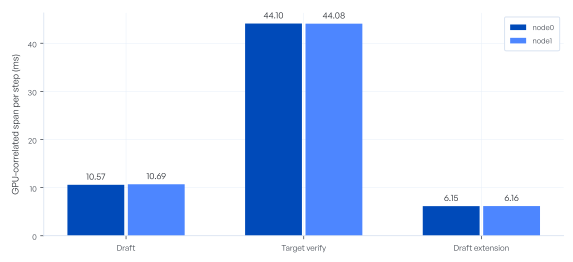

Figure 08-04 | MTP phase decomposition | Four captured decode steps per rank; bars show mean GPU-correlated spans, which cannot be added as end-to-end latency.

Phase ranges match CPU and GPU annotations by External id. CUDA Graphs annotate one verify execution on multiple virtual streams, so intervals are merged per execution before calculating its span. Spans include device waits and communication and differ from busy-kernel time; draft, verify and extension spans cannot be added without overlap checks. Accepted-token counts for each captured step are unavailable, so device decode tokens/s is not fabricated by multiplying step count by a fixed MTP length.

Both ranks captured prefill/decode GPU kernels and MTP draft, verify and draft-extension annotations. GPU work and communication overlap, so summing operator or NCCL durations double-counts time. The initial trace covers **8K** at concurrency 1; additional input/concurrency conditions and paired overhead are reported below. NCCL activity is not equivalent to removable communication wait.

[Per-request metrics](../../2026-10-14_17-dual-spark/data/engine/requests.csv) · [Per-block metrics](../../2026-10-14_17-dual-spark/data/engine/blocks.csv) · Source and raw timelines

Implementation references: [SGLang profiling](https://github.com/sgl-project/sglang/blob/main/docs/docs/developer_guide/benchmark_and_profiling.mdx) · [SGLang observability](https://docs.sglang.ai/advanced_features/observability.html) · Installed timing source; online documentation informs methodology, while saved installed source determines field semantics.

### Public concurrency: throughput and waiting


| Concurrency | Blocks / requests | Generated tokens/s | Visible TTFT median / p95 s | Completion p95 s |
| --- | --- | --- | --- | --- |
| 1 | **2 / 120** | **45.1** | **1.01 / 1.65** | **19.46** |
| 2 | **3 / 180** | **78.7** | **1.07 / 1.78** | **24.87** |
| 4 | **1 / 60** | **120.2** | **1.11 / 1.79** | **30.53** |
| 8 | **3 / 180** | **158.9** | **1.17 / 2.39** | **46.93** |


<!--CAPACITY-->


Figure 08-05 | Concurrency comparison | Same-cohort throughput and visible-content latency; consider the waiting cost of additional concurrency.

For this short-prompt bank, concurrency eight gives **158.9 tokens/s** with mean output 400.8 tokens. Use workload-matched results for long-document capacity planning.

### Length: input processing and generation

The heatmaps separate input length, output budget and concurrency. Each cell includes uninterrupted complete blocks only. Darker means a larger value; grey means no eligible block. The output budget is a ceiling, not a forced generation length. Both figures use the same population and show first-content waiting and aggregate generation respectively.

<!--LENGTH_WAIT-->

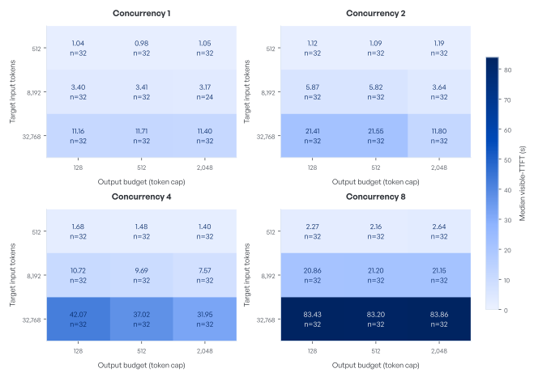

Figure 08-06 | Input/output lengths and visible waiting | Each cell shows median visible-TTFT and response count n. All four concurrency panels share one scale. This latency is not pure GPU prefill time.

<!--LENGTH_THROUGHPUT-->

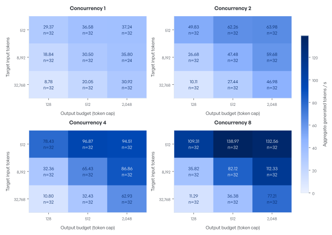

Figure 08-07 | Input/output lengths and throughput | Actual generated tokens divided by total complete-block duration. Early stopping changes realized work. A higher output budget is not necessarily more useful business output.

### Comparable slice at a fixed output budget

The table fixes the output budget at **512 tokens** while varying input length and concurrency. Realized input includes the chat template; mean realized output reveals differences in generation work.

| Input target / concurrency | Blocks / responses | Mean input / output | Visible-TTFT median s | E2E median s | Aggregate tokens/s |
| --- | --- | --- | --- | --- | --- |
| 512 / 1 | **4 / 32** | **513 / 512.0** | **0.98** | **13.97** | **36.6** |
| 512 / 2 | **4 / 32** | **513 / 512.0** | **1.09** | **16.12** | **62.3** |
| 512 / 4 | **4 / 32** | **513 / 512.0** | **1.48** | **20.53** | **96.9** |
| 512 / 8 | **4 / 32** | **513 / 512.0** | **2.16** | **28.51** | **139.0** |
| 8,192 / 1 | **4 / 32** | **8,193 / 512.0** | **3.41** | **16.78** | **30.5** |
| 8,192 / 2 | **4 / 32** | **8,193 / 512.0** | **5.82** | **21.24** | **47.5** |
| 8,192 / 4 | **4 / 32** | **8,193 / 512.0** | **9.69** | **30.69** | **65.4** |
| 8,192 / 8 | **4 / 32** | **8,193 / 512.0** | **21.20** | **48.44** | **82.1** |
| 32,768 / 1 | **4 / 32** | **32,769 / 512.0** | **11.71** | **24.89** | **20.0** |
| 32,768 / 2 | **4 / 32** | **32,769 / 512.0** | **21.55** | **37.09** | **27.4** |
| 32,768 / 4 | **4 / 32** | **32,769 / 512.0** | **37.02** | **62.01** | **32.4** |
| 32,768 / 8 | **4 / 32** | **32,769 / 512.0** | **83.20** | **111.55** | **36.4** |


**Length effect.** At concurrency one and output cap 512, increasing the input target from 512 to **32,768 tokens** changes median visible-TTFT from 0.98 to **11.71 s** and aggregate output from 36.6 to **20.0 tokens**/s. This is end-to-end length sensitivity under the observed prefix state and serving path.

[Reproducible data for all length conditions](../../2026-10-14_17-dual-spark/data/service/length-metrics.csv)

| Context or prefix condition | Complete / failed | First-generated median s |
| --- | --- | --- |
| Long context and boundaries · Context boundary probe | **0 / 1** | — |
| Long context and boundaries · Target input 131,072 tokens · Concurrency 1 · Generation after long input | **3 / 0** | **48.34** |
| Long context and boundaries · Target input 131,072 tokens · Concurrency 2 · Generation after long input | **3 / 0** | **90.65** |
| Long context and boundaries · Target input 16,384 tokens · Concurrency 1 · Generation after long input | **3 / 0** | **6.77** |
| Long context and boundaries · Target input 16,384 tokens · Concurrency 2 · Generation after long input | **3 / 0** | **11.28** |
| Long context and boundaries · Target input 200,000 tokens · Concurrency 1 · Generation after long input | **3 / 0** | **74.05** |
| Long context and boundaries · Target input 250,000 tokens · Concurrency 1 · Generation after long input | **3 / 0** | **94.08** |
| Long context and boundaries · Target input 32,768 tokens · Concurrency 1 · Generation after long input | **3 / 0** | **12.55** |
| Long context and boundaries · Target input 32,768 tokens · Concurrency 2 · Generation after long input | **3 / 0** | **22.01** |
| Long context and boundaries · Target input 4,096 tokens · Concurrency 1 · Generation after long input | **3 / 0** | **2.54** |
| Long context and boundaries · Target input 4,096 tokens · Concurrency 2 · Generation after long input | **3 / 0** | **2.41** |
| Long context and boundaries · Target input 65,536 tokens · Concurrency 1 · Generation after long input | **3 / 0** | **24.49** |
| Long context and boundaries · Target input 65,536 tokens · Concurrency 2 · Generation after long input | **3 / 2** | **42.67** |
| Prefix caching · History text 0 tokens · First prefix | **10 / 0** | **1.07** |
| Prefix caching · History text 0 tokens · Repeated prefix | **10 / 0** | **0.96** |
| Prefix caching · History text 0 tokens · Appended text | **10 / 0** | **1.06** |
| Prefix caching · History text 32,768 tokens · First prefix | **10 / 0** | **11.69** |
| Prefix caching · History text 32,768 tokens · Repeated prefix | **10 / 0** | **1.55** |
| Prefix caching · History text 32,768 tokens · Appended text | **10 / 0** | **1.61** |
| Prefix caching · History text 8,192 tokens · First prefix | **10 / 0** | **3.61** |
| Prefix caching · History text 8,192 tokens · Repeated prefix | **10 / 0** | **1.08** |
| Prefix caching · History text 8,192 tokens · Appended text | **10 / 0** | **1.17** |


### Reasoning budget: visible waiting and output shape

Compare low versus none for the same prompt, round and concurrency; differences are low minus none. Performance analysis retains missing visible content and output-limit events.

<!--REASONING-->

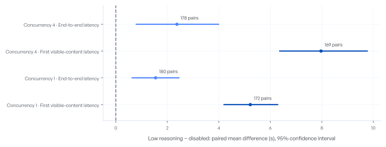

Figure 08-08 | Paired reasoning delay | Points are mean differences; lines are 95% prompt-cluster intervals. Pair counts and round sensitivity are in Appendix B.

<!--GENERATION_SHAPE-->

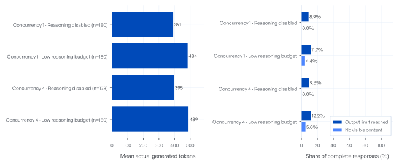

Figure 08-09 | Output shape | Read generated volume with output-limit and no-visible-content fractions; the latter two can overlap.

### Business shapes and cache ratios: observed coverage

At this snapshot, business-shape and cache-ratio tests have 347 / 352 planned calls completed, including 260 / 264 complete measured responses.


| Shape / concurrency | Complete | Median output | Median realized I/O | Median visible TTFT s | Median E2E s |
| --- | --- | --- | --- | --- | --- |
| Long-document analysis / 1 | **12** | **2,048.0** | **16.0** | **11.92** | **49.73** |
| Long-document analysis / 4 | **12** | **2,048.0** | **16.0** | **42.59** | **101.32** |
| Code editing / 1 | **12** | **512.0** | **16.0** | **3.64** | **11.54** |
| Code editing / 4 | **12** | **512.0** | **16.0** | **11.73** | **22.86** |
| Multi-turn assistant / 1 | **12** | **499.5** | **16.4** | **3.49** | **13.26** |
| Multi-turn assistant / 4 | **12** | **505.0** | **16.2** | **11.63** | **26.16** |
| Short brief, long draft / 1 | **12** | **1,599.5** | **0.3** | **1.10** | **35.31** |
| Short brief, long draft / 4 | **8** | **1,566.5** | **0.3** | **2.04** | **51.05** |
| Structured extraction / 1 | **12** | **43.0** | **47.7** | **1.49** | **2.15** |
| Structured extraction / 4 | **12** | **43.0** | **47.7** | **3.80** | **4.61** |
| Balanced rewriting / 1 | **12** | **510.0** | **4.0** | **1.52** | **13.50** |
| Balanced rewriting / 4 | **12** | **486.0** | **4.2** | **3.83** | **20.04** |
| Long-document summary / 1 | **12** | **128.0** | **256.0** | **11.59** | **14.60** |
| Long-document summary / 4 | **12** | **128.0** | **256.0** | **42.35** | **46.74** |
| Ticket triage / 1 | **12** | **25.0** | **20.6** | **1.10** | **1.73** |
| Ticket triage / 4 | **12** | **25.0** | **20.5** | **2.03** | **2.80** |


| Shape / concurrency | Complete continuous-block token/s | Median estimated TPOT ms | Length-limited / complete |
| --- | --- | --- | --- |
| Long-document analysis / 1 | **36.1** | **21.88** | **7/12** |
| Long-document analysis / 4 | **73.1** | **28.85** | **7/12** |
| Code editing / 1 | **38.8** | **16.13** | **8/12** |
| Code editing / 4 | **74.9** | **22.54** | **9/12** |
| Multi-turn assistant / 1 | **31.4** | **23.95** | **6/12** |
| Multi-turn assistant / 4 | **63.5** | **32.48** | **6/12** |
| Short brief, long draft / 1 | **44.9** | **21.50** | **1/12** |
| Short brief, long draft / 4 | **117.9** | **31.08** | **0/8** |
| Structured extraction / 1 | **19.0** | **15.04** | **0/12** |
| Structured extraction / 4 | **36.8** | **19.41** | **0/12** |
| Balanced rewriting / 1 | **45.0** | **22.44** | **0/12** |
| Balanced rewriting / 4 | **98.8** | **32.49** | **0/12** |
| Long-document summary / 1 | **8.6** | **22.77** | **12/12** |
| Long-document summary / 4 | **10.9** | **35.22** | **12/12** |
| Ticket triage / 1 | **13.5** | **25.98** | **0/12** |
| Ticket triage / 4 | **34.2** | **32.41** | **0/12** |


| Input / target overlap | Complete | Realized overlap % | Cache-field coverage | Reported cached % | Median visible TTFT s |
| --- | --- | --- | --- | --- | --- |
| 32,768 / 0% | **6** | **0.0** | **0/6** | — | **12.44** |
| 32,768 / 100% | **6** | **100.0** | **0/6** | — | **1.91** |
| 32,768 / 25% | **6** | **25.0** | **0/6** | — | **11.79** |
| 32,768 / 50% | **6** | **50.0** | **0/6** | — | **9.18** |
| 32,768 / 75% | **6** | **75.0** | **0/6** | — | **6.77** |
| 32,768 / 90% | **6** | **90.0** | **0/6** | — | **4.56** |
| 8,192 / 0% | **6** | **0.1** | **0/6** | — | **3.50** |
| 8,192 / 100% | **6** | **100.0** | **0/6** | — | **1.14** |
| 8,192 / 25% | **6** | **24.9** | **0/6** | — | **3.60** |
| 8,192 / 50% | **6** | **49.9** | **0/6** | — | **3.47** |
| 8,192 / 75% | **6** | **74.9** | **0/6** | — | **3.46** |
| 8,192 / 90% | **6** | **89.9** | **0/6** | — | **3.55** |


Interpret in order: verify realized lengths and truncation → align concurrency and sample composition → inspect waiting and generation → check cache-field coverage → examine contemporaneous resources. Without complete blocks, valid cache fields or matching inputs, describe observations and retain alternative explanations.

### Context boundaries and request reuse

One-token output probes observe input-processing waits; long and oversized contexts check the usable range; first, repeated and appended prompts check request reuse. Appendix B gives actual lengths, latency and outcomes. A configured limit is not a validated usable capacity.

### Cache reuse and stability

A prefix cache retains intermediate states for processed input so later matching prefixes may reduce input computation. Reuse depends on prefix equality, residency and scheduling. Cache occupancy describes storage state; it is not a hit fraction.

#### Cache diagnostics: scope and samples

The existing 144-call, two-length/six-overlap design is retained. The following 160 diagnostics are added. Arrows denote target input → output cap; temperature is zero and reasoning is disabled, with identical generation settings within each reuse pair.

| Calls | Test | Conditions and meaning |
| --- | --- | --- |
| 72 | Business × reuse × concurrency | Triage 512→64, dialogue 8,192→512, summary 32,768→128; concurrency 1/4; four independent prefixes per condition, each with seed, 50% overlap and exact repeat. |
| 36 | Idle retention | **8,192/32,768** input × nominal waits **0/30/300 s** × three independent prefixes × seed/probe. Each prefix receives one terminal probe. |
| 24 | Competition and recovery | Three independent 8,192-token anchors: seed → baseline repeat → four distinct 32,768-token distractors → post-pressure repeat → recovery repeat. |
| 28 | Periodic-reuse stability | Four 8,192-token prefixes; four seeds, then six repeat rounds at concurrency four, spaced 120 s apart; planned span ten minutes. |
| 0 | Cache under sustained load | Reuse arrival and soak tests; approximately 60-second valid windows align cache fraction, TTFT and occupancy. No extra generation calls. |


The three crossed shapes represent short input, conversation and long documents. The other five retain their original performance measurements, without extrapolated cache findings. Concurrency arms use independent prefixes; **50%**/**100%** probe order alternates. A seed is a fresh-prefix reference, not proof of an empty engine cache. Actual idle time runs from seed completion to probe dispatch; zero denotes no intentional wait, with telemetry overhead retained. Timing deviations, retries, telemetry gaps and counter mismatches are flagged and excluded from cache attribution.

<!--CACHE_PROTOCOL-->

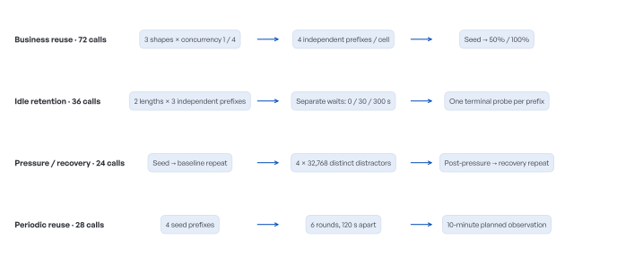

Figure 08-10 | Cache evaluation sequence | Reuse, idle retention, pressure/recovery and temporal behavior. Conditions are prospective.

#### Observed evidence and coverage

The supplement has completed **160/160 calls** with 85 attributable counter windows. Interpret business, actual idle gaps, pressure and periodic reuse separately; incomplete or invalid cells remain unresolved. Across 30 observed first/repeat pairs, 26 repeats have lower TTFT. This supports a waiting-time observation, not isolated causal cache benefit. Across 358 valid active node-counter windows, the token-weighted cached fraction is 20.3%. This describes the input mix in those windows, not per-request hits or long-term stability.

| Workload | Complete | Cache fields valid / missing |
| --- | --- | --- |
| Interface and measurement calibration | **12** | **0 / 12** |
| Natural workloads and concurrency scaling | **718** | **0 / 718** |
| Input/output length matrix | **1435** | **0 / 1435** |
| Paired reasoning budgets | **360** | **0 / 360** |
| Long context and boundaries | **36** | **0 / 36** |
| Prefix caching | **90** | **0 / 90** |
| Business shapes and cache-ratio amendment | **507** | **0 / 507** |
| Open arrivals and mixed workloads | **783** | **0 / 783** |
| Length expansion and sustained operation | **925** | **0 / 925** |


Paired waiting observations from existing first/exact-repeat sequences follow. First denotes first within the sequence, not guaranteed absence of prior cache state. Differences are calculated per pair before taking the median.

| History tokens | Pairs | Input median | First TTFT s | Repeat TTFT s | Paired reduction s | Repeat faster |
| --- | --- | --- | --- | --- | --- | --- |
| 0 | **10** | **107** | **1.07** | **0.96** | **0.08** | **6/10** |
| 8192 | **10** | **8,298** | **3.61** | **1.08** | **2.49** | **10/10** |
| 32768 | **10** | **32,875** | **11.69** | **1.55** | **10.04** | **10/10** |


Coverage counts cache fields in original upstream usage only. Zeros in gateway-normalized responses remain unverified until matched to upstream fields and are excluded from hit-fraction denominators.

The archived SGLang configuration has `enable_cache_report=false` while prefix caching is enabled. Missing per-request fields therefore do not establish a miss. SparkDash exposes cumulative prompt and cached-token counters; isolated diagnostic blocks use fresh boundary deltas reconciled with the same requests. API fields, node counters and their coverage remain separate. [SGLang v0.5.21](https://github.com/sgl-project/sglang/blob/v0.5.21/python/sglang/srt/entrypoints/openai/usage_processor.py) · [SparkDash counter implementation](https://github.com/MiaAI-Lab/sparkDash/blob/d94450b0da3e57c5998ced9dc971e0038ff896d4/server/collectors/LlmProbe.js)

<!--CACHE_EVIDENCE-->

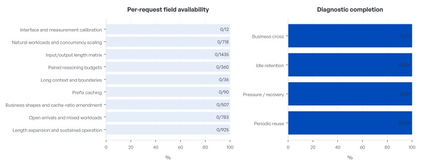

Figure 08-11 | Evidence coverage | Left: per-request cache-field availability. Right: completed diagnostic calls. Neither is a cache-hit rate.

| Condition | Conc. | n | TTFT median s | Paired reduction s | Valid windows / cache % |
| --- | --- | --- | --- | --- | --- |
| Business / triage / Seed | **4** | **4** | **2.48** | **0.00** | **1 / 0.0%** |
| Business / triage / 50% | **4** | **4** | **2.59** | **-0.09** | **1 / 0.0%** |
| Business / triage / 100% | **4** | **4** | **1.62** | **0.88** | **1 / 99.8%** |
| Business / dialogue / Seed | **1** | **4** | **3.44** | **0.00** | **1 / 0.0%** |
| Business / dialogue / 100% | **1** | **4** | **3.76** | **-0.16** | **1 / 0.0%** |
| Business / dialogue / 50% | **1** | **4** | **3.35** | **-0.06** | **1 / 0.0%** |
| Business / summary / Seed | **1** | **4** | **13.58** | **0.00** | **1 / 0.0%** |
| Business / summary / 50% | **1** | **4** | **9.72** | **3.83** | **1 / 25.0%** |
| Business / summary / 100% | **1** | **4** | **1.78** | **11.62** | **1 / 100.0%** |
| Business / triage / Seed | **1** | **4** | **1.19** | **0.00** | **1 / 0.0%** |
| Business / triage / 100% | **1** | **4** | **0.91** | **0.29** | **1 / 99.8%** |
| Business / triage / 50% | **1** | **4** | **1.17** | **0.08** | **1 / 0.0%** |
| Business / summary / Seed | **4** | **4** | **43.15** | **0.00** | **1 / 0.0%** |
| Business / summary / 50% | **4** | **4** | **25.90** | **17.25** | **1 / 43.5%** |
| Business / summary / 100% | **4** | **4** | **2.91** | **40.25** | **1 / 99.8%** |
| Business / dialogue / Seed | **4** | **4** | **11.22** | **0.00** | **1 / 0.0%** |
| Business / dialogue / 100% | **4** | **4** | **9.89** | **1.34** | **1 / 24.8%** |
| Business / dialogue / 50% | **4** | **4** | **12.10** | **-0.88** | **1 / 0.0%** |
| Idle / 32768 / Seed / 30 s | **1** | **3** | **13.63** | — | **3 / 0.0%** |
| Idle / 32768 / Probe / 30 s | **1** | **3** | **2.22** | **10.53** | **3 / 100.0%** |
| Idle / 32768 / Seed / 0 s | **1** | **3** | **13.26** | — | **3 / 0.0%** |
| Idle / 32768 / Probe / 0 s | **1** | **3** | **2.79** | **10.67** | **3 / 100.0%** |
| Idle / 32768 / Seed / 300 s | **1** | **3** | **12.89** | — | **3 / 0.0%** |
| Idle / 32768 / Probe / 300 s | **1** | **3** | **3.69** | **9.96** | **3 / 91.7%** |
| Idle / 8192 / Seed / 0 s | **1** | **3** | **4.75** | — | **3 / 0.0%** |
| Idle / 8192 / Probe / 0 s | **1** | **3** | **2.03** | **3.08** | **3 / 100.0%** |
| Idle / 8192 / Seed / 300 s | **1** | **3** | **4.84** | — | **3 / 0.0%** |
| Idle / 8192 / Probe / 300 s | **1** | **3** | **2.67** | **2.13** | **3 / 100.0%** |
| Idle / 8192 / Seed / 30 s | **1** | **3** | **4.39** | — | **3 / 0.0%** |
| Idle / 8192 / Probe / 30 s | **1** | **3** | **1.71** | **2.43** | **3 / 100.0%** |
| Pressure / 8192 / Seed | **1** | **3** | **4.33** | **0.00** | **3 / 0.0%** |
| Pressure / 8192 / Baseline | **1** | **3** | **1.76** | **2.50** | **3 / 100.0%** |
| Pressure / 8192 / Post-pressure | **1** | **3** | **1.70** | **2.63** | **3 / 100.0%** |
| Pressure / 8192 / Recovery | **1** | **3** | **1.76** | **2.52** | **3 / 100.0%** |
| Periodic / 8192 / Seed | **4** | **4** | **11.42** | — | **1 / 0.0%** |
| Periodic / 8192 / Probe / 1 | **4** | **4** | **2.02** | **9.38** | **1 / 100.0%** |
| Periodic / 8192 / Probe / 2 | **4** | **4** | **2.16** | **9.25** | **1 / 100.0%** |
| Periodic / 8192 / Probe / 3 | **4** | **4** | **2.18** | **9.26** | **1 / 100.0%** |
| Periodic / 8192 / Probe / 4 | **4** | **4** | **2.26** | **9.15** | **1 / 100.0%** |
| Periodic / 8192 / Probe / 5 | **4** | **4** | **2.39** | **9.03** | **1 / 100.0%** |
| Periodic / 8192 / Probe / 6 | **4** | **4** | **2.33** | **9.08** | **1 / 100.0%** |


#### Cache variation over time

358 valid windows contain prompt activity, with a token-weighted cache fraction of **20.29%** and a window range of **0.00%**–100.00%. Windows may contain different workloads; they describe temporal behavior rather than proving retention or stable hits. The sample SD across window fractions is 25.77 percentage points.

<!--CACHE_TIMELINE-->

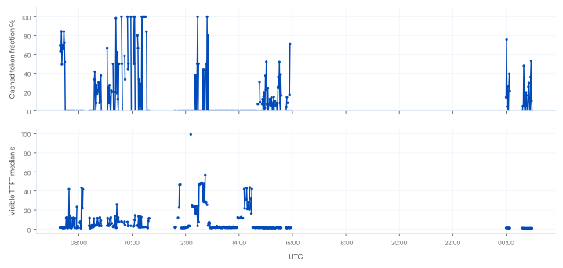

Figure 08-12 | Time observation | Counter-delta fractions in approximately 60-second windows with contemporaneous TTFT; workload changes prevent simple causal attribution.

#### Interpretation and further validation

Only matched-parameter, complete, retry-free blocks with reconciled counters receive block token-cache fractions; concurrent blocks do not yield per-request hit fractions. Idle prefixes are probed once to avoid refreshing retention. Pressure tests insert about 131,072 distractor input tokens, without claiming cache-capacity exhaustion. Periodic reuse spans ten planned minutes; sustained load uses actual observed duration. Further work should vary business popularity, independent periods and competition strength. Capacity and cost models receive no unverified cache benefit.

### October 14–17 length batches: coverage and realized generation

Length expansion: 290/299 complete, 205 outputs reached **98–100%** of cap. Maximum completed target-attaining output is **4,096 tokens**, limited to its input and probe conditions.

Public length expansion uses natural stopping as defined in section 03; requested caps and realized generation are reported together.

| Load | Complete / planned | Upstream counts | Actual output range | Median attainment | Output length attained |
| --- | --- | --- | --- | --- | --- |
| Output calibration | **2/2** | **2** | **2–2** | **0.2%** | **0** |
| Input axis | **24/24** | **24** | **1,024–1,024** | **100.0%** | **24** |
| Output axis | **9/13** | **9** | **1,826–4,955** | **100.0%** | **5** |
| Balanced lengths | **9/12** | **9** | **2,048–5,943** | **100.0%** | **6** |
| Near boundary | **1/2** | **1** | **1,024–1,024** | **100.0%** | **1** |
| Long prefixes | **36/36** | **36** | **1,024–1,024** | **100.0%** | **36** |
| Business anchors | **31/32** | **31** | **25–4,096** | **16.9%** | Natural EOS |
| Representative warmups | **10/10** | **10** | **1,024–4,096** | **100.0%** | **7** |
| Repeated blocks | **168/168** | **168** | **1,024–4,096** | **100.0%** | **124** |


<!--LENGTH_ATTAINMENT-->

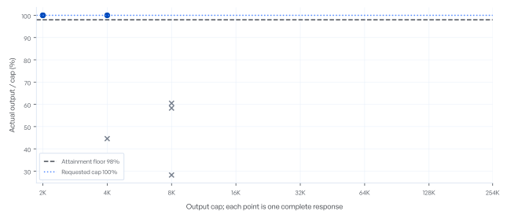

Figure 08-13 | Output attainment | Compare original upstream generation with requested caps; missing counts remain blank, not zero.

The following includes only complete requests with input error ≤**1%** and realized output at **98–100%** of cap. Values are medians; a one-sample cell is that observation, with no tail percentiles.

| Input → output cap | Eligible / complete | Actual output | Visible TTFT s | E2E s | Estimated TPOT ms |
| --- | --- | --- | --- | --- | --- |
| 1K → 1K | **3/3** | **1,024** | **1.20** | **25.14** | **23.2** |
| 2K → 1K | **3/3** | **1,024** | **1.45** | **23.38** | **21.5** |
| 4K → 1K | **3/3** | **1,024** | **2.12** | **25.90** | **23.2** |
| 8K → 1K | **3/3** | **1,024** | **3.60** | **25.49** | **21.6** |
| 16K → 1K | **3/3** | **1,024** | **5.91** | **26.80** | **20.0** |
| 32K → 1K | **3/3** | **1,024** | **12.00** | **33.21** | **20.8** |
| 64K → 1K | **3/3** | **1,024** | **23.33** | **45.91** | **21.8** |
| 128K → 1K | **3/3** | **1,024** | **46.47** | **68.05** | **21.1** |
| 1K → 2K | **3/3** | **2,048** | **1.30** | **47.45** | **22.6** |
| 1K → 4K | **2/3** | **4,096** | **1.20** | **88.58** | **21.3** |
| 2K → 2K | **3/3** | **2,048** | **1.46** | **45.56** | **21.4** |
| 4K → 4K | **3/3** | **4,096** | **2.08** | **88.44** | **21.1** |
| 254K → 1K | **1/1** | **1,024** | **99.27** | **121.45** | **21.7** |


6 repeat blocks currently qualify for capacity comparison; boundary probes are excluded from steady-capacity claims.

| Input → output / concurrency | Eligible blocks | Aggregate tokens/s | Block-rate range |
| --- | --- | --- | --- |
| 32K → 1K / 1 | **3** | **33.0** | **31.0–34.8** |
| 32K → 1K / 4 | **3** | **55.5** | **54.9–55.9** |


The **64K**/**128K** prefix diagnostic currently has 17/18 valid probe windows; observed cache fractions and intended overlap remain distinct.

| Input / target overlap | Valid / planned pairs | Window cache fraction median / range |
| --- | --- | --- |
| 64K / 0% | **2/3** | **0.0%** / **0.0%**–**0.0%** |
| 64K / 50% | **3/3** | **37.5%** / **37.5%**–**37.5%** |
| 64K / 100% | **3/3** | **100.0%** / **100.0%**–**100.0%** |
| 128K / 0% | **3/3** | **0.0%** / **0.0%**–**0.0%** |
| 128K / 50% | **3/3** | **43.7%** / **43.7%**–**43.7%** |
| 128K / 100% | **3/3** | **100.0%** / **100.0%**–**100.0%** |


Early stopping, parameter rejection, insufficient time and unstarted cells retain their distinct states. New length findings are not extrapolated to untested concurrency or annual return. [CSV](../../2026-10-14_17-dual-spark/data/service/length-observations.csv) · [JSON](../../2026-10-14_17-dual-spark/data/service/length_analysis.json)


<!--REVIEW_CONCURRENCY-->

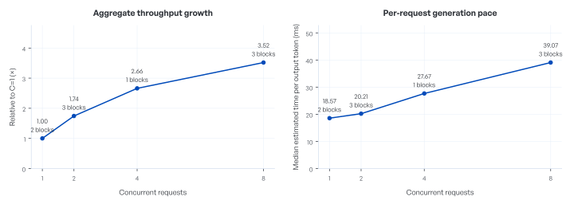

Figure 08-14 | Concurrency benefit and cost | Left: aggregate throughput relative to C=1 on the same prompt bank. Right: median estimated time per output token. Eligible block counts remain visible; this is descriptive, not a paired causal effect.

### 2026-10-19 public lengths: caps and actual generation

An output cap only limits the maximum permitted generation. Source records confirm max_tokens forwarding, while ignore_eos is not forwarded; the model can stop naturally. Each condition has one observation, so first-text and total times are individual measurements, not distribution quantiles. Measured cache state is shown explicitly.

| Actual input | Output cap | Actual output | First text s | Total s | Cached-token fraction | Finish |
| --- | --- | --- | --- | --- | --- | --- |
| 1,025 | 16,384 | **2,245** | 1.00 | 55.39 | 99.90% | stop |
| 1,025 | 32,768 | **4,219** | 0.80 | 90.68 | 99.90% | stop |
| 1,025 | 65,536 | **2,089** | 0.85 | 50.58 | 99.90% | stop |
| 1,024 | 131,072 | **3,575** | 1.63 | 80.86 | 0.00% | stop |
| 16,385 | 16,384 | **6,670** | 6.55 | 125.20 | 0.00% | stop |
| 32,769 | 32,768 | **12,661** | 20.79 | 259.23 | 0.00% | stop |
| 65,537 | 65,536 | **27,018** | 32.81 | 505.56 | 0.00% | stop |
| 1,025 | 260,096 | **5,604** | 1.53 | 132.07 | 0.00% | stop |


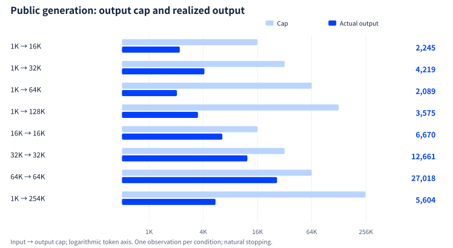

This adds response evidence for **8/8** public conditions, with a maximum observed natural output of **27,018 tokens**; **0** qualify as fixed-output observations. The observed maximum is not a service limit. Native fixed generation up to 260,096 tokens remains a separate path.


### Fixed long output: demonstrated native-engine range

This arm uses authenticated native generation with exact token-ID inputs, temperature zero, ignored end tokens and a fixed generation count; the stream interval is 128 tokens. Decode rates use same-process engine counts and times, not public first-content latency. Input plus output stays within 262,144. The 1,024-input / 260,096-output case reserves **1,024 tokens** of headroom, so its longest output target is 254K.

| Input → output tokens | Complete / planned | Decode token/s, median [range] | Median engine time s | Draft acceptance fraction |
| --- | --- | --- | --- | --- |
| 1,024 → 1,024 | **1/1** | **62.24** [62.24–62.24] | **16.91** | **0.940** |
| 1,024 → 8,192 | **3/3** | **55.64** [54.17–59.24] | **147.62** | **0.832** |
| 1,024 → 16,384 | **3/3** | **61.35** [54.15–61.51] | **267.46** | **0.931** |
| 1,024 → 32,768 | **3/3** | **60.50** [56.93–61.17] | **541.80** | **0.918** |
| 1,024 → 65,536 | **1/1** | **60.32** [60.32–60.32] | **1,086.82** | **0.924** |
| 1,024 → 131,072 | **1/1** | **61.96** [61.96–61.96] | **2,115.69** | **0.959** |
| 1,024 → 260,096 | **1/1** | **61.61** [61.61–61.61] | **4,222.17** | **0.961** |
| 16,384 → 16,384 | **1/1** | **62.10** [62.10–62.10] | **270.54** | **0.963** |
| 32,768 → 32,768 | **1/1** | **60.88** [60.88–60.88] | **548.28** | **0.938** |
| 65,536 → 65,536 | **1/1** | **60.27** [60.27–60.27] | **1,109.63** | **0.926** |


<!--GAP_LONG_OUTPUT-->

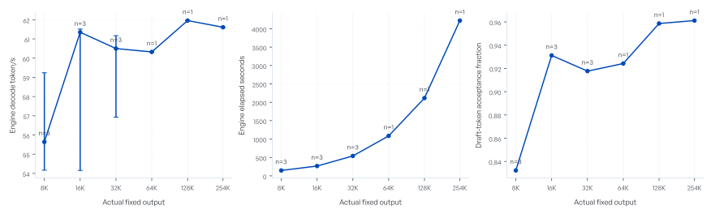

Figure 08-15 | Long-output generation rate and work | Input is fixed at 1K. Error bars are observed ranges of completed independent requests; n=1 is one observation. Draft acceptance is the native field. Unfinished targets have no performance point.

Forced length may produce repeated text, whitespace or special tokens. Count attainment establishes execution at that length, not useful content. MTP acceptance depends on the generated sequence, so these rates do not directly predict every business workload or annual production. Three-request cells report observed ranges; longer single probes provide no tail percentile or population confidence interval.

Visible-text checks flag 8 complete requests with runs of at least 256 identical characters. Flags accompany the raw outputs and are not answer-quality scores.

[Additional requests and timings CSV](../../2026-10-14_17-dual-spark/data/completion/native_requests.csv)

### GPU profiling across conditions and measurement overhead

Each pair uses identical inputs and 256 output tokens, with alternating arm order. Prefix cache is flushed on an idle service before each arm. Profiling captures prefill and four decode steps; the full-request time ratio measures the impact of this diagnostic on that request, not a correction factor for all historical data.

| Input / concurrency | Pairs | Profiled / unprofiled time ratio | Cached tokens across both arms |
| --- | --- | --- | --- |
| 1,024 / 1 | **3** | **1.162** [1.124–1.220] | **0** |
| 8,192 / 4 | **3** | **1.236** [1.182–1.263] | **0** |
| 32,768 / 1 | **3** | **1.084** [0.931–1.186] | **0** |


<!--GAP_PROFILE_COST-->

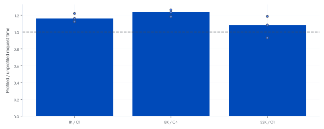

Figure 08-16 | Paired profiling overhead | Bars show medians and points show independent pairs; 1 means equal request duration.

### Independent check of 64K prefix reuse

| Independent prefix | First / reuse | Actual cached tokens | Cached fraction | Engine first-token seconds |
| --- | --- | --- | --- | --- |
| 2 | First | **0** | **0.000** | **20.564** |
| 2 | Reuse | **57344** | **0.875** | **2.766** |
| 3 | First | **0** | **0.000** | **20.746** |
| 3 | Reuse | **57344** | **0.875** | **2.682** |
| 1 | First | **0** | **0.000** | **20.457** |
| 1 | Reuse | **57344** | **0.875** | **2.664** |


Each prefix is sent after a cache flush and reused immediately. This table tests immediate reuse, not long-term retention or cache capacity.


### 2026-10-19: cache verification at 64K with zero designed overlap

A 0% design uses different markers early in the inputs; it does not assume zero measured reuse. This tests low-reuse inputs and complements the identical-prefix immediate-reuse experiment. It does not measure a TTL or long-term cache lifetime.

| Pair | Request | Input increment | Cached increment | Measured ratio | Window |
| --- | --- | --- | --- | --- | --- |
| 1 | seed | 65,555 | 0 | **0.000%** | Valid |
| 1 | probe | 65,555 | 0 | **0.000%** | Valid |
| 2 | seed | 65,554 | 0 | **0.000%** | Valid |
| 2 | probe | 65,555 | 0 | **0.000%** | Valid |
| 3 | seed | 65,555 | 0 | **0.000%** | Valid |
| 3 | probe | 65,555 | 0 | **0.000%** | Valid |


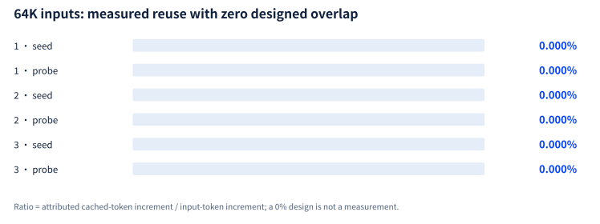

**3/3** independent pairs qualify, with measured cached-token fractions of **0.000–0.000%** in qualified windows. The earlier missing 64K low-reuse window remains missing; these are attributable observations from a new date and are not pooled across dates.


<a id="section-09"></a>

## 09 · Sustained performance, thermal state and resources

### Independent arrivals and sustained operation


| Block | Offered / sent / complete | Local rejections | Window s |
| --- | --- | --- | --- |
| Open arrivals and mixed workloads · 0.5 times reference rate | **120 / 120 / 120** | **0** | **624.9** |
| Open arrivals and mixed workloads · 0.25 times reference rate | **57 / 57 / 57** | **0** | **607.9** |
| Open arrivals and mixed workloads · 1.25 times reference rate | **296 / 243 / 243** | **53** | **617.4** |
| Historical observation (5 segments, including gaps) | **638 / 638 / 635** | **0** | **34,580.3** |
| Open arrivals and mixed workloads · 1 times reference rate | **226 / 203 / 203** | **23** | **616.4** |
| Open arrivals and mixed workloads · 0.75 times reference rate | **160 / 160 / 160** | **0** | **612.3** |


Analytical thresholds: visible TTFT≤**1/2/5/10 s** and estimated TPOT≤20/50/100 ms. These are sensitivity conditions, not committed service-level agreements. Global concurrency is capped at eight, queue length at 32 and queue wait at 5 s. The sustained-stability test ends at **1 hour**,**2,701 requests** or the budget/deadline, whichever occurs first. [Per-condition qualified-throughput data](../../2026-10-14_17-dual-spark/data/service/goodput.csv)

The table selects three analytical threshold pairs; cells show qualified requests/s and their fraction of all measured arrivals. The data table contains the remaining pairs. Mixed-load results evaluate matched short requests only.

| Condition | 1 s / 20 ms | 2 s / 50 ms | 5 s / 100 ms |
| --- | --- | --- | --- |
| Open arrivals and mixed workloads · 0.25 times reference rate | **0.012 / 12.2%** | **0.058 / 61.0%** | **0.096 / 100.0%** |
| Open arrivals and mixed workloads · 0.5 times reference rate | **0.013 / 6.7%** | **0.150 / 77.9%** | **0.185 / 96.2%** |
| Open arrivals and mixed workloads · 0.75 times reference rate | **0.009 / 3.5%** | **0.212 / 81.2%** | **0.253 / 97.2%** |
| Open arrivals and mixed workloads · 1 times reference rate | **0.000 / 0.0%** | **0.208 / 57.1%** | **0.304 / 83.8%** |
| Open arrivals and mixed workloads · 1.25 times reference rate | **0.000 / 0.0%** | **0.154 / 31.8%** | **0.326 / 67.5%** |


### Node resources

Compare means aligned to the same concurrency blocks, then inspect changes over the observation period. Telemetry gaps are not interpolated.

### Resources aligned with natural-workload blocks

<!--RESOURCE_BY_LOAD-->

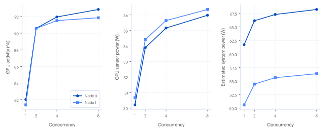

Figure 09-01 | Concurrency and node resources | Same natural-workload blocks as the throughput comparison; means are weighted by valid sample duration. Gaps over 20 seconds or missing fields are not interpolated. GPU sensor and estimated system power are separate views and are not added.

| Concurrency / node | Mean GPU activity | GPU / estimated system W | Peak temperature °C | Activity / power coverage |
| --- | --- | --- | --- | --- |
| 1 / 0 | **82.0%** | **30.2 / 61.7** | **65.0** | **100.0%** / **100.0%** |
| 1 / 1 | **81.4%** | **30.7 / 50.6** | **66.0** | **100.0%** / **100.0%** |
| 2 / 0 | **90.6%** | **33.9 / 66.1** | **70.0** | **100.0%** / **100.0%** |
| 2 / 1 | **90.6%** | **34.4 / 54.4** | **70.0** | **100.0%** / **100.0%** |
| 4 / 0 | **91.9%** | **35.2 / 67.3** | **70.0** | **100.0%** / **100.0%** |
| 4 / 1 | **91.5%** | **35.6 / 55.6** | **70.0** | **100.0%** / **100.0%** |
| 8 / 0 | **92.8%** | **36.0 / 68.2** | **68.0** | **100.0%** / **100.0%** |
| 8 / 1 | **91.9%** | **36.3 / 56.3** | **69.0** | **100.0%** / **100.0%** |


Coverage is the fraction of condition-block time supported by valid adjacent samples; means use the covered intervals. GPU activity near **100%** alone does not establish compute or memory-bandwidth saturation. Between-node power differences also require clocks, work allocation and sensor semantics.

<!--HARDWARE-->

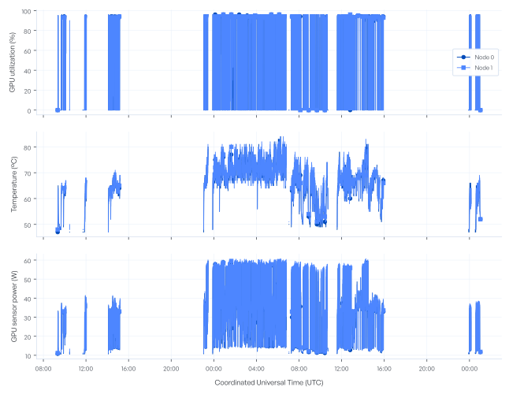

Figure 09-02 | Node timelines | Includes warmups and idle time; load comparisons use the aligned table above.

Raw engine and memory timelines are in Appendix B. The separate network microbenchmark is about **109 Gb/s** for that transfer test; current evidence does not isolate networking, memory or compute as the sole model bottleneck.

The opening telemetry belongs to serving windows; independent GPU sustained work is reported below by actual coverage. Their work and baselines differ and durations cannot be combined into one stability claim. Keep sensor, estimated system and outlet-metered energy separate; absent outlet measurements, cost remains scenario-based.

### Independent hardware sustained load: performance retention and thermal state

The schedule is **60 minutes** of compute, **60 minutes** of bandwidth and **120 minutes** of mixed work. Each phase first records a five-minute matched-work baseline, outside its formal duration. Mixed work alternates compute and bandwidth, retaining separate rates. Retention divides each ten-minute window’s median by the same-work baseline median. Windows, phases and serving durations are distinct and cannot be combined into continuous business-service uptime.

Mixed work uses an independent warmup and baseline. GPU submissions pause at **85°C** and resume below75°C after30stable seconds. Timing and cooling belong to this execution; earlier interrupted attempts remain separate. Compute and bandwidth retain their original85°C cutoff, so thermal control is not identical across phases.

| Node | Workload | Observed / planned min | Validated samples | Median / max °C | Median SM MHz | Sensor kWh | Integration-time coverage |
| --- | --- | --- | --- | --- | --- | --- | --- |
| 0 | Compute | **60.0 / 60** | **3359** | **81.0 / 82.0** | **2262** | **0.0888** | **100.0%** |
| 0 | Bandwidth | **60.0 / 60** | **3485** | **65.0 / 66.0** | **2522** | **0.0318** | **100.0%** |
| 0 | Alternating mixed | **120.0 / 120** | **5832** | **75.0 / 86.0** | **2405** | **0.1082** | **100.0%** |
| 1 | Compute | **60.0 / 60** | **3405** | **83.0 / 84.0** | **2249** | **0.0888** | **100.0%** |
| 1 | Bandwidth | **60.0 / 60** | **3490** | **67.0 / 67.0** | **2515** | **0.0324** | **100.0%** |
| 1 | Alternating mixed | **120.0 / 120** | **6527** | **74.0 / 86.0** | **2431** | **0.1178** | **100.0%** |


### Mixed-load thermal control and throughput boundaries

| Control | Rule |
| --- | --- |
| Backoff trigger | Temperature ≥**85°C** or unavailable: pause GPU submissions |
| Automatic recovery | Temperature below **75°C** for 30 continuous seconds |
| Maximum individual backoff | **600 seconds**; end the run and restore service on timeout |
| Time and stop boundaries | No automatic deadline extension; manual stop, lease and memory guards remain effective |


Mixed work uses this policy; the compute and bandwidth phases retain their respective measurement-time thermal conditions. Cooling occurs at CUDA submission boundaries and is excluded from CUDA-event rates. Effective throughput separately counts measured work over the whole phase wall time, including cooling, validation and the other mixed workload. Backoff events are archived separately; unfinished timed calls are not valid performance samples.

Driver limit reasons | Active means the driver reported that reason as active; Not Active means inactive at that sample. Unsupported/missing values are not counted as inactive. Counts do not directly establish throttling duration or performance loss.

| Node | Phase | Driver reason flag | Active samples | Known-state samples |
| --- | --- | --- | --- | --- |
| 0 | mixed | sw_thermal_slowdown | **0** | **7196** |
| 0 | mixed | hw_thermal_slowdown | **0** | **7196** |
| 0 | mixed | hw_slowdown | **0** | **7196** |
| 0 | mixed | sw_power_cap | **0** | **7196** |
| 1 | mixed | sw_thermal_slowdown | **0** | **7197** |
| 1 | mixed | hw_thermal_slowdown | **0** | **7197** |
| 1 | mixed | hw_slowdown | **0** | **7197** |
| 1 | mixed | sw_power_cap | **0** | **7197** |


### Mixed work: execution rate and throughput including cooling

| Node | Median execution rate | Phase-wall throughput | Cooling seconds in completed calls | Cooling / phase wall time | Calls containing cooling |
| --- | --- | --- | --- | --- | --- |
| 0 | gemm: **87.57 TFLOP/s**; triad: **221.62 GB/s** | gemm: **36.39 TFLOP/s**; triad: **91.72 GB/s** | **1178.8** | **16.4%** | **38** |
| 1 | gemm: **86.99 TFLOP/s**; triad: **217.28 GB/s** | gemm: **40.63 TFLOP/s**; triad: **100.93 GB/s** | **434.4** | **6.0%** | **14** |


Phase-wall throughput divides counted work of each type by the entire mixed-phase duration, including the other workload, validation and cooling. Its difference from execution rate is therefore not solely a cooling effect. Cooling seconds sum completed timed calls; events from interrupted calls remain in the raw records.

Cooling in this run was triggered by the benchmark temperature threshold. Valid driver samples on both nodes recorded no active thermal, hardware-slowdown or power-cap flags. This describes approximately one-second sampling and cannot exclude events between samples. Capacity assessment should consider execution rates together with wall-clock throughput including waits.

<!--HARDWARE_UNLOADED_RETENTION-->

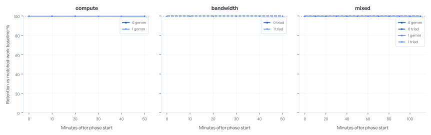

Figure 09-03 | Windowed performance retention | Only complete ten-minute windows are plotted; partial-tail samples remain in the statistical files. Compare matching node, workload and phase; 100% denotes the five-minute phase baseline, not a theoretical peak.

<!--HARDWARE_UNLOADED_TELEMETRY-->

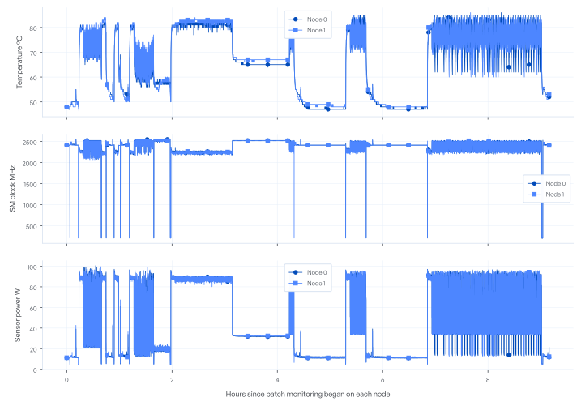

Figure 09-04 | Node resource timeline | Includes warmup, individual scans and sustained work; phase receipts define each window. Lines break across gaps exceeding five seconds. Sensor power is not whole-system wall power.

Energy uses trapezoidal integration of adjacent valid power samples no more than five seconds apart, reporting time coverage without zero-filling or extrapolating gaps. No wall-meter evidence exists. Depreciation and 1/3/5-year returns retain the explicit whole-system electricity scenarios in section 11; sensor energy does not replace wall-electricity cost.

<!--REVIEW_SUSTAINED-->

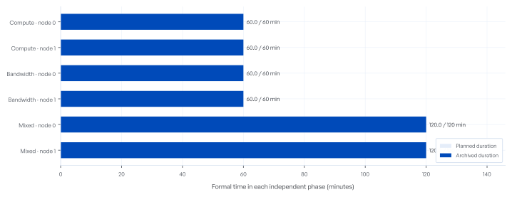

Figure 09-05 | Sustained coverage | Solid bars show valid formal duration, pale bars show the planned remainder. Phases are independent and do not establish continuous stability.

The original sustained arm has 638 arrivals in five segments. Its 34,580.3-second span includes interruptions and does not establish continuous stability or continuous goodput. Any completed independent window below is reported separately, without joining it to those segments.

### Independent public blocks, interference and continuous window

| Condition | Sent / complete | Window seconds | Origin output token/s | First-content median / p95 s |
| --- | --- | --- | --- | --- |
| Additional business/length block | **4/4** | **62.3** | **108.44** | **1.67 / 1.68** |
| Interference pair 4 Isolated | **32/32** | **145.1** | **42.11** | **0.85 / 1.20** |
| Interference pair 0 Isolated | **32/32** | **151.2** | **42.99** | **0.97 / 1.58** |
| Interference pair 4 Mixed | **36/36** | **154.2** | **42.07** | **6.49 / 12.77** |
| Additional business/length block | **8/8** | **398.5** | **35.26** | **3.28 / 4.03** |
| Interference pair 2 Isolated | **32/32** | **171.3** | **35.39** | **0.90 / 1.15** |
| Continuous run | **599/599** | **3,600.2** | **64.77** | **1.01 / 1.49** |
| Short-prompt C4 reference | **60/60** | **196.4** | **117.65** | **0.90 / 1.15** |
| Interference pair 2 Mixed | **39/39** | **173.2** | **39.46** | **1.92 / 12.57** |
| Short-prompt C4 reference | **60/60** | **194.8** | **118.45** | **0.94 / 1.45** |
| Additional business/length block | **4/4** | **255.7** | **38.53** | **11.95 / 13.75** |
| Short-prompt C4 reference | **60/60** | **201.1** | **118.35** | **0.90 / 1.24** |
| Interference pair 0 Mixed | **33/33** | **159.3** | **39.01** | **4.32 / 13.88** |


Throughput requires original token counts for every complete response; open arrivals retain local rejection counts. Interference effects compare short requests within matched pairs; total mixed throughput is not a substitute for short-request latency differences.

### 2026-10-19: effect of long requests on short-request waiting

The isolated arm has 32 short requests. The mixed arm preserves their prompts and scheduled arrivals and adds eight 32K inputs. Both arms prewarm every short input. Ratios require complete pairs, while all rejections remain reported. This measures the overall mixed-service effect, not pure prefill-kernel time.

| Pair | Complete short: isolated→mixed | Median wait s: isolated→mixed | p95 wait s: isolated→mixed | Median ratio | Rejections: isolated/mixed | Interpretation |
| --- | --- | --- | --- | --- | --- | --- |
| 1 | 32/32 → 32/32 | 0.95 → **1.23** | 1.33 → **12.44** | **1.30** | 0 / 0 | Complete pair |
| 2 | 32/32 → 32/32 | 0.98 → **1.16** | 2.05 → **9.32** | **1.18** | 0 / 0 | Complete pair |
| 3 | 32/32 → 32/32 | 0.87 → **2.94** | 1.15 → **16.89** | **3.37** | 0 / 0 | Complete pair |
| 4 | 32/32 → 32/32 | 0.97 → **1.59** | 1.41 → **11.36** | **1.64** | 0 / 0 | Complete pair |
| 5 | 32/32 → 29/32 | 1.00 → **4.63** | 1.22 → **14.61** | **—** | 0 / 3 | Rejections; latency describes completed responses only |


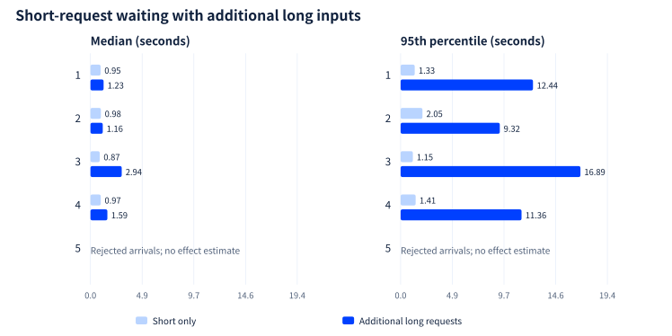

All arrivals and outcomes are observed in **5/5** pairs; **4/5** qualify for complete-pair effect estimates, with median-wait ratios of **1.18–3.37×** and p95 ratios of **4.54–14.68×**. These are ranges across blocks, not confidence intervals. The three incomplete pairs from October 17 remain historical rejection evidence and are excluded from this effect estimate.

| Pair | Arm | Local short-request rejections | Observed queue wait at rejection s | Execution |
| --- | --- | --- | --- | --- |
| 5 | mixed | 3/32 | 5.99–14.28 | Not forwarded to model |

The local queue checks its 5-second threshold on dequeue, so actual waiting before rejection can be longer. Rejected requests have no first-text time. Latency summaries for an arm with rejections describe completed responses only and do not establish a complete-pair effect. These are observed admission outcomes, not missing test records.

| Pair | Arm | Offered/sent/complete | Block wall time s | Block output tokens/s | Median short output tokens | Whole-arm cache fraction |
| --- | --- | --- | --- | --- | --- | --- |
| 1 | isolated | 32 / 32 / 32 | 273.5 | **22.97** | 240 | 69.75% |
| 1 | mixed | 40 / 40 / 40 | 273.4 | **26.50** | 250 | 0.63% |
| 2 | isolated | 32 / 32 / 32 | 339.9 | **18.68** | 256 | 66.39% |
| 2 | mixed | 40 / 40 / 40 | 339.4 | **21.78** | 256 | 0.17% |
| 3 | isolated | 32 / 32 / 32 | 219.5 | **26.33** | 242 | 76.68% |
| 3 | mixed | 40 / 40 / 40 | 220.7 | **32.24** | 248 | 1.01% |
| 4 | isolated | 32 / 32 / 32 | 244.1 | **20.57** | 153 | 67.19% |
| 4 | mixed | 40 / 40 / 40 | 243.9 | **25.37** | 167 | 0.36% |
| 5 | isolated | 32 / 32 / 32 | 192.9 | **31.41** | 253 | 75.67% |
| 5 | mixed | 40 / 37 / 37 | 193.2 | **34.30** | 256 | 0.38% |

Block throughput divides actual source output by wall time from scheduler start through the last response, including inter-arrival gaps; it is not saturated capacity. Whole-arm cache fractions are input-token weighted and include long prompts in mixed arms, so they are not short-request hit rates.

### Five-minute windows of continuous service

| Independent attempt / minutes | Offered / complete | First-content median / p95 s | Completed-response output token/s |
| --- | --- | --- | --- |
| 1 / 0–5 | **55/54** | **1.03 / 1.67** | **71.63** |
| 1 / 5–10 | **45/45** | **0.99 / 1.27** | **48.54** |
| 1 / 10–15 | **50/50** | **1.08 / 1.63** | **67.85** |
| 1 / 15–20 | **59/59** | **0.99 / 1.56** | **76.47** |
| 1 / 20–25 | **58/58** | **1.07 / 1.65** | **69.37** |
| 1 / 25–30 | **40/40** | **0.98 / 1.36** | **55.57** |
| 1 / 30–35 | **55/55** | **0.97 / 1.38** | **72.35** |
| 1 / 35–40 | **51/51** | **1.08 / 1.43** | **65.93** |
| 1 / 40–45 | **55/55** | **1.04 / 1.49** | **67.71** |
| 1 / 45–50 | **33/33** | **1.04 / 1.65** | **50.93** |
| 1 / 50–55 | **53/53** | **1.14 / 1.35** | **70.85** |
| 1 / 55–60 | **46/46** | **1.12 / 1.58** | **60.13** |


<!--GAP_SOAK_WINDOWS-->

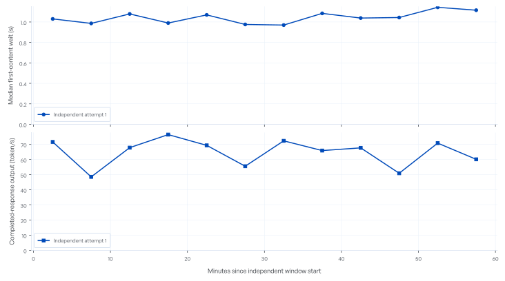

Figure 09-07 | Waiting and completed output in continuous windows | Latency cohorts use planned arrival time. Tokens are credited when a response completes, not at their individual generation times. Original warmup flags remain; early windows include startup transients.


### 2026-10-19: two-node temperature and resources


| Node | Temperature median/max°C | GPU utilization median/p95% | Median GPU clock MHz | Median sensor power W | Minimum available memory GiB |
| --- | --- | --- | --- | --- | --- |
| 0 | 63.0 / **73.0** | 94.0 / 96.0 | 2,502 | 33.5 | 21.41 |
| 1 | 64.0 / **75.0** | 95.0 / 96.0 | 2,502 | 33.6 | 23.77 |


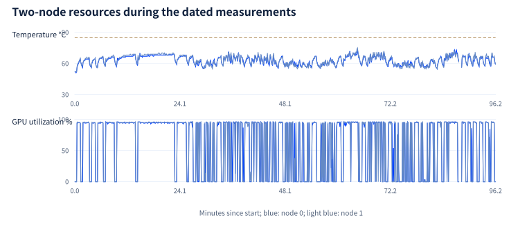

Samples are taken approximately every 5 seconds, including warmup, work, inter-block draining and environment verification. Median utilization therefore does not represent saturated throughput. Gaps longer than 20 seconds are not connected. 85°C is the experiment's backoff threshold, not evidence of a driver throttling signal. Sensor power is not whole-system wall energy.


<a id="section-10"></a>

## 10 · Cross-layer interpretation and H200 comparison

The experiments establish resource ceilings, execution efficiency and user experience separately. This section connects them: multiple mechanisms can produce the same symptom, and matched-work controls narrow the explanation. The table separates established observations from mechanisms requiring validation.

| Dimension | Combined observations | Supported interpretation |
| --- | --- | --- |
| Compute and shape | Matrix size/dtype sweeps, standalone operators and engine GPU traces. | Achieved rate depends on shape and implementation; peak TFLOP/s is not model token throughput. Missing pipeline counters prevent unique compute attribution. |
| Memory and coordination | **8 GiB** copy: about **223–227 GB/s**;**1 GiB** AllReduce bus rate: about **21.81 GB**/s. | Local access and inter-node synchronization have different resource budgets and byte accounting; their ratio is not a model speedup. |
| Concurrency and waiting | On short prompts,C=1→8 raises aggregate output **45.1→158.9 tokens/s** while per-request token time increases. | Concurrency raises system output; user waiting must be checked alongside it. Neither unlimited scaling nor long-term capacity is established. |
| Cache and context | Public reuse diagnostics, node token counters and native immediate repeats are measured separately. | Repeated input, cached tokens and waiting benefit are distinct. Short reuse tests do not establish retention for arbitrary business traffic. |
| Temperature and retention | Compute, bandwidth and mixed loads separately complete60/**60/120 minutes**; driver reasons retain their sampled coverage. | Retention is assessable within observed segments. A temperature threshold, driver throttling and performance loss are distinct observations. |


Interpretation distinguishes direct observations, matched comparisons, official specifications and economic scenarios. Only the first two are performance experiments here; ordering, sample-size and resource-state limits accompany comparisons. Hardware counters cover only a single-kernel diagnostic probe; representative hardware/model workloads remain unprofiled, preventing model roofline attribution.


### GB10 and H200: an architectural reference aligned by resource function

The basic comparison is one GB10 in one DGX Spark versus one H200 SXM; multi-device topology is stated separately. Metrics align by function—holding data, supplying compute, executing arithmetic, exchanging shards and expanding across servers—rather than technology names. DGX Spark is a complete computer; H200 SXM is a server accelerator. Capacity ownership, power boundaries and fabric scope accompany every value.

| Technical function | DGX Spark / GB10 | H200 SXM / stated server | Alignment and interpretation |
| --- | --- | --- | --- |
| Hold weights, KV and workspace | **128 GB** LPDDR5x shared CPU/GPU unified memory | **141 GB** HBM3e GPU-local memory | Similar nominal capacity; Spark CPU/system use shares the same pool. Two Sparks provide256 GB distributed capacity. |
| Supply local data to the GPU | **273 GB/s** LPDDR5x specified | **4,800 GB/s** HBM3e specified | Both supply local memory data; the 17.58× specification ratio is a bandwidth ratio, not inference speedup. |
| Exchange data between CPU and GPU | Shared memory and on-chip NVLink-C2C; no unverified C2C peak is assigned. | PCIe Gen5:**128 GB/s** bidirectional aggregate; host memory and HBM are separate | Compare cooperation and migration needs; C2C is not the link between two Sparks. |
| Coordinate shards of one model | Two Sparks use RoCE; the active **200 Gb/s** port specifies **25 GB/s** in one direction. | H200 SXM uses NVLink:**900 GB/s** bidirectional aggregate per GPU, equivalent to **450 GB/s** aggregate transmit direction. | Same function, different topology: one NIC port versus all GPU links. This is not a single-link or GPU-pair performance ratio. |
| Expand across more servers | One active **200 Gb/s** port per node=**25 GB/s**; logical interfaces are not additive. | DGX H200 example:**400 Gb/s**=**50 GB/s** per NIC; eight NICs in an eight-GPU system total 3.2 Tb/s. | Per-NIC specified rate is 2×; system aggregation depends on topology, concurrency and fabric. |
| Low-precision matrix acceleration | Blackwell supports FP8 and NVFP4; fixed 8192³ dense measurements appear below. | Hopper native FP8:about 1,979 dense and 3,958 with2:4 sparsity TFLOP/s (specifications). | FP4 and FP8 serve low-precision acceleration, but formats, kernels and errors differ; their rates are not a speedup ratio. |
| Power and provisioning | GB10 SoC TDP**140 W**; Spark power supply rated 240 W. | H200 SXM configurable TDP up to **700 W**; host-system power is additional. | Design specifications with different boundaries; neither establishes tokens/J or wall-electricity cost. |


[DGX Spark](https://docs.nvidia.com/dgx/dgx-spark/hardware.html) · [H200 SXM](https://www.nvidia.com/en-us/data-center/h200/) · [Spark ConnectX-7](https://docs.nvidia.com/dgx/dgx-spark/spark-clustering.html) · [DGX H200](https://docs.nvidia.com/dgx/dgxh100-user-guide/introduction-to-dgxh100.html) · [Hopper NVLink](https://docs.nvidia.com/cuda/hopper-tuning-guide/index.html)

All H200 values are official specifications; H200 was not benchmarked in this study. GB10 measurements below use unloaded-model conditions. Functional alignment supports architectural comparison; inference performance ratios require matched model, precision, work and timing on both platforms.

<!--REVIEW_FABRIC_MAP-->

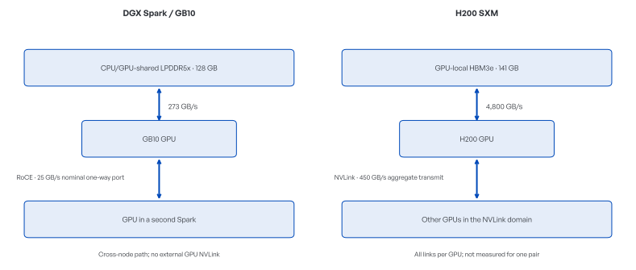

Figure 10-01 | Data-path comparison | Both systems supply local data and exchange model shards through different memory and interconnects. Lines denote functional paths and are not scaled by bandwidth.

<!--HARDWARE_H200_MEMORY-->

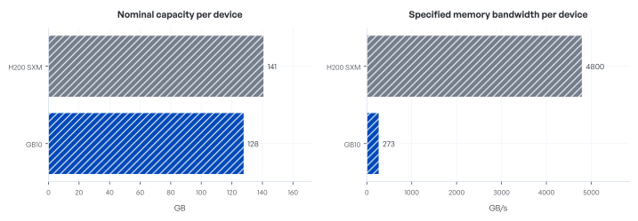

Capacity and data supply | Per-device official specifications. Similar capacity does not imply similar bandwidth; both panels begin at zero.

#### Measured memory rates: fixed 8 GiB working set

| Operation | Node 0 GB/s: median [range]; rounds | Node 1 GB/s: median [range]; rounds | H200 HBM3e reference |
| --- | --- | --- | --- |
| Contiguous copy: read + write | **223.41** [222.75–223.74]; n=10 | **226.95** [226.31–227.88]; n=10 | **4,800 GB/s** specified; this operation unmeasured |
| Triad: two reads + one write | **214.88** [213.76–215.27]; n=10 | **217.66** [217.07–218.13]; n=10 | **4,800 GB/s** specified; this operation unmeasured |
| Native read | **110.04** [109.88–110.21]; n=5 | **110.09** [108.89–110.79]; n=5 | **4,800 GB/s** specified; this operation unmeasured |
| Native write | **192.63** [191.81–193.07]; n=5 | **192.87** [191.51–193.06]; n=5 | **4,800 GB/s** specified; this operation unmeasured |


Working sets use binary GiB; rates use decimal GB/s. Values count logical bytes requested by the program, not counter-measured physical DRAM traffic. Native read includes dependent per-thread accumulation and describes that kernel rather than a theoretical read limit. Triad counts actual element-aligned bytes.

#### Core compute throughput by precision

TFLOP/s counts 10¹² floating-point operations per second, with FMA counting as two. GEMM fixes M=N=K=8192 and counts 2MNK/time rather than selecting the fastest size. Scalar FP32 FMA is separate. H200 dense Tensor Core figures are approximate halves of the rounded published sparse figures, not measurements. In 2:4 sparsity two of every four weights are nonzero; sparse rates use dense-equivalent work.

Status key: **No native support** means the hardware lacks a native arithmetic path for that format; **Not applicable** means the row does not use that column’s dense or 2:4 sparse convention; **Not measured** means this study has no valid measurement yet. None means zero throughput.

| Operation / precision | GB10 node 0 measured TFLOP/s | GB10 node 1 measured TFLOP/s | H200 dense specified TFLOP/s | H200 2:4 specified TFLOP/s |
| --- | --- | --- | --- | --- |
| Scalar FP32 FMA | **28.01** [27.97–28.04]; n=5 | **27.98** [27.94–28.06]; n=5 | **67** | Not applicable |
| FP32 GEMM | **18.39** [18.16–18.48]; n=10 | **18.22** [17.94–18.30]; n=10 | **67** | Not applicable |
| TF32 allowed | **33.10** [24.01–38.59]; n=10 | **37.17** [33.21–38.53]; n=10 | **≈494.5** | **989** |
| FP16 | **93.24** [91.83–93.95]; n=10 | **92.67** [91.59–92.99]; n=10 | **≈989.5** | **1,979** |
| BF16 | **94.34** [93.50–94.78]; n=10 | **94.08** [93.63–94.42]; n=10 | **≈989.5** | **1,979** |
| FP8 E4M3 | **192.64** [192.07–195.62]; n=5 | **191.88** [191.38–193.22]; n=5 | **≈1,979** | **3,958** |
| NVFP4 | **157.38** [148.49–160.44]; n=5 | **148.02** [143.42–161.21]; n=5 | No native support | No native support |
| FP16 2:4 | **39.33** [39.25–39.45]; n=5 | **39.48** [39.38–39.65]; n=5 | Not applicable | **1,979** |
| BF16 2:4 | **39.28** [39.03–39.69]; n=5 | **39.41** [38.82–40.02]; n=5 | Not applicable | **1,979** |
| FP64 | **0.4280** [0.4280–0.4281]; n=5 | **0.4276** [0.4276–0.4277]; n=5 | **34** scalar; **67** Tensor Core | — |


Scalar GB10 FMA uses 256 threads/block, eight independent chains and four blocks per SM. TF32 allowed permits library selection; the flag alone does not establish executed instructions. NVFP4 uses controlled exactly representable operands, not production quantization errors or MoE kernels. GB10’s advertised up-to-**1 PFLOP/s** uses sparse FP4 and is not the denominator for a dense NVFP4 attainment rate.

**NVFP4 architecture difference:** GB10 is Blackwell and supports native FP4 matrix arithmetic; H200 is Hopper and lacks native NVFP4 Tensor Core arithmetic, so no native dense or sparse peak applies. Compatible software kernels can dequantize FP4 weights to BF16 for computation, but that is a different arithmetic path; H200 FP8 or INT8 specifications cannot fill these cells. This software path was not benchmarked on H200 in this study. [NVIDIA NVFP4](https://developer.nvidia.com/blog/introducing-nvfp4-for-efficient-and-accurate-low-precision-inference/) · [NVIDIA NIM NVFP4 Emulation](https://docs.nvidia.com/nim/large-language-models/_2.0.13/2.0.13/reference/advanced-configuration.html#nvfp4-emulation)

<!--HARDWARE_H200_COMPUTE-->

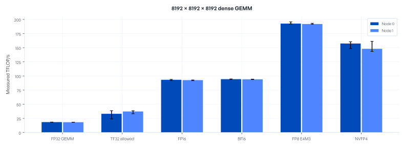

Fixed-size compute measurements | Only GB10 measurements are plotted, with observed round ranges. H200 specifications remain in the table and are not presented as a matched benchmark.

#### Implications for deployment

The measured **8 GiB** copy reaches **223–227 GB/s**, while two-node **1 GiB** AllReduce bus bandwidth is about **21.81 GB**/s. Cross-node synchronization and local memory access operate at different rate scales. H200 specifications offer higher memory and GPU-interconnect ceilings, but benefits depend on sharding, arithmetic intensity, batching and overlap. These data identify resource differences; they do not establish H200 token throughput, latency, energy-efficiency or payback ratios. A matched comparison requires the same model, quantization/precision, input/output, concurrency and cache conditions, plus wall-power measurement.

<a id="section-11"></a>

## 11 · API cost, ownership and investment return

### Observed API charges

Charges are reconciled by the same cohort’s request IDs. Blended cost per million generated tokens includes input charges for this input/output mix; it is not a catalog output-token price.

| Concurrency condition | Bill coverage | Paid USD | USD/1k responses | USD/1M generated |
| --- | --- | --- | --- | --- |
| Concurrency 1 · Reasoning disabled | **120/120** | **0.0244** | **0.204** | **0.519** |
| Concurrency 2 · Reasoning disabled | **180/180** | **0.0375** | **0.208** | **0.517** |
| Concurrency 4 · Reasoning disabled | **60/60** | **0.0124** | **0.206** | **0.518** |
| Concurrency 8 · Reasoning disabled | **180/180** | **0.0373** | **0.207** | **0.517** |


<!--COST_BY_WORKLOAD-->

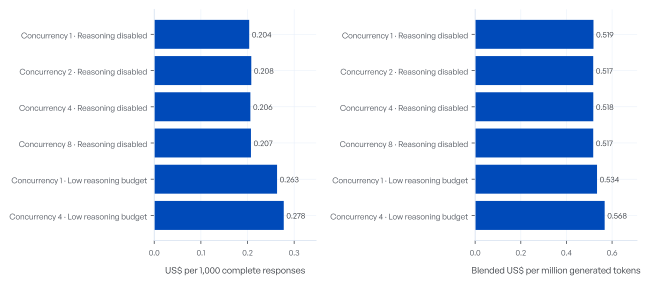

Figure 11-01 | Cost normalization | Charges per response and per generated token both include cohort input fees.

<div id="ownership-cost"></div>

### Two-node ownership: purchase and electricity

The supplied purchase price is **US$5,000** per device, **US$10,000** for the pair. Electricity uses the public China business reference **US$0.109/kWh (2026 Q3)** as a reproducible proxy, not a site contract or an official consumption-weighted national average. [GlobalPetrolPrices](https://www.globalpetrolprices.com/electricity_prices/)

Unit cost uses straight-line depreciation and estimated electricity: annual expense = purchase price / depreciation life + pair kW × **8,760 hours** × tariff, divided by useful annual generation. Power uses the matched-condition estimated system sum, assumed constant year-round. Productive fraction is time producing useful work, not GPU activity. Staff, space, cooling, repairs and financing are excluded.

| Concurrency | Estimated pair W | Energy USD/year | 50% · USD/1M | 75% · USD/1M | 100% · USD/1M |
| --- | --- | --- | --- | --- | --- |
| 1 | **112.3** | **107** | **4.833** | **3.222** | **2.417** |
| 2 | **120.6** | **115** | **2.778** | **1.852** | **1.389** |
| 4 | **122.9** | **117** | **1.821** | **1.214** | **0.911** |
| 8 | **124.6** | **119** | **1.378** | **0.919** | **0.689** |


The table uses three-year depreciation; the final columns give cost per million generated tokens at each productive fraction.

<!--COST_SENSITIVITY-->

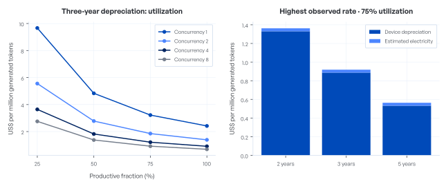

Figure 11-02 | Cost sensitivity | Left: utilization with three-year depreciation. Right: depreciation life at 75% utilization.

<div id="investment-returns"></div>

### 1 / 3 / 5-year payback and investment returns: self-use and sales

This section asks when cash savings or sales receipts cover the initial two-device investment. Depreciation is used above to allocate unit costs; cash-flow analysis instead deducts the purchase once at acquisition and then only cash operating expenses. Depreciation is not deducted again. All amounts are USD. These are conditional projections from measured throughput, not realized multiyear returns.

| Use | Definition of annual benefit | Price and work-volume basis |
| --- | --- | --- |
| Self-use: avoided external API spending | API expense that the same work would otherwise incur | Same input/output mix and account-paid blended price; only work actually needed counts |
| Sales: inference-service receipts | Sold volume × blended sale price, less sales deductions | Illustrative 0.5 / 1 / 2× reference price; sale utilization is time producing collectible work |


**Fixed projection basis.** Natural-bank concurrency 8, observed throughput **158.90 tokens/s**, estimated pair power **124.57 W**, 8,760 provisioned hours/year and **US$10,000** purchase cost. The corresponding account-paid blended API price is **US$0.51739 per million generated tokens**, including input fees for this mix. Sales scenarios use it only as a reference for hypothetical quotes; account spending is not node revenue or a general output-token price.

| Metric | Definition and calculation |
| --- | --- |
| Annual useful output Q | Q = R × 3,600 × H × u / 1,000,000, in million generated tokens |
| Annual cash operating expense O | O = pair watts/1,000 × provisioned hours × tariff + other annual expense; sales deductions separate |
| Annual net cash benefit S | Self-use: S = Q × API reference price − O; sales: S = Q × sale price × (1 − deduction rate) − O |
| Cumulative net cash at year T | T × S − K, where K is initial capital; negative means capital is not fully recovered |
| Cumulative simple ROI | (T × S − K) / K; denominator is initial capital, not revenue; this is not annualized |
| Simple payback | K / S when S > 0; a value over five years means no payback within five years |
| Minimum blended price for T-year payback | (K/T + O) / [Q × (1 − deduction rate)], covering cash costs included here |


Fixed scenarios hold throughput, prices and tariffs constant and ignore the time value of money. They exclude residual proceeds, replacement, financing, taxes, staff, cooling, space and other operations. Baseline sales deductions are set to zero solely to illustrate a ceiling before channel and similar fees; zero is not an observed fee. Each use assumes sustained demand for the stated volume; effective utilization is not GPU activity. Five-year results also require five years of usable device and service life.

#### Self-use: 1 / 3 / 5-year cash account at 75% productive utilization

Annual useful generation is approximately **3,758.2 million tokens**, avoiding **US$1,944** of API expense, with estimated electricity **US$119** and net annual savings **US$1**,826.

| Holding period | Avoided API expense | Cumulative electricity | Initial purchase | Net cumulative cash | Cumulative ROI |
| --- | --- | --- | --- | --- | --- |
| 1 year | **US$1,944** | **US$119** | **US$10,000** | **US$-8,174** | **-81.7%** |
| 3 years | **US$5,833** | **US$357** | **US$10,000** | **US$-4,523** | **-45.2%** |
| 5 years | **US$9,722** | **US$595** | **US$10,000** | **US$-872** | **-8.7%** |


Utilization sensitivity: with the same purchase and year-round energy assumptions, only useful work creates avoided expenditure.

| Productive fraction | Annual net saving | Simple payback | 1 year ROI | 3 year ROI | 5 year ROI |
| --- | --- | --- | --- | --- | --- |
| 25% | **US$529** | **18.90 years** | **-94.7%** | **-84.1%** | **-73.5%** |
| 50% | **US$1,177** | **8.49 years** | **-88.2%** | **-64.7%** | **-41.1%** |
| 75% | **US$1,826** | **5.48 years** | **-81.7%** | **-45.2%** | **-8.7%** |
| 100% | **US$2,474** | **4.04 years** | **-75.3%** | **-25.8%** | **+23.7%** |


<!--INVESTMENT_SELF-->


Figure 11-03 | Self-use cumulative cash and payback | Curves start at the US$10,000 purchase outlay; crossing zero indicates full capital recovery. Endpoint percentages are year-five cumulative ROI. Only productive utilization varies. The curves extrapolate a fixed short-run measured rate; they are not multiyear observations.

**Self-use finding.** At **75%** productive utilization, simple payback is **5.48 years** and five-year cumulative ROI **-8.7%**. At **100%**, payback is **4.04 years** and five-year ROI **+23.7%**. Payback beyond five years is mathematical extrapolation conditional on unchanged assumptions, not evidence of that device lifetime.

#### External sales: price and sold utilization jointly determine return

The table fixes sold utilization at **75%** and varies the quote to 0.5 / 1 / 2 times the reference. Annual net cash here is gross sales less estimated electricity; omitted expenses must be added for actual operations. At equal price and volume with no sales deductions, sales and self-use have equal arithmetic, but sales require paying demand while self-use requires internal demand. Their benefits must not be added together.

| Sale price USD/1M generated | Annual gross sales | Annual net cash | Simple payback | 1 year ROI | 3 year ROI | 5 year ROI |
| --- | --- | --- | --- | --- | --- | --- |
| 0.259 (0.5×) | **US$972** | **US$853** | **11.72 years** | **-91.5%** | **-74.4%** | **-57.3%** |
| 0.517 (1×) | **US$1,944** | **US$1,826** | **5.48 years** | **-81.7%** | **-45.2%** | **-8.7%** |
| 1.035 (2×) | **US$3,889** | **US$3,770** | **2.65 years** | **-62.3%** | **+13.1%** | **+88.5%** |


**Sales scenario finding.** At **75%** sold utilization, selling at the reference price still gives **5.48 years** payback. At twice that price (**US$1.035**/million generated tokens), payback is about **2.65 years**, with cumulative net cash at years 1 / 3 / 5 of **US$-6,230** / **US$1,310** / **US$8**,850. Return depends on both price and sustained sales volume; a higher quote alone does not establish demand at that volume.

<!--INVESTMENT_SALES-->


Figure 11-04 | Sales ROI sensitivity to price and sold utilization | Panels show cumulative simple ROI at years 1, 3 and 5; negative percentages mean capital is not fully recovered. All panels share one color scale. Prices include the fixed input mix; sales deductions and other operating expenses are excluded.

Blended sale price required to recover capital within a chosen horizon:

| Sold utilization | 1-year payback price | 3-year payback price | 5-year payback price |
| --- | --- | --- | --- |
| 25% | **US$8.078** | **US$2.756** | **US$1.691** |
| 50% | **US$4.039** | **US$1.378** | **US$0.846** |
| 75% | **US$2.693** | **US$0.919** | **US$0.564** |
| 100% | **US$2.019** | **US$0.689** | **US$0.423** |


Prices are blended USD per million actual generated tokens at an unchanged input/output mix. Changes in long-input share, reasoning length or cache conditions require replacing both throughput and blended price with matched-workload values. Minimum prices cover only included costs and are not commercial quote recommendations.

[Open the interactive cost calculator](report.en.html#cost-tool)

[Download all return scenarios and calculation inputs](../../2026-10-14_17-dual-spark/data/service/investment-scenarios.csv)

[Reconciled billing by workload](../../2026-10-14_17-dual-spark/data/service/cohort-costs.csv) · [All ownership-cost scenarios](../../2026-10-14_17-dual-spark/data/service/cost-scenarios.csv)

### Actual API charges for the additional experiments

| Scope | USD |
| --- | --- |
| Historical reconciled charges | **8.561299** |
| Independent additional batch | **0.376474** |
| Cumulative reconciled charges | **8.937773** |


Additional charges are not inserted into earlier workload unit costs or investment returns; those scenarios retain their original matched charges and throughput.


### Actual API charges for the 2026-10-19 supplement


| Item | Observed/reconciled value |
| --- | --- |
| Charges for archived attempts in this supplement | **US$0.401753** |
| Submitted physical attempts | 696 |
| Billing attribution coverage | 696/696 |
| Accounting boundary | Includes preflight, warmup and retained attempts; reconciled with source-linked billing. |

These experiment charges are not a production unit-price estimate. Earlier 1/3/5-year ownership and return scenarios retain their workload, capital and utilization assumptions; throughput from this different workload is not substituted.


<a id="section-12"></a>

## 12 · Overall conclusions and next work

This evaluation establishes a layered baseline for two DGX Spark nodes under the tested model, engine and workloads. Deployment decisions require capacity, waiting, throughput and cost to be considered together; each conclusion below maps to reproducible preceding evidence.

| Dimension | Finding | Applicability |
| --- | --- | --- |
| Data supply and communication | **8 GiB** contiguous copy223–**227 GB/s**;**1 GiB** AllReduce about **21.81 GB**/s. | A resource baseline under matching conditions, not a token-throughput prediction. |
| Engine stages | At C=1 and 256fixed output tokens, median decode rates span **49.8–60.2 tokens/s** across tested input lengths. | Native synthetic loads; stage timing includes engine scheduling boundaries. |
| Public concurrency | C=8 aggregates **158.9 tokens/s** with visible-content p95 of **2.39s**; throughput is about 3.52×C=1. | The 60-prompt short-input bank and eligible complete blocks; not a service guarantee. |
| Long input and output |Native fixed output reaches **260,096 tokens**; the October 19 supplement adds **8/8** public conditions, with natural-stop lengths reported separately.|Native and public results remain separate.|
| Prefix reuse | Token-weighted cache fraction is **20.3%** in eligible active node windows; native reuse is reported by input length. | Mixed-window statistics are not per-request hit rates or evidence of long retention. |
| Sustained and thermal behavior | Both nodes completed **60 minutes** each of compute and bandwidth; the common mixed-load coverage is 120.0 minutes. | Segmented evidence, not four-hour continuous reliability validation. |
| H200 technical reference | Per-device capacities are similar; H200 specifies higher local-memory bandwidth, with different cooperation paths and power boundaries. | No matched H200 run supports an inference value-for-money ranking. |


| Economic use | Scenario result | Key conditions |
| --- | --- | --- |
| Self-use economics | At **75%** productive utilization, simple payback **5.48 years** and five-year ROI -8.7%. | Conditional on steady demand and price; operating expenses reduce return. |
| Sales economics | At **75%** sold utilization and twice the blended API reference price: payback **2.65 years** and five-year ROI +88.5%. | A scenario with no channel deductions or other operating costs, not realized revenue. |


### Limitations and future work

| Priority | Open uncertainty | Next experiment and assessment |
| --- | --- | --- |
| 1 | Sustained behavior across periods | Repeat sustained work on independent dates and ambient conditions to assess reproducibility of retention and cooling frequency. |
| 2 | Realized long-output range | Verify longer outputs under controlled generation; separate natural stopping from fixed length rather than treating caps as realized work. |
| 3 | Retention and service objectives | Hold a representative traffic distribution fixed, add independent periods and competing requests, and link per-request reuse to waiting and goodput. |
| 4 | Hardware mechanism and matched H200 benefit | Compare identical model, precision, lengths, concurrency and cache states; add counters, verified transport and same-trace analysis. |
| 5 | Real ownership cost | Replace scenarios with wall-meter energy, actual utilization, purchase quotes and operating expenses before recomputing1/3/5-year returns. |

### New evidence, applicability and next work


| Dimension | Supported conclusion | Next work |
| --- | --- | --- |
| Public long output | 8/8 output-cap conditions have response evidence; actual lengths are separate. | Verify end-to-end fixed-generation parameter forwarding before a public fixed-length capacity study. |
| Mixed serving | 4/5 complete pairs; median-wait ratios 1.18–3.37, p95 ratios 4.54–14.68. | Use the same traces to compare separate short/long queues or prefill budgets, testing tail-latency improvement before extending rates and dates. |
| Prefix caching | 3/3 attributable 64K low-reuse controls. | Interpret alongside reuse/retention tests; add cross-period competition rather than inferring a TTL from low-reuse controls. |
| Hardware comparison and economics | GB10/H200 resources are functionally aligned; measurements, specifications and cost scenarios remain distinct. | Same-workload H200 data, a wall meter and real utilization are needed for measured inference price/performance. |

Completion is defined by the separate fixed denominators in section05. Physical DRAM-byte counts, exact token timestamps and a same-workload H200 comparison remain unmeasured; more ordinary requests do not resolve those instrument/resource limits.

## 13 · Appendix A: complete metric and statistical definitions

This appendix collects metric formulas, data sources and interpretation limits. Seconds are s, milliseconds ms, and token/s denotes tokens per second. Each estimate requires a population, warmup rule, time window and missing-value count. “Collected” means the record type exists, not that every request or the entire experiment has a valid value.

The method follows the distinctions between first response, request latency, output throughput and concurrency/rate in NVIDIA GenAI-Perf and SGLang serving benchmarks. This study uses its own collector and explicitly defines observable fragment boundaries; it does not claim official certification by these tools. References use archived pre-experiment documentation; rolling docs do not prove all behavior of the installed version. [NVIDIA GenAI-Perf](https://docs.nvidia.com/deeplearning/triton-inference-server/user-guide/docs/perf_benchmark/genai-perf-README.html) · [SGLang bench_serving](https://docs.sglang.io/docs/developer_guide/bench_serving) · Archived references and hashes

Formula notation: t denotes an event timestamp; subtracting timestamps gives duration. N_in and N_out denote input and output token counts; cap means a ceiling and target a planned value. Σ means summing over the stated samples. Ratios require matching valid samples in numerator and denominator.

### Request timing and streaming experience


| Metric | Definition, units and limits | Source / availability |
| --- | --- | --- |
| Response-header wait | t_headers − t_send; seconds. Includes connection, service waiting and transport. | headers_s; collected per request |
| First generated-fragment latency | t_generated − t_send; first reasoning, content or tool fragment. Often called TTFT, but not an exact token event. | first_generated_s; collected |
| First visible-content latency | t_visible − t_send; counts visible content only; missing if no visible content. | first_visible_s; collected |
| First reasoning-fragment latency | t_reasoning − t_send; missing rather than zero when no reasoning appears. | first_reasoning_s; collected when present |
| End-to-end latency | t_end − t_send, including stream closure. Open arrivals additionally count pre-send waiting for latency from scheduled arrival. | e2e_s; collected |
| Estimated time per output token | (E2E − first-generated latency)/(N_out − 1), N_out>1; ms/token. Uses upstream output counts; an approximation. | tpot_compat_s × 1,000; derived |
| Fragment span and terminal delay | (t_last − t_generated)/(N_out−1) is an alternative decode estimate; t_end−t_last is terminal delay. First-fragment token count is unknown. | decode_tpot_approx_s / terminal_delay_s; recorded/derived |
| Streaming gaps and stalls | Median, p95 and maximum gaps between nonempty generated events, with counts/durations above 200 ms and 1 s. Not exact inter-token latency. | events.jsonl / chunk_intervals; collected |


### Tokens, length and caching


| Metric | Definition, units and limits | Source / availability |
| --- | --- | --- |
| Input and output counts | Input includes the chat template; output uses upstream generation counts. API, upstream and billing-normalized counts retain separate provenance. | prompt_tokens / completion_tokens / api_completion_tokens; collected |
| Reasoning-token counts | Use explicit fields; do not reconstruct by subtracting incompatible total and visible counts. | reasoning_tokens; reported when available |
| Planned and realized input/output ratios | Planned=N_in,target / N_out,cap; realized=N_in,observed / N_out,observed. Missing for zero or unavailable output. | Plan manifest and requests.csv; derived |
| Output-limit fraction | Complete responses with finish_reason=length / complete responses; not an accuracy-failure rate. | truncated / finish_reason; collected |
| Shared-prefix fraction | Longest common token prefix of complete templates / measured input tokens; separate from the target. | Business manifest matched_prefix_tokens; verified offline |
| Cached-token fraction | Σ reported cached tokens / Σ corresponding input tokens for valid-field samples, with coverage; per-request distributions are separate. | cached_tokens; requires explicit fields, missing is not zero |
| Requests with any cache hit | Requests with cached tokens>0 / requests with valid cache fields; distinct from the token-weighted fraction. | Derived from valid cache fields; not a design target |


### Throughput, arrivals and reliability


| Metric | Definition, units and limits | Source / availability |
| --- | --- | --- |
| Aggregate block output throughput | Σ output tokens / (block drain end−start), token/s; multiply by 60 for token/min. Not the sum of per-request rates. | Main figure uses complete uninterrupted blocks; full-wall values retained |
| Request throughput and offered rate | Completed requests / window seconds; scheduled arrivals / window seconds; sent and completed counts remain distinct. | Block receipts and arrivals; latter generated in open-arrival stages |
| Concurrency, queue and scheduler lag | active counts in-flight requests; client_queue_s measures local waiting; scheduler_delay_s measures planned-to-enqueued delay. | Client monitor; open-queue fields require that stage |
| Goodput and qualified fraction | Complete, integrity-unflagged requests satisfying both visible-TTFT and estimated-TPOT thresholds / first measured arrival to drain. Qualification fraction divides by all measured offered requests, including local rejections. | Thresholds 1/2/5/10 s × 20/50/100 ms; uses open-stage data |
| Completion and failure denominators | Complete attempts / terminal attempts; logical first-attempt and eventual completion are separate. In-flight work is not prematurely counted as failure; failed retries are retained. | state / retry_summary / HTTP status; collected |
| Integrity flags and boundary rejection | Empty content or repetitive fragments are candidate flags. Intended context-limit HTTP 400 rejection is separate from normal generation completion. | integrity_flags / expected_context_rejection; stage-specific |
| Cost per response and generated output | Same eligible blocks: paid charges / complete responses × 1,000; paid charges / original generated tokens × 1,000,000. Both include input charges. | Exact per-request bill join; missing bills are not zero |
| Device and electricity scenarios | Purchase cost / useful life + mean kW × provisioned hours/year × tariff, divided by projected generation. Productive fraction is not GPU activity. | User price, public tariff benchmark, estimated power and explicit assumptions; not measured full TCO |
| Cost and budget reservation | Actual cost is reconciled by request; reservation is a conservative ceiling, not paid cost or hardware total cost of ownership. | billing_latest.json / ledger.json; collected |


### Inference nodes and mechanisms


| Metric | Definition, units and limits | Source / availability |
| --- | --- | --- |
| GPU activity, clock and temperature | % / MHz / °C by node and load window. GPU activity is not FLOP efficiency or memory-bandwidth utilization. | SparkDash; collected with possible gaps |
| Power and throttling | GPU sensor watts; systemDraw is estimated system power; thermal/hwSlowdown identify throttling. No outlet-level tokens/J are derived. | SparkDash; collected |
| Unified memory and swapping | Available RAM, page cache and used swap; MiB=2²⁰ bytes, GiB=2³⁰. Overlapping CPU/GPU memory views must not be added. | SparkDash memory fields; meminfo restricted to sampled windows |
| KV cache and state slots | Used, available and evictable tokens/slots. Evictable is not immediately free; pools with different units cannot be combined. | Available SparkDash fields; raw SGLang metrics have incomplete coverage |
| Engine running and queue counts | num_running_reqs / num_queue_reqs; inspect accumulation by window. Missing segments are not filled with zero. | SparkDash snapshots and raw timelines; analyze valid windows |
| Engine histograms and counters | Boundary deltas for requests/input/generation/cache; histogram quantiles stay within supported bucket bounds. Resets/disappearing series become missing; parallel replicas are not blindly summed. | Incomplete Prometheus archive; raw histograms and counters unavailable through SparkDash |
| Prediction acceptance | Window acceptance fraction/length follow engine-defined denominators; missing accepted-token counters prevent whole-run acceptance or speedup inference. | Archived raw gauges; SparkDash acceptance fields are null |
| Memory pressure and faults | PSI measures time stalled on resources; swap-in/out and major faults use valid-window counter deltas per second. | Incomplete vmstat / PSI archive; valid windows only |
| Errors and fabric | Xid tracks driver errors and OOM counts out-of-memory kills; use changes from baseline. Observe available RoCE traffic/error fields. Isolated RDMA microbenchmarks are not model communication measurements. | Raw SparkDash node snapshots; separate RDMA results |


### Measurement quality and statistics


| Metric | Definition, units and limits | Source / availability |
| --- | --- | --- |
| Telemetry coverage and collection cost | Valid sample counts, intervals, last successful sample and collection duration determine which workload windows are alignable. | monitor/status, timestamps and collection_seconds; collected |
| Client resources and event-loop lag | CPU user/system time, peak resident memory and heartbeat lag help assess client saturation as an alternative explanation. | monitor/client.jsonl; collected |
| Median, tail quantiles and intervals | p50 is the median; about 95% of observations are at or below p95. A 95% confidence interval for a mean difference uses cluster resampling, not the interval containing 95% of requests. | 10,000 seeded bootstrap draws; no robust p99 claim for small samples |


Remaining gaps include exact client inter-token intervals, complete engine counters across every stage, wall-meter energy and physical DRAM transactions. Independent collectives and logical memory bandwidth are measured in sections 06–07; they do not directly establish communication cost within a model request or physical bus utilization.


| Cache metric | Definition and interpretation |
| --- | --- |
| Input-prefix overlap | Longest common token prefix over the full chat template / probe input length. A controlled input property. |
| Per-request token-cache fraction | Sum of cached input tokens / sum of input tokens for requests with valid fields, accompanied by field coverage / complete responses. |
| Fraction of requests with a hit | Requests with cached tokens >0 / requests with valid cache fields. A small template hit counts; it does not imply full-input reuse. |
| Window token-cache fraction | Endpoint cached-counter delta / prompt-counter delta; check freshness, resets, identity and receipt agreement. Count the head endpoint once. |
| Paired waiting change | Seed visible TTFT minus repeat TTFT; positive means the repeat was faster. Relative changes are separate. Network, order and load may contribute; this is not isolated causal acceleration. |
| Retention, competition and recovery | Compare cache fractions by actual idle gap; compare post-pressure with baseline for cache loss and extra waiting, then examine recovery. Findings apply only to tested pressure and intervals. |
| Temporal stability and coverage | Report valid / all windows, observed span, token-weighted mean, range and SD for at least three valid windows. Missing or reset intervals are neither zero-filled nor connected. |


### Units, inclusion rules and denominators

Primary units are requests and continuous blocks at fixed workload settings. Capacity curves include only blocks with all planned requests completed, no interruption segments or extra client attempts, and usable output counts; latency and throughput use the same blocks. All attempts remain available for completion and cost analysis. Complete-block selection may favor better operating periods, so these rates describe completed conditions rather than service availability. Warmups are excluded from formal business and open-arrival estimates; cache warmups retain pair identity and timing.

### Replication, pairing and uncertainty

The 60 natural prompts repeat across conditions; request count is not independent semantic sample count. Reasoning comparisons match prompt, round and concurrency, with low minus none defining the effect. Ten thousand seeded bootstrap resamples draw whole prompt or round clusters to retain dependence. With only three rounds, round-level intervals are unstable; narrow intervals do not establish broad applicability. Comparisons are exploratory, with no multiple-comparison significance claim.

Business cells contain only 12 measured calls and cache cells six pairs. Report sample counts, medians and ranges rather than robust p99 or population-wide claims. Business concurrency conditions use matched material and distinct prefix identifiers. Three blocks provide limited replication, not precise population estimates. When generation stops early, realized output, truncation fraction and throughput must be read together.

### Missingness, interim results and causal limits

API, original upstream and billing counts retain distinct provenance. Token rates for low reasoning remain unavailable without original upstream counts; missing cache data is not zero and unmeasured conditions are not interpolated. Telemetry is aligned by source and valid window; association analyses retain temporal coverage limits. Length, content, cache residency, generation and serving paths can jointly affect results. Causal mechanism claims require isolated, matched interventions. Conclusions state the data snapshot, coverage and conditions.

### GPU and system metric dictionary


| Metric | Definition, unit and boundary |
| --- | --- |
| Compute throughput | Dense GEMM ≈2MNK/t; TFLOP/s = FLOP/s / 10¹². State input/accumulator precision and conversion inclusion. Sparse effective-operation counts are separate. |
| Memory bandwidth | Effective bandwidth = (read + written bytes)/t; copy normally counts 2N bytes. Preserve a tool’s one-way payload convention. Physical traffic requires valid counters. |
| Memory access and cache | Dependent-access latency = chain time/accesses; specify cache, translation-cache and clock state. L1/L2 hit rates retain counter-specific access denominators. |
| Execution and launch | CUDA events measure device time; a host monotonic clock measures submission and synchronized elapsed time. Separate graph instantiation, first execution and replay. |
| Concurrency and overlap | Concurrency gain is a throughput ratio at matched total work; overlap benefit = (serial−overlapped time)/serial time. Retain per-task latency. |
| Communication | algbw = tool-defined message bytes/t; AllReduce busbw = algbw×2(n−1)/n; other operations use their formulas. Distinguish GB/s from Gb/s. |
| Sustained performance | Ten-minute-window throughput / that stage’s post-warmup baseline; separate compute, bandwidth and mixed workloads. Do not mix unlike work. |
| Energy and efficiency | Energy E=∫P(t)dt in J; efficiency = work/E. Separate chip, estimated system and outlet-metered boundaries; dynamic energy subtracts a matched idle baseline. |
| Numerics and reliability | Validation errors, valid/invalid rounds, observed duration, new driver faults, allocation failures and throttle reasons. Short error-free tests do not estimate MTBF. |
| Roofline | Arithmetic intensity I=operations/bytes at the same memory level; reference ceiling min(P,B×I). P and B use matched measured or explicitly rated ceilings; interpret proximity with execution traces. |


[NVIDIA DGX Spark hardware](https://docs.nvidia.com/dgx/dgx-spark/hardware.html) · [Unified-memory reporting limits](https://docs.nvidia.com/dgx/dgx-spark/known-issues.html) · [CUTLASS architecture and dtype support](https://github.com/NVIDIA/cutlass) · [nvbandwidth methodology](https://github.com/NVIDIA/nvbandwidth) · [NCCL communication metrics](https://github.com/NVIDIA/nccl-tests/blob/master/doc/PERFORMANCE.md) · [Nsight timing, counters and roofline](https://docs.nvidia.com/nsight-compute/ProfilingGuide/index.html)

<a id="section-14"></a>

## 14 · Appendix B: supplementary figures and statistics

These supplementary figures document distributions, block variation and sampling coverage; primary definitions and findings are in the main text.

<!--SAMPLE_FLOW-->


Figure 14-01 | Sample inclusion | All attempts through eligible complete blocks; requests and blocks are separate units.

<!--LATENCY-->


Figure 14-02 | Response distributions | All non-warmup complete responses, including partial blocks; the population differs from the main capacity curve.

<!--EVOLUTION-->


Figure 14-03 | Block variation | Solid points are uninterrupted blocks; crosses retain interrupted wall-clock values.

<!--PARETO-->


Figure 14-04 | Throughput and waiting | One point per concurrency condition; lines only guide reading.

<!--ENGINE-->


Figure 14-05 | Raw engine and memory samples | Missing intervals remain blank; acceptance is a sampled-window field.

<!--ARRIVAL_DESIGN-->


Figure 14-06 | Arrival schematic | Independent arrivals can queue; this diagram does not establish test completion.

### Full paired reasoning statistics

| Condition | Complete | Median first-content latency s | Median end-to-end latency s | Mean output | Length / integrity flags |
| --- | --- | --- | --- | --- | --- |
| Concurrency 1 · Low reasoning budget | **180** | **4.42** | **8.00** | **483.6** | **21 / 8** |
| Concurrency 4 · Low reasoning budget | **180** | **6.26** | **12.01** | **489.3** | **22 / 9** |


| Concurrency / metric | Pairs | Mean Δ s | Prompt-cluster 95% confidence interval | Repeat-cluster 95% confidence interval |
| --- | --- | --- | --- | --- |
| 1 / First generated-fragment latency | **180** | **0.042** | **-0.017–0.098** | **-0.057–0.125** |
| 1 / First visible-content latency | **172** | **5.222** | **4.180–6.309** | **4.774–5.462** |
| 1 / End-to-end latency | **180** | **1.546** | **0.610–2.475** | **1.165–1.779** |
| 4 / First generated-fragment latency | **178** | **-0.128** | **-0.197–-0.058** | **-0.371–0.173** |
| 4 / First visible-content latency | **169** | **7.968** | **6.342–9.787** | **7.368–8.776** |
| 4 / End-to-end latency | **178** | **2.372** | **0.773–4.011** | **1.968–3.010** |


### Input processing, context and reuse details

| Condition | Attempts | Mean input / output | Median first-generated s | Complete stream / other terminal |
| --- | --- | --- | --- | --- |
| Long context and boundaries · Context boundary probe | **1** | — / — | — | **0 / 1** |
| Long context and boundaries · Target input 131,072 tokens · Concurrency 1 · Generation after long input | **3** | **131,073.0 / 1,024.0** | **48.34** | **3 / 0** |
| Long context and boundaries · Target input 131,072 tokens · Concurrency 2 · Generation after long input | **3** | **131,073.0 / 1,024.0** | **90.65** | **3 / 0** |
| Long context and boundaries · Target input 16,384 tokens · Concurrency 1 · Generation after long input | **3** | **16,385.0 / 1,024.0** | **6.77** | **3 / 0** |
| Long context and boundaries · Target input 16,384 tokens · Concurrency 2 · Generation after long input | **3** | **16,384.7 / 1,024.0** | **11.28** | **3 / 0** |
| Long context and boundaries · Target input 200,000 tokens · Concurrency 1 · Generation after long input | **3** | **200,000.3 / 1,024.0** | **74.05** | **3 / 0** |
| Long context and boundaries · Target input 250,000 tokens · Concurrency 1 · Generation after long input | **3** | **250,000.7 / 1,024.0** | **94.08** | **3 / 0** |
| Long context and boundaries · Target input 32,768 tokens · Concurrency 1 · Generation after long input | **3** | **32,769.0 / 1,024.0** | **12.55** | **3 / 0** |
| Long context and boundaries · Target input 32,768 tokens · Concurrency 2 · Generation after long input | **3** | **32,769.0 / 1,024.0** | **22.01** | **3 / 0** |
| Long context and boundaries · Target input 4,096 tokens · Concurrency 1 · Generation after long input | **3** | **4,096.7 / 1,024.0** | **2.54** | **3 / 0** |
| Long context and boundaries · Target input 4,096 tokens · Concurrency 2 · Generation after long input | **3** | **4,097.0 / 1,024.0** | **2.41** | **3 / 0** |
| Long context and boundaries · Target input 65,536 tokens · Concurrency 1 · Generation after long input | **3** | **65,536.3 / 1,024.0** | **24.49** | **3 / 0** |
| Long context and boundaries · Target input 65,536 tokens · Concurrency 2 · Generation after long input | **5** | **65,537.0 / 1,024.0** | **42.67** | **3 / 2** |
| Prefix caching · History text 0 tokens · First prefix | **10** | **148.0 / 210.8** | **1.07** | **10 / 0** |
| Prefix caching · History text 0 tokens · Repeated prefix | **10** | **148.0 / 213.8** | **0.96** | **10 / 0** |
| Prefix caching · History text 0 tokens · Appended text | **10** | **404.7 / 206.9** | **1.06** | **10 / 0** |
| Prefix caching · History text 32,768 tokens · First prefix | **10** | **32,917.2 / 229.3** | **11.69** | **10 / 0** |
| Prefix caching · History text 32,768 tokens · Repeated prefix | **10** | **32,917.2 / 262.2** | **1.55** | **10 / 0** |
| Prefix caching · History text 32,768 tokens · Appended text | **10** | **33,174.1 / 193.6** | **1.61** | **10 / 0** |
| Prefix caching · History text 8,192 tokens · First prefix | **10** | **8,340.8 / 222.1** | **3.61** | **10 / 0** |
| Prefix caching · History text 8,192 tokens · Repeated prefix | **10** | **8,340.8 / 234.5** | **1.08** | **10 / 0** |
| Prefix caching · History text 8,192 tokens · Appended text | **10** | **8,597.6 / 222.3** | **1.17** | **10 / 0** |


Lengths and latency use complete streams. Other terminal states include expected boundary rejections and are not all ordinary request failures. Cache fields remain in per-request data; faster responses alone do not prove cache hits or retention.

### Complete statistics for key matrix shapes

| Node | Precision | M×N×K | Rounds | Median TFLOP/s | Observed range |
| --- | --- | --- | --- | --- | --- |
| 0 | fp32 | **128×4096×4096** | **10** | **13.127** | **12.758–13.267** |
| 0 | fp32 | **4096×4096×4096** | **10** | **16.762** | **16.628–16.861** |
| 0 | fp16 | **1×4096×4096** | **10** | **0.276** | **0.227–0.304** |
| 0 | fp16 | **4096×4096×4096** | **10** | **87.556** | **86.791–88.325** |
| 0 | tf32_allowed | **128×4096×4096** | **10** | **15.154** | **14.365–15.389** |
| 0 | fp32 | **1×4096×4096** | **10** | **0.123** | **0.119–0.126** |
| 0 | bf16 | **1×4096×4096** | **10** | **0.284** | **0.265–0.292** |
| 0 | bf16 | **128×4096×4096** | **10** | **33.110** | **31.757–34.217** |
| 0 | bf16 | **4096×4096×4096** | **10** | **88.641** | **86.682–89.490** |
| 0 | fp16 | **128×4096×4096** | **10** | **32.312** | **30.924–34.355** |
| 0 | tf32_allowed | **1×4096×4096** | **10** | **0.125** | **0.119–0.127** |
| 0 | tf32_allowed | **4096×4096×4096** | **10** | **39.380** | **38.995–39.802** |
| 1 | fp32 | **128×4096×4096** | **10** | **12.992** | **12.576–13.150** |
| 1 | fp32 | **4096×4096×4096** | **10** | **16.579** | **16.470–16.726** |
| 1 | fp16 | **1×4096×4096** | **10** | **0.281** | **0.255–0.297** |
| 1 | fp16 | **4096×4096×4096** | **10** | **87.287** | **85.604–87.888** |
| 1 | tf32_allowed | **128×4096×4096** | **10** | **14.387** | **13.757–15.252** |
| 1 | fp32 | **1×4096×4096** | **10** | **0.121** | **0.118–0.124** |
| 1 | bf16 | **1×4096×4096** | **10** | **0.283** | **0.260–0.303** |
| 1 | bf16 | **128×4096×4096** | **10** | **32.418** | **31.179–33.816** |
| 1 | bf16 | **4096×4096×4096** | **10** | **87.727** | **87.410–88.985** |
| 1 | fp16 | **128×4096×4096** | **10** | **32.275** | **30.953–34.407** |
| 1 | tf32_allowed | **1×4096×4096** | **10** | **0.122** | **0.119–0.128** |
| 1 | tf32_allowed | **4096×4096×4096** | **10** | **39.194** | **38.901–39.687** |
| 0 | bf16_sparse_2of4 | **4096×4096×4096** | **10** | **34.292** | **33.662–35.655** |
| 0 | nvfp4 | **1×4096×4096** | **10** | **0.767** | **0.766–0.772** |
| 0 | nvfp4 | **128×4096×4096** | **10** | **98.417** | **97.847–98.677** |
| 0 | bf16_sparse_2of4 | **1×4096×4096** | **10** | **0.010** | **0.010–0.011** |
| 0 | nvfp4 | **4096×4096×4096** | **10** | **318.537** | **311.189–322.891** |
| 0 | fp16_sparse_2of4 | **1×4096×4096** | **10** | **0.010** | **0.010–0.010** |
| 0 | bf16_sparse_2of4 | **128×4096×4096** | **10** | **1.307** | **1.271–1.340** |
| 0 | fp8_e4m3 | **4096×4096×4096** | **10** | **176.414** | **175.105–177.438** |
| 0 | fp16_sparse_2of4 | **128×4096×4096** | **10** | **1.320** | **1.297–1.330** |
| 0 | fp16_sparse_2of4 | **4096×4096×4096** | **10** | **33.755** | **33.070–34.757** |
| 0 | fp8_e4m3 | **1×4096×4096** | **10** | **0.467** | **0.465–0.468** |
| 0 | fp8_e4m3 | **128×4096×4096** | **10** | **118.961** | **116.431–120.597** |
| 1 | bf16_sparse_2of4 | **4096×4096×4096** | **10** | **34.179** | **32.971–35.480** |
| 1 | nvfp4 | **1×4096×4096** | **10** | **0.771** | **0.766–0.776** |
| 1 | nvfp4 | **128×4096×4096** | **10** | **98.541** | **97.539–98.784** |
| 1 | bf16_sparse_2of4 | **1×4096×4096** | **10** | **0.010** | **0.010–0.011** |
| 1 | nvfp4 | **4096×4096×4096** | **10** | **317.672** | **308.915–320.311** |
| 1 | fp16_sparse_2of4 | **1×4096×4096** | **10** | **0.010** | **0.010–0.010** |
| 1 | bf16_sparse_2of4 | **128×4096×4096** | **10** | **1.285** | **1.245–1.312** |
| 1 | fp8_e4m3 | **4096×4096×4096** | **10** | **175.027** | **170.906–176.635** |
| 1 | fp16_sparse_2of4 | **128×4096×4096** | **10** | **1.305** | **1.271–1.314** |
| 1 | fp16_sparse_2of4 | **4096×4096×4096** | **10** | **33.868** | **32.344–34.901** |
| 1 | fp8_e4m3 | **1×4096×4096** | **10** | **0.464** | **0.463–0.465** |
| 1 | fp8_e4m3 | **128×4096×4096** | **10** | **116.633** | **115.258–117.238** |

<a id="section-15"></a>

## 15 · Appendix C: test code and data disk paths

This preserves the original measurement-workspace index. workspace/ denotes the execution workspace root, and export/ is relative to that root; these paths do not mean every raw file is distributed on GitHub. Downloadable code and data are under reference/, src/ and experiments/ in the repository. The original inventory records paths, sizes, modification times and source-code SHA256 hashes.

The inventory contains **50,430 files**; scan completed (UTC): 2026-10-17T08:58:51.005978+00:00

| Contents | Original workspace path |
| --- | --- |
| Current experiment root | [workspace/export/qwen38_perf_p3_20261014_0905/](..) |
| Model, dataset and protocol source root | `workspace/export/qwen38_abliterated_eval_20261014_mtp/` |
| Current execution test plan | `workspace/export/qwen38_perf_p3_20261014_0905/test_plan/test-plan.en.html` |
| Searchable complete file inventory | `workspace/export/qwen38_perf_p3_20261014_0905/reports/artifact-index.en.html` |
| Complete path inventory (CSV) | `workspace/export/qwen38_perf_p3_20261014_0905/reports/artifact-index.csv` |
| Complete paths and metadata (JSON) | `workspace/export/qwen38_perf_p3_20261014_0905/reports/artifact-index.json` |


### Test code

#### Workload construction and execution

| Contents | Original workspace path |
| --- | --- |
| length_plan.py | [workspace/export/qwen38_perf_p3_20261014_0905/length_plan.py](../../../../reference/2026-study/serving/length_plan.py.txt) |
| length_runner.py | [workspace/export/qwen38_perf_p3_20261014_0905/length_runner.py](../../../../reference/2026-study/serving/length_runner.py.txt) |
| length_rejections.py | [workspace/export/qwen38_perf_p3_20261014_0905/length_rejections.py](../../../../reference/2026-study/serving/length_rejections.py.txt) |
| prepare_performance.py | [workspace/export/qwen38_perf_p3_20261014_0905/prepare_performance.py](../../../../reference/2026-study/serving/prepare_performance.py.txt) |
| business_plan.py | [workspace/export/qwen38_perf_p3_20261014_0905/business_plan.py](../../../../reference/2026-study/serving/business_plan.py.txt) |
| refine_business_plan.py | [workspace/export/qwen38_perf_p3_20261014_0905/refine_business_plan.py](../../../../reference/2026-study/serving/refine_business_plan.py.txt) |
| runner.py | [workspace/export/qwen38_perf_p3_20261014_0905/runner.py](../../../../reference/2026-study/serving/runner.py.txt) |
| driver.py | [workspace/export/qwen38_perf_p3_20261014_0905/driver.py](../../../../reference/2026-study/serving/driver.py.txt) |
| business_runner.py | [workspace/export/qwen38_perf_p3_20261014_0905/business_runner.py](../../../../reference/2026-study/serving/business_runner.py.txt) |
| extended.py | [workspace/export/qwen38_perf_p3_20261014_0905/extended.py](../../../../reference/2026-study/serving/extended.py.txt) |
| arrival.py | [workspace/export/qwen38_perf_p3_20261014_0905/arrival.py](../../../../reference/2026-study/serving/arrival.py.txt) |


#### Monitoring and run management

| Contents | Original workspace path |
| --- | --- |
| cache_runner.py | [workspace/export/qwen38_perf_p3_20261014_0905/cache_runner.py](../../../../reference/2026-study/serving/cache_runner.py.txt) |
| cache_counters.py | [workspace/export/qwen38_perf_p3_20261014_0905/cache_counters.py](../../../../reference/2026-study/serving/cache_counters.py.txt) |
| collector.py | `workspace/export/qwen38_perf_p3_20261014_0905/collector.py` |
| public_monitor.py | [workspace/export/qwen38_perf_p3_20261014_0905/public_monitor.py](../../../../reference/2026-study/serving/public_monitor.py.txt) |
| hardware_diag.py | [workspace/export/qwen38_perf_p3_20261014_0905/hardware_diag.py](../../../../reference/2026-study/serving/hardware_diag.py.txt) |
| observe_tunnel.py | [workspace/export/qwen38_perf_p3_20261014_0905/observe_tunnel.py](../../../../reference/2026-study/serving/observe_tunnel.py.txt) |
| supervise.py | [workspace/export/qwen38_perf_p3_20261014_0905/supervise.py](../../../../reference/2026-study/serving/supervise.py.txt) |
| recover.py | [workspace/export/qwen38_perf_p3_20261014_0905/recover.py](../../../../reference/2026-study/serving/recover.py.txt) |
| continuation.py | [workspace/export/qwen38_perf_p3_20261014_0905/continuation.py](../../../../reference/2026-study/serving/continuation.py.txt) |
| cf_retry.py | [workspace/export/qwen38_perf_p3_20261014_0905/cf_retry.py](../../../../reference/2026-study/serving/cf_retry.py.txt) |
| terminal_review.py | [workspace/export/qwen38_perf_p3_20261014_0905/terminal_review.py](../../../../reference/2026-study/serving/terminal_review.py.txt) |
| incident_report.py | [workspace/export/qwen38_perf_p3_20261014_0905/incident_report.py](../../../../reference/2026-study/serving/incident_report.py.txt) |
| common.py | [workspace/export/qwen38_perf_p3_20261014_0905/common.py](../../../../reference/2026-study/serving/common.py.txt) |


#### Statistics, token counts and billing

| Contents | Original workspace path |
| --- | --- |
| cache_analysis.py | [workspace/export/qwen38_perf_p3_20261014_0905/cache_analysis.py](../../../../reference/2026-study/serving/cache_analysis.py.txt) |
| analyze.py | [workspace/export/qwen38_perf_p3_20261014_0905/analyze.py](../../../../reference/2026-study/serving/analyze.py.txt) |
| metrics.py | [workspace/export/qwen38_perf_p3_20261014_0905/metrics.py](../../../../reference/2026-study/serving/metrics.py.txt) |
| origin.py | [workspace/export/qwen38_perf_p3_20261014_0905/origin.py](../../../../reference/2026-study/serving/origin.py.txt) |
| reconcile.py | [workspace/export/qwen38_perf_p3_20261014_0905/reconcile.py](../../../../reference/2026-study/serving/reconcile.py.txt) |
| business_results.py | [workspace/export/qwen38_perf_p3_20261014_0905/business_results.py](../../../../reference/2026-study/serving/business_results.py.txt) |
| report_model.py | [workspace/export/qwen38_perf_p3_20261014_0905/report_model.py](../../../../reference/2026-study/serving/report_model.py.txt) |
| report_diagnostics.py | [workspace/export/qwen38_perf_p3_20261014_0905/report_diagnostics.py](../../../../reference/2026-study/serving/report_diagnostics.py.txt) |
| report_cost_model.py | [workspace/export/qwen38_perf_p3_20261014_0905/report_cost_model.py](../../../../reference/2026-study/serving/report_cost_model.py.txt) |


#### Report and visualization

| Contents | Original workspace path |
| --- | --- |
| report_benchmarks.py | [workspace/export/qwen38_perf_p3_20261014_0905/report_benchmarks.py](../../../../reference/2026-study/serving/report_benchmarks.py.txt) |
| report_gpu_system.py | [workspace/export/qwen38_perf_p3_20261014_0905/report_gpu_system.py](../../../../reference/2026-study/serving/report_gpu_system.py.txt) |
| system_figures.py | [workspace/export/qwen38_perf_p3_20261014_0905/system_figures.py](../../../../reference/2026-study/serving/system_figures.py.txt) |
| integrate_system_plan.py | [workspace/export/qwen38_perf_p3_20261014_0905/integrate_system_plan.py](../../../../reference/2026-study/serving/integrate_system_plan.py.txt) |
| length_analysis.py | [workspace/export/qwen38_perf_p3_20261014_0905/length_analysis.py](../../../../reference/2026-study/serving/length_analysis.py.txt) |
| report_length.py | [workspace/export/qwen38_perf_p3_20261014_0905/report_length.py](../../../../reference/2026-study/serving/report_length.py.txt) |
| length_figures.py | [workspace/export/qwen38_perf_p3_20261014_0905/length_figures.py](../../../../reference/2026-study/serving/length_figures.py.txt) |
| cache_plan.py | [workspace/export/qwen38_perf_p3_20261014_0905/cache_plan.py](../../../../reference/2026-study/serving/cache_plan.py.txt) |
| report_cache.py | [workspace/export/qwen38_perf_p3_20261014_0905/report_cache.py](../../../../reference/2026-study/serving/report_cache.py.txt) |
| cache_figures.py | [workspace/export/qwen38_perf_p3_20261014_0905/cache_figures.py](../../../../reference/2026-study/serving/cache_figures.py.txt) |
| report_endpoint_details.py | [workspace/export/qwen38_perf_p3_20261014_0905/report_endpoint_details.py](../../../../reference/2026-study/serving/report_endpoint_details.py.txt) |
| report_emphasis.py | [workspace/export/qwen38_perf_p3_20261014_0905/report_emphasis.py](../../../../reference/2026-study/serving/report_emphasis.py.txt) |
| build_report.py | [workspace/export/qwen38_perf_p3_20261014_0905/build_report.py](../../../../reference/2026-study/serving/build_report.py.txt) |
| plots.py | [workspace/export/qwen38_perf_p3_20261014_0905/plots.py](../../../../reference/2026-study/serving/plots.py.txt) |
| research_figures.py | [workspace/export/qwen38_perf_p3_20261014_0905/research_figures.py](../../../../reference/2026-study/serving/research_figures.py.txt) |
| diagnostic_figures.py | [workspace/export/qwen38_perf_p3_20261014_0905/diagnostic_figures.py](../../../../reference/2026-study/serving/diagnostic_figures.py.txt) |
| report_foundations.py | [workspace/export/qwen38_perf_p3_20261014_0905/report_foundations.py](../../../../reference/2026-study/serving/report_foundations.py.txt) |
| report_measurements.py | [workspace/export/qwen38_perf_p3_20261014_0905/report_measurements.py](../../../../reference/2026-study/serving/report_measurements.py.txt) |
| report_narrative.py | [workspace/export/qwen38_perf_p3_20261014_0905/report_narrative.py](../../../../reference/2026-study/serving/report_narrative.py.txt) |
| report_results_expansion.py | [workspace/export/qwen38_perf_p3_20261014_0905/report_results_expansion.py](../../../../reference/2026-study/serving/report_results_expansion.py.txt) |
| report_returns.py | [workspace/export/qwen38_perf_p3_20261014_0905/report_returns.py](../../../../reference/2026-study/serving/report_returns.py.txt) |
| report_editorial.py | [workspace/export/qwen38_perf_p3_20261014_0905/report_editorial.py](../../../../reference/2026-study/serving/report_editorial.py.txt) |
| build_reviewed_plan.py | [workspace/export/qwen38_perf_p3_20261014_0905/build_reviewed_plan.py](../../../../reference/2026-study/serving/build_reviewed_plan.py.txt) |
| report_labels.py | [workspace/export/qwen38_perf_p3_20261014_0905/report_labels.py](../../../../reference/2026-study/serving/report_labels.py.txt) |
| report_chart_catalog.py | [workspace/export/qwen38_perf_p3_20261014_0905/report_chart_catalog.py](../../../../reference/2026-study/serving/report_chart_catalog.py.txt) |
| report_cost_widget.py | [workspace/export/qwen38_perf_p3_20261014_0905/report_cost_widget.py](../../../../reference/2026-study/serving/report_cost_widget.py.txt) |
| report_appendix.py | [workspace/export/qwen38_perf_p3_20261014_0905/report_appendix.py](../../../../reference/2026-study/serving/report_appendix.py.txt) |


#### Offline validation and other scripts

| Contents | Original workspace path |
| --- | --- |
| boundary_review.py | [workspace/export/qwen38_perf_p3_20261014_0905/boundary_review.py](../../../../reference/2026-study/serving/boundary_review.py.txt) |
| cf_edge_review.py | [workspace/export/qwen38_perf_p3_20261014_0905/cf_edge_review.py](../../../../reference/2026-study/serving/cf_edge_review.py.txt) |
| engine_split_report.py | [workspace/export/qwen38_perf_p3_20261014_0905/engine_split_report.py](../../../../reference/2026-study/serving/engine_split_report.py.txt) |
| finalize_hardware.py | [workspace/export/qwen38_perf_p3_20261014_0905/finalize_hardware.py](../../../../reference/2026-study/serving/finalize_hardware.py.txt) |
| gpu_system_bench.py | [workspace/export/qwen38_perf_p3_20261014_0905/gpu_system_bench.py](../../../../reference/2026-study/serving/gpu_system_bench.py.txt) |
| gpu_system_collectives.py | [workspace/export/qwen38_perf_p3_20261014_0905/gpu_system_collectives.py](../../../../reference/2026-study/serving/gpu_system_collectives.py.txt) |
| gpu_system_control.py | [workspace/export/qwen38_perf_p3_20261014_0905/gpu_system_control.py](../../../../reference/2026-study/serving/gpu_system_control.py.txt) |
| gpu_system_guard.py | [workspace/export/qwen38_perf_p3_20261014_0905/gpu_system_guard.py](../../../../reference/2026-study/serving/gpu_system_guard.py.txt) |
| gpu_system_observer.py | [workspace/export/qwen38_perf_p3_20261014_0905/gpu_system_observer.py](../../../../reference/2026-study/serving/gpu_system_observer.py.txt) |
| gpu_system_preflight.py | [workspace/export/qwen38_perf_p3_20261014_0905/gpu_system_preflight.py](../../../../reference/2026-study/serving/gpu_system_preflight.py.txt) |
| gpu_system_remote.py | [workspace/export/qwen38_perf_p3_20261014_0905/gpu_system_remote.py](../../../../reference/2026-study/serving/gpu_system_remote.py.txt) |
| hardware_collective_analysis.py | [workspace/export/qwen38_perf_p3_20261014_0905/hardware_collective_analysis.py](../../../../reference/2026-study/serving/hardware_collective_analysis.py.txt) |
| hardware_completion_report.py | [workspace/export/qwen38_perf_p3_20261014_0905/hardware_completion_report.py](../../../../reference/2026-study/serving/hardware_completion_report.py.txt) |
| hardware_extension_figures.py | [workspace/export/qwen38_perf_p3_20261014_0905/hardware_extension_figures.py](../../../../reference/2026-study/serving/hardware_extension_figures.py.txt) |
| hardware_h200_report.py | [workspace/export/qwen38_perf_p3_20261014_0905/hardware_h200_report.py](../../../../reference/2026-study/serving/hardware_h200_report.py.txt) |
| hardware_partial.py | [workspace/export/qwen38_perf_p3_20261014_0905/hardware_partial.py](../../../../reference/2026-study/serving/hardware_partial.py.txt) |
| quarantine.py | [workspace/export/qwen38_perf_p3_20261014_0905/quarantine.py](../../../../reference/2026-study/serving/quarantine.py.txt) |
| redraw_report_figures.py | [workspace/export/qwen38_perf_p3_20261014_0905/redraw_report_figures.py](../../../../reference/2026-study/serving/redraw_report_figures.py.txt) |
| report_coverage.py | [workspace/export/qwen38_perf_p3_20261014_0905/report_coverage.py](../../../../reference/2026-study/serving/report_coverage.py.txt) |
| report_gap_completion.py | [workspace/export/qwen38_perf_p3_20261014_0905/report_gap_completion.py](../../../../reference/2026-study/serving/report_gap_completion.py.txt) |
| report_overview.py | [workspace/export/qwen38_perf_p3_20261014_0905/report_overview.py](../../../../reference/2026-study/serving/report_overview.py.txt) |
| report_review.py | [workspace/export/qwen38_perf_p3_20261014_0905/report_review.py](../../../../reference/2026-study/serving/report_review.py.txt) |
| report_visual_layout.py | [workspace/export/qwen38_perf_p3_20261014_0905/report_visual_layout.py](../../../../reference/2026-study/serving/report_visual_layout.py.txt) |
| report_visual_theme.py | [workspace/export/qwen38_perf_p3_20261014_0905/report_visual_theme.py](../../../../reference/2026-study/serving/report_visual_theme.py.txt) |
| review_figures.py | [workspace/export/qwen38_perf_p3_20261014_0905/review_figures.py](../../../../reference/2026-study/serving/review_figures.py.txt) |
| test_arrival.py | [workspace/export/qwen38_perf_p3_20261014_0905/test_arrival.py](../../../../reference/2026-study/serving/test_arrival.py.txt) |
| test_business.py | [workspace/export/qwen38_perf_p3_20261014_0905/test_business.py](../../../../reference/2026-study/serving/test_business.py.txt) |
| test_cache_diagnostics.py | [workspace/export/qwen38_perf_p3_20261014_0905/test_cache_diagnostics.py](../../../../reference/2026-study/serving/test_cache_diagnostics.py.txt) |
| test_cf_retry.py | [workspace/export/qwen38_perf_p3_20261014_0905/test_cf_retry.py](../../../../reference/2026-study/serving/test_cf_retry.py.txt) |
| test_common_atomic.py | [workspace/export/qwen38_perf_p3_20261014_0905/test_common_atomic.py](../../../../reference/2026-study/serving/test_common_atomic.py.txt) |
| test_incident.py | [workspace/export/qwen38_perf_p3_20261014_0905/test_incident.py](../../../../reference/2026-study/serving/test_incident.py.txt) |
| test_metrics.py | [workspace/export/qwen38_perf_p3_20261014_0905/test_metrics.py](../../../../reference/2026-study/serving/test_metrics.py.txt) |
| test_public_monitor.py | [workspace/export/qwen38_perf_p3_20261014_0905/test_public_monitor.py](../../../../reference/2026-study/serving/test_public_monitor.py.txt) |
| test_quarantine.py | [workspace/export/qwen38_perf_p3_20261014_0905/test_quarantine.py](../../../../reference/2026-study/serving/test_quarantine.py.txt) |
| test_recover.py | [workspace/export/qwen38_perf_p3_20261014_0905/test_recover.py](../../../../reference/2026-study/serving/test_recover.py.txt) |
| test_report_diagnostics.py | [workspace/export/qwen38_perf_p3_20261014_0905/test_report_diagnostics.py](../../../../reference/2026-study/serving/test_report_diagnostics.py.txt) |
| test_runner.py | [workspace/export/qwen38_perf_p3_20261014_0905/test_runner.py](../../../../reference/2026-study/serving/test_runner.py.txt) |
| test_terminal_review.py | [workspace/export/qwen38_perf_p3_20261014_0905/test_terminal_review.py](../../../../reference/2026-study/serving/test_terminal_review.py.txt) |
| validate_h200_comparison.py | [workspace/export/qwen38_perf_p3_20261014_0905/validate_h200_comparison.py](../../../../reference/2026-study/serving/validate_h200_comparison.py.txt) |
| verify_scientific_report.py | [workspace/export/qwen38_perf_p3_20261014_0905/verify_scientific_report.py](../../../../reference/2026-study/serving/verify_scientific_report.py.txt) |
| verify_visual_system.py | [workspace/export/qwen38_perf_p3_20261014_0905/verify_visual_system.py](../../../../reference/2026-study/serving/verify_visual_system.py.txt) |


#### Shared code, execution snapshots and runtime environment

| Contents | Original workspace path |
| --- | --- |
| Project settings entry point | `workspace/src/insightloop/config/loader.py` |
| ClickHouse read-query client entry point | `workspace/src/insightloop/runtime/clickhouse.py` |
| ClickHouse client implementation | `workspace/src/insightloop/datasources/clickhouse.py` |
| Core execution source snapshot | `workspace/export/qwen38_perf_p3_20261014_0905/evidence/executor_core/` |
| Frozen business execution source | `workspace/export/qwen38_perf_p3_20261014_0905/evidence/business_amendment/` |
| Execution source and configuration evidence | `workspace/export/qwen38_perf_p3_20261014_0905/evidence/` |
| Test Python interpreter | /tmp/gp-qwen38-eval/bin/python |
| Report Python interpreter | /tmp/growthpulse-morphic-report-311/bin/python |
| Project dependencies | `workspace/pyproject.toml` |
| Project dependency lock | `workspace/uv.lock` |
| Recorded source environment versions | `workspace/export/qwen38_abliterated_eval_20261014_mtp/sources/environment_versions.json` |


### Input data, sampling and frozen request lists

| Contents | Original workspace path |
| --- | --- |
| GPU/system module design manifest | `workspace/export/qwen38_perf_p3_20261014_0905/plans/gpu_system/manifest.json` |
| GPU-method official-source snapshots | `workspace/export/qwen38_perf_p3_20261014_0905/evidence/gpu_system_revision/sources/` |
| Length expansion requests, parameters and hashes | `workspace/export/qwen38_perf_p3_20261014_0905/plans/length_expansion/` |
| Expanded length observations | [workspace/export/qwen38_perf_p3_20261014_0905/reports/length-observations.csv](../../2026-10-14_17-dual-spark/data/service/length-observations.csv) |
| Framework methodology sources | `workspace/export/qwen38_perf_p3_20261014_0905/evidence/length_expansion/sources/` |
| Fixed 60 prompts from six suites | [workspace/export/qwen38_perf_p3_20261014_0905/protocol/workloads.jsonl](../../2026-10-14_17-dual-spark/protocols/protocol/workloads.jsonl) |
| Prompt sampling and length manifest | [workspace/export/qwen38_perf_p3_20261014_0905/protocol/workload_manifest.json](../../2026-10-14_17-dual-spark/protocols/protocol/workload_manifest.json) |
| Benchmark size and selected-sample audit | `workspace/export/qwen38_perf_p3_20261014_0905/evidence/benchmark_documentation/inventory.json` |
| Original dataset directory | `workspace/export/qwen38_abliterated_eval_20261014_mtp/datasets/` |
| MMLU-Pro source data | `workspace/export/qwen38_abliterated_eval_20261014_mtp/datasets/TIGER-Lab__MMLU-Pro/` |
| MATH-500 source data | `workspace/export/qwen38_abliterated_eval_20261014_mtp/datasets/HuggingFaceH4__MATH-500/` |
| GSM8K source data | `workspace/export/qwen38_abliterated_eval_20261014_mtp/datasets/openai__gsm8k/` |
| IFEval source inputs | `workspace/export/qwen38_abliterated_eval_20261014_mtp/sources/instruction_following_eval/data/input_data.jsonl` |
| HumanEval+ source data | `workspace/export/qwen38_abliterated_eval_20261014_mtp/datasets/humaneval_plus.jsonl` |
| MBPP+ source data | `workspace/export/qwen38_abliterated_eval_20261014_mtp/datasets/mbpp_plus.jsonl` |
| Length-test text corpus | `workspace/export/qwen38_perf_p3_20261014_0905/plans/corpus.txt` |
| Tokenized length-test corpus | `workspace/export/qwen38_perf_p3_20261014_0905/plans/corpus_tokens.json` |
| Frozen cache diagnostic requests and design | `workspace/export/qwen38_perf_p3_20261014_0905/plans/cache_diagnostics/` |
| Complete request-plan directory | `workspace/export/qwen38_perf_p3_20261014_0905/plans/` |
| Core schedule and seeds | `workspace/export/qwen38_perf_p3_20261014_0905/plans/schedule.json` |
| Frozen request-file hashes | `workspace/export/qwen38_perf_p3_20261014_0905/plans/frozen.json` |
| Business and prefix-ratio requests | `workspace/export/qwen38_perf_p3_20261014_0905/plans/business/` |
| Business shapes and sample counts | [workspace/export/qwen38_perf_p3_20261014_0905/plans/business/manifest.json](../../2026-10-14_17-dual-spark/protocols/business/manifest.json) |
| Model configuration, tokenizer and chat template | `workspace/export/qwen38_abliterated_eval_20261014_mtp/sources/model/` |
| Model and dataset source hashes | [workspace/export/qwen38_abliterated_eval_20261014_mtp/sources/manifest.json](../../2026-10-14_17-dual-spark/protocols/sources.json) |
| Full protocol and references | `workspace/export/qwen38_abliterated_eval_20261014_mtp/test_plan/` |


### Raw responses, telemetry and run records

| Contents | Original workspace path |
| --- | --- |
| Per-request raw data directory | `workspace/export/qwen38_perf_p3_20261014_0905/runs/requests/` |
| Block execution records | `workspace/export/qwen38_perf_p3_20261014_0905/runs/blocks/` |
| Before/after block resource boundaries | `workspace/export/qwen38_perf_p3_20261014_0905/runs/boundaries/` |
| Request ledger and reservations | `workspace/export/qwen38_perf_p3_20261014_0905/runs/ledger.json` |
| Logical-case outcomes | `workspace/export/qwen38_perf_p3_20261014_0905/runs/logical_outcomes/` |
| Raw node-dashboard samples | `workspace/export/qwen38_perf_p3_20261014_0905/monitor/sparkdash.jsonl` |
| Raw engine and operating-system samples | `workspace/export/qwen38_perf_p3_20261014_0905/monitor/engine-os.jsonl` |
| Client activity samples | `workspace/export/qwen38_perf_p3_20261014_0905/monitor/client.jsonl` |
| Cache diagnostic windows and observed timing | `workspace/export/qwen38_perf_p3_20261014_0905/runs/cache_windows/` |
| Raw cache counters and freshness | `workspace/export/qwen38_perf_p3_20261014_0905/monitor/cache_counters.jsonl` |
| Cache provenance and execution evidence | `workspace/export/qwen38_perf_p3_20261014_0905/evidence/cache_evaluation/` |
| All run logs and receipts | `workspace/export/qwen38_perf_p3_20261014_0905/runs/` |
| All monitoring files | `workspace/export/qwen38_perf_p3_20261014_0905/monitor/` |
| Exact-request billing records | `workspace/export/qwen38_perf_p3_20261014_0905/evidence/billing_latest.json` |
| Configuration, counts and provenance evidence | `workspace/export/qwen38_perf_p3_20261014_0905/evidence/` |


#### Files for one request

The paths below show one saved request. Other requests use the same directory structure and are individually searchable in the complete inventory.

| Contents | Original workspace path |
| --- | --- |
| Sent input and parameters | `workspace/export/qwen38_perf_p3_20261014_0905/runs/requests/P0_0_HumanEval_51/request.json` |
| Send-start record | `workspace/export/qwen38_perf_p3_20261014_0905/runs/requests/P0_0_HumanEval_51/started.json` |
| Raw server-sent-event response stream | `workspace/export/qwen38_perf_p3_20261014_0905/runs/requests/P0_0_HumanEval_51/response.sse` |
| Parsed stream events | `workspace/export/qwen38_perf_p3_20261014_0905/runs/requests/P0_0_HumanEval_51/events.jsonl` |
| Chunk receive timing | `workspace/export/qwen38_perf_p3_20261014_0905/runs/requests/P0_0_HumanEval_51/chunks.jsonl` |
| Final state, usage and latency | `workspace/export/qwen38_perf_p3_20261014_0905/runs/requests/P0_0_HumanEval_51/result.json` |


### Statistics, figures and delivered reports

| Contents | Original workspace path |
| --- | --- |
| Complete cache analysis | [workspace/export/qwen38_perf_p3_20261014_0905/reports/cache_analysis.json](../../2026-10-14_17-dual-spark/data/service/cache_analysis.json) |
| Cache condition results | [workspace/export/qwen38_perf_p3_20261014_0905/reports/cache_conditions.csv](../../2026-10-14_17-dual-spark/data/service/cache_conditions.csv) |
| Cache per-request results | [workspace/export/qwen38_perf_p3_20261014_0905/reports/cache_requests.csv](../../2026-10-14_17-dual-spark/data/service/cache_requests.csv) |
| Cache time windows | [workspace/export/qwen38_perf_p3_20261014_0905/reports/cache_time_windows.csv](../../2026-10-14_17-dual-spark/data/service/cache_time_windows.csv) |
| Cache field coverage | [workspace/export/qwen38_perf_p3_20261014_0905/reports/cache_field_coverage.csv](../../2026-10-14_17-dual-spark/data/service/cache_field_coverage.csv) |
| First/repeat pairs | [workspace/export/qwen38_perf_p3_20261014_0905/reports/cache_reuse_pairs.csv](../../2026-10-14_17-dual-spark/data/service/cache_reuse_pairs.csv) |
| Per-request analysis | [workspace/export/qwen38_perf_p3_20261014_0905/reports/requests.csv](../../2026-10-14_17-dual-spark/data/service/requests.csv) |
| Complete analysis | `workspace/export/qwen38_perf_p3_20261014_0905/reports/analysis.json` |
| Eligible complete-block population | [workspace/export/qwen38_perf_p3_20261014_0905/reports/presentation.json](../../2026-10-14_17-dual-spark/data/service/presentation.json) |
| Joined cost, length and resource data | [workspace/export/qwen38_perf_p3_20261014_0905/reports/diagnostics.json](../../2026-10-14_17-dual-spark/data/service/diagnostics.json) |
| Reconciled cost by workload | [workspace/export/qwen38_perf_p3_20261014_0905/reports/cohort-costs.csv](../../2026-10-14_17-dual-spark/data/service/cohort-costs.csv) |
| Block-aligned node resources | [workspace/export/qwen38_perf_p3_20261014_0905/reports/cohort-resources.csv](../../2026-10-14_17-dual-spark/data/service/cohort-resources.csv) |
| Length matrix | [workspace/export/qwen38_perf_p3_20261014_0905/reports/length-metrics.csv](../../2026-10-14_17-dual-spark/data/service/length-metrics.csv) |
| Device and electricity scenarios | [workspace/export/qwen38_perf_p3_20261014_0905/reports/cost-scenarios.csv](../../2026-10-14_17-dual-spark/data/service/cost-scenarios.csv) |
| Investment-return and payback scenarios | [workspace/export/qwen38_perf_p3_20261014_0905/reports/investment-scenarios.csv](../../2026-10-14_17-dual-spark/data/service/investment-scenarios.csv) |
| Business and cache measurements | [workspace/export/qwen38_perf_p3_20261014_0905/reports/business_results.json](../../2026-10-14_17-dual-spark/data/service/business_results.json) |
| Hardware timeline | `workspace/export/qwen38_perf_p3_20261014_0905/reports/hardware.csv` |
| Engine and operating-system timeline | `workspace/export/qwen38_perf_p3_20261014_0905/reports/engine-os.csv` |
| Qualified throughput | [workspace/export/qwen38_perf_p3_20261014_0905/reports/goodput.csv](../../2026-10-14_17-dual-spark/data/service/goodput.csv) |
| Chinese report (HTML) | [workspace/export/qwen38_perf_p3_20261014_0905/reports/report.zh.html](report.zh.html) |
| Chinese report (MD) | [workspace/export/qwen38_perf_p3_20261014_0905/reports/report.zh.md](report.zh.md) |
| Chinese report (PDF) | [workspace/export/qwen38_perf_p3_20261014_0905/reports/report.zh.pdf](report.zh.pdf) |
| English report (HTML) | [workspace/export/qwen38_perf_p3_20261014_0905/reports/report.en.html](report.en.html) |
| English report (MD) | [workspace/export/qwen38_perf_p3_20261014_0905/reports/report.en.md](report.en.md) |
| English report (PDF) | `workspace/export/qwen38_perf_p3_20261014_0905/reports/report.en.pdf` |
| Standalone SVG/PNG figures and report directory | [workspace/export/qwen38_perf_p3_20261014_0905/reports/](.) |
| Report validation record | `workspace/export/qwen38_perf_p3_20261014_0905/reports/scientific_qa.json` |


The inventory reflects its scan time; live files may continue growing. Credentials, lock/temp files, bytecode and third-party installation directories are excluded. Historical material in the source root is not automatically included in this experiment’s performance statistics.

### Hardware completion: code, data and reproduction paths


| Purpose | Original workspace path |
| --- | --- |
| Instruction, scope and fixed deadline | workspace/export/qwen38_perf_p3_20261014_0905/hardware_unloaded_confirmed_20261016/authorization.json |
| Base conditions and guards | workspace/export/qwen38_perf_p3_20261014_0905/hardware_unloaded_confirmed_20261016/manifest.json |
| Extension conditions, repeats and source hashes | workspace/export/qwen38_perf_p3_20261014_0905/hardware_unloaded_confirmed_20261016/extensions_manifest.json |
| Bounded server/LAN coordination | workspace/export/qwen38_perf_p3_20261014_0905/hardware_unloaded_confirmed_20261016/remote_coordinator.py |
| External status collection and phase archival | workspace/export/qwen38_perf_p3_20261014_0905/hardware_unloaded_confirmed_20261016/collect.py |
| Base compute/bandwidth/operators and sustained work | workspace/export/qwen38_perf_p3_20261014_0905/hardware_unloaded_confirmed_20261016/gpu_system_bench.py |
| Extension execution and numerical checks | workspace/export/qwen38_perf_p3_20261014_0905/hardware_unloaded_confirmed_20261016/gpu_extensions.py |
| Scalar FMA, pointer and shared-memory CUDA source | workspace/export/qwen38_perf_p3_20261014_0905/hardware_unloaded_confirmed_20261016/kernels.cu |
| Four-arm compute/communication pairs | workspace/export/qwen38_perf_p3_20261014_0905/hardware_unloaded_confirmed_20261016/gpu_overlap.py |
| Per-phase two-node raw telemetry, timings and logs | workspace/export/qwen38_perf_p3_20261014_0905/hardware_unloaded_confirmed_20261016/raw |
| Per-record CSV, summaries, coverage and energy | workspace/export/qwen38_perf_p3_20261014_0905/hardware_unloaded_confirmed_20261016/analysis |
| Offline report update and verification | workspace/export/qwen38_perf_p3_20261014_0905/hardware_unloaded_confirmed_20261016/finalize.py |
| Service capture, guarded restoration and log redaction | workspace/export/qwen38_perf_p3_20261014_0905/hardware_unloaded_confirmed_20261016/service_custodian.py |
| Final two-node restoration verification | workspace/export/qwen38_perf_p3_20261014_0905/hardware_unloaded_confirmed_20261016/service_restoration_verification.json |
| Source hashes, launch and validation receipts | workspace/export/qwen38_perf_p3_20261014_0905/hardware_unloaded_confirmed_20261016/evidence |
| Automatic thermal backoff and events | workspace/export/qwen38_perf_p3_20261014_0905/hardware_unloaded_confirmed_20261016/thermal_backoff.py |
| Effective thermal thresholds and recovery rules | workspace/export/qwen38_perf_p3_20261014_0905/hardware_unloaded_confirmed_20261016/thermal_backoff_policy.json |
| Finite mixed queue, retries and terminal validation | workspace/export/qwen38_perf_p3_20261014_0905/hardware_unloaded_confirmed_20261016/resume_thermal_retry.py |
| Failure classification and retry admission | workspace/export/qwen38_perf_p3_20261014_0905/hardware_unloaded_confirmed_20261016/retry_policy.py |
| Live retry-supervisor state | workspace/export/qwen38_perf_p3_20261014_0905/hardware_unloaded_confirmed_20261016/retry_supervisor_status.json |
| Continuation authorization, launch, failure decisions and restoration evidence | workspace/export/qwen38_perf_p3_20261014_0905/hardware_unloaded_confirmed_20261016/evidence/thermal_retry_continuation |
| Overnight collection/report retries and coverage verification | workspace/export/qwen38_perf_p3_20261014_0905/hardware_unloaded_confirmed_20261016/overnight_finish.py |
| Bounded counter diagnostic recheck | workspace/export/qwen38_perf_p3_20261014_0905/hardware_unloaded_confirmed_20261016/counter_retry_remote.py |
| Completion coverage, diagnostic counters and terminal verification evidence | workspace/export/qwen38_perf_p3_20261014_0905/hardware_unloaded_confirmed_20261016/evidence/overnight_completion |
| Initialization-error diagnosis for the fixed counter probe | workspace/export/qwen38_perf_p3_20261014_0905/hardware_unloaded_confirmed_20261016/evidence/overnight_completion/diagnose_counter_verbose.py |
| CUDA-status diagnostic entry point preserving the original kernel | workspace/export/qwen38_perf_p3_20261014_0905/hardware_unloaded_confirmed_20261016/evidence/overnight_completion/counter_probe_diagnostic.cu |
| Post-diagnostic serving verification and study-observer closure | workspace/export/qwen38_perf_p3_20261014_0905/hardware_unloaded_confirmed_20261016/evidence/overnight_completion/close_observers.py |


Remote directory on both nodes: /home/benchmark/infron-benchmarks/hardware_unloaded_confirmed_20261016

H200 comparison code, specifications and fixed-condition evidence: workspace/export/qwen38_perf_p3_20261014_0905/hardware_h200_report.py · workspace/export/qwen38_perf_p3_20261014_0905/evidence/h200_comparison

Resident-condition evidence: workspace/export/qwen38_perf_p3_20261014_0905/hardware_completion_20261016

Maintenance preflight and control-network evidence: workspace/export/qwen38_perf_p3_20261014_0905/hardware_unloaded_20261016

### Independent engine code and raw evidence

Local root: workspace/export/qwen38_perf_p3_20261014_0905/engine_split_20261016

Executor: engine_probe.py and run_engine.py; collector: collect_engine.py; offline analysis: analyze_engine.py; raw requests/responses and GPU traces: raw/node0 and raw/node1; timing tables: analysis/*.csv; installed-source snapshot: evidence/source. Remote directory: /home/benchmark/infron-benchmarks/engine-split-20261016

### Full SGLang launch and resolved settings


Configuration recorded (UTC): 2026-10-14T09:08:19.004649+00:00。 Launch arguments and resolved engine values are distinguished below; values not explicitly passed come from the engine configuration snapshot.

| Item | Recorded value |
| --- | --- |
| SGLang version | `0.5.21` |
| Runtime entrypoint | `/home/benchmark/Projects/qwen38/.sglang/bin/python3 -m sglang.launch_server` |
| Ranks and served name | `tp_size=2; nnodes=2; node_rank=0 / 1; served_model_name=qwen38-flash` |
| Listener and distributed initialization | `host=0.0.0.0; port=8000; dist_init_addr=192.0.2.10:5000` |
| Prefill and running requests | `chunked_prefill_size=8192; max_prefill_tokens=16384; max_running_requests=48` |
| KV pages and eviction | `page_size=64; kv_cache_dtype=auto; disable_radix_cache=false; radix_eviction_policy=lru` |
| Scheduling and CUDA Graph | `schedule_policy=fcfs; schedule_conservativeness=1.0; disable_overlap_schedule=false; enable_mixed_chunk=false; disable_cuda_graph=false` |
| Compute backends | `attention_backend=flashinfer; sampling_backend=flashinfer; moe_runner_backend=flashinfer_cutlass; moe_a2a_backend=none; --fp4-gemm-backend flashinfer_cutlass` |
| MTP launch / resolved value | `--speculative-algorithm NEXTN → speculative_algorithm=EAGLE; num_steps=3; eagle_topk=1; num_draft_tokens=4` |
| Output parsers | `reasoning_parser=qwen3; tool_call_parser=qwen3_coder` |
| Metrics and cache reporting | `enable_metrics=true; enable_cache_report=false` |
| Other resolved settings | `trust_remote_code=true; random_seed=523471992` |


Node 0 launch command (credential redacted); node 1 uses the same arguments with `--node-rank 1`.

```bash
MODEL_PATH=/home/benchmark/.cache/huggingface/hub/
MODEL_PATH+=models--dealignai--Qwen3.8-Flash-Next-ABLITERATED-NVFP4/
MODEL_PATH+=snapshots/be794b990578ef3031eccf9f28e675a289a09ee9/
/home/benchmark/Projects/qwen38/.sglang/bin/python3 -m sglang.launch_server \
  --model-path "$MODEL_PATH" \
  --served-model-name qwen38-flash \
  --api-key '[REDACTED]' \
  --quantization modelopt_fp4 \
  --fp4-gemm-backend flashinfer_cutlass \
  --tp 2 \
  --nnodes 2 \
  --node-rank 0 \
  --dist-init-addr 192.0.2.10:5000 \
  --page-size 64 \
  --context-length 262144 \
  --mem-fraction-static 0.75 \
  --reasoning-parser qwen3 \
  --speculative-algorithm NEXTN \
  --speculative-num-steps 3 \
  --speculative-eagle-topk 1 \
  --speculative-num-draft-tokens 4 \
  --tool-call-parser qwen3_coder \
  --trust-remote-code \
  --host 0.0.0.0 \
  --port 8000 \
  --enable-metrics
```

Prefix reuse and per-request reporting are separate settings: `disable_radix_cache=false` permits reuse, while `enable_cache_report=false` means per-request cache usage reporting was not enabled in this configuration.


| Control network for the hardware window | Effective values and scope |
| --- | --- |
| Inter-node control address | SGLANG_HOST_IP=192.0.2.10 / 192.0.2.11 |
| Inference configuration verification | Restored model path, version, TP, MTP, context and core cache settings match the pre-stop configuration. Public-endpoint and independent-engine performance data were collected before this network binding. |


Node 0 configuration and command · Node 1 command

### Independent completion arm: code, raw evidence and analysis

| Content | Original workspace path |
| --- | --- |
| Gap audit | `workspace/export/qwen38_perf_p3_20261014_0905/gap_completion_20261017/gap_audit.zh.md` |
| Protocol | [workspace/export/qwen38_perf_p3_20261014_0905/gap_completion_20261017/manifest.json](../../2026-10-14_17-dual-spark/protocols/completion.json) |
| Budget amendment | `workspace/export/qwen38_perf_p3_20261014_0905/gap_completion_20261017/budget_amendment.json` |
| Supervisor | `workspace/export/qwen38_perf_p3_20261014_0905/gap_completion_20261017/supervisor.py` |
| Native fixed output | [workspace/export/qwen38_perf_p3_20261014_0905/gap_completion_20261017/native_completion.py](../../../../reference/2026-study/completion/native_completion.py.txt) |
| Paired profiles and cache | [workspace/export/qwen38_perf_p3_20261014_0905/gap_completion_20261017/profile_completion.py](../../../../reference/2026-study/completion/profile_completion.py.txt) |
| Public endpoint | [workspace/export/qwen38_perf_p3_20261014_0905/gap_completion_20261017/public_completion.py](../../../../reference/2026-study/completion/public_completion.py.txt) |
| Hardware coordinator | `workspace/export/qwen38_perf_p3_20261014_0905/gap_completion_20261017/hardware_coordinator.py` |
| FP64 | [workspace/export/qwen38_perf_p3_20261014_0905/gap_completion_20261017/fp64_completion.py](../../../../reference/2026-study/completion/fp64_completion.py.txt) |
| Counter kernels | [workspace/export/qwen38_perf_p3_20261014_0905/gap_completion_20261017/counter_workload.cu](../../../../reference/2026-study/completion/counter_workload.cu.txt) |
| Counter worker | `workspace/export/qwen38_perf_p3_20261014_0905/gap_completion_20261017/hardware_worker.py` |
| Offline analysis | [workspace/export/qwen38_perf_p3_20261014_0905/gap_completion_20261017/analyze_completion.py](../../../../reference/2026-study/completion/analyze_completion.py.txt) |
| Statistical summary | [workspace/export/qwen38_perf_p3_20261014_0905/gap_completion_20261017/analysis/summary.json](../../2026-10-14_17-dual-spark/data/completion/summary.json) |
| Native request CSV | [workspace/export/qwen38_perf_p3_20261014_0905/gap_completion_20261017/analysis/native_requests.csv](../../2026-10-14_17-dual-spark/data/completion/native_requests.csv) |
| Node 0 raw evidence | `workspace/export/qwen38_perf_p3_20261014_0905/gap_completion_20261017/raw/node0` |
| Node 1 raw evidence | `workspace/export/qwen38_perf_p3_20261014_0905/gap_completion_20261017/raw/node1` |


### 2026-10-19: additional experiment code and data


| Path | Purpose |
| --- | --- |
| `../protocols/environment.json` | Per-node hardware model, driver, SDK versions and complete redacted launch arguments. |
| `../protocols/public/manifest.json` / `../protocols/cache/manifest.json` | Frozen conditions, full arrival offsets, counts and SHA256. |
| `../protocols/*/plans/*.jsonl` | Request inputs and parameters in their original language. |
| `../data/requests.json` | Attempt-level states, timing, usage, charges, prompt hashes and inclusion flags. |
| `../data/arrivals.json` | All arrival and admission events, including local rejections that were never forwarded. |
| `../data/blocks.json` | Blocks, independent attempts and boundary source counters. |
| `../data/telemetry.json` | Two-node temperature, utilization, clocks, sensor power and available memory. |
| `../analysis/completion-summary.json` | Reproducible statistics, pair qualification and counter-validation reasons. |
| `../analysis/build_report.py` / `../../../../src/sparkbench/completion.py` | Offline report builder and analysis implementation. |

Private raw archive: `workspace/export/qwen38_perf_p3_20261014_0905/evidence_completion_20261019/`, containing SSE, generated text, receipts and source snapshots. The GitHub distribution includes frozen inputs, scalar evidence and offline analysis, excluding credentials, production controllers and business identities.
