# NVIDIA DGX Spark：双节点系统与推理性能评估

**服务、硬件、集合通信与独立引擎实验均按实际完成范围报告。**

测量窗口：2026-10-14 至 2026-10-19；各实验保留独立的采样日期与统计分母。

<a id="section-01"></a>

## 01 · 研究背景、摘要与结论

大语言模型推理系统的性能由计算、内存数据供给、设备间协作和请求调度共同决定。单一峰值算力或单请求生成速度无法描述不同输入长度、并发和缓存条件下的服务表现。本研究以双 NVIDIA DGX Spark / GB10 为实验平台，对已接入 Infron 的 `qwen/qwen3.8-flash-next-abliterated` 开展分层性能测量，建立从硬件资源到用户响应的可追溯证据。

实验分别使用合成张量、固定长度的原生引擎请求，以及公开题库和业务文本。硬件计时、引擎阶段计时与公网响应独立统计；固定条件重复测量，数值校验、样本量及未完成范围随结果报告。方法依据NVIDIA推理指标定义与MLPerf的负载场景思想；本研究为自定义实验，不宣称标准榜单认证。 [NVIDIA](https://developer.nvidia.com/blog/llm-benchmarking-fundamental-concepts/) · [MLPerf](https://github.com/mlcommons/inference_policies/blob/master/inference_rules.adoc)

### 运行环境、SDK与启动配置

下表为2026-10-19核验的推理服务环境，两节点版本一致。系统SDK安装版本与服务Python环境中的运行库分列；硬件型号为双NVIDIA DGX Spark / GB10。

| 组件／型号 | 节点0与节点1的版本 |
| --- | --- |
| GPU型号 / 架构 | NVIDIA GB10 / Blackwell; SM 12.1 |
| GPU驱动 | 580.178.04 |
| 操作系统 / 内核 | Ubuntu 24.04.5 LTS / 7.0.0-1019-nvidia aarch64 |
| CUDA Toolkit / nvcc | 13.0.3-1 / 13.0.88-1 |
| CUDA Runtime / PyTorch CUDA | 13.0.96-1 / 13.0 |
| cuBLAS（系统安装包） | 13.1.1.3-1 |
| NCCL / cuDNN | 2.29.7 / 9.20.0.48 |
| Python / SGLang | 3.12.3 / 0.5.21 |
| PyTorch / Transformers | 2.13.0 / 5.12.1 |
| FlashInfer / Triton | 0.6.18 / 3.7.1 |
| safetensors | 0.8.0 |
| ModelOpt（节点安装版） | 0.47.0 |
| UCX（系统安装包） | 1.16.0+ds-5ubuntu1 |
| Nsight Compute / Nsight Systems | 2025.3.1.4-1 / 2025.3.2.474-253236389321v0 |

权重配置记录的量化工具为ModelOpt 0.46.0，与节点当前安装的ModelOpt版本分别记录。完整清单见`protocols/environment.json`。

**实际启动参数**（密钥、机器地址与安装路径使用变量）：

```bash
export NCCL_SOCKET_IFNAME=enp1s0f1np1,enP2p1s0f1np1
export SGLANG_HOST_IP="${NODE_IP}"
"${SGLANG_PYTHON}" -m sglang.launch_server \
  --model-path "${MODEL_PATH}" \
  --served-model-name qwen38-flash \
  --api-key "${SGLANG_API_KEY}" \
  --quantization modelopt_fp4 \
  --fp4-gemm-backend flashinfer_cutlass \
  --tp 2 \
  --nnodes 2 \
  --node-rank "${NODE_RANK}" \
  --dist-init-addr "${NODE0_IP}:5000" \
  --page-size 64 \
  --context-length 262144 \
  --mem-fraction-static 0.75 \
  --reasoning-parser qwen3 \
  --speculative-algorithm NEXTN \
  --speculative-num-steps 3 \
  --speculative-eagle-topk 1 \
  --speculative-num-draft-tokens 4 \
  --tool-call-parser qwen3_coder \
  --trust-remote-code \
  --host 0.0.0.0 \
  --port 8000 \
  --enable-metrics
```

`NODE_RANK`在两节点分别为0和1，`NODE_IP`为本节点地址，`NODE0_IP`为节点0的双机互联地址；`SGLANG_PYTHON`指服务虚拟环境中的Python，`MODEL_PATH`指固定权重版本目录，`SGLANG_API_KEY`由部署者提供。命令请求NEXTN，当前引擎解析为EAGLE；上下文262,144、TP=2、预测步数3、草稿词元4。

### 测试领域、测试项与主要结论

下表概括本次实际测量及辅助分析。点击领域名称可查看详细结果；计算和内存带宽范围取自相同条件下两节点的中位数。题库仅作性能负载，不评价模型答案正确性。

<div id="study-overview"></div>


| 测试领域 | 涵盖的测试项 | 主要结论与适用范围 |
| --- | --- | --- |
| [GPU计算](#section-06) | 通用FP32乘加；FP32／允许TF32／FP16／BF16／FP8／NVFP4矩阵；结构化稀疏。 | **8,192**³稠密矩阵：BF16 **94.08–94.34**、FP8 **191.88–192.64 TFLOP/s**。速率取决于规模、数据与库路径。 |
| [内存与CPU/GPU协同](#section-06) | 连续／跨步读写、随机访问、共享内存、统一内存首次访问及CPU资源竞争。 | **8 GiB**连续复制为 **223–227 GB/s**（读＋写字节口径）；CPU竞争可降低GPU数据供给。不是物理DRAM事务带宽。 |
| [独立算子与执行效率](#section-06) | 归一化、Softmax、归约、注意力；内核启动、CUDA Graphs与多执行流。 | 已建立逐规模耗时基线；多流配对耗时比为 **0.95–1.25倍**，并行收益需按具体条件判断。 |
| [双机通信与重叠](#section-07) | RDMA网络；NCCL聚合、收集、分发；计算与通信串行／重叠对照。 | **1 GiB** AllReduce总线带宽 **21.81 GB/s**；完成 **840次**通信、**120次**重叠试验。本次NCCL未启用GPU直接网络访问。 |
| [引擎内部阶段](#section-08) | 预填充（处理输入）、解码（生成输出）、排队与双节点GPU时间线。 | 单并发预填充 **2,427–3,354词元/s**；固定**256**输出的解码为 **49.8–60.2词元/s**。限于已测合成输入，计时含引擎调度。 |
| [公网服务与到达负载](#section-08) | 六套题库共**60条**提示；并发**1／2／4／8**、思考档位、独立到达与达标吞吐。 | 短提示并发**1→8**：合计 **45.1→158.9词元/s**，正文首字**95**分位 **1.65→2.39秒**；高到达率出现排队拒绝。 |
| [混合请求调度](#section-08) | 相同短输入与完整到达序列；混合臂加入32K长输入。 | 4组完整配对的短请求中位等待为孤立臂的**1.18–3.37倍**，95分位**4.54–14.68倍**；第5组保留**3条**本地拒绝。 |
| [输入／输出与业务形态](#section-08) | **1K**–**256K**长度设计空间；八类业务输入／输出比例、长上下文与实际生成量。 | 原生固定输出最高**260,096词元**；公网64K输入条件自然生成**27,018词元**。各长度预算与实际生成量分别报告。 |
| [前缀缓存与保留](#section-08) | 六档共享比例；首次／复用、空闲保留、竞争恢复和周期复用。 | 64K低复用6个窗口均为**0%**；32K名义空闲300秒组为**91.7%**；8K周期复用6轮约**100%**。各值对应不同控制条件。 |
| [持续性能与温度](#section-09) | 分段计算、带宽与混合负载；频率、温度、功率、自动退避及性能保持。 | 两节点分别完成 **60／60／120分钟**；混合阶段冷却占时为 **16.4% / 6.0%**（节点**0／1**）。退避影响墙钟吞吐；三阶段不等于连续**4小时**业务验证。 |
| [可观测性与瓶颈解释](#section-06) | 客户端、引擎与节点监控；GPU阶段剖析、硬件缓存和内存计数器诊断。 | 已区分各层计时边界；硬件计数器仅部分可读，缺少代表性负载的物理内存流量，尚不能确定模型的唯一瓶颈。 |
| [H200技术对照](#section-10) | 按计算、内存供给、容量、设备互联、跨节点网络和功率逐项对照。 | H200标称内存带宽更高，互联与功耗边界不同。本项采用官方规格参照，未进行同模型H200实测，不给出推理加速排名。 |
| [成本与投资回报](#section-11) | 实付API费用；双机**US$10,000**采购、电费、自用／售卖的**1／3／5年**回报。 | 短提示并发**8**、**75%**有效生产比例情景：自用回本 **5.48年**、五年ROI **-8.7%**；按参考API综合价**2倍**售卖，回本 **2.65年**。未计其他运营费。 |


<a id="section-02"></a>

## 02 · 实验对象与部署配置

### 模型身份与权重来源


| 项目 | 定义与本次范围 |
| --- | --- |
| 对外调用名称 | qwen/qwen3.8-flash-next-abliterated |
| 权重仓库与版本 | [dealignai 发布的模型权重](https://huggingface.co/dealignai/Qwen3.8-Flash-Next-ABLITERATED-NVFP4/tree/be794b990578ef3031eccf9f28e675a289a09ee9)；`be794b990578ef3031eccf9f28e675a289a09ee9` |
| 基础模型与修改 | 作者声明基于 Qwen/Qwen3.8-Flash-Next，并进行了权重层面的去拒答修改。该来源声明不构成本报告对行为或质量变化的验证。 |
| 模型内部结构标识 | Qwen4ExpForConditionalGeneration / qwen4_exp；配置文件内部类名与对外模型名称不同，按原文件保留。 |
| 文本网络结构 | **48 层**、隐藏维度 **2,560**；**512** 个路由专家、每个 token 选择 **10** 个；**36 层**线性注意力与 **12 层**完整注意力。专家数不是参数量；没有经核对的总参数／激活参数数量。 |
| 量化范围 | 模型卡说明路由专家使用 NVFP4 W4A4（四位权重与激活）；注意力、共享专家及其他排除模块并非全部四位。量化器配置为 ModelOpt 0.46.0 / NVFP4。 |
| 模态与上下文 | 来源包含文本与视觉组件；本次仅测试文本输入与文本流输出。配置上下文上限为 **262,144 token**，须容纳输入和生成；该值不是已实测通过的服务边界。 |
| 来源核对边界 | 保存了模型卡、配置、分词器与聊天模板；节点基线加载路径指向同一仓库版本。没有重新散列全部权重分片。模型卡许可标识为 qwen-community-license-**1.0**。 |


[固定版本模型配置](https://huggingface.co/dealignai/Qwen3.8-Flash-Next-ABLITERATED-NVFP4/blob/be794b990578ef3031eccf9f28e675a289a09ee9/config.json) · [本地来源清单与散列](../../2026-10-14_17-dual-spark/protocols/sources.json)

### 推理端点与数据范围速览


| 硬件参数 | 配置 |
| --- | --- |
| 节点与芯片 | **2** × NVIDIA DGX Spark / GB10 Grace Blackwell |
| CPU（每节点） | **20 核** Arm：**10** × Cortex-X925 + **10** × Cortex-A725 |
| GPU（每节点） | Blackwell；**6,144** 个 CUDA 核心；第五代 Tensor Core |
| 统一内存 | 每节点 **128 GB** LPDDR5x；双节点物理容量合计 **256 GB** |
| 内存带宽（每节点） | **273 GB/s**；**256**-bit |
| 标称计算峰值（每节点） | 最高 **1 PFLOP/s**（FP4、稀疏计算） |
| 网络接口 | ConnectX-**7**：标称 **200 Gb/s**；以太网：**10** GbE |
| 额定功率（每节点） | GB10 热设计功耗 **140 W**；电源 **240 W** |


[NVIDIA 硬件规格](https://docs.nvidia.com/dgx/dgx-spark/hardware.html) · [NVIDIA 网络规格](https://www.nvidia.com/en-us/products/workstations/dgx-spark/)

| 推理端点核心参数 | 配置值 |
| --- | --- |
| 平台端点 | POST `https://api.example.invalid/v1/chat/completions` |
| 模型与路由 | `qwen/qwen3.8-flash-next-abliterated`；`infron/cn`；跨供应商回退关闭 |
| 引擎与并行 | SGLang **0.5.21**；双节点、两路张量并行 |
| 软件环境 | PyTorch 2.13.0 · Transformers 5.12.1 |
| 本次配置核验 | 2026-10-19 · 双节点版本与配置／分词器文件散列一致 |
| 量化与加载精度 | NVFP4 / `modelopt_fp4`；`dtype=auto`；`kv_cache_dtype=auto` |
| 计算后端 | 注意力：FlashInfer；混合专家：FlashInfer CUTLASS |
| 上下文与预填充分块 | 上下文上限 **262,144 词元**（输入 + 输出）；分块 **8,192 词元** |
| 运行槽位与内存分配 | 最大运行请求数 **48**；静态内存分配比例 **0.75** |
| 多词元预测（MTP） | 开启；EAGLE 路径；预测步数 **3**、分支数 **1**、草稿词元数 **4** |
| 前缀缓存与调度 | RadixCache 开启；计算与调度重叠开启 |
| 测试请求参数 | 温度 **0**；流式输出；思考预算 none / low；客户端并发 **1 / 2 / 4 / 8** |


节点配置记录


当前环境与完整启动命令见第1节；附录C保留部署参数的详细核验记录。

### 实验材料与范围摘要


| 材料／范围 | 本次定义 |
| --- | --- |
| 自然题库 | 六套公开基准，各**10条**，共**60条**独立提示；只作性能负载。 |
| 受控服务负载 | 输入／输出**1K**–**256K**设计空间、八类业务、前缀比例与保留诊断；完成量见第**05**节。 |
| 引擎与硬件 | 原生引擎**231条**正式请求；双节点计算、内存、算子、通信及分阶段持续负载。 |
| 对照与经济模型 | H200采用官方规格作架构参照；采购、电价与利用率用于成本情景。 |

<a id="section-03"></a>

## 03 · 实验设计、材料与工作负载

系统性能由计算、数据供给、跨设备协作与请求调度共同决定。本方案设置四个测量层级：硬件微基准、独立算子、双机系统、端到端模型服务。每一层固定自己的工作量与计时边界，再利用匹配条件建立解释链。硬件实验使用合成张量；公开题集只用于服务工作负载。算子数值校验属于实现正确性检查，与模型答案评分无关。

<!--STUDY_LAYERS-->

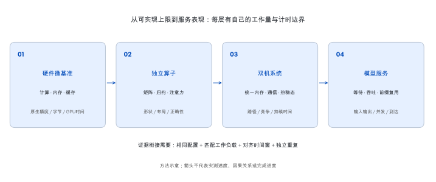

图 03-01｜研究层级与证据衔接


| 层级 | 测量边界 | 可回答的范围 |
| --- | --- | --- |
| GPU硬件 | 设备端运算与内存访问 | 特定精度、规模与状态下的可实现上限 |
| 独立算子 | 数据准备、内核执行、同步分别计时 | 实现效率、形状敏感性与数据搬运代价 |
| 双机系统 | CPU/GPU协同、集合通信与持续负载 | 资源竞争、通信代价及性能保持 |
| 模型服务 | 客户端经Infron至双节点再返回响应 | 真实路径的等待、吞吐、缓存与费用 |


GB10采用共享LPDDR5X统一内存；128GB不等于GPU独占可分配容量，双机256GB也不是单个共享地址池。273GB/s是每节点标称内存带宽；1PFLOP/s是稀疏FP4规格。效率比较必须匹配精度、稀疏性、频率和数据流量口径。GPU的L1/L2缓存以字节访问计数；推理前缀缓存以输入词元复用计数，两者分别统计。 [NVIDIA](https://docs.nvidia.com/dgx/dgx-spark/hardware.html)

### 理解硬件结果所需的概念

| 概念 | 定义与测量意义 |
| --- | --- |
| CUDA核心与Tensor Core | 前者执行通用并行运算，后者加速特定矩阵乘加。FP32／FP16／FP8／FP4分别描述数值格式；位数较少不等于任意任务必然更快。 |
| 矩阵乘法与M、N、K | GEMM指通用矩阵乘法。A为M×K、B为K×N，输出为M×N。矩阵形状改变并行度与数据复用，须与精度一起报告。 |
| GPU内核与CUDA Graphs | 内核是一次在GPU执行的程序；执行流组织有序任务。CUDA Graphs复用事先记录的任务依赖，可能减少CPU重复提交开销。 |
| L1/L2、共享内存与统一内存 | L1/L2是硬件缓存；CUDA共享内存是线程块使用的片上空间；GB10统一内存是CPU/GPU共享的系统内存。三者容量、延迟和访问规则不同。 |
| RDMA与GPU直接路径 | RDMA允许网卡远程读写注册内存；GPU直接路径还需确认网卡实际访问GPU缓冲区。普通RDMA测试本身不证明GPU直接通信。 |
| NCCL集合通信 | NCCL是GPU通信库。AllReduce聚合后把结果发给各节点；AllGather收集各节点分片；ReduceScatter聚合后把不同结果分片交给各节点。 |


### 评测基准：来源、任务形式与本次用途

本次以六套公开基准构成固定题库，并用长度、业务和缓存负载补充系统压力条件。公开基准原本用于评价模型回答；本研究使用其中的题目作为可重复的请求输入，记录等待时间、实际生成量、吞吐与节点资源。基准名称标识输入来源，不代表本次执行了该基准的完整能力评测。

| 基准与原始用途 | 本次输入构造与性能用途 | 实际选中任务示例 |
| --- | --- | --- |
| [MMLU-Pro](https://github.com/TIGER-AI-Lab/MMLU-Pro)<br>跨学科知识与推理选择题，原始测试集覆盖 14 个学科；通常按选项正确率评价。 | 使用问题及原始选项，去除少样本解题示范。提供含专业术语和选项列表的短输入。 | 直流电机需要哪种绕组；从给定选项中选择。<br>`mmlu_11888` |
| [MATH-500](https://huggingface.co/datasets/HuggingFaceH4/MATH-500/blob/6e4ed1a2a79af7d8630a6b768ec859cb5af4d3be/README.md)<br>由 MATH 基准选取的 500 道数学题，涵盖代数、几何、数论等；原任务评估数学答案正确性。 | 保留题干和数学表达式，要求把最终答案放入 \boxed{}。用于观察数学文本生成时的长度与等待。 | 求一个绝对值不等式的整数解个数。<br>`math_386` |
| [GSM8K](https://github.com/openai/grade-school-math)<br>小学数学应用题，通常需多步四则运算；原任务核对最终数值答案。使用 main/test 分割。 | 保留应用题，要求写出解答并以 #### 标记最终数值。提供自然语言叙述与运算步骤混合的负载。 | 根据三人的年龄倍数关系计算其中一人的年龄。<br>`gsm_1104` |
| [IFEval](https://arxiv.org/abs/2311.07911)<br>指令遵循评测，使用可程序检查的语言、格式、字数或关键词约束；原任务检查这些约束是否满足。 | 直接使用原始指令，保留其中的语言与格式约束。观察受约束请求的响应形态和实际生成量。 | 仅用波斯语写一首关于尤达进入另一宇宙的诗。<br>`ifeval_1477` |
| [HumanEval+](https://github.com/evalplus/evalplus/blob/v0.3.1/README.md)<br>Python 函数级程序生成；“+”表示 EvalPlus 扩充了正确性测试输入。原任务通过执行测试检验程序。 | 保留函数签名、说明和题内示例，要求返回完整 Python 代码块。用于测量函数生成的流式输出。 | 实现 largest_divisor(n)，返回小于 n 的最大约数。<br>`HumanEval_24` |
| [MBPP+](https://github.com/evalplus/evalplus/blob/v0.3.1/README.md)<br>基础 Python 编程任务；采用 EvalPlus 整理并扩展测试的 378 题版本。原任务检查程序功能正确性。 | 保留任务描述及题内断言示例，要求返回完整 Python 代码块。提供较短的代码生成输入。 | 实现返回两个数中较小值的函数，并满足题内断言。<br>`Mbpp_404` |


示例是已选任务的简短转述；发送时使用固定题库中的原始提示。参考解答和隐藏测试不加入请求，题目自带的示例或断言保留。HumanEval+、MBPP+ 的扩展测试未执行，“+”不会在本次转化为更多生成请求；不计算准确率、指令通过率或代码测试通过率。

### 数据版本、样本规模与长度分布

“来源规模”指本次读取的固定版本或测试分割，“候选数”指参与抽样的题目数，“选用数”指最终独立提示数。词元是分词器的计数单位，不等同于单词或汉字。下表长度按本模型分词器计算，仅计提示正文；实际接口输入还包含聊天模板和角色标记。

| 固定数据来源与版本 | 来源规模 → 候选数 → 选用数 | 正文词元：最短／中位／最长 |
| --- | --- | --- |
| [MMLU-Pro](https://huggingface.co/datasets/TIGER-Lab/MMLU-Pro/tree/b189ec765aa7ed75c8acfea42df31fdae71f97be)<br>版本：`b189ec765aa7` | **12,032 → 1,400 → 10** | **70 / 166 / 386** |
| [MATH-500](https://huggingface.co/datasets/HuggingFaceH4/MATH-500/tree/6e4ed1a2a79af7d8630a6b768ec859cb5af4d3be)<br>版本：`6e4ed1a2a79a` | **500 → 500 → 10** | **36 / 64 / 188** |
| [GSM8K](https://huggingface.co/datasets/openai/gsm8k/tree/740312add88f781978c0658806c59bc2815b9866)<br>版本：`740312add88f` | **1,319 → 1,319 → 10** | **46 / 76.5 / 112** |
| [IFEval](https://github.com/google-research/google-research/blob/0a1b0fe7298a58bca6dcb47112379d829bc0c0a5/instruction_following_eval/data/input_data.jsonl)<br>版本：`0a1b0fe7298a` | **541 → 541 → 10** | **24 / 43.5 / 83** |
| [HumanEval+](https://github.com/evalplus/evalplus/releases/tag/v0.3.1)<br>EvalPlus 0.3.1<br>SHA-256: `42526ec0e7d5` | **164 → 164 → 10** | **77 / 153 / 315** |
| [MBPP+](https://github.com/evalplus/evalplus/releases/tag/v0.3.1)<br>EvalPlus 0.3.1<br>SHA-256: `b54e76275524` | **378 → 378 → 10** | **55 / 72.5 / 144** |


版本栏展示提交标识或数据文件 SHA-256 的前 12 位；链接指向对应来源，完整标识与本地文件散列见[来源清单](../../2026-10-14_17-dual-spark/protocols/sources.json)。EvalPlus 0.3.1 是取数工具版本，两个数据文件另以各自散列固定。

<!--DATASET_PROFILE-->

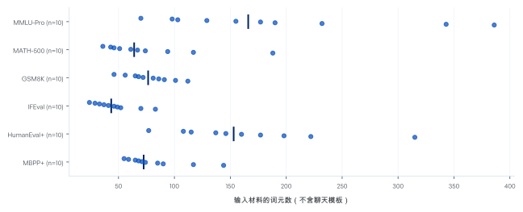

图 03-02｜题库长度分布


### 抽样方法与可比较范围

候选池共 4,302 条。MMLU-Pro 先从 12,032 道测试题中按 14 个学科各取 100 条，形成 1,400 条候选；其余五套使用表中完整版本或测试分割。随后，每套候选按提示正文词元数排序，分成十个数量尽量相等的长度层；每层按固定种子 `20261014-performance-v2` 与题目编号生成 SHA-256 排序，取最小者。最终每套 10 条，共 60 条；选择过程不使用模型输出。

最终 MMLU-Pro 样本覆盖工程、数学、物理、化学、健康、经济、计算机科学和法律八个学科，其中物理与经济各两条，其余各一条；MATH-500 样本覆盖七个原始主题中的五个。长度分层有助于保留提示长度差异，但每套 10 条不足以支持学科排名或完整题集的性能泛化。六套等量混合也不等于真实业务的流量占比。

同一组 60 条提示在并发 1／2／4／8 下各重复三轮，形成 720 次计划测量；低思考预算在并发 1／4 下各重复三轮，增加 360 次计划测量。这些重复用于比较性能，不增加独立题目数。自然题库输出上限为 1,024 词元，实际输出可提前结束；分题集比较时须同时查看实际输出长度和触顶比例。题目内容、输出量与缓存状态同时变化时，不能把延迟差异单独归因于题目“难度”。

[固定 60 条提示](../../2026-10-14_17-dual-spark/protocols/protocol/workloads.jsonl) · [抽样规则](../../2026-10-14_17-dual-spark/protocols/protocol/workload_manifest.json) · 规模与样本核对记录

### 性能负载：长度、业务与缓存

短题库无法独立覆盖长上下文、长输出与缓存保留行为，因此另设以下受控负载。表中数量均为计划调用量，包含相应预热、校准或对照；实际完成量见第05节及结果章节。这里的 1K = 1,024 词元，输出长度参数表示生成上限。

| 负载与材料来源 | 构造方式与计划规模 | 覆盖的性能范围 |
| --- | --- | --- |
| 长度与长输出：Project Gutenberg《战争与和平》普通文本，以及本地生成的业务记录 | 输入与输出各设 1／2／4／8／16／32／64／128／256K 九档。81 个组合中，63 个有安全余量、1 个恰达边界、17 个越界；选取轴线、对角线及近边界条件等，共 299 次扩展调用。 | 区分输入处理等待与持续生成压力；同时记录输出达成率。256K 为输入与输出共享上限，不代表两者可同时达到 256K。 |
| 八类业务：本地生成的工单、订单、运维记录、代码及多轮消息 | 分类、改写、起草、摘要、分析、抽取、代码修改、多轮问答。每类在并发 1／4 下各 12 次测量＋1 次预热，共 192 次测量＋16 次预热＝208 次。 | 比较不同输入／输出比例下的响应与处理能力。材料为合成场景，场景比例不代表线上流量。 |
| 前缀比例：具有共同开头和不同后缀的合成记录 | 8K／32K 输入 × 0%／25%／50%／75%／90%／100% 共享前缀 × 6 个独立前缀对；每对预热和复测各一次，共 144 次。与业务负载合计 352 次。 | 目标比例控制输入的公共前缀；实际缓存命中由服务计数器核验，二者分别报告。 |
| 缓存保留与稳定性：独立生成的业务前缀与竞争请求 | 业务交叉 72 次、间隔保留 36 次、竞争与恢复 24 次、周期复用 28 次，共 160 次；与上述 144 次前缀比例实验分别统计。 | 观察空闲间隔、其他请求和重复访问后的复用变化；结合缓存计数窗口与延迟。短时诊断不等于长期稳定性证明。 |


长文本来源：[Project Gutenberg](https://www.gutenberg.org/ebooks/2600.txt.utf-8)及[固定语料散列](../../2026-10-14_17-dual-spark/protocols/plans/corpus_provenance.json)。具体长度组合、业务输入／输出示例、缓存间隔和并发控制见本节后文；全部代码与数据路径见附录 C。GPU 计算、内存和双机通信采用第 06–07 节的独立系统基准，与这里的模型请求题库分开统计。

### 模型服务实验与材料

每个测试条件固定输入、输出上限、思考档位和并发。自然题库重复三轮，长度矩阵分四个区组；请求和区组顺序按固定种子生成。基础与扩展负载均保留自然结束行为；长度达成按源站实际生成量核验，所有速度使用实际工作量。

固定并发测试在请求结束后补充新请求，用于比较处理能力；独立到达测试按预定随机时刻发起请求，用于观察排队和拒绝。两者全局在途上限均为 8。完整的执行数量、顺序和停止条件见 测试计划。

<!--SYSTEM_MAP-->

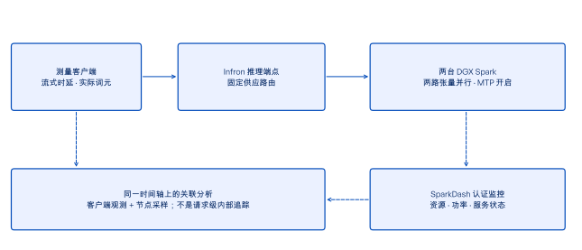

图 03-03｜测量路径


### 与 SGLang、vLLM 官方评测方法的对应

实际推理引擎为 SGLang 0.5.21；vLLM 0.31.0 仅作为测量方法参照。下表区分官方工具的设计与本实验采用的规则，不构成两个引擎的性能比较。

| 方法依据 | 本实验的实现与解释 |
| --- | --- |
| [SGLang: benchmark layers](https://docs.sglang.io/docs/developer_guide/benchmark_and_profiling) | 在线服务测试包含 HTTP、调度和生成。本次再包含 Infron 与公网路径；离线引擎或单批算子结果不能直接代替该服务延迟。 |
| [SGLang: sample count](https://docs.sglang.io/docs/developer_guide/benchmark_and_profiling) | 官方建议请求数至少为最大并发的5倍。重复区组在并发1／4时分别用8／20次，重复3组；仍检查区组间变化，不仅凭样本数认定稳态。 |
| [SGLang 0.5.21: EOS](https://github.com/sgl-project/sglang/blob/v0.5.21/python/sglang/benchmark/serving.py) · [vLLM 0.31.0: EOS](https://docs.vllm.ai/en/v0.31.0/cli/bench/serve/) | 两个工具的默认结束词元处理不同，显式固定参数。先比较自然结束与 ignore_eos=true，并检查转发请求和源站实际生成量；仅通过核验的固定输出进入长度受控比较。 |
| [vLLM: arrival / goodput](https://docs.vllm.ai/en/v0.31.0/cli/bench/serve/) | 独立到达、客户端并发和达标吞吐分别记录。保留计划到达、实际发送、首片段和结束时间；排队与拒绝纳入用户等待及到达分母。当前采用泊松到达，突发到达作为后续扩展。 |
| [SGLang: shared prefixes](https://docs.sglang.io/docs/developer_guide/bench_serving) | 共享前缀作为可控输入；实际命中来自有效字段或隔离窗口的计数增量。自然业务与合成长输出分开，不用一种材料代表全部生成行为。 |


方法与源代码快照均保留版本和 SHA-256。框架命令只作为参照，本轮使用统一采集器保证同一路由、预算和证据格式。 源码及文档清单

公网长度扩展保留自然结束：校准请求的ignore_eos字段未传递到源站。输出达到上限的98%–100%仅表示该次长度达成。独立原生引擎实验使用已核验的固定输出，见第08节。 执行模式与证据

### 实验材料与长度构造

六套公开基准的来源、固定版本、抽样规则及 60 条提示的长度分布见本章前文。以下说明如何在这些短题目之外控制输入长度、输出上限和前缀结构。

长度控制材料为 Project Gutenberg 的《战争与和平》普通文本；按固定偏移抽取，并在开头放置不同标识，降低跨请求前缀复用。全文来源与 SHA-256 已保存；这类材料用于隔离长度因素，并不代表业务需求分布。业务扩展则使用本地生成的订单、工单、运维记录及代码，不含真实客户内容。 [Project Gutenberg](https://www.gutenberg.org/ebooks/2600.txt.utf-8) · [自然题目抽样清单](../../2026-10-14_17-dual-spark/protocols/protocol/workload_manifest.json) · [长文本来源与散列](../../2026-10-14_17-dual-spark/protocols/plans/corpus_provenance.json)

### 长度覆盖：从 1K 到 256K 的可行域

**1K = 1,024词元。** 输入和输出分别设置1／2／4／8／16／32／64／128／256K九档。输入按完整聊天模板计数，输出是请求上限；实际生成量单独记录。当前262,144词元上下文由输入和输出共用，因此不能执行256K输入再加1K输出，也不能执行1K输入加256K输出。

81个设计格中，63格在预留1K后满足长度条件；128K＋128K只有零余量，列为边界；17格超出上下文。只挑选21个轴线／对角线条件执行，并增加254K→1K、1K→254K两个近边界探针。63格“长度可行”不代表网关输出上限、可用内存或时限已经验证。

<!--LENGTH_DOMAIN-->

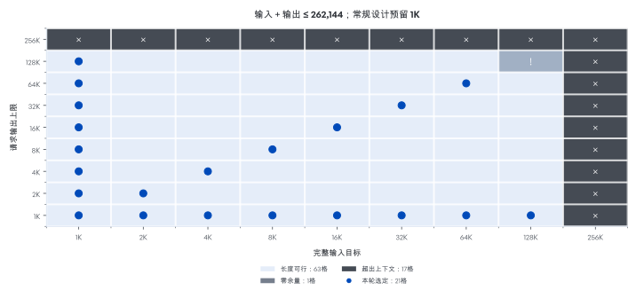

图 03-04｜长度可行域


| 负载组 | 输入→输出上限 | 调用数 | 测量目的 |
| --- | --- | --- | --- |
| 输入轴线 | **1–128K** → **1K** | **24** | 保持输出上限，观察输入处理与首字等待。 |
| 输出轴线 | **1K** → **2–128K** | **13** | 保持输入；≤**8K**每格**3次**，≥**16K**每格**1次**。 |
| 平衡长度 | **2／4／8／16／32／64K** → 同档 / same | **12** | 观察输入和生成共同增长；高档是单次探针。 |
| 近边界 | **254K** → **1K**；**1K** → **254K** | **2** | 每格**1次**，条件满足才发起；不报告尾分位。 |
| 长前缀 | **64／128K** → **1K** | **36** | **0／50／100%**目标重合；每格**3**对首次／复测。 |
| 业务锚点 | 见下表 / below | **32** | 八类各**1次**预热＋**3次**测量，自然结束。 |
| 重复区组 | **1K** → **4K**；**32K** → **1K** | **178** | 并发1／4，每格3组×**8／20次**；另有**10次**预热。 |
| 参数校准 | **1K** → **1K** | **2** | 同一短答要求分别采用自然结束与忽略结束词元。 |


长度扩展预先固定299次调用，按轴线、对角线与近边界组合选择；实际完成量与达成情况见第05、08节。

#### 八类业务在长度空间中的代表点


| 业务／长度 | 背景 | 典型输入→示意输出 |
| --- | --- | --- |
| 批量工单分类<br>4K → 1K | 多工单合并分流；记录变多时输出分类列表。 | 输入：20张工单；输出：[{id, category, reason}, …] |
| 文档改写<br>4K → 4K | 接近等量的信息重写，保留原文结构。 | 输入：运维流程；输出：客户操作指南章节。 |
| 长文起草<br>1K → 8K | 简报扩展为手册，生成阶段占比较大。 | 输入：上线目标与约束；输出：准备、执行、恢复流程。 |
| 长文摘要<br>32K → 1K | 检索材料或日志压缩成少量结论。 | 输入：一个月记录；输出：关键事件与待办。 |
| 证据分析<br>32K → 8K | 长材料加长解释，同时施加输入与生成负担。 | 输入：多批工单；输出：趋势、证据与替代解释。 |
| 批量字段提取<br>8K → 1K | 文档转结构化列表；没有启用约束解码。 | 输入：多份订单；输出：[{order_id, amount, status}, …] |
| 代码修改<br>16K → 4K | 多函数上下文对应补丁与说明。 | 输入：账单模块；输出：幂等检查补丁及说明。 |
| 多轮助理<br>16K → 2K | 历史消息加追问，保留多消息聊天结构。 | 输入：历史工单＋下一步怎么做；输出：操作建议。 |


以上输出是格式示意。长输出合成材料使用变化的编号、日期与业务记录，不要求分类任务产生256K答案。原有八类短负载保留为基线；新代表点与基线分组展示，不混合成一个业务平均分。

#### 进入条件与解释边界

固定长度模式先核验转发的 ignore_eos=true 和 max_tokens，并要求源站实际生成达到上限的98%–100%。长度档按递增顺序保护性执行，顺序与时间效应可能混杂；未通过固定输出校准时，未发送条件采用自然结束；上一个输出档未达长度时不升级下一档。输出上限为1K的输入轴线每格3次，≥16K输出探针每格仅1次，不能据此给出稳定吞吐或95／99分位。代表区组通过完整性、实际长度与计数检查后才比较吞吐。

发送前检查完整输入＋输出上限≤262,144，以及并发×单请求预算≤262,144的保守占用包络；后者是本实验保护规则，不是引擎KV容量测量。时间准入按每请求120秒＋输出上限×0.08秒＋输入／300秒估算，区组结束再留300秒排空；0.08秒只是准入假设。保留原监控与费用保护，实际提前结束和未执行原因均记录。长前缀首次／复测分别采集隔离计数窗口，每格仅3对，不能证明长期保留。

### 八类业务的短负载基线

输入／输出比例先定义为“目标输入 token 数 ÷ 输出 token 上限”。它控制实验形状，但实际生成会提前结束；结果另报实际输入／实际输出比例。每类在并发 1 和 4 下各安排 12 次测量与 1 次预热，合计 208 次。每个条件分成 3 个区组，每组 4 次，区组顺序固定随机化。并发对照使用同一批材料，开头加入不同标识以减少跨条件前缀复用；样本量只支持诊断，不用于稳定的尾分位估计。

| 场景 | 输入目标 → 输出上限 | 名义比例 | 背景与解释 |
| --- | --- | --- | --- |
| 工单分类 | **512 → 64** | **8:1** | 短问短答，模拟自动分流；关注等待而非长生成。 |
| 等量改写 | **2,048 → 2,048** | **1:1** | 输入输出规模接近，模拟文案重写；观察解码占用。 |
| 短提示长生成 | **512 → 2,048** | **0.25:1** | 少量要求生成长文，模拟内容起草；观察长输出成本。 |
| 长文档摘要 | **32,768 → 128** | **256:1** | 长材料压缩成短摘要；关注预填充与首片段等待。 |
| 长文档分析 | **32,768 → 2,048** | **16:1** | 长输入结合长分析；观察两阶段共同压力。 |
| 结构化提取 | **2,048 → 128** | **16:1** | 文本到短 JSON，模拟字段抽取；未启用 JSON 模式或工具接口。 |
| 代码修改 | **8,192 → 512** | **16:1** | 代码上下文和局部补丁；观察中长输入后短输出。 |
| 多轮业务助理 | **8,192 → 512** | **16:1** | 带历史的跟进问答；使用真实多条聊天消息结构。 |


<!--SHAPES-->

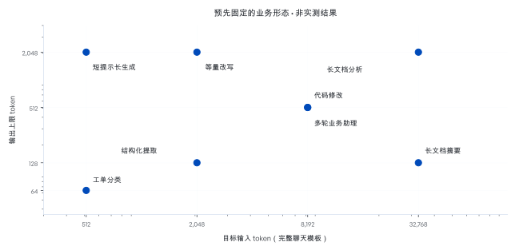

图 03-05｜业务长度设计图


### 典型输入／输出样例

以下均为精简的教学样例，输出为人工编写的形式示意，**不是本模型的实测回答**。实际请求包含为目标长度生成的记录；输入输出全文保留在逐请求证据中。


| 场景 | 典型输入（节选） | 示意输出（节选） |
| --- | --- | --- |
| 工单分类 | 客户已付款，但重置访问权限失败。请分类。 | {"category":"access","reason":"付款完成后仍无法访问"} |
| 等量改写 | 将运维说明改写成客户操作指南，保留步骤与限制。 | 第一步，核对订单号；第二步，检查付款状态…… |
| 短提示长生成 | 基于上线简报，撰写含准备、操作和恢复流程的手册。 | 上线准备：确认负责人、回滚版本和告警规则…… |
| 长文档摘要 | 以下为长篇运营记录。用五点概括日期与未解决问题。 | 1. 访问恢复仍待处理；2. 已核对订单付款…… |
| 长文档分析 | 分析多批运营记录，列出趋势、证据、替代解释和下一步。 | 访问问题集中在付款后流程；需要进一步区分权限同步和客户端状态…… |
| 结构化提取 | 订单 INV-204，120 美元，已付款。返回四字段 JSON。 | {"order_id":"INV-204","amount":120,"currency":"USD","status":"paid"} |
| 代码修改 | 修改账单模块，避免超时重试重复处理同一订单。 | if invoice_id in processed_ids:<br>    return existing_result |
| 多轮业务助理 | 历史：客户已付款，访问重置失败。追问：运营团队下一步做什么？ | 先核对订单与付款状态，再检查访问权限同步并通知客户进展。 |


### 缓存比例：从可控输入到可观察命中

扩展使用 8,192 与 32,768 两档输入、0%／25%／50%／75%／90%／100% 六档目标共享前缀，每格六个独立前缀对，共 72 对、144 次调用。每对串行执行一次预热和一次测量，输出上限均为 256，其他生成参数也相同。比例按完整聊天模板的 token 最长公共前缀精确复算；0% 仍可能共享模板头，故记录实际比例而不强行记零。

| 共享目标 | 业务背景 | 输入变化与示意输出 |
| --- | --- | --- |
| **0%** | 互不相关的新工单 | 预热：工单 A；测量：不同记录 B。输出：B 的摘要。 |
| **25%** | 少量固定规则，多数动态材料 | 相同开头规则＋不同订单明细。输出：新订单处理要点。 |
| **50%** | 公共知识与用户上下文规模相近 | 相同前半部分＋新的后半部分。输出：新上下文摘要。 |
| **75%** | 较长固定知识材料，多条客户问询 | 知识主体相同，末段工单变化。输出：当前工单建议。 |
| **90%** | 大型公共材料，短个性化追问 | 保留九成前缀，替换末尾记录。输出：针对新记录的摘要。 |
| **100%** | 完全相同输入重复访问 | 完整输入相同再次请求。输出：同一材料的摘要；仍执行生成。 |


<!--CACHE_DESIGN-->

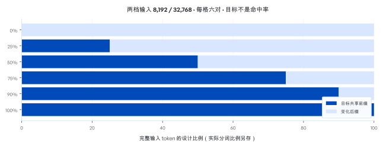

图 03-06｜前缀控制图


共享前缀比例描述输入相似程度；实际缓存命中比例来自服务字段，字段缺失时不估算。

### GPU与系统实验控制

独占窗口覆盖计算、内存、缓存、调度和独立算子；第二节点复验关键条件，双机执行集合通信。固定版本、数据类型、布局、内存状态及功耗策略；基础矩阵每格10轮；扩展矩阵一般5轮、预设关键条件10轮。普通启动与CUDA Graphs、串行与重叠、CPU内存与计算干扰采用配对条件。数值校验与性能剖析分开记录。完整条件、稳态规则及排程见测试计划第03节。


### 受控长度、混合请求与低复用前缀的实验设计

长度、完整混合到达序列和低复用前缀使用专用双节点窗口。请求路径为Infron → Cloudflare → 预注册载荷转发入口 → SGLang；两臂使用相同路径。采样日期为2026-10-19，启动参数见第1节。引擎原生请求、其他公网负载和硬件实验保留各自的配置快照与计时边界。


| 部分 | 固定数量 | 控制条件 |
| --- | --- | --- |
| 路由预检 | 1 | 32词元上限；核验实际路由和源站参数。 |
| 公网长度 | 8 | 8个输入／输出预算组合；每条件1条。 |
| 干扰预热 | 320 | 5对×2臂×32条；每臂预热全部短输入，输出参数相同。 |
| 干扰正式短请求 | 320 | 5对×2臂×32条；配对输入和完整泊松到达序列相同，名义到达率0.12次/秒。 |
| 混合臂长请求 | 40 | 每对8条；32K输入、128输出上限，均匀散布于短请求窗口。 |
| 缓存对照 | 6 | 3个独立对，每对2条64K输入；早期唯一标记使设计前缀重叠为0%。 |

总计 **695条逻辑请求**；预热、重试和正式测量分列。干扰臂交替先后顺序；客户端短／长工作协程分别最多4／2，总体授权上限8。完整保留32个短请求的到达时刻，不截断时间序列；队列上限32，出队时以5秒作为超时判定阈值；实际拒绝等待可以超过5秒，全部拒绝计入结果。温度达到85°C退避，低于75°C并稳定30秒后恢复。


<a id="section-04"></a>

## 04 · 指标定义与统计方法

| 指标 | 含义与口径 |
| --- | --- |
| 正文首字延迟 | 从发送请求到第一个正文片段，单位秒；主要反映用户开始看到答案前的等待。 |
| 首个生成片段延迟 | 从发送到第一段思考、正文或工具内容；思考开启时可能早于正文。 |
| 完成时间 | 从发送到完整响应流结束，单位秒。 |
| 平均每词元耗时（估算） | （完成时间 − 首个生成片段延迟）÷（实际生成词元 − 1）；含流结束开销，不是逐词元间隔实测。 |
| 系统生成吞吐 | 同一条件全部有效区组的生成词元总数 ÷ 区组总时长，词元/s。 |
| 达标吞吐 | 同时满足等待和生成速度门槛的完整请求数 ÷ 测量窗口。等待从计划到达起算，包含客户端排队；拒绝保留在到达分母。 |
| 长度与缓存 | 分别记录输入、实际输出、输出上限、实际前缀重合及服务报告缓存量；输出上限不是输出量。 |
| 节点资源 | GPU 活跃度、内存、温度、功率及运行状态按相同负载窗口统计；估算整机功率不是插座电表读数。 |


<!--MEASUREMENT-->

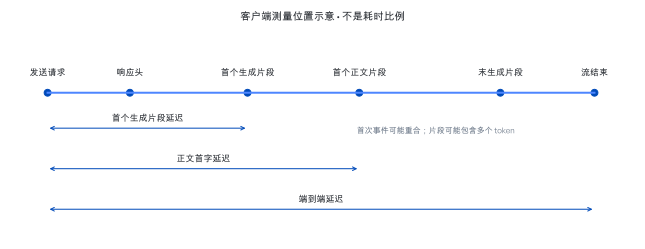

图 04-01｜时间边界


中位数表示典型响应；95分位表示约95%的样本不超过该值。吞吐和延迟比较使用同一批连续完整区组，预热单列；失败记录保留在可靠性统计。每组同时给出请求数和区组数，重复同一题不增加独立题目数量。业务每格12次、缓存每格6对，只作诊断，不报告稳健99分位。

词元速度以核对后的源站生成计数为准；费用使用对应请求的实际账单。缺失计数、缓存或监控不补零。详细字段、公式和统计说明见附录A。

流式传输使用服务端发送事件（SSE）。一个事件可以包含多个词元，多词元预测时尤需注意：事件间隔反映客户端接收节奏，不能直接称为引擎逐词元延迟。长度扩展另报实际生成／上限的达成率、完整输入误差、长度合格数及每个区组的实际工作量。

#### 缓存指标：输入结构、实际复用和稳定性


| 缓存指标 | 定义与判定 |
| --- | --- |
| 输入前缀重合比例 | 完整聊天模板的最长公共词元前缀长度／探测输入长度。属于受控输入结构。 |
| 逐请求缓存词元比例 | 仅在字段有效的请求中，已缓存输入词元总数／输入词元总数；同时给出字段覆盖数／完整请求数。 |
| 有命中的请求比例 | 有效字段中缓存词元>0的请求数／有效字段请求数；模板少量命中也计入，不代表整段输入复用。 |
| 窗口缓存词元比例 | 同一服务窗口的累计缓存量增量／累计输入量增量；检查新鲜度、计数复位、服务标识及与请求计数的一致性，只取头节点一次。 |
| 配对等待收益 | 首次正文首字延迟−重复请求正文首字延迟，正值表示重复请求更快；另列相对变化。网络、执行顺序和负载可能共同影响，不直接称为缓存因果加速。 |
| 保留、竞争与恢复 | 按实际空闲间隔比较缓存比例；竞争后与立即复测相比，观察比例下降和等待增加；再次重复观察恢复。只对已施加的压力与时长成立。 |
| 时间稳定性与覆盖 | 报告有效窗口数／全部窗口数、实际跨度、词元加权平均、范围及至少3个有效窗口时的标准差；监控缺失、复位不补零或跨段相连。 |


### GPU与系统指标的边界

计算以指定精度的运算量／设备时间报告；内存带宽区分有效读写字节和实际总线流量。硬件缓存的分母是访问量，前缀缓存的分母是输入词元。内核时间、CPU提交、集合通信与公网服务时间分别报告，不能跨实验相减。持续性能采用同负载预热基线；能效使用相同边界的积分能量。附录A给出公式、单位和数值校验要求。

统计以独立轮次或配对区组为单位，报告全部样本、有效分母、中位数、四分位距及95%区间；关键配对比较采用轮次成簇重采样，并给出各轮原始点。5轮扫描以描述性统计为主；10轮也不保证高精度区间。比率先在配对轮内计算再汇总。固定阶段之间随机化条件顺序，冷／热缓存及首次访问实验单列。短时微基准不报告服务尾延迟；少量轮次不报告稳健p99。稳态性能下降超过5%且持续两个10分钟窗口标为复核信号，结合温度、频率和负载验证，不能直接判为硬件故障。细粒度剖析有额外开销，计时结果与剖析结果分开保存。


### 准入、配对与计数器归属规则


| 指标 | 定义与边界 |
| --- | --- |
| 从到达到首字的等待 | 首个可见正文到达客户端的时间 − 预定到达时间；包含客户端调度、排队和已核验重试。 |
| 首字等待中位数／95分位 | 每臂32条短请求的样本分位数，线性插值；95分位对少量尾部样本敏感，不报告p99。 |
| 干扰比值 | 同一配对的混合臂中位等待 ÷ 孤立臂中位等待；两臂全部短请求完整、载荷和到达匹配后才计算。 |
| 缓存词元比例 | 源站缓存词元增量 ÷ 输入词元增量；两端空闲、计数单调，完成数和输入／输出用量与本批逐请求记录一致。 |
| 实际生成量 | 源站原始usage的completion_tokens；公网usage、计费量和生成上限分别保存。 |
| 统计重复单位 | 5个配对区组；每组32条相关短请求不是32个独立实验。报告逐对结果与范围，不将全部请求当独立重复来缩窄置信区间。 |

响应必须具有正常终态、流结束标志、有效源站用量及一致计数器窗口。缺失窗口显示不可用；0%命中只在有效分母上报告。


<a id="section-05"></a>

## 05 · 实际覆盖与分析样本

实验覆盖按测量单位分别报告：硬件轮次、通信试验、请求、配对和连续窗口具有不同分母。完成响应、达到输出上限和满足服务目标是不同结果。各组保留实际采样日期、配置和排除记录。

### 固定条件与有效观测

| 测试项 | 有效观测／计划 | 统计口径 |
| --- | --- | --- |
| 单节点硬件轮次 | **3,740/3,740** | 固定条件、固定轮次 |
| 双机集合通信 | **840/840** | 固定条件、固定轮次 |
| 计算与通信重叠 | **120/120** | 固定条件、固定轮次 |
| 原生固定长输出 | **16/16** | 固定条件、固定轮次 |
| GPU剖析配对 | **9/9** | 固定条件、固定轮次 |
| 64K缓存配对 | **3/3** | 固定条件、固定轮次 |
| FP64矩阵轮次 | **30/30** | 固定条件、固定轮次 |
| 代表性计数器 | **12/12** | 固定条件、固定轮次 |
| 公网连续一小时 | **1/1** | 固定条件、固定轮次 |
| 公网大输出预算 | **8/8** | 各条件1条自然结束响应；输出上限与实际长度分列。 |
| 完整到达序列的混合负载 | **5/5** | **4/5**可估计完整配对效应；第5组混合臂**3/32**短请求本地拒绝。 |
| 64K低复用前缀 | **3/3** | 每对2条；6个源站计数器窗口全部可归属。 |


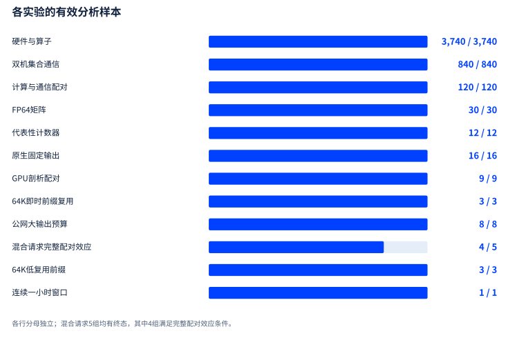

图 05-01｜分层实验覆盖与效应估计资格


### 公网请求分组与结果

表中区分固定样本清单与条件调用上限；后者是停止约束，不是必须用满的请求数量。

| 请求分组 | 设计数量 | 已发送逻辑请求 | 完整响应 | 未完整响应 |
| --- | --- | --- | --- | --- |
| 接口校准 | 12 固定 | 12 | 12 | 0 |
| 短题库与并发 | 720 固定 | 720 | 718 | 2 |
| 输入／输出矩阵 | 1,440 固定 | 1,440 | 1,435 | 5 |
| 思考预算配对 | 360 固定 | 360 | 360 | 0 |
| 上下文与边界 | 37 固定 | 37 | 36 | 1 |
| 前缀复用 | 90 固定 | 90 | 90 | 0 |
| 业务与缓存 | 512 固定 | 512 | 507 | 5 |
| 开放到达与混合负载 | 2,000 上限 | 783 | 783 | 0 |
| 长度与持续窗口 | 3,000 上限 | 929 | 925 | 4 |

上表来自10月14–17日的服务矩阵。另有独立并发参考、业务长度、混合调度与一小时窗口的**1,028条**完整公网响应，按其自身条件分析。原生引擎的**231条**正式请求与公网请求分开计量。

10月19日受控长度、完整混合序列和低复用前缀实验共**695个逻辑请求**：**692条**完整源站响应和**3条**本地拒绝。其构成为1条校准、8条长度观测、320条预热、320条正式短请求、40条混合长请求及6条缓存请求。另归档4条入口隔离前的探针；**696次**物理已发尝试均有账单归属。

### 排除记录与结论边界

| 范围 | 观测记录 | 分析规则 |
| --- | --- | --- |
| 长度清单 | 299项中290条完整、1条不完整、8条未发送；32K/8K条件另有4条完整匹配观测，大输出预算组覆盖8个条件。 | 按条件索引可获得响应证据；不重写单次请求状态，不把输出预算当实际长度。 |
| 截断到达序列 | 5对候选中3对执行、2对未进入；无完整配对效应。 | 不与完整到达序列的5对混合负载合并估计。 |
| 计数器缺失 | 原始长度缓存18个窗口中17个有效；64K低复用组另有6个可归属窗口。 | 缺失值不记作零命中；按请求和计数窗口分别归属。 |
| 公网固定长输出 | 公网请求自然结束；原生固定输出最高260,096词元。 | 原生结果不能替代公网定长容量。 |
| 仪器与设备范围 | H200同负载、插座电表、完整物理DRAM字节及精确逐词元时钟未实测。 | 保留规格参照与估算，避免将其标作实测。 |

## 06 · GPU计算、内存与算子

**资源条件与比较方法。** 驻留条件保留模型权重和服务进程；卸载条件在专用窗口停止双机推理进程，保持驱动、时钟策略与硬件相同。两组分别预热并执行相同基础矩阵，各自报告有效轮次。执行时间与内存状态同时变化，差值是资源条件的整体差异，不能单独证明缓存、调频或芯片机制的因果效应。

| 节点 | 资源条件 | 计划轮次 | 归档有效计时 | 内存保护跳过 |
| --- | --- | --- | --- | --- |
| 0 | 模型驻留 | **1070** | **684** | **386** |
| 0 | 模型卸载 | **1070** | **1070** | **0** |
| 1 | 模型驻留 | **1070** | **990** | **80** |
| 1 | 模型卸载 | **1070** | **1070** | **0** |


服务恢复核验：通过；双节点启动参数、环境、工作目录及引擎核心配置与停服前一致。

基础矩阵为每节点107个条件、每条件10轮；扩展矩阵覆盖通用FP32乘加、随机指针追踪、共享内存、统一内存访问、CPU竞争、多执行流及受支持的低精度／2:4稀疏矩阵计算。每次计时前后验证结果，保护跳过和不支持项不进入性能分母。49条校准观测单独归档，不加入这些重复轮次。

| 节点 | 实验层 | 计划轮次 | 归档有效 | 保护跳过 | 不支持 | 失败 | 待完成 |
| --- | --- | --- | --- | --- | --- | --- | --- |
| 0 | 基础矩阵 | **1070** | **1070** | **0** | **0** | **0** | **0** |
| 0 | 扩展矩阵 | **800** | **800** | **0** | **0** | **0** | **0** |
| 1 | 基础矩阵 | **1070** | **1070** | **0** | **0** | **0** | **0** |
| 1 | 扩展矩阵 | **800** | **800** | **0** | **0** | **0** | **0** |


**8条**接口或校验边界不合格的记录单列审计，不计入性能样本及有效覆盖；原始记录与排除依据保留在分析汇总中。

**指标口径。** TFLOP/s为每秒万亿次浮点运算；矩阵乘法按2MNK计数，2:4稀疏结果同时保留实际非零运算量，图中使用稠密等效口径。有效GB/s统计程序请求的读写字节，不等于DRAM物理流量。CUDA事件区间包含重复提交的主机间隙；随机指针访问的ns值也包含这一边界开销，不能解释为单条加载指令的固有延迟。统计采用各条件独立轮次的中位数和观测范围，不将循环迭代或两台设备当成大量独立设备样本。

<!--HARDWARE_UNLOADED_COMPUTE-->

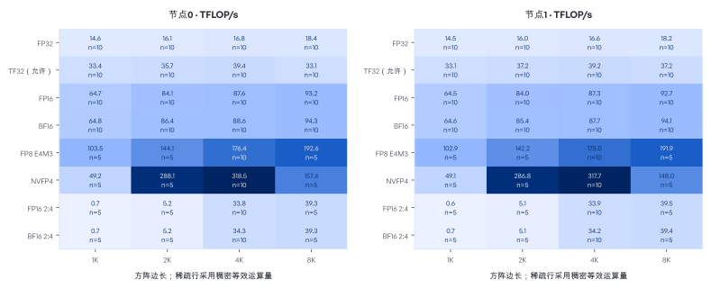

图 06-01｜精度与规模


关键形状的逐精度、逐节点统计见附录B；本节图示保留规模趋势。


### 独立算子与调用边界

归约、Softmax和RMSNorm使用已安装PyTorch库；RMSNorm保留库内部输出分配。注意力使用强制Flash SDPA，BF16、16头、每头128维且不加因果掩码，分别测全长查询和单查询；这些是固定合成张量，不是该模型完整预填充或解码。**1M**元素加法比较普通提交与图重放，保持计算量一致。

<!--HARDWARE_UNLOADED_OPERATORS-->

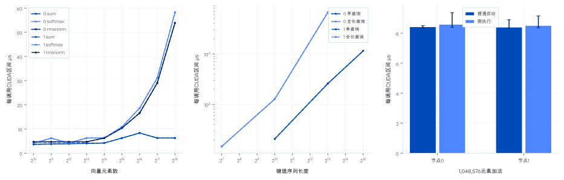

图 06-02｜算子规模与启动方式


### 通用计算、数据供给与资源竞争

通用FP32测试以显式乘加指令比较**1条**依赖链与**8条**独立链，在相同每线程乘加数量下改变线程块和总并行量；编译汇编留档。随机指针测试让访问位置依赖上次加载结果，以128字节间距构造完整随机环，分别使用ca／cg缓存提示。共享内存改变同一线程束的地址步长。CPU竞争使用固定核心上的0／1／4／10／20个工作进程，以内存流和CPU计算作对照。多流比较保持每一串行／并行配对的矩阵数量相同。

<!--HARDWARE_UNLOADED_MEMORY-->

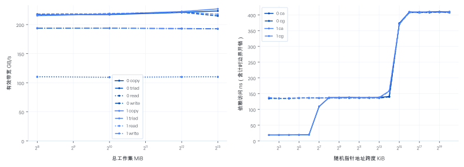

图 06-03｜数据供给曲线


| 实验 | 节点×条件 | 有效轮次 | 解释 |
| --- | --- | --- | --- |
| 通用FP32乘加 | **36** | **180** | 逐条件数据见CSV；单位和资源边界按工作负载区分 |
| 共享内存步长 | **12** | **60** | 逐条件数据见CSV；单位和资源边界按工作负载区分 |
| 空内核启动 | **4** | **40** | 逐条件数据见CSV；单位和资源边界按工作负载区分 |
| 多执行流 | **16** | **80** | 逐条件数据见CSV；单位和资源边界按工作负载区分 |
| CPU资源竞争 | **18** | **90** | 逐条件数据见CSV；单位和资源边界按工作负载区分 |
| 管理内存首次／重复访问 | **2** | **10** | 逐条件数据见CSV；单位和资源边界按工作负载区分 |


<!--HARDWARE_UNLOADED_FMA-->

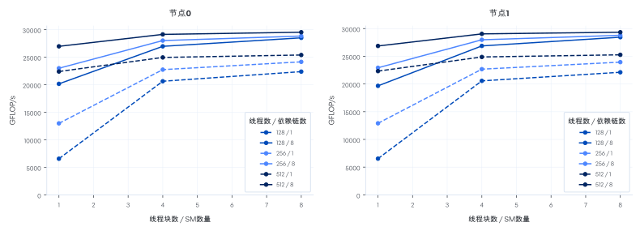

图 06-04｜通用FP32并行性


<!--HARDWARE_UNLOADED_CONTENTION-->

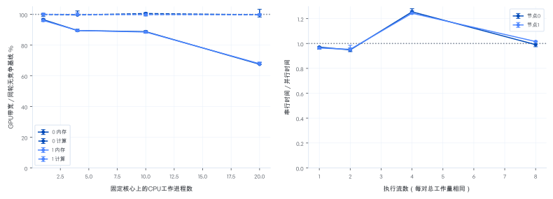

图 06-05｜资源竞争与多流


<!--HARDWARE_UNLOADED_LAUNCH_SHARED-->

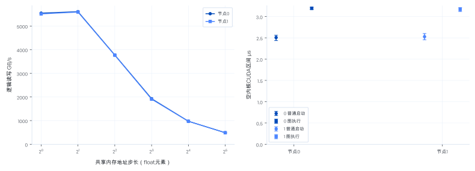

图 06-06｜共享内存与启动


<!--HARDWARE_UNLOADED_MANAGED-->

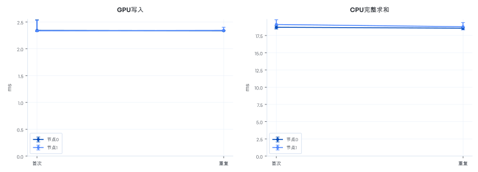

图 06-07｜统一内存访问顺序


| 节点 | 观察 | 结果 | 适用条件 |
| --- | --- | --- | --- |
| 0 | 通用FP32最高条件中位值 | **29529.7 GFLOP/s** | **512**线程、**8**×SM线程块、**8**链；**5**轮 |
| 0 | CPU竞争条件保持率范围 | **67.49–100.55%** | **8**个条件的中位比值；逐条件范围见图 |
| 0 | 多流配对加速比范围 | **0.95–1.25**× | **4**个条件的中位比值；逐条件范围见图 |
| 1 | 通用FP32最高条件中位值 | **29341.2 GFLOP/s** | **512**线程、**8**×SM线程块、**8**链；**5**轮 |
| 1 | CPU竞争条件保持率范围 | **67.82–100.00%** | **8**个条件的中位比值；逐条件范围见图 |
| 1 | 多流配对加速比范围 | **0.95–1.24**× | **4**个条件的中位比值；逐条件范围见图 |


NVFP4专项使用可精确表示的E2M1输入，显式固定每16元素块的幅度上限以获得单位尺度，先验证打包结果再测矩阵乘法。该控制隔离矩阵计算误差；不代表生产权重的量化误差或生产MoE内核性能。量化／打包和稀疏压缩耗时另外保存，内核轨迹与无剖析计时分开。硬件计数器按后文的代表性核函数单独统计；物理DRAM字节字段不可用，不以零值替代。

[本批逐条数据、条件汇总与保护状态](../../2026-10-14_17-dual-spark/data/hardware/summary.json) · [有效计时CSV](../../2026-10-14_17-dual-spark/data/hardware/measurements.csv)。模型驻留下因内存不足跳过的条件，不能标记为芯片不支持；驻留与卸载模型后的结果按独立条件报告，不合并轮次或将差异直接归因于单个硬件机制。

<!--REVIEW_NODE_PARITY-->

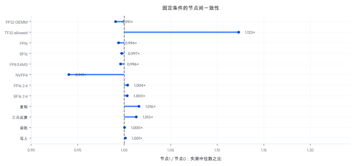

图 06-08｜节点一致性


### FP64矩阵计算

卸载模型后运行CUDA上的双精度矩阵乘法，乘加按两次运算计数。输入为可精确表示的有符号二进制分数，每轮将九个跨行列位置与CPU双精度参考比较；下表只纳入校验通过的轮次。

| 节点 | M=N=K | n | TFLOP/s 中位数［范围］ |
| --- | --- | --- | --- |
| 0 | **1024** | **5** | **0.4130** [0.4107–0.4157] |
| 0 | **4096** | **5** | **0.4254** [0.4246–0.4254] |
| 0 | **8192** | **5** | **0.4280** [0.4280–0.4281] |
| 1 | **1024** | **5** | **0.4086** [0.4048–0.4097] |
| 1 | **4096** | **5** | **0.4246** [0.4246–0.4250] |
| 1 | **8192** | **5** | **0.4276** [0.4276–0.4277] |


<!--GAP_FP64-->

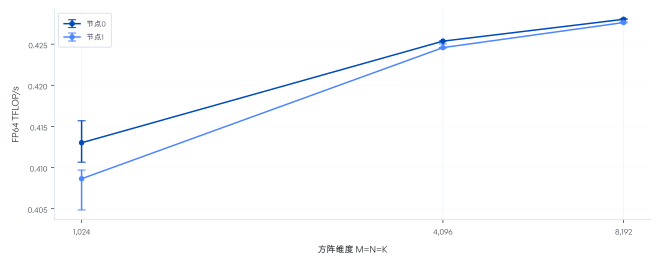

图 06-09｜FP64规模效应


FP64规模效应｜点为五轮中位数，误差线为观测范围；不用于预测低精度模型吞吐。

### 代表性核函数的硬件计数器

| 节点／核函数 | 指标 | n | 中位数［范围］ | 单位 |
| --- | --- | --- | --- | --- |
| 0 / fma | 剖析内核时长 | **3** | **936896.000** [936672.000–937504.000] | ns |
| 0 / fma | L2扇区命中比例 | **3** | **15.690** [7.020–17.090] | % |
| 0 / fma | SM吞吐占峰值比例 | **3** | **99.030** [99.020–99.040] | % |
| 0 / fma | 活跃warp比例 | **3** | **46.340** [46.340–46.350] | % |
| 0 / triad | 剖析内核时长 | **3** | **3831552.000** [3800544.000–3865088.000] | ns |
| 0 / triad | L2扇区命中比例 | **3** | **0.010** [0.010–0.020] | % |
| 0 / triad | SM吞吐占峰值比例 | **3** | **2.740** [2.690–2.740] | % |
| 0 / triad | 活跃warp比例 | **3** | **88.920** [88.470–92.660] | % |
| 1 / fma | 剖析内核时长 | **3** | **938752.000** [937888.000–939232.000] | ns |
| 1 / fma | L2扇区命中比例 | **3** | **18.230** [18.000–45.320] | % |
| 1 / fma | SM吞吐占峰值比例 | **3** | **99.030** [99.020–99.040] | % |
| 1 / fma | 活跃warp比例 | **3** | **46.340** [46.340–46.350] | % |
| 1 / triad | 剖析内核时长 | **3** | **3999008.000** [3891552.000–4325664.000] | ns |
| 1 / triad | L2扇区命中比例 | **3** | **0.020** [0.010–0.070] | % |
| 1 / triad | SM吞吐占峰值比例 | **3** | **2.590** [2.390–2.650] | % |
| 1 / triad | 活跃warp比例 | **3** | **87.300** [84.800–90.130] | % |


计算核函数使用每线程八条独立乘加链、每个SM四个线程块；访存核函数使用三数组共**768MiB**工作集。管理员运行Nsight Compute，只采集一次指定内核；不修改全局驱动权限、时钟或缓存控制。计数只解释这两个核函数，不能当作模型平均命中率。当前接口未公布物理DRAM字节指标，因此仍不构建依赖该计数的模型Roofline。

<a id="section-07"></a>

## 07 · 双机通信与系统协同

### 设备间数据交换：端口、RDMA与集合通信

本实验每节点一个GPU通信进程（rank），双节点经ConnectX-7/RoCE连接。启用的物理端口标称**200 Gb/s**＝**25 GB/s**单向；两个逻辑接口共享该端口。RDMA记录测主机缓冲区，NCCL记录测GPU集合通信，两种实验按各自工作量统计。功能对应的H200互连参照统一见第10节。

| 传输／操作 | 消息大小 | 轮次 | 中位速率 | 测量条件 |
| --- | --- | --- | --- | --- |
| RDMA Write / roceP2p1s0f1 | **8 MiB** | **3** | **13.629 GB/s** (**109.03 Gb/s**) | 2026-10-14；主机内存缓冲区，单逻辑路径 |
| RDMA Write / rocep1s0f1 | **8 MiB** | **3** | **13.617 GB/s** (**108.94 Gb/s**) | 2026-10-14；主机内存缓冲区，单逻辑路径 |
| all_gather | **1 GiB** | **10** | **19.930 GB/s** | 2026-10-16；两GPU rank，总线口径 |
| all_reduce | **1 GiB** | **10** | **21.815 GB/s** | 2026-10-16；两GPU rank，总线口径 |
| reduce_scatter | **1 GiB** | **10** | **20.946 GB/s** | 2026-10-16；两GPU rank，总线口径 |


RDMA Write以ib_write_bw、单QP、单向**8 MiB**消息测试，每逻辑路径3轮；输出使用--report_gbits，除8换算GB/s。它是独立主机缓冲区测量，不能替代GPU集合通信或与其相加。NCCL测量日志确认NET/IB上的RoCE，并明确记录GPU Direct RDMA Disabled；不声称GPU直接RDMA路径。

<!--HARDWARE_H200_NETWORK-->

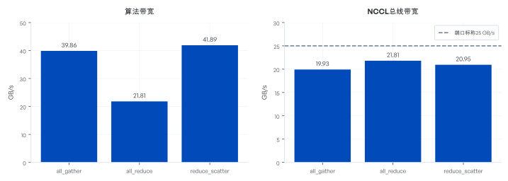

图 07-01｜1 GiB集合通信


1 GiB集合通信｜算法带宽按完整输入/输出张量计数；总线带宽按NCCL规则校正。两rank时AllReduce系数为1，AllGather与ReduceScatter为1/2，因此算法GB/s可以高于25而不代表物理端口超过200 Gb/s。总线带宽也不是网卡硬件计数器读数；虚线只作标称端口线速参考。

RDMA第一路径 · RDMA第二路径 · [本节固定条件与数据来源](../../2026-10-14_17-dual-spark/data/h200-comparison.json) · [官方规格快照索引](../../2026-10-14_17-dual-spark/protocols/h200-sources.json)。本批已归档840次双rank配对有效试验。两rank合为一次测量，采用较慢rank时间；算法带宽为规定消息字节数／时间，总线带宽按NCCL定义校正，不跨rank相加。AllReduce消息为完整输入，AllGather为完整输出，ReduceScatter为完整输入。原批434次配对记录单独保留，不混入本批重复分母。

<!--HARDWARE_UNLOADED_COLLECTIVE-->

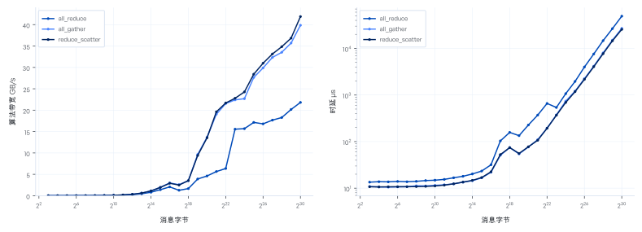

图 07-02｜通信规模曲线


| 操作 | 消息字节 | 配对轮次 | 中位延迟 μs | 算法GB/s | 总线GB/s |
| --- | --- | --- | --- | --- | --- |
| all_gather | **8** | **10** | **10.89** | **0.001** | **0.000** |
| all_gather | **8,192** | **10** | **13.46** | **0.608** | **0.304** |
| all_gather | **8,388,608** | **10** | **374.38** | **22.408** | **11.204** |
| all_gather | **67,108,864** | **10** | **2245.77** | **29.882** | **14.941** |
| all_gather | **1,073,741,824** | **10** | **26937.75** | **39.860** | **19.930** |
| all_reduce | **8** | **10** | **13.49** | **0.001** | **0.001** |
| all_reduce | **8,192** | **10** | **18.02** | **0.454** | **0.454** |
| all_reduce | **8,388,608** | **10** | **539.32** | **15.555** | **15.555** |
| all_reduce | **67,108,864** | **10** | **3993.42** | **16.805** | **16.805** |
| all_reduce | **1,073,741,824** | **10** | **49220.55** | **21.815** | **21.815** |
| reduce_scatter | **8** | **10** | **10.74** | **0.001** | **0.000** |
| reduce_scatter | **8,192** | **10** | **13.51** | **0.606** | **0.303** |
| reduce_scatter | **8,388,608** | **10** | **368.19** | **22.784** | **11.392** |
| reduce_scatter | **67,108,864** | **10** | **2165.91** | **30.984** | **15.492** |
| reduce_scatter | **1,073,741,824** | **10** | **25631.79** | **41.891** | **20.946** |


### 计算与通信的受控重叠

固定一项BF16矩阵计算和一次AllReduce，分别测计算单独、通信单独、串行组合和双流重叠。每个消息大小与矩阵规模保持相同工作量；串行时间／重叠时间大于1表示这组工作缩短，小于1表示重叠反而变慢。该比值只描述合成工作组合，不是模型双机加速倍数。

| 消息字节 | 方阵边长 | 配对轮次 | 串行／重叠 | 观测范围 |
| --- | --- | --- | --- | --- |
| 8,192 | **2048** | **5** | **1.059** | **1.001–1.113** |
| 8,192 | **4096** | **5** | **1.020** | **1.011–1.029** |
| 8,388,608 | **2048** | **5** | **1.168** | **1.093–1.193** |
| 8,388,608 | **4096** | **5** | **1.035** | **1.020–1.094** |
| 67,108,864 | **2048** | **5** | **1.023** | **1.016–1.027** |
| 67,108,864 | **4096** | **5** | **1.096** | **1.071–1.122** |


<!--HARDWARE_UNLOADED_OVERLAP-->

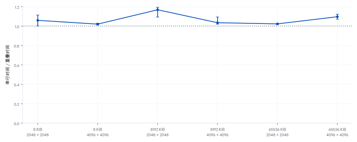

图 07-03｜重叠收益


[本批统计及原始来源](../../2026-10-14_17-dual-spark/data/hardware/summary.json) · [NCCL带宽定义](https://github.com/NVIDIA/nccl-tests/blob/master/doc/PERFORMANCE.md)。实际传输方式以本批NCCL日志核验，不以网卡名称直接证明GPU Direct路径。

<a id="section-08"></a>

## 08 · 从引擎阶段到服务表现

本节按引擎阶段、固定长输出、公网并发、长度、混合请求和前缀缓存展开。不同工作负载分别统计；每项比较使用其对应的输入、输出、缓存和采样窗口。


本节先定义并测量引擎处理阶段，再观察公网用户体验，最后分析输入结构与缓存。预填充处理输入；解码持续生成输出。两组请求的材料与计时边界不同，结果互作解释依据，不做跨实验耗时相减。

### 引擎内部预填充与解码：独立实验

本实验直接调用推理节点本机的SGLang原生接口，将公网、Cloudflare与Infron网关移出计时路径。使用相同权重与双节点张量并行配置，MTP保持开启。并发上限8；直接源站调用不计入Infron API账单。此实验不与前述公网请求合并统计。

| 实验 | 工作量与重复 | 测量含义 |
| --- | --- | --- |
| 预填充 | **1K**／**8K**／**32K**／**64K**／**128K**／**250,000**输入，输出**1**；并发**1**，并在较短输入增加并发**4／8**；每条件**3**轮 | 读取调度器预填充起止时间；分母含分块调度间隙，不称为纯GPU时间 |
| 解码 | **1K**／**8K**／**32K**输入×并发**1／2／4／8**，另加**64K**／**128K**单并发；输出固定**256**；每条件**3**轮 | 接口进程首词元到结束的生成速率、MTP接受长度与验证次数 |
| 前缀复用对照 | **8K**／**32K**，各**3**组首次请求与立即重复，输出均为**1** | 以实际缓存词元确认命中；不测长期保留 |
| GPU时间线 | **8K**输入、**128**输出、并发**1**；双节点分别捕获预填充与**4**个解码调度步 | 记录GPU活动区间、NCCL命名内核、MTP草稿／验证阶段；剖析数据与常规速度测量分开 |


清单共78组、**231条**正式请求，另有**2条**预检／剖析请求。并发×（输入＋输出）超过262,144的组合排除。使用固定种子的合成订单记录，经实际模型分词器生成精确长度的token ID；不经过聊天模板。温度为0，忽略结束词元以固定输出长度。因此这是可控的引擎负载，不代表自然对话的输出长度或MTP接受率。每轮随机化条件顺序；不同请求具有不同的早期前缀，是否命中仍以返回字段核验。

#### 计时定义与核验

| 指标 | 定义与边界 |
| --- | --- |
| 调度器预填充耗时 | 同一调度器进程的prefill_finished_time − forward_entry_time；包括分块等待，不包括首次进入调度前的排队。 |
| 预填充处理速率 | 同一区组Σ（输入−已缓存词元）／（最后预填充结束−最早预填充开始）。多请求重叠区间不重复累加。 |
| 单请求解码速率 | （实际输出−1）／（引擎总耗时−引擎首词元耗时），与原生decode_throughput交叉校验；包含引擎调度、结果传递和MTP路径。 |
| 并发解码窗口吞吐 | Σ（实际输出−1）／（最后请求结束−最早首词元）；同一接口进程计时，并发请求的错峰预填充可能仍在此窗口内。 |
| MTP接受长度与接受率 | 已安装实现的接受长度＝完成输出词元／验证次数；接受率＝正确草稿词元／提出的草稿词元。两者分母不同，接受长度不是加速倍数，也不是捕获的每一步实际输出计数。 |
| GPU活动分解 | 分别求两节点内核／拷贝区间的并集，再区分NCCL独占、其他活动独占及重叠。不相加嵌套注释，不跨节点叠加时间。 |


调度器与接口进程的绝对时间戳转换存在偏移，因此只在同一进程的时间基准内计算区间。三个区组的中位数与最小／最大范围用于描述重复性，不据此报告尾部百分位或置信区间。发生重计算／回退的请求需单独分析，不进入当前时间拆分。

#### 独立速率实测

当前归档可分析78组、**231条**正式请求；计时校验未通过**0条**。

<!--ENGINE_INTERNAL_RATES-->

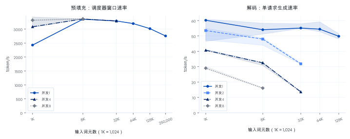

图 08-01｜引擎阶段速率


| 输入词元 | 并发 | 区组／请求 | 预填充中位 s | 窗口速率 token/s | 缓存词元 |
| --- | --- | --- | --- | --- | --- |
| 1,024 | **1** | **3 / 3** | **0.422** | **2,427.4** | **0** |
| 1,024 | **4** | **3 / 12** | **0.915** | **3,084.9** | **0** |
| 1,024 | **8** | **3 / 24** | **2.059** | **3,318.9** | **0** |
| 8,192 | **1** | **3 / 3** | **2.442** | **3,354.2** | **0** |
| 8,192 | **4** | **3 / 12** | **4.837** | **3,363.7** | **0** |
| 8,192 | **8** | **3 / 24** | **4.861** | **3,366.1** | **0** |
| 32,768 | **1** | **3 / 3** | **9.957** | **3,290.8** | **0** |
| 32,768 | **4** | **3 / 12** | **12.351** | **3,291.9** | **0** |
| 65,536 | **1** | **3 / 3** | **20.491** | **3,198.3** | **0** |
| 131,072 | **1** | **3 / 3** | **43.462** | **3,015.8** | **0** |
| 250,000 | **1** | **3 / 3** | **90.787** | **2,753.7** | **0** |


| 输入词元 | 并发 | 区组／请求 | 单请求 token/s | 并发窗口 token/s | MTP接受长度中位 |
| --- | --- | --- | --- | --- | --- |
| 1,024 | **1** | **3 / 3** | **60.2** | **60.2** | **3.71** |
| 1,024 | **2** | **3 / 6** | **53.5** | **107.0** | **3.74** |
| 1,024 | **4** | **3 / 12** | **40.7** | **144.9** | **3.61** |
| 1,024 | **8** | **3 / 24** | **29.0** | **206.6** | **3.58** |
| 8,192 | **1** | **3 / 3** | **54.0** | **54.0** | **3.32** |
| 8,192 | **2** | **3 / 6** | **48.0** | **93.2** | **3.44** |
| 8,192 | **4** | **3 / 12** | **32.5** | **86.2** | **3.46** |
| 8,192 | **8** | **3 / 24** | **16.1** | **81.1** | **3.37** |
| 32,768 | **1** | **3 / 3** | **55.1** | **55.1** | **3.41** |
| 32,768 | **2** | **3 / 6** | **31.9** | **38.0** | **3.18** |
| 32,768 | **4** | **3 / 12** | **13.6** | **29.0** | **3.37** |
| 65,536 | **1** | **3 / 3** | **54.4** | **54.4** | **3.41** |
| 131,072 | **1** | **3 / 3** | **49.8** | **49.8** | **3.12** |


在已测单并发条件下，各输入长度的解码速率中位数为**49.8–60.2 token/s**。此范围来自合成记录与固定输出条件；不能直接替代公网端点容量或任意业务的生成速度。


<!--REVIEW_DECODE_GRID-->

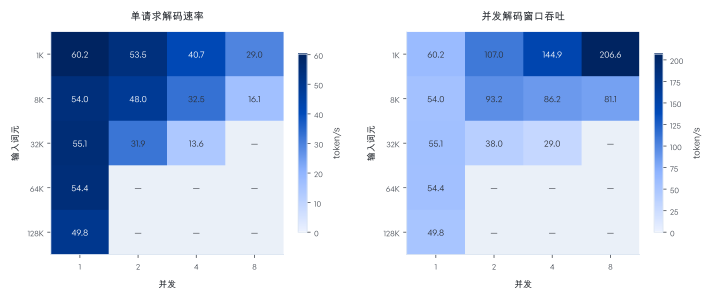

图 08-02｜解码长度×并发


#### 同一前缀立即复用的预填充对照

| 输入 | 配对数 | 重复请求缓存词元比例 | 首次／重复预填充中位 s | 配对耗时比中位 |
| --- | --- | --- | --- | --- |
| 8,192 | **3** | **0.00%** | **2.4343 / 2.4507** | **0.99** |
| 32,768 | **3** | **75.00%** | **9.9719 / 2.5517** | **3.91** |


缓存比例分母为重复请求的实际输入词元总数；耗时比逐对计算后取中位数。固定先首次、后重复的顺序仍有顺序效应；三个立即重复样本不能证明长期缓存稳定性，也不应将此比值称为模型计算加速倍数。

本轮**8K**立即重复的报告缓存比例为**0%**，**32K**为**75%**。相同输入并不保证全量缓存命中；这些结果限定于本次输入长度、单词元输出和当前缓存状态，不能直接推断所有业务的缓存规则或保留时间。

#### GPU侧阶段与通信活动

<!--ENGINE_GPU_TIMELINE-->

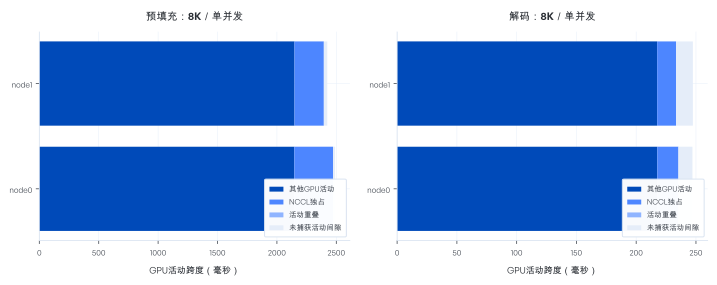

图 08-03｜两节点GPU活动分解


| 节点／阶段 | 活动跨度 ms | 活动并集 ms | NCCL独占 ms | 重叠 ms |
| --- | --- | --- | --- | --- |
| node0 / decode | **247.07** | **235.38** | **17.68** | **0.05** |
| node0 / prefill | **2,489.51** | **2,472.72** | **325.91** | **0.02** |
| node1 / decode | **247.42** | **233.38** | **15.80** | **0.03** |
| node1 / prefill | **2,423.98** | **2,395.04** | **246.97** | **0.00** |


| 节点／捕获阶段 | 内部阶段 | 匹配的执行次数 | GPU关联范围均值 ms |
| --- | --- | --- | --- |
| node0 / decode | MTP草稿生成 | **4** | **10.575** |
| node0 / decode | 目标模型验证 | **4** | **44.100** |
| node0 / decode | 草稿状态扩展 | **4** | **6.150** |
| node0 / prefill | 目标模型预填充 | **1** | **2,401.288** |
| node0 / prefill | 草稿状态扩展 | **1** | **87.003** |
| node1 / decode | MTP草稿生成 | **4** | **10.692** |
| node1 / decode | 目标模型验证 | **4** | **44.079** |
| node1 / decode | 草稿状态扩展 | **4** | **6.159** |
| node1 / prefill | 目标模型预填充 | **1** | **2,332.348** |
| node1 / prefill | 草稿状态扩展 | **1** | **87.009** |


<!--ENGINE_MTP_STAGES-->

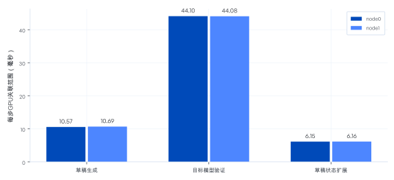

图 08-04｜MTP阶段拆分


阶段范围通过CPU注释与GPU注释的同一External id关联；CUDA Graphs会在多个虚拟执行流上重复标注同一次验证，因此先按执行标识合并区间，再计算每次执行的范围。该范围包含设备等待与通信，不等同于内核忙碌时间；草稿、验证与状态扩展的范围不能不经重叠检查就相加。未获取每个捕获步实际接受的词元数，因此不以验证步数乘固定MTP长度来伪造GPU解码token/s。

双节点时间线均捕获到预填充与解码GPU内核，以及MTP草稿、验证和草稿状态扩展的阶段注释。GPU活动与通信存在重叠，因此相加每个算子或NCCL内核耗时会重复计算。基础剖析为**8K**单并发场景；下文报告三种输入／并发条件及配对开销。NCCL活动时间不能直接等同于可消除的通信等待。

[逐请求指标](../../2026-10-14_17-dual-spark/data/engine/requests.csv) · [逐区组指标](../../2026-10-14_17-dual-spark/data/engine/blocks.csv) · 源码及原始时间线目录

实现依据：[SGLang profiling](https://github.com/sgl-project/sglang/blob/main/docs/docs/developer_guide/benchmark_and_profiling.mdx) · [SGLang observability](https://docs.sglang.ai/advanced_features/observability.html) · 已安装版本的计时源码；线上文档用于方法参考，字段含义以保存的已安装源码为准。

### 固定长输出：原生引擎的可达范围

本组以本地认证的原生生成接口发送精确词元输入，温度为0，忽略结束词元并固定生成数；流式间隔设为**128词元**。解码速率使用引擎同一进程的生成计数与时间，不能与公网正文首字延迟混为同一指标。输入加输出不超过262,144；1,024输入＋260,096输出保留**1,024词元**余量，因此这里的最长目标是**254K**输出。

| 输入→输出词元 | 完整／计划 | 解码词元/s，中位数［范围］ | 请求耗时中位数s | 草稿接受比例 |
| --- | --- | --- | --- | --- |
| 1,024 → 1,024 | **1/1** | **62.24** [62.24–62.24] | **16.91** | **0.940** |
| 1,024 → 8,192 | **3/3** | **55.64** [54.17–59.24] | **147.62** | **0.832** |
| 1,024 → 16,384 | **3/3** | **61.35** [54.15–61.51] | **267.46** | **0.931** |
| 1,024 → 32,768 | **3/3** | **60.50** [56.93–61.17] | **541.80** | **0.918** |
| 1,024 → 65,536 | **1/1** | **60.32** [60.32–60.32] | **1,086.82** | **0.924** |
| 1,024 → 131,072 | **1/1** | **61.96** [61.96–61.96] | **2,115.69** | **0.959** |
| 1,024 → 260,096 | **1/1** | **61.61** [61.61–61.61] | **4,222.17** | **0.961** |
| 16,384 → 16,384 | **1/1** | **62.10** [62.10–62.10] | **270.54** | **0.963** |
| 32,768 → 32,768 | **1/1** | **60.88** [60.88–60.88] | **548.28** | **0.938** |
| 65,536 → 65,536 | **1/1** | **60.27** [60.27–60.27] | **1,109.63** | **0.926** |


<!--GAP_LONG_OUTPUT-->

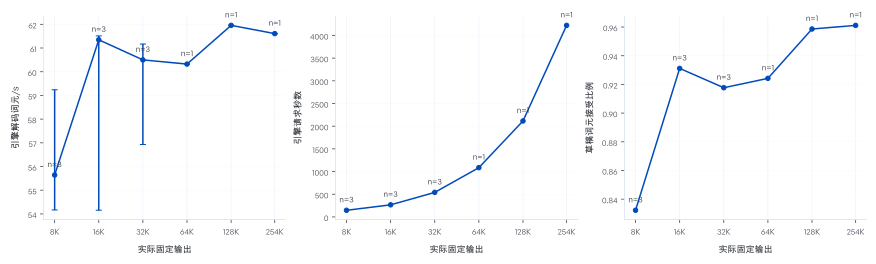

图 08-05｜长输出的生成速率与工作量


强制长度可能产生重复文本、空白或特殊词元；计数达成只证明计算负载执行到该长度，不证明正文有用性。MTP接受情况与具体生成序列有关，不能将此速率直接用于所有业务或年度产能估算。每格三次的条件报告范围；更长单次探针不提供尾分位或总体置信区间。

可见文本检查中，**8条**完整请求出现连续至少256个相同字符；该标记随原始输出保留，不作为答案能力评分。

[请求与计时CSV](../../2026-10-14_17-dual-spark/data/completion/native_requests.csv)

### 多场景GPU剖析与测量开销

每对使用相同输入与256输出词元，交替执行顺序；每臂发送前在空闲服务清空前缀缓存。剖析只捕获预填充和四个解码步骤，完整请求耗时比衡量这项诊断对该请求的影响，不用于修正所有历史样本。

| 输入／并发 | 配对数 | 剖析／无剖析耗时比 | 两臂缓存词元总数 |
| --- | --- | --- | --- |
| 1,024 / 1 | **3** | **1.162** [1.124–1.220] | **0** |
| 8,192 / 4 | **3** | **1.236** [1.182–1.263] | **0** |
| 32,768 / 1 | **3** | **1.084** [0.931–1.186] | **0** |


<!--GAP_PROFILE_COST-->

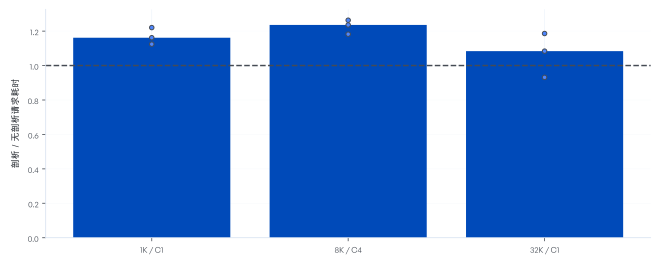

图 08-06｜剖析开销的配对分布


### 公网并发：吞吐与等待


| 并发 | 区组／请求 | 生成词元/s | 正文首字 中位／95分位 s | 完成时间95分位 s |
| --- | --- | --- | --- | --- |
| 1 | **2 / 120** | **45.1** | **1.01 / 1.65** | **19.46** |
| 2 | **3 / 180** | **78.7** | **1.07 / 1.78** | **24.87** |
| 4 | **1 / 60** | **120.2** | **1.11 / 1.79** | **30.53** |
| 8 | **3 / 180** | **158.9** | **1.17 / 2.39** | **46.93** |


<!--CAPACITY-->

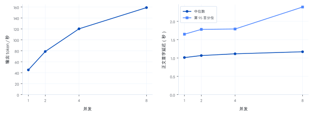

图 08-07｜并发比较


在本次短提示题库中，并发8的合计吞吐为 **158.9 词元/s**。该结果对应平均输出 **400.8 词元**，不能直接用于长文档业务的容量规划。

### 长度：输入处理与生成压力

以下热力图把输入长度、输出预算与并发拆成三个明确的变量。每个格子只纳入连续完整区组；深色表示数值较大，灰色表示该条件没有合格区组。输出预算是允许生成的上限，并不要求模型生成到上限。两图使用相同样本口径，分别回答“多久看到正文”和“整个系统每秒生成多少词元”。

<!--LENGTH_WAIT-->

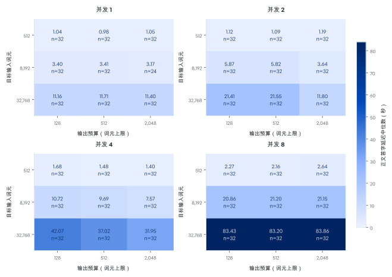

图 08-08｜输入／输出长度与正文等待


<!--LENGTH_THROUGHPUT-->

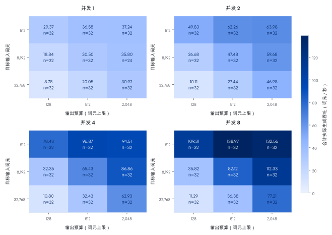

图 08-09｜输入／输出长度与系统吞吐


### 固定输出预算下的可比切片

下表固定输出预算为 **512 词元**，保留输入长度和并发变化。实际输入包含聊天模板；实际输出均值用于检查各格是否真的完成了相近的生成工作量。

| 目标输入 / 并发 | 区组 / 响应 | 实际输入 / 输出均值 | 正文首字中位数 s | 总时延中位数 s | 合计词元/s |
| --- | --- | --- | --- | --- | --- |
| 512 / 1 | **4 / 32** | **513 / 512.0** | **0.98** | **13.97** | **36.6** |
| 512 / 2 | **4 / 32** | **513 / 512.0** | **1.09** | **16.12** | **62.3** |
| 512 / 4 | **4 / 32** | **513 / 512.0** | **1.48** | **20.53** | **96.9** |
| 512 / 8 | **4 / 32** | **513 / 512.0** | **2.16** | **28.51** | **139.0** |
| 8,192 / 1 | **4 / 32** | **8,193 / 512.0** | **3.41** | **16.78** | **30.5** |
| 8,192 / 2 | **4 / 32** | **8,193 / 512.0** | **5.82** | **21.24** | **47.5** |
| 8,192 / 4 | **4 / 32** | **8,193 / 512.0** | **9.69** | **30.69** | **65.4** |
| 8,192 / 8 | **4 / 32** | **8,193 / 512.0** | **21.20** | **48.44** | **82.1** |
| 32,768 / 1 | **4 / 32** | **32,769 / 512.0** | **11.71** | **24.89** | **20.0** |
| 32,768 / 2 | **4 / 32** | **32,769 / 512.0** | **21.55** | **37.09** | **27.4** |
| 32,768 / 4 | **4 / 32** | **32,769 / 512.0** | **37.02** | **62.01** | **32.4** |
| 32,768 / 8 | **4 / 32** | **32,769 / 512.0** | **83.20** | **111.55** | **36.4** |


**长度效应。**在并发 1、输出预算 512 的切片中，目标输入从 512 增至 **32,768 词元**，正文首字中位数由 **0.98 s** 变为 **11.71 s**；合计输出吞吐由 36.6 变为 **20.0 词元/s**。这是端到端的长度敏感性观测，包含当前前缀状态和服务链路的共同影响。

[全部长度条件的可复算数据](../../2026-10-14_17-dual-spark/data/service/length-metrics.csv)

| 上下文或前缀条件 | 完整 / 失败 | 首生成中位数 s |
| --- | --- | --- |
| 长上下文与边界 · 上下文边界探针 | **0 / 1** | — |
| 长上下文与边界 · 目标输入 131,072 token · 并发 1 · 长输入后生成 | **3 / 0** | **48.34** |
| 长上下文与边界 · 目标输入 131,072 token · 并发 2 · 长输入后生成 | **3 / 0** | **90.65** |
| 长上下文与边界 · 目标输入 16,384 token · 并发 1 · 长输入后生成 | **3 / 0** | **6.77** |
| 长上下文与边界 · 目标输入 16,384 token · 并发 2 · 长输入后生成 | **3 / 0** | **11.28** |
| 长上下文与边界 · 目标输入 200,000 token · 并发 1 · 长输入后生成 | **3 / 0** | **74.05** |
| 长上下文与边界 · 目标输入 250,000 token · 并发 1 · 长输入后生成 | **3 / 0** | **94.08** |
| 长上下文与边界 · 目标输入 32,768 token · 并发 1 · 长输入后生成 | **3 / 0** | **12.55** |
| 长上下文与边界 · 目标输入 32,768 token · 并发 2 · 长输入后生成 | **3 / 0** | **22.01** |
| 长上下文与边界 · 目标输入 4,096 token · 并发 1 · 长输入后生成 | **3 / 0** | **2.54** |
| 长上下文与边界 · 目标输入 4,096 token · 并发 2 · 长输入后生成 | **3 / 0** | **2.41** |
| 长上下文与边界 · 目标输入 65,536 token · 并发 1 · 长输入后生成 | **3 / 0** | **24.49** |
| 长上下文与边界 · 目标输入 65,536 token · 并发 2 · 长输入后生成 | **3 / 2** | **42.67** |
| 前缀缓存 · 历史文本 0 token · 首次前缀 | **10 / 0** | **1.07** |
| 前缀缓存 · 历史文本 0 token · 重复前缀 | **10 / 0** | **0.96** |
| 前缀缓存 · 历史文本 0 token · 追加文本 | **10 / 0** | **1.06** |
| 前缀缓存 · 历史文本 32,768 token · 首次前缀 | **10 / 0** | **11.69** |
| 前缀缓存 · 历史文本 32,768 token · 重复前缀 | **10 / 0** | **1.55** |
| 前缀缓存 · 历史文本 32,768 token · 追加文本 | **10 / 0** | **1.61** |
| 前缀缓存 · 历史文本 8,192 token · 首次前缀 | **10 / 0** | **3.61** |
| 前缀缓存 · 历史文本 8,192 token · 重复前缀 | **10 / 0** | **1.08** |
| 前缀缓存 · 历史文本 8,192 token · 追加文本 | **10 / 0** | **1.17** |


### 长上下文与输入／输出比例：响应分布

长度扩展完成 **290/299 次**，**205 次**实际输出达到上限的**98%**–**100%**。已完成且达到目标的最大输出为 **4,096 词元**；仅适用于对应输入和单次条件。

公网长度扩展采用自然结束，控制方式见第03节；以下同时报告生成上限与实际生成量。 执行模式与证据

| 负载 | 完整／计划 | 源站计数数 | 实际输出范围 | 达成率中位数 | 实际长度达成数 |
| --- | --- | --- | --- | --- | --- |
| 输出参数校准 | **2/2** | **2** | **2–2** | **0.2%** | **0** |
| 输入轴线 | **24/24** | **24** | **1,024–1,024** | **100.0%** | **24** |
| 输出轴线 | **9/13** | **9** | **1,826–4,955** | **100.0%** | **5** |
| 平衡长度 | **9/12** | **9** | **2,048–5,943** | **100.0%** | **6** |
| 近边界 | **1/2** | **1** | **1,024–1,024** | **100.0%** | **1** |
| 长前缀 | **36/36** | **36** | **1,024–1,024** | **100.0%** | **36** |
| 业务锚点 | **31/32** | **31** | **25–4,096** | **16.9%** | 自然结束 |
| 代表条件预热 | **10/10** | **10** | **1,024–4,096** | **100.0%** | **7** |
| 重复区组 | **168/168** | **168** | **1,024–4,096** | **100.0%** | **124** |


<!--LENGTH_ATTAINMENT-->

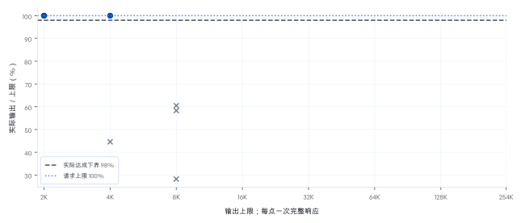

图 08-10｜输出达成


以下仅纳入实际输入误差≤**1%**、实际输出达成**98%**–**100%**的完整请求。数值为中位数；单样本格就是该次观测，不输出尾分位。

| 输入→输出上限 | 合格／完整 | 实际输出 | 首字 s | 完成 s | 每词元 ms（估算） |
| --- | --- | --- | --- | --- | --- |
| 1K → 1K | **3/3** | **1,024** | **1.20** | **25.14** | **23.2** |
| 2K → 1K | **3/3** | **1,024** | **1.45** | **23.38** | **21.5** |
| 4K → 1K | **3/3** | **1,024** | **2.12** | **25.90** | **23.2** |
| 8K → 1K | **3/3** | **1,024** | **3.60** | **25.49** | **21.6** |
| 16K → 1K | **3/3** | **1,024** | **5.91** | **26.80** | **20.0** |
| 32K → 1K | **3/3** | **1,024** | **12.00** | **33.21** | **20.8** |
| 64K → 1K | **3/3** | **1,024** | **23.33** | **45.91** | **21.8** |
| 128K → 1K | **3/3** | **1,024** | **46.47** | **68.05** | **21.1** |
| 1K → 2K | **3/3** | **2,048** | **1.30** | **47.45** | **22.6** |
| 1K → 4K | **2/3** | **4,096** | **1.20** | **88.58** | **21.3** |
| 2K → 2K | **3/3** | **2,048** | **1.46** | **45.56** | **21.4** |
| 4K → 4K | **3/3** | **4,096** | **2.08** | **88.44** | **21.1** |
| 254K → 1K | **1/1** | **1,024** | **99.27** | **121.45** | **21.7** |


当前 6 个重复区组满足容量比较条件；单次边界探针不混入稳态容量。

| 输入→输出／并发 | 有效区组数 | 合计吞吐 词元/s | 区组吞吐范围 |
| --- | --- | --- | --- |
| 32K → 1K / 1 | **3** | **33.0** | **31.0–34.8** |
| 32K → 1K / 4 | **3** | **55.5** | **54.9–55.9** |


**64K**／**128K**前缀诊断包含17/18 个有效复测窗口；命中比例与目标重合分别报告。

| 输入／目标重合 | 有效／计划对 | 窗口缓存比例 中位／范围 |
| --- | --- | --- |
| 64K / 0% | **2/3** | **0.0%** / **0.0%**–**0.0%** |
| 64K / 50% | **3/3** | **37.5%** / **37.5%**–**37.5%** |
| 64K / 100% | **3/3** | **100.0%** / **100.0%**–**100.0%** |
| 128K / 0% | **3/3** | **0.0%** / **0.0%**–**0.0%** |
| 128K / 50% | **3/3** | **43.7%** / **43.7%**–**43.7%** |
| 128K / 100% | **3/3** | **100.0%** / **100.0%**–**100.0%** |


提前结束、参数拒绝、时间不足与未开始均保留原状态。长度结果不外推到未测并发或年度收益。 [CSV](../../2026-10-14_17-dual-spark/data/service/length-observations.csv) · [JSON](../../2026-10-14_17-dual-spark/data/service/length_analysis.json)


<!--REVIEW_CONCURRENCY-->

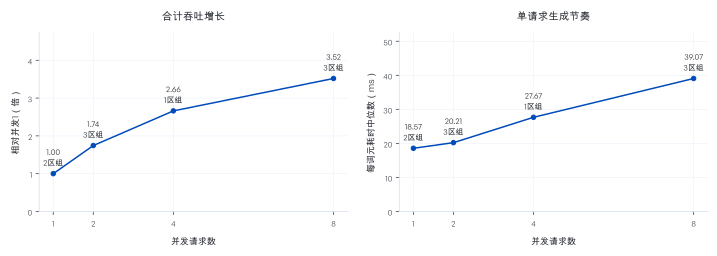

图 08-11｜并发扩展的收益与代价


### 大输出预算：上限与实际生成

输出上限只约束允许生成的最大词元数量。源站记录确认max_tokens透传，ignore_eos未透传；模型可提前自然结束。每条件只有1次观测，表中首字和总耗时是单请求记录，不能当作分布分位数。缓存状态随实测窗口列出。

| 实际输入 | 输出上限 | 实际输出 | 首字秒 | 总耗时秒 | 缓存词元比例 | 结束原因 |
| --- | --- | --- | --- | --- | --- | --- |
| 1,025 | 16,384 | **2,245** | 1.00 | 55.39 | 99.90% | stop |
| 1,025 | 32,768 | **4,219** | 0.80 | 90.68 | 99.90% | stop |
| 1,025 | 65,536 | **2,089** | 0.85 | 50.58 | 99.90% | stop |
| 1,024 | 131,072 | **3,575** | 1.63 | 80.86 | 0.00% | stop |
| 16,385 | 16,384 | **6,670** | 6.55 | 125.20 | 0.00% | stop |
| 32,769 | 32,768 | **12,661** | 20.79 | 259.23 | 0.00% | stop |
| 65,537 | 65,536 | **27,018** | 32.81 | 505.56 | 0.00% | stop |
| 1,025 | 260,096 | **5,604** | 1.53 | 132.07 | 0.00% | stop |


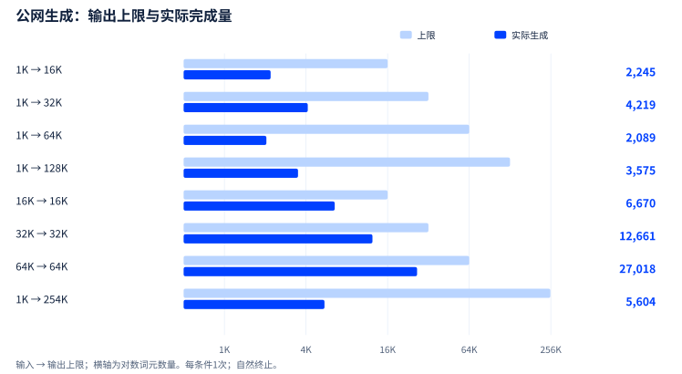

图 08-12｜输出上限与实际生成


八个大输出预算条件均取得完整响应；本组自然输出最大观测量为**27,018词元**。这表示对应输入材料的实际生成结果，不是服务输出上限。固定输出的最高观测量**260,096词元**来自原生引擎，按其独立路径解释。

### 思考预算：正文等待与输出形态

同题、同轮次、同并发比较 low 与 none，差值为 low 减 none。只分析性能变化，保留正文缺失和输出触顶情况。

<!--REASONING-->

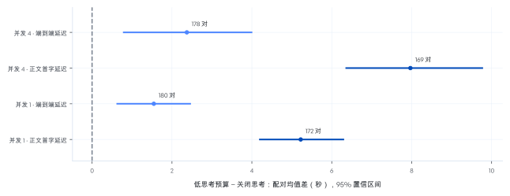

图 08-13｜思考档位的配对延迟差


<!--GENERATION_SHAPE-->

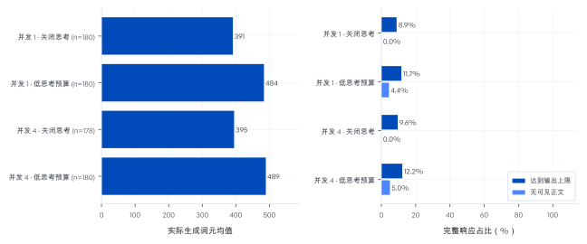

图 08-14｜输出形态


### 混合请求调度：长输入对短请求等待的影响

孤立臂只有32条短请求；混合臂保持相同短输入与到达时刻，并加入8条32K输入。正式测量前，两臂均预热全部短输入。下表只在完整配对上给出比值，同时保留所有拒绝；结果是该混合服务条件的整体影响，不能等同于纯预填充内核耗时。

| 配对 | 短请求完整数：孤立→混合 | 首字中位秒：孤立→混合 | 首字95分位秒：孤立→混合 | 中位比值 | 本地拒绝：孤立/混合 | 解释范围 |
| --- | --- | --- | --- | --- | --- | --- |
| 1 | 32/32 → 32/32 | 0.95 → **1.23** | 1.33 → **12.44** | **1.30** | 0 / 0 | 完整配对 |
| 2 | 32/32 → 32/32 | 0.98 → **1.16** | 2.05 → **9.32** | **1.18** | 0 / 0 | 完整配对 |
| 3 | 32/32 → 32/32 | 0.87 → **2.94** | 1.15 → **16.89** | **3.37** | 0 / 0 | 完整配对 |
| 4 | 32/32 → 32/32 | 0.97 → **1.59** | 1.41 → **11.36** | **1.64** | 0 / 0 | 完整配对 |
| 5 | 32/32 → 29/32 | 1.00 → **4.63** | 1.22 → **14.61** | **—** | 0 / 3 | 含拒绝；延迟仅描述完整响应 |


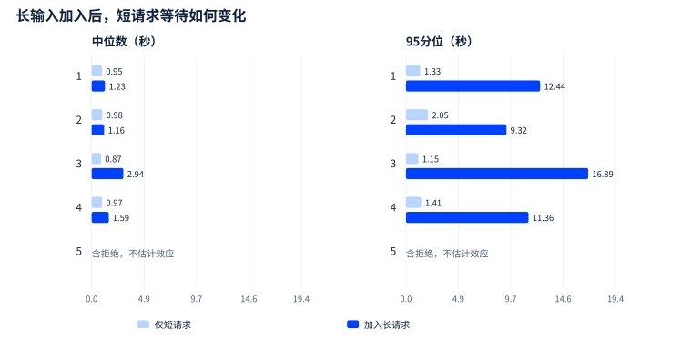

图 08-15｜短请求配对等待


五组到达与终态均已完整记录，其中**4/5**组可估计完整配对效应：中位等待比值**1.18–3.37倍**，95分位比值**4.54–14.68倍**。范围描述区组间差异，不是置信区间。截断到达序列的区组不纳入该效应估计，排除规则见第05节。

| 配对 | 臂 | 短请求本地拒绝 | 拒绝时实际排队秒 | 执行状态 |
| --- | --- | --- | --- | --- |
| 5 | 混合 | 3/32 | 5.99–14.28 | 未转发到模型 |

本地队列在出队时检查5秒阈值，因此记录到的实际等待可能更长。拒绝请求没有首字时间；含拒绝组的延迟统计只描述完成响应，不能作为完整配对效应。这些拒绝是预定准入规则下的观测结果，并非缺失测试记录。

| 配对 | 臂 | 到达／发送／完整 | 区组墙钟秒 | 区组输出词元/s | 短请求输出中位词元 | 全臂缓存比例 |
| --- | --- | --- | --- | --- | --- | --- |
| 1 | 孤立 | 32 / 32 / 32 | 273.5 | **22.97** | 240 | 69.75% |
| 1 | 混合 | 40 / 40 / 40 | 273.4 | **26.50** | 250 | 0.63% |
| 2 | 孤立 | 32 / 32 / 32 | 339.9 | **18.68** | 256 | 66.39% |
| 2 | 混合 | 40 / 40 / 40 | 339.4 | **21.78** | 256 | 0.17% |
| 3 | 孤立 | 32 / 32 / 32 | 219.5 | **26.33** | 242 | 76.68% |
| 3 | 混合 | 40 / 40 / 40 | 220.7 | **32.24** | 248 | 1.01% |
| 4 | 孤立 | 32 / 32 / 32 | 244.1 | **20.57** | 153 | 67.19% |
| 4 | 混合 | 40 / 40 / 40 | 243.9 | **25.37** | 167 | 0.36% |
| 5 | 孤立 | 32 / 32 / 32 | 192.9 | **31.41** | 253 | 75.67% |
| 5 | 混合 | 40 / 37 / 37 | 193.2 | **34.30** | 256 | 0.38% |

区组吞吐以同一到达窗口内的源站实际输出总量除以从调度开始到全部响应结束的墙钟时间，包含到达间隔；它不代表饱和容量。全臂缓存比例按输入词元加权，混合臂包含长输入，不能直接当作短请求的命中率。

### 业务形态与缓存比例：实际覆盖

业务形态与缓存比例测试在本快照完成 **347 / 352 次**计划调用，其中正式测量完整响应 260 / 264。


| 业务／并发 | 完整数 | 实际输出中位数 | 实际输入输出比中位数 | 正文首字中位数 s | 端到端中位数 s |
| --- | --- | --- | --- | --- | --- |
| 长文档分析 / 1 | **12** | **2,048.0** | **16.0** | **11.92** | **49.73** |
| 长文档分析 / 4 | **12** | **2,048.0** | **16.0** | **42.59** | **101.32** |
| 代码修改 / 1 | **12** | **512.0** | **16.0** | **3.64** | **11.54** |
| 代码修改 / 4 | **12** | **512.0** | **16.0** | **11.73** | **22.86** |
| 多轮业务助理 / 1 | **12** | **499.5** | **16.4** | **3.49** | **13.26** |
| 多轮业务助理 / 4 | **12** | **505.0** | **16.2** | **11.63** | **26.16** |
| 短提示长生成 / 1 | **12** | **1,599.5** | **0.3** | **1.10** | **35.31** |
| 短提示长生成 / 4 | **8** | **1,566.5** | **0.3** | **2.04** | **51.05** |
| 结构化提取 / 1 | **12** | **43.0** | **47.7** | **1.49** | **2.15** |
| 结构化提取 / 4 | **12** | **43.0** | **47.7** | **3.80** | **4.61** |
| 等量改写 / 1 | **12** | **510.0** | **4.0** | **1.52** | **13.50** |
| 等量改写 / 4 | **12** | **486.0** | **4.2** | **3.83** | **20.04** |
| 长文档摘要 / 1 | **12** | **128.0** | **256.0** | **11.59** | **14.60** |
| 长文档摘要 / 4 | **12** | **128.0** | **256.0** | **42.35** | **46.74** |
| 工单分类 / 1 | **12** | **25.0** | **20.6** | **1.10** | **1.73** |
| 工单分类 / 4 | **12** | **25.0** | **20.5** | **2.03** | **2.80** |


| 业务／并发 | 连续完整区组 token/s | 估算 TPOT 中位数 ms | 触顶／完整数 |
| --- | --- | --- | --- |
| 长文档分析 / 1 | **36.1** | **21.88** | **7/12** |
| 长文档分析 / 4 | **73.1** | **28.85** | **7/12** |
| 代码修改 / 1 | **38.8** | **16.13** | **8/12** |
| 代码修改 / 4 | **74.9** | **22.54** | **9/12** |
| 多轮业务助理 / 1 | **31.4** | **23.95** | **6/12** |
| 多轮业务助理 / 4 | **63.5** | **32.48** | **6/12** |
| 短提示长生成 / 1 | **44.9** | **21.50** | **1/12** |
| 短提示长生成 / 4 | **117.9** | **31.08** | **0/8** |
| 结构化提取 / 1 | **19.0** | **15.04** | **0/12** |
| 结构化提取 / 4 | **36.8** | **19.41** | **0/12** |
| 等量改写 / 1 | **45.0** | **22.44** | **0/12** |
| 等量改写 / 4 | **98.8** | **32.49** | **0/12** |
| 长文档摘要 / 1 | **8.6** | **22.77** | **12/12** |
| 长文档摘要 / 4 | **10.9** | **35.22** | **12/12** |
| 工单分类 / 1 | **13.5** | **25.98** | **0/12** |
| 工单分类 / 4 | **34.2** | **32.41** | **0/12** |


| 输入／目标共享 | 完整数 | 实际共享 % | 缓存字段覆盖 | 字段报告缓存 % | 正文首字中位数 s |
| --- | --- | --- | --- | --- | --- |
| 32,768 / 0% | **6** | **0.0** | **0/6** | — | **12.44** |
| 32,768 / 100% | **6** | **100.0** | **0/6** | — | **1.91** |
| 32,768 / 25% | **6** | **25.0** | **0/6** | — | **11.79** |
| 32,768 / 50% | **6** | **50.0** | **0/6** | — | **9.18** |
| 32,768 / 75% | **6** | **75.0** | **0/6** | — | **6.77** |
| 32,768 / 90% | **6** | **90.0** | **0/6** | — | **4.56** |
| 8,192 / 0% | **6** | **0.1** | **0/6** | — | **3.50** |
| 8,192 / 100% | **6** | **100.0** | **0/6** | — | **1.14** |
| 8,192 / 25% | **6** | **24.9** | **0/6** | — | **3.60** |
| 8,192 / 50% | **6** | **49.9** | **0/6** | — | **3.47** |
| 8,192 / 75% | **6** | **74.9** | **0/6** | — | **3.46** |
| 8,192 / 90% | **6** | **89.9** | **0/6** | — | **3.55** |


解释顺序为：核对实际长度与输出触顶 → 对齐并发和样本组成 → 看首片段等待及生成耗时 → 核对缓存字段覆盖 → 结合同时段资源说明可能机制。没有完整区组、有效缓存字段或匹配输入时，只报告观察，保留替代解释。

### 上下文边界与请求复用

单词元输出探针观察输入处理等待，长上下文与越界请求检查可用范围，首次／重复／追加文本检查请求复用。各条件的实际长度、延迟与终态见附录B；配置上限不等于已经验证的可用容量。

### 缓存命中与稳定性

前缀缓存保存已处理输入的中间状态，使后续相同开头有机会减少输入计算。是否能复用，取决于前缀一致性、缓存驻留和调度；缓存占用率反映存储状态，本身不等于命中率。

#### 缓存专项：覆盖范围与样本

原有两档长度、六档共享比例的**144次**对照保留，另增加以下**160次**诊断。箭头为目标输入→输出上限，均使用温度0、关闭思考；同一复用对的生成参数保持一致。

| 调用数 | 测试 | 条件与含义 |
| --- | --- | --- |
| 72 | 业务 × 复用 × 并发 | 工单分类512→64、多轮助理8,192→512、摘要32,768→128；并发1／4；各4个独立前缀，每个首次、50%共享、100%重复。 |
| 36 | 空闲保留 | **8,192／32,768**输入 × 名义等待**0／30／300秒** × **3**个独立前缀 × 首次与探测。每个前缀只做一次终点探测。 |
| 24 | 竞争与恢复 | **3**个独立**8,192词元**锚点；首次→立即复测→**4**个独立**32,768词元**干扰请求→锚点复测→再次复测。 |
| 28 | 周期复用稳定性 | **4**个**8,192词元**前缀；预热**4次**后，并发**4**，每**120秒**复测一轮，共**6**轮；计划跨度**10分钟**。 |
| 0 | 持续负载中的缓存变化 | 复用独立到达与持续运行测试，按约60秒有效窗口统计缓存比例、首字延迟和缓存占用，不额外发请求。 |


三类交叉业务覆盖短输入、中长会话和长文档；其余五类业务仍保留原有性能测量，不外推缓存结论。不同并发使用独立前缀，**50%**／**100%**探测顺序交替；首次请求只是新前缀参照，不保证底层缓存为空。空闲实际间隔从首次响应完成到探测发送；**0秒**表示不主动等待，监控边界采样仍有开销。计划偏差、重试、监控缺口和计数不匹配单独标记，不纳入缓存归因。

<!--CACHE_PROTOCOL-->


图 08-16｜缓存验证顺序


#### 实际观测与证据覆盖

缓存专项已完成 **160/160 次**调用，获得 85 个可归因计数窗口。结论按业务、实际空闲间隔、竞争压力与周期分别阅读；未完成或计数不满足条件的格子仍无结论。 已有 30 对首次／重复观察，其中 26 对重复访问首字更快；这只支持等待差异观察，尚不能确认缓存因果收益。 节点计数的 358 个有效活动窗口记录到 **20.3%** 的词元加权缓存比例；这是该时段混合输入的观测值，不是逐请求命中率或长期稳定性结论。

| 负载组 | 完整响应 | 缓存字段有效／缺失 |
| --- | --- | --- |
| 接口与测量校准 | **12** | **0 / 12** |
| 自然负载与并发扩展 | **718** | **0 / 718** |
| 输入／输出长度矩阵 | **1435** | **0 / 1435** |
| 思考预算配对 | **360** | **0 / 360** |
| 长上下文与边界 | **36** | **0 / 36** |
| 前缀缓存 | **90** | **0 / 90** |
| 业务形态与缓存比例扩展 | **507** | **0 / 507** |
| 开放到达与混合负载 | **783** | **0 / 783** |
| 长度扩展与持续运行 | **925** | **0 / 925** |


已有首次／完全重复序列的配对等待结果如下。这里“首次”是序列内的首次访问，不能保证系统此前没有相同前缀；表中差值先逐对计算，再取中位数。

| 附加历史词元 | 配对数 | 实际输入中位 | 首次首字 s | 重复首字 s | 配对减少 s | 重复更快 |
| --- | --- | --- | --- | --- | --- | --- |
| 0 | **10** | **107** | **1.07** | **0.96** | **0.08** | **6/10** |
| 8192 | **10** | **8,298** | **3.61** | **1.08** | **2.49** | **10/10** |
| 32768 | **10** | **32,875** | **11.69** | **1.55** | **10.04** | **10/10** |


覆盖表只将原始源站用量中的缓存字段视为有效；网关标准化响应中的零值若尚未与源站字段核对，保留为待核验，不进入命中率分母。

已保存的SGLang配置为 `enable_cache_report=false`，同时前缀缓存开启。因此，缺少逐请求字段不能解释为没有命中。SparkDash提供累计输入与缓存计数；专项测试使用隔离区组前后的新鲜增量，并与同区组请求量核对。接口字段、节点累计量及其观测覆盖分别保存。 [SGLang v0.5.21](https://github.com/sgl-project/sglang/blob/v0.5.21/python/sglang/srt/entrypoints/openai/usage_processor.py) · [SparkDash 计数实现](https://github.com/MiaAI-Lab/sparkDash/blob/d94450b0da3e57c5998ced9dc971e0038ff896d4/server/collectors/LlmProbe.js)

<!--CACHE_EVIDENCE-->

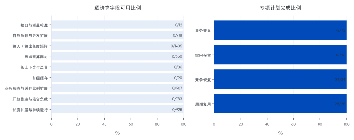

图 08-17｜证据覆盖


| 条件 | 并发 | n | 首字中位 s | 配对减少 s | 有效窗口／缓存% |
| --- | --- | --- | --- | --- | --- |
| 业务 / triage / 首次 | **4** | **4** | **2.48** | **0.00** | **1 / 0.0%** |
| 业务 / triage / 50% | **4** | **4** | **2.59** | **-0.09** | **1 / 0.0%** |
| 业务 / triage / 100% | **4** | **4** | **1.62** | **0.88** | **1 / 99.8%** |
| 业务 / dialogue / 首次 | **1** | **4** | **3.44** | **0.00** | **1 / 0.0%** |
| 业务 / dialogue / 100% | **1** | **4** | **3.76** | **-0.16** | **1 / 0.0%** |
| 业务 / dialogue / 50% | **1** | **4** | **3.35** | **-0.06** | **1 / 0.0%** |
| 业务 / summary / 首次 | **1** | **4** | **13.58** | **0.00** | **1 / 0.0%** |
| 业务 / summary / 50% | **1** | **4** | **9.72** | **3.83** | **1 / 25.0%** |
| 业务 / summary / 100% | **1** | **4** | **1.78** | **11.62** | **1 / 100.0%** |
| 业务 / triage / 首次 | **1** | **4** | **1.19** | **0.00** | **1 / 0.0%** |
| 业务 / triage / 100% | **1** | **4** | **0.91** | **0.29** | **1 / 99.8%** |
| 业务 / triage / 50% | **1** | **4** | **1.17** | **0.08** | **1 / 0.0%** |
| 业务 / summary / 首次 | **4** | **4** | **43.15** | **0.00** | **1 / 0.0%** |
| 业务 / summary / 50% | **4** | **4** | **25.90** | **17.25** | **1 / 43.5%** |
| 业务 / summary / 100% | **4** | **4** | **2.91** | **40.25** | **1 / 99.8%** |
| 业务 / dialogue / 首次 | **4** | **4** | **11.22** | **0.00** | **1 / 0.0%** |
| 业务 / dialogue / 100% | **4** | **4** | **9.89** | **1.34** | **1 / 24.8%** |
| 业务 / dialogue / 50% | **4** | **4** | **12.10** | **-0.88** | **1 / 0.0%** |
| 空闲 / 32768 / 首次 / 30 s | **1** | **3** | **13.63** | — | **3 / 0.0%** |
| 空闲 / 32768 / 复测 / 30 s | **1** | **3** | **2.22** | **10.53** | **3 / 100.0%** |
| 空闲 / 32768 / 首次 / 0 s | **1** | **3** | **13.26** | — | **3 / 0.0%** |
| 空闲 / 32768 / 复测 / 0 s | **1** | **3** | **2.79** | **10.67** | **3 / 100.0%** |
| 空闲 / 32768 / 首次 / 300 s | **1** | **3** | **12.89** | — | **3 / 0.0%** |
| 空闲 / 32768 / 复测 / 300 s | **1** | **3** | **3.69** | **9.96** | **3 / 91.7%** |
| 空闲 / 8192 / 首次 / 0 s | **1** | **3** | **4.75** | — | **3 / 0.0%** |
| 空闲 / 8192 / 复测 / 0 s | **1** | **3** | **2.03** | **3.08** | **3 / 100.0%** |
| 空闲 / 8192 / 首次 / 300 s | **1** | **3** | **4.84** | — | **3 / 0.0%** |
| 空闲 / 8192 / 复测 / 300 s | **1** | **3** | **2.67** | **2.13** | **3 / 100.0%** |
| 空闲 / 8192 / 首次 / 30 s | **1** | **3** | **4.39** | — | **3 / 0.0%** |
| 空闲 / 8192 / 复测 / 30 s | **1** | **3** | **1.71** | **2.43** | **3 / 100.0%** |
| 竞争 / 8192 / 首次 | **1** | **3** | **4.33** | **0.00** | **3 / 0.0%** |
| 竞争 / 8192 / 立即复测 | **1** | **3** | **1.76** | **2.50** | **3 / 100.0%** |
| 竞争 / 8192 / 竞争后 | **1** | **3** | **1.70** | **2.63** | **3 / 100.0%** |
| 竞争 / 8192 / 再次复测 | **1** | **3** | **1.76** | **2.52** | **3 / 100.0%** |
| 周期 / 8192 / 首次 | **4** | **4** | **11.42** | — | **1 / 0.0%** |
| 周期 / 8192 / 复测 / 1 | **4** | **4** | **2.02** | **9.38** | **1 / 100.0%** |
| 周期 / 8192 / 复测 / 2 | **4** | **4** | **2.16** | **9.25** | **1 / 100.0%** |
| 周期 / 8192 / 复测 / 3 | **4** | **4** | **2.18** | **9.26** | **1 / 100.0%** |
| 周期 / 8192 / 复测 / 4 | **4** | **4** | **2.26** | **9.15** | **1 / 100.0%** |
| 周期 / 8192 / 复测 / 5 | **4** | **4** | **2.39** | **9.03** | **1 / 100.0%** |
| 周期 / 8192 / 复测 / 6 | **4** | **4** | **2.33** | **9.08** | **1 / 100.0%** |


#### 运行期间的缓存变化

已获得 358 个有输入量的有效计数窗口，词元加权缓存比例为 **20.29%**，窗口范围 **0.00%**–**100.00%**。这些窗口可能包含不同测试负载，只用于描述时间变化，不作为缓存保留或稳定命中的证明。 窗口比例标准差为 25.77 个百分点。

<!--CACHE_TIMELINE-->

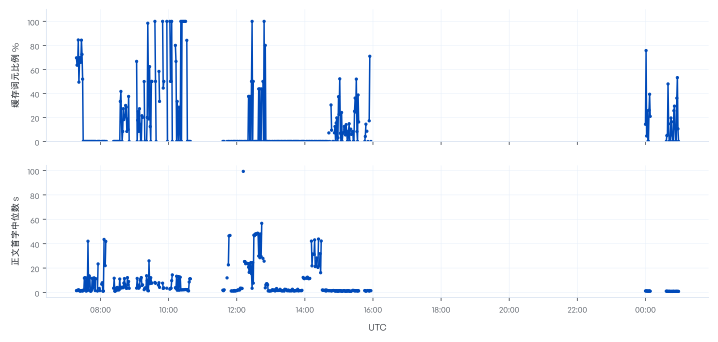

图 08-18｜时间观察


#### 判定与后续验证

只有同一参数、完整响应、无重试且计数核对通过的区组，才给出区组缓存词元比例；并发区组无法拆成逐请求命中率。空闲组每个前缀只探测一次，避免探测本身刷新保留状态；竞争实验只覆盖约131,072个干扰输入词元，不声称达到缓存容量上限。周期实验只有**10分钟**计划跨度，连续负载按实际执行时长报告。下一步以真实业务热度分布、更多独立时段及不同竞争强度验证可重复性；容量与成本模型暂不加入未经验证的缓存收益。

### 64K前缀复用的独立核验

| 独立前缀 | 首次／复用 | 实际缓存词元 | 缓存比例 | 引擎首词元秒数 |
| --- | --- | --- | --- | --- |
| 2 | 首次 | **0** | **0.000** | **20.564** |
| 2 | 复用 | **57344** | **0.875** | **2.766** |
| 3 | 首次 | **0** | **0.000** | **20.746** |
| 3 | 复用 | **57344** | **0.875** | **2.682** |
| 1 | 首次 | **0** | **0.000** | **20.457** |
| 1 | 复用 | **57344** | **0.875** | **2.664** |


每个前缀在清空缓存后首次发送，再立即复用；本表核验即时复用，不推导长期保留或缓存容量结论。


### 64K低复用前缀：实际缓存比例

设计0%表示两条输入在靠前位置使用不同标记，不表示缓存计数必然为零。此对照检验低复用输入的实际状态，与前述相同前缀立即复用实验共同构成两个端点；它不测TTL或长期缓存寿命。

| 配对 | 请求 | 输入增量 | 缓存增量 | 实际比例 | 窗口 |
| --- | --- | --- | --- | --- | --- |
| 1 | 首条 | 65,555 | 0 | **0.000%** | 有效 |
| 1 | 第二条 | 65,555 | 0 | **0.000%** | 有效 |
| 2 | 首条 | 65,554 | 0 | **0.000%** | 有效 |
| 2 | 第二条 | 65,555 | 0 | **0.000%** | 有效 |
| 3 | 首条 | 65,555 | 0 | **0.000%** | 有效 |
| 3 | 第二条 | 65,555 | 0 | **0.000%** | 有效 |


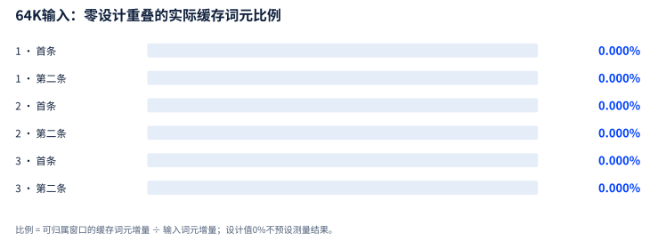

图 08-19｜缓存计数器对照


三个独立配对、六个窗口均可归属，实际缓存词元比例均为**0%**。结果与靠前位置使用不同输入标记的低复用设计一致；即时复用、空闲保留和竞争实验分别回答不同的缓存问题。


<a id="section-09"></a>

## 09 · 持续性能、热状态与资源

### 独立到达与持续运行


| 区组 | 到达／发送／完成 | 本地拒绝 | 观测秒数 |
| --- | --- | --- | --- |
| 开放到达与混合负载 · 参考速率的 0.5 倍 | **120 / 120 / 120** | **0** | **624.9** |
| 开放到达与混合负载 · 参考速率的 0.25 倍 | **57 / 57 / 57** | **0** | **607.9** |
| 开放到达与混合负载 · 参考速率的 1.25 倍 | **296 / 243 / 243** | **53** | **617.4** |
| 分段观测（5段，包含中断） | **638 / 638 / 635** | **0** | **34,580.3** |
| 开放到达与混合负载 · 参考速率的 1 倍 | **226 / 203 / 203** | **23** | **616.4** |
| 开放到达与混合负载 · 参考速率的 0.75 倍 | **160 / 160 / 160** | **0** | **612.3** |


分析阈值：正文首字延迟阈值分别为 1、2、5、**10 秒**，估算平均每词元耗时阈值分别为 20、50、100 毫秒；这些是敏感性分析条件，不是对外承诺的服务等级协议。全局并发上限 8；队列最多 32，等待最多 **5 秒**。持续稳定性测试以 **1 小时**、**2,701 次**或预算／截止任一先到为止。 [达标吞吐逐条件数据表](../../2026-10-14_17-dual-spark/data/service/goodput.csv)

下表选取三组分析阈值；每格为达标请求/s及其占全部正式到达的比例。其余阈值组合见逐条件数据表。混合负载只统计配对短请求。

| 条件 | 1 s / 20 ms | 2 s / 50 ms | 5 s / 100 ms |
| --- | --- | --- | --- |
| 开放到达与混合负载 · 参考速率的 0.25 倍 | **0.012 / 12.2%** | **0.058 / 61.0%** | **0.096 / 100.0%** |
| 开放到达与混合负载 · 参考速率的 0.5 倍 | **0.013 / 6.7%** | **0.150 / 77.9%** | **0.185 / 96.2%** |
| 开放到达与混合负载 · 参考速率的 0.75 倍 | **0.009 / 3.5%** | **0.212 / 81.2%** | **0.253 / 97.2%** |
| 开放到达与混合负载 · 参考速率的 1 倍 | **0.000 / 0.0%** | **0.208 / 57.1%** | **0.304 / 83.8%** |
| 开放到达与混合负载 · 参考速率的 1.25 倍 | **0.000 / 0.0%** | **0.154 / 31.8%** | **0.326 / 67.5%** |


### 节点资源

先查看与同一并发区组对齐的均值，再看整个观测时段的变化。监控有空档时不插值。

### 与自然负载区组对齐的资源表现

<!--RESOURCE_BY_LOAD-->

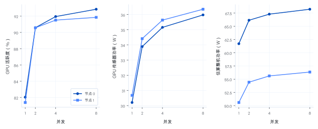

图 09-01｜并发与双节点资源


| 并发 / 节点 | GPU 活跃度均值 | GPU / 整机估算 W | 温度峰值 °C | 活跃度 / 功率覆盖 |
| --- | --- | --- | --- | --- |
| 1 / 0 | **82.0%** | **30.2 / 61.7** | **65.0** | **100.0%** / **100.0%** |
| 1 / 1 | **81.4%** | **30.7 / 50.6** | **66.0** | **100.0%** / **100.0%** |
| 2 / 0 | **90.6%** | **33.9 / 66.1** | **70.0** | **100.0%** / **100.0%** |
| 2 / 1 | **90.6%** | **34.4 / 54.4** | **70.0** | **100.0%** / **100.0%** |
| 4 / 0 | **91.9%** | **35.2 / 67.3** | **70.0** | **100.0%** / **100.0%** |
| 4 / 1 | **91.5%** | **35.6 / 55.6** | **70.0** | **100.0%** / **100.0%** |
| 8 / 0 | **92.8%** | **36.0 / 68.2** | **68.0** | **100.0%** / **100.0%** |
| 8 / 1 | **91.9%** | **36.3 / 56.3** | **69.0** | **100.0%** / **100.0%** |


读法：覆盖率是该条件全部区组时长中，具有有效相邻采样的时间占比；均值只在覆盖部分计算。即使 GPU 活跃度接近 **100%**，也不能仅凭这一字段认定计算单元或内存带宽已经饱和。跨节点功率差异还需要结合频率、任务分工和采样字段语义解释。

<!--HARDWARE-->

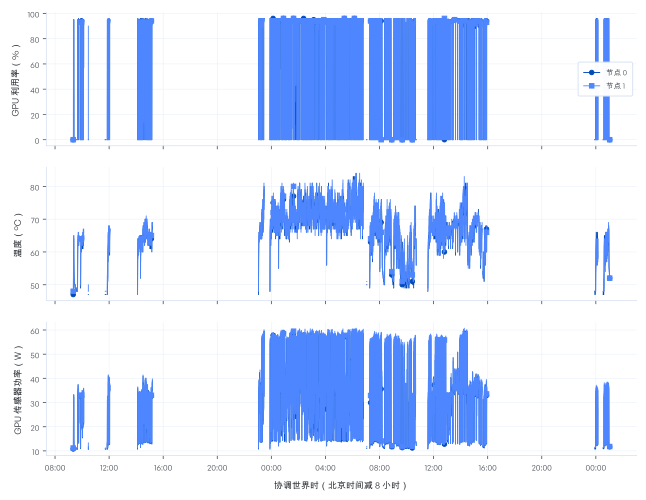

图 09-02｜双节点资源时序


原始引擎与内存时序见附录B。独立网络微基准约**109 Gb/s**，只反映该传输测试；现有证据不足以把模型瓶颈归因于互联、内存或计算中的单一因素。

本节首先展示模型服务窗口监控；独立GPU持续负载在下文按实际覆盖列出。两类持续测试的工作量与基线不同，不能合并为一段稳定性时长。传感器、估算整机与插座电量的边界分别保留；缺少插座电量时，后续成本仍为情景估算。

### 独立硬件持续负载：性能保持与热状态

计划依次执行计算**60分钟**、带宽**60分钟**、混合**120分钟**。每阶段先采集该负载**5分钟**基线，再开始正式时长；混合阶段交替执行计算与带宽任务，分别统计两类速率。每**10分钟**窗口的中位速率除以同负载基线中位数，得到保持率。窗口、阶段和服务测试时长分别统计，不能相加为同一连续业务稳定性试验。

混合负载采用独立预热和基线：温度达到**85°C**时暂停提交GPU工作，低于**75°C**持续**30秒**后恢复。执行时间、冷却时间与中断尝试分别记录。计算和带宽阶段采用达到**85°C**即停止的控制规则，因此各阶段的持续时长与温控边界分别报告。

| 节点 | 负载 | 实测／计划分钟 | 校验样本 | 温度中位／最大°C | SM中位MHz | 传感器kWh | 积分时间覆盖 |
| --- | --- | --- | --- | --- | --- | --- | --- |
| 0 | 计算 | **60.0 / 60** | **3359** | **81.0 / 82.0** | **2262** | **0.0888** | **100.0%** |
| 0 | 带宽 | **60.0 / 60** | **3485** | **65.0 / 66.0** | **2522** | **0.0318** | **100.0%** |
| 0 | 交替混合 | **120.0 / 120** | **5832** | **75.0 / 86.0** | **2405** | **0.1082** | **100.0%** |
| 1 | 计算 | **60.0 / 60** | **3405** | **83.0 / 84.0** | **2249** | **0.0888** | **100.0%** |
| 1 | 带宽 | **60.0 / 60** | **3490** | **67.0 / 67.0** | **2515** | **0.0324** | **100.0%** |
| 1 | 交替混合 | **120.0 / 120** | **6527** | **74.0 / 86.0** | **2431** | **0.1178** | **100.0%** |


### 混合负载的温度控制与吞吐口径

| 控制项 | 规则 |
| --- | --- |
| 触发退避 | 温度≥**85°C**或读数缺失，暂停提交GPU工作 |
| 自动恢复 | 温度低于**75°C**连续稳定**30秒** |
| 最长单次退避 | **600秒**；超时结束本轮并恢复服务 |
| 时间与停止边界 | 不自动延长固定截止；退避期间继续响应手动停止、租约和内存保护 |


混合负载采用该策略；计算和带宽阶段保留各自测量时的温控条件。退避发生在CUDA提交边界，冷却时间不进入CUDA事件计算速率；实际吞吐另按计量工作量／整个阶段墙钟时长统计，包含退避、校验和混合阶段另一类工作。退避事件独立留档；未完成计时单元不计为有效性能样本。

驱动限制原因｜Active为驱动报告该限制原因生效，Not Active为该次采样未生效；不支持或缺失不计作未生效。下表统计采样数，不能直接换算限速持续时间或性能损失。

| 节点 | 阶段 | 驱动原因标志 | Active采样数 | 已知状态采样数 |
| --- | --- | --- | --- | --- |
| 0 | mixed | sw_thermal_slowdown | **0** | **7196** |
| 0 | mixed | hw_thermal_slowdown | **0** | **7196** |
| 0 | mixed | hw_slowdown | **0** | **7196** |
| 0 | mixed | sw_power_cap | **0** | **7196** |
| 1 | mixed | sw_thermal_slowdown | **0** | **7197** |
| 1 | mixed | hw_thermal_slowdown | **0** | **7197** |
| 1 | mixed | hw_slowdown | **0** | **7197** |
| 1 | mixed | sw_power_cap | **0** | **7197** |


### 混合负载：执行速率与包含退避的实际吞吐

| 节点 | 正常执行速率中位数 | 阶段墙钟吞吐 | 完整计时单元内退避秒数 | 退避／阶段时长 | 含退避计时单元数 |
| --- | --- | --- | --- | --- | --- |
| 0 | gemm: **87.57 TFLOP/s**; triad: **221.62 GB/s** | gemm: **36.39 TFLOP/s**; triad: **91.72 GB/s** | **1178.8** | **16.4%** | **38** |
| 1 | gemm: **86.99 TFLOP/s**; triad: **217.28 GB/s** | gemm: **40.63 TFLOP/s**; triad: **100.93 GB/s** | **434.4** | **6.0%** | **14** |


阶段墙钟吞吐以该类已计量工作量除以整个混合阶段时间，包含另一类工作、数值校验和冷却等待。因此它与正常执行速率的差值不能全部归因为退避。退避秒数只汇总已完成的计时单元；中断单元的退避仍保留在原始事件记录中。

本轮冷却由测试程序的温度阈值触发；两节点的有效驱动采样均未记录热降频、硬件限速或功率限制标志为Active。该结果描述约**1秒**间隔的采样证据，不能排除采样间的短暂事件。部署容量评估应同时观察正常执行速率和包含等待的墙钟吞吐。

<!--HARDWARE_UNLOADED_RETENTION-->

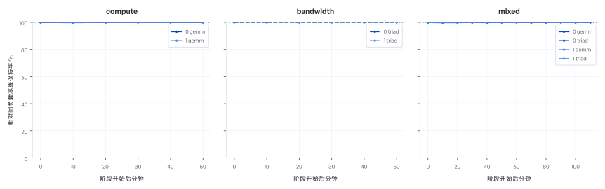

图 09-03｜分窗性能保持


<!--HARDWARE_UNLOADED_TELEMETRY-->

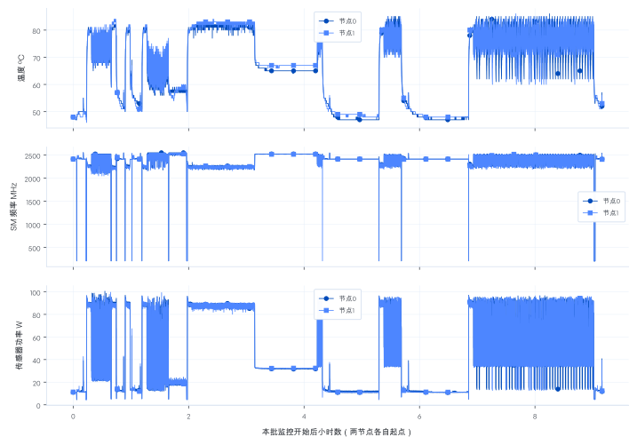

图 09-04｜本批节点资源时间线


能量以相邻有效功率采样作梯形积分，只纳入间隔不超过**5秒**的片段，并报告覆盖比例；缺测片段不补零或外推。当前没有插座电表证据，采购折旧与**1／3／5年**投资回报仍使用第11节明示的整机用电情景，不能用传感器能量替换整机电费。

<!--REVIEW_SUSTAINED-->

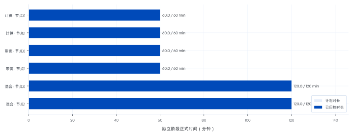

图 09-05｜持续负载覆盖


638次到达的观测分为五段，包含中断的总跨度为34,580.3秒，不能代表连续运行。连续服务结论采用独立的3,600.1秒窗口，按五分钟分组展示。

### 连续服务的五分钟窗口

| 独立尝试/分钟 | 到达/完整 | 首字中位/95分位s | 完成响应产出词元/s |
| --- | --- | --- | --- |
| 1 / 0–5 | **55/54** | **1.03 / 1.67** | **71.63** |
| 1 / 5–10 | **45/45** | **0.99 / 1.27** | **48.54** |
| 1 / 10–15 | **50/50** | **1.08 / 1.63** | **67.85** |
| 1 / 15–20 | **59/59** | **0.99 / 1.56** | **76.47** |
| 1 / 20–25 | **58/58** | **1.07 / 1.65** | **69.37** |
| 1 / 25–30 | **40/40** | **0.98 / 1.36** | **55.57** |
| 1 / 30–35 | **55/55** | **0.97 / 1.38** | **72.35** |
| 1 / 35–40 | **51/51** | **1.08 / 1.43** | **65.93** |
| 1 / 40–45 | **55/55** | **1.04 / 1.49** | **67.71** |
| 1 / 45–50 | **33/33** | **1.04 / 1.65** | **50.93** |
| 1 / 50–55 | **53/53** | **1.14 / 1.35** | **70.85** |
| 1 / 55–60 | **46/46** | **1.12 / 1.58** | **60.13** |


<!--GAP_SOAK_WINDOWS-->

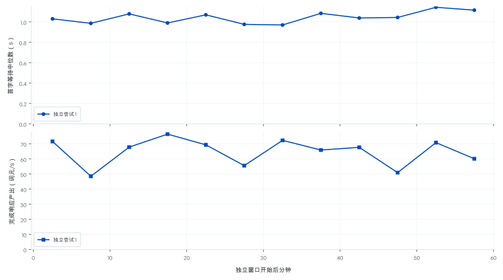

图 09-06｜连续窗口中的等待与完成产出


### 受控公网负载期间的双节点资源


| 节点 | 温度中位/最高°C | GPU利用率中位/95分位% | GPU频率中位MHz | 传感器功率中位W | 最低可用内存GiB |
| --- | --- | --- | --- | --- | --- |
| 0 | 63.0 / **73.0** | 94.0 / 96.0 | 2,502 | 33.5 | 21.41 |
| 1 | 64.0 / **75.0** | 95.0 / 96.0 | 2,502 | 33.6 | 23.77 |


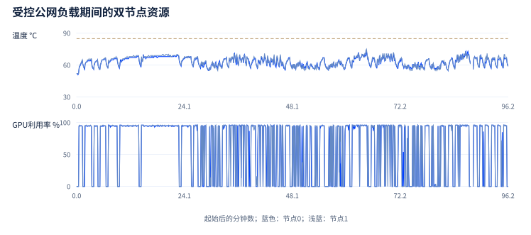

图 09-07｜节点资源时间序列


约每5秒采样一次；统计包含预热、负载、区组间排空与环境核验，因此利用率中位数不能代表饱和吞吐。超过20秒的采样间断不连线。85°C为实验退避阈值，不能据此推断驱动已经发出硬件降频信号；传感器功率不等于整机插座能耗。


<a id="section-10"></a>

## 10 · 跨层解释与H200技术对照

前面的实验分别给出资源上限、执行效率和用户体验。本节把这些观测联系起来：同一现象可以由多个机制产生，只有匹配工作量的对照才能缩小解释范围。下表将已建立的结论与仍需验证的机制分开。

| 维度 | 联合观测 | 可支持的解释 |
| --- | --- | --- |
| 计算与形状 | 矩阵规模／精度扫描、独立算子与引擎GPU轨迹。 | 实际速率依赖规模与实现；最高TFLOP/s不等于模型词元吞吐。缺少计算管线计数，不能确定唯一计算瓶颈。 |
| 内存与协作 | **8 GiB**复制约**223–227 GB/s**；**1 GiB** AllReduce总线口径约**21.81 GB/s**。 | 本地读写与跨节点同步有不同资源预算；各自字节口径不同，不能用两者比值推算模型加速。 |
| 并发与等待 | 短题库并发1→8，合计吞吐**45.1→158.9词元/s**；单请求词元耗时随之增加。 | 并发提升系统处理量，需同时检查用户等待；未建立无限扩展或长期容量。 |
| 缓存与上下文 | 公网复用诊断、节点词元计数和原生引擎立即复用分别计量。 | 重复输入、实际缓存量和等待收益是三个量；短时复用不能证明任意业务的保留期限。 |
| 温度与保持率 | 计算、带宽与混合负载分别完成**60／60／120分钟**；驱动原因字段按采样覆盖解释。 | 可评价已测分段的性能保持；温度阈值、驱动限速和性能损失不能互相替代。 |


统计解释采用四类证据：直接观测、匹配对照、官方规格、经济情景。仅前两类来自本次性能实验；对照存在顺序效应、样本量或资源状态限制时随表注明。 硬件计数器仅覆盖单核函数诊断探针；尚缺代表性硬件与模型工作负载的计数，不能据此推导模型Roofline。


### GB10与H200：按资源功能对齐的架构参照

比较单位首先固定为单颗GB10（位于一台DGX Spark）与单颗H200 SXM；多设备协作另注明拓扑。指标按“存放数据、向计算核心供数、执行运算、交换分片、跨服务器扩展”的功能对齐，不要求底层技术同名。DGX Spark为完整计算机，H200 SXM为服务器加速器，容量归属、功耗边界与互连范围需随数值一起阅读。

| 技术功能 | DGX Spark / GB10 | H200 SXM／指定服务器 | 对齐方式与解释 |
| --- | --- | --- | --- |
| 容纳权重、KV与工作空间 | **128 GB** LPDDR5x CPU/GPU共享统一内存 | **141 GB** HBM3e GPU本地内存 | 容量接近；Spark系统与CPU也占用同一内存池。双Spark的**256 GB**为分布式容量。 |
| 向GPU供给本地数据 | **273 GB/s** LPDDR5x标称 | **4,800 GB/s** HBM3e标称 | 同属本地内存数据供给；H200规格比值**17.58倍**，仅是带宽比，不是推理加速比。 |
| CPU与GPU交换数据 | 共享内存与芯片内NVLink-C2C；本报告不赋予未核验的C2C峰值。 | PCIe Gen5:**128 GB/s** 双向合计；主机与HBM分离 | 比较协同路径与迁移需求；C2C不充当两台Spark之间的互连。 |
| 同一模型分片间协作 | 双Spark经RoCE；启用**200 Gb/s**端口＝**25 GB/s**单向标称。 | H200 SXM经NVLink；每GPU**900 GB/s**双向合计，折算发送方向总和**450 GB/s**。 | 功能相同但拓扑不同：网卡端口对GPU全部链路；不是单链路或单对GPU性能比。 |
| 向更多服务器扩展 | 每台本次启用**1×200 Gb/s**＝**25 GB/s**；两个逻辑接口不相加。 | DGX H200示例：每网卡**400 Gb/s**＝**50 GB/s**；8 GPU整机8张，合计**3.2 Tb/s**。 | 归一到单网卡时规格为**2倍**；整机聚合依赖拓扑、并发与网络。 |
| 低精度矩阵加速 | Blackwell支持FP8与NVFP4；本轮8192³稠密实测见下表。 | Hopper原生FP8；稠密约**1,979 TFLOP/s**、2:4稀疏**3,958 TFLOP/s**（规格）。 | FP4与FP8承担低精度加速功能，但数值格式、库路径与误差不同，不相除作加速倍数。 |
| 功率与供电约束 | GB10 SoC TDP**140 W**；Spark电源额定**240 W**。 | H200 SXM最高**700 W**可配置TDP；主机功耗另计。 | 都是设计规格，边界不同；不用于直接计算词元/J或整机电费。 |


[DGX Spark](https://docs.nvidia.com/dgx/dgx-spark/hardware.html) · [H200 SXM](https://www.nvidia.com/en-us/data-center/h200/) · [Spark ConnectX-7](https://docs.nvidia.com/dgx/dgx-spark/spark-clustering.html) · [DGX H200](https://docs.nvidia.com/dgx/dgxh100-user-guide/introduction-to-dgxh100.html) · [Hopper NVLink](https://docs.nvidia.com/cuda/hopper-tuning-guide/index.html)

表中H200全部为官方规格，未在本次执行H200实测。下文GB10为卸载模型后的测量。相同功能使架构对照有意义，但只有相同模型、精度、工作量及计时边界的双平台实测才能建立推理性能比。

<!--REVIEW_FABRIC_MAP-->

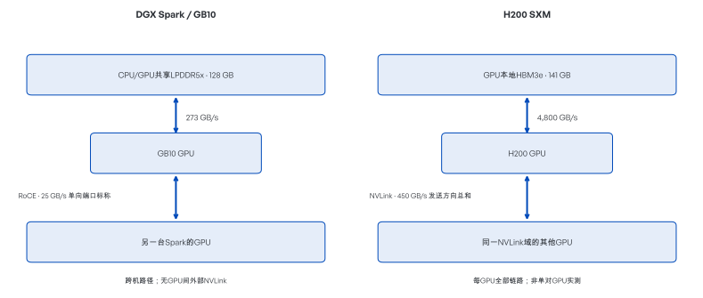

图 10-01｜数据路径对照


<!--HARDWARE_H200_MEMORY-->

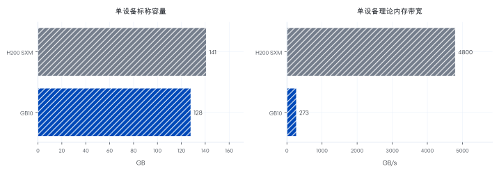

图 10-02｜容量与数据供给


容量与数据供给｜均为单设备官方规格；相近容量不等于相近带宽。两个面板从零起轴。

#### 本机内存速率：固定8 GiB工作集

| 操作 | 节点0 GB/s：中位 [范围]；轮次 | 节点1 GB/s：中位 [范围]；轮次 | H200 HBM3e参照 |
| --- | --- | --- | --- |
| 连续复制：读＋写 | **223.41** [222.75–223.74]; n=10 | **226.95** [226.31–227.88]; n=10 | **4,800 GB/s**标称；本操作未测 |
| 三元运算：两读＋一写 | **214.88** [213.76–215.27]; n=10 | **217.66** [217.07–218.13]; n=10 | **4,800 GB/s**标称；本操作未测 |
| 原生读取 | **110.04** [109.88–110.21]; n=5 | **110.09** [108.89–110.79]; n=5 | **4,800 GB/s**标称；本操作未测 |
| 原生写入 | **192.63** [191.81–193.07]; n=5 | **192.87** [191.51–193.06]; n=5 | **4,800 GB/s**标称；本操作未测 |


工作集使用二进制GiB，速率使用十进制GB/s。数值按程序请求的逻辑字节计数，不能标为硬件计数器测得的物理DRAM带宽。原生读取包含线程内依赖累加，反映该访问内核而非理论读取上限；三元运算按元素对齐后的实际字节计数。

#### 不同精度的核心计算速率

TFLOP/s表示每秒10¹²次浮点运算，乘加计**2次**。下表GEMM固定M=N=K=8192，使用2MNK/时间，不从各规模中挑选最高值；FP32通用乘加单独列出。H200稠密Tensor Core值以官方带稀疏值除2近似换算，保留原表舍入；不是本研究实测。2:4稀疏指每4个权重中2个非零，表中稀疏速率采用稠密等效运算量。

状态说明：**原生不支持**表示硬件没有该格式的原生运算路径；**不适用**表示该行运算不采用该列的稠密或2:4稀疏口径；**未测**表示本研究尚无有效实测结果。三者均不表示算力为零。

| 运算／精度 | GB10节点0实测TFLOP/s | GB10节点1实测TFLOP/s | H200稠密理论TFLOP/s | H200 2:4理论TFLOP/s |
| --- | --- | --- | --- | --- |
| FP32通用乘加 | **28.01** [27.97–28.04]; n=5 | **27.98** [27.94–28.06]; n=5 | **67** | 不适用 |
| FP32 GEMM | **18.39** [18.16–18.48]; n=10 | **18.22** [17.94–18.30]; n=10 | **67** | 不适用 |
| TF32 allowed | **33.10** [24.01–38.59]; n=10 | **37.17** [33.21–38.53]; n=10 | **≈494.5** | **989** |
| FP16 | **93.24** [91.83–93.95]; n=10 | **92.67** [91.59–92.99]; n=10 | **≈989.5** | **1,979** |
| BF16 | **94.34** [93.50–94.78]; n=10 | **94.08** [93.63–94.42]; n=10 | **≈989.5** | **1,979** |
| FP8 E4M3 | **192.64** [192.07–195.62]; n=5 | **191.88** [191.38–193.22]; n=5 | **≈1,979** | **3,958** |
| NVFP4 | **157.38** [148.49–160.44]; n=5 | **148.02** [143.42–161.21]; n=5 | 原生不支持 | 原生不支持 |
| FP16 2:4 | **39.33** [39.25–39.45]; n=5 | **39.48** [39.38–39.65]; n=5 | 不适用 | **1,979** |
| BF16 2:4 | **39.28** [39.03–39.69]; n=5 | **39.41** [38.82–40.02]; n=5 | 不适用 | **1,979** |
| FP64 | **0.4280** [0.4280–0.4281]; n=5 | **0.4276** [0.4276–0.4277]; n=5 | **34** 通用；**67** Tensor Core | — |


GB10通用乘加条件为256线程/块、**8条**独立链、线程块数为SM数的**4倍**。TF32 allowed表示允许库使用TF32，不能仅凭该开关确认每次调用的实际指令。NVFP4使用受控、可精确表示的数据分布，不能代表生产权重误差或MoE内核性能。GB10官方“最高**1 PFLOP/s**”采用FP4稀疏口径，不与本表稠密NVFP4实测直接计算达成率。

**NVFP4的架构差异：**GB10属于Blackwell，具有原生FP4矩阵运算支持；H200属于Hopper，没有原生NVFP4 Tensor Core运算，因此没有可填入的原生稠密或稀疏峰值。软件可通过兼容内核把FP4权重反量化为BF16后计算，但这属于不同运算路径，不能用H200的FP8或INT8规格代填。本研究也未在H200上实测这种软件路径。 [NVIDIA NVFP4](https://developer.nvidia.com/blog/introducing-nvfp4-for-efficient-and-accurate-low-precision-inference/) · [NVIDIA NIM NVFP4 Emulation](https://docs.nvidia.com/nim/large-language-models/_2.0.13/2.0.13/reference/advanced-configuration.html#nvfp4-emulation)

<!--HARDWARE_H200_COMPUTE-->

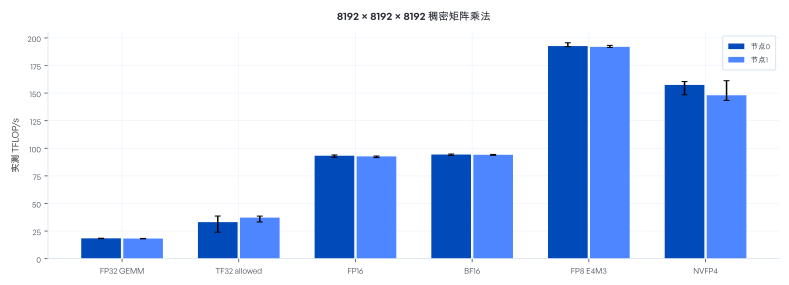

图 10-03｜固定规模计算实测


固定规模计算实测｜仅绘制两颗GB10实测，误差线为轮次观测范围。H200理论上限保留在表中，避免呈现为同场实测。

#### 对部署选择的意义

本次**8 GiB**连续复制达到**223–227 GB/s**，两节点**1 GiB** AllReduce总线带宽约**21.81 GB/s**；跨节点同步与本地内存访问处于不同速率层级。H200的HBM和NVLink规格显示其具备更高的内存及GPU互连上限，但实际收益仍取决于模型分片、计算密度、批量与通信重叠。现有证据支持识别这些资源差异，不支持给出H200相对本机的词元速率、时延、能效或回本倍数。后续对照需要同一模型、量化/精度、输入输出、并发、缓存条件及墙上功耗测量。

<a id="section-11"></a>

## 11 · 费用、持有成本与投资回报

### 实际 API 费用

费用按同组请求标识核对到账单。下表的每百万生成词元费用包含输入收费，适用于本次输入／输出组合，不是单独的输出目录价格。

| 并发条件 | 账单覆盖 | 实付 USD | USD/千次响应 | USD/百万生成词元 |
| --- | --- | --- | --- | --- |
| 并发 1 · 关闭思考 | **120/120** | **0.0244** | **0.204** | **0.519** |
| 并发 2 · 关闭思考 | **180/180** | **0.0375** | **0.208** | **0.517** |
| 并发 4 · 关闭思考 | **60/60** | **0.0124** | **0.206** | **0.518** |
| 并发 8 · 关闭思考 | **180/180** | **0.0373** | **0.207** | **0.517** |


<!--COST_BY_WORKLOAD-->

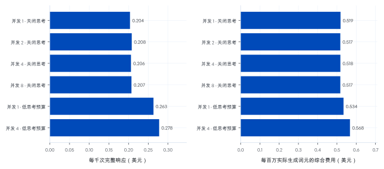

图 11-01｜费用归一化


<div id="ownership-cost"></div>

### 实验费用汇总


| 工作负载范围 | 实付USD | 核算范围 |
| --- | --- | --- |
| 服务性能矩阵 | **8.561299** | 10月14–17日；按原始请求账单归属。 |
| 独立并发、业务长度与连续服务窗口 | **0.376474** | 10月17日；按公网请求账单核对。 |
| 受控长度、混合调度与低复用前缀 | **0.401753** | 10月19日；696/696已发物理尝试账单可归属，含预热与探针。 |
| 实验API费用合计 | **9.339526** | 互不重叠的账单小计相加；不含设备、电费和人力。 |

实验总费用描述本研究的调用开销。生产单位成本与投资回报仍使用同一负载组的费用、生成量和吞吐，避免把不同输入／输出比例的费用混为一个生产单价。

### 双机持有成本：采购与电费

采购价按每台 **US$5,000**，双机合计 **US$10,000**。电价采用中国商业用电公开参考 **US$0.109/kWh（2026年第三季度）**，作为可复算代理值，并非部署地点合同电价或官方用电量加权均价。 [GlobalPetrolPrices](https://www.globalpetrolprices.com/electricity_prices/)

单位成本按直线折旧加估算电费计算：年费用 = 采购价 ÷ 折旧年限 + 双机功率(kW) × **8,760小时** × 电价；再除以年有效生成量。功率采用对应负载采样的估算整机功率之和，并假设全年保持该水平。有效生产比例表示有用任务产出时间，不是GPU活跃度。未计人工、机房、冷却、维修及融资。

| 并发 | 双机估算 W | 年电费 USD | 50% · USD/1M | 75% · USD/1M | 100% · USD/1M |
| --- | --- | --- | --- | --- | --- |
| 1 | **112.3** | **107** | **4.833** | **3.222** | **2.417** |
| 2 | **120.6** | **115** | **2.778** | **1.852** | **1.389** |
| 4 | **122.9** | **117** | **1.821** | **1.214** | **0.911** |
| 8 | **124.6** | **119** | **1.378** | **0.919** | **0.689** |


上表统一按三年折旧；后三列是对应有效生产比例下的每百万生成词元成本。

<!--COST_SENSITIVITY-->

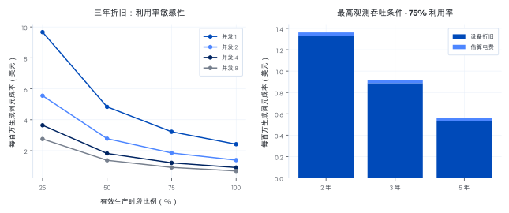

图 11-02｜成本敏感性


<div id="investment-returns"></div>

### 1／3／5 年回本与投资回报：自用和对外售卖

本节回答投入两台设备之后，现金节省或销售收入何时覆盖初始投资。折旧只用于前面的单位成本分摊；这里在购机时一次扣除采购支出，之后只扣现金运营费用，不再重复扣除折旧。所有金额均为美元，以下是基于已测吞吐的条件测算，不是已经实现的多年收益。

| 用途 | 年度收益如何定义 | 价格与工作量口径 |
| --- | --- | --- |
| 自用：减少外购 API 支出 | 完成同等工作原本需支付的 API 费用 | 沿用同一输入／输出组合的账户实付综合单价；只计算实际需要的工作量 |
| 售卖：推理服务销售收入 | 实际售出量 × 综合售价，再扣销售扣费 | 展示参考价的 **0.5／1／2 倍**；有效售出利用率是产生可收款工作量的时间占比 |


**固定测算依据。**采用自然题库并发 8 的观测吞吐 **158.90 词元/s**、双机估算功率 **124.57 W**、全年配置 **8,760 小时**和采购价 **US$10,000**。对应账户实付综合 API 价格为 **US$0.51739/百万生成词元**，已包含这一输入／输出组合的输入费用。售卖部分仅将其用作假设报价的参照，不把账户支出视为节点收入，也不把它视为通用输出词元单价。

| 指标 | 定义与计算 |
| --- | --- |
| 年有效产出 Q | Q = R × 3,600 × H × u ÷ 1,000,000，单位：百万生成词元 |
| 年现金运营费 O | O = 双机功率/1,000 × 年配置小时 × 电价 + 其他年度费用；销售扣费单列 |
| 年净现金收益 S | 自用：S = Q × API 参考价 − O；售卖：S = Q × 售价 × (1 − 扣费比例) − O |
| 第 T 年累计净收益 | T × S − K；K 为初始采购投入，负值表示尚未收回全部投入 |
| 累计简单投资回报率 | (T × S − K) ÷ K；分母为初始采购投入，不是营业收入，也不是年化收益率 |
| 简单回本周期 | K ÷ S，仅在 S > 0 时有有限值；回本超过 5 年表示五年内未回本 |
| T 年回本所需最低综合售价 | (K/T + O) ÷ [Q × (1 − 扣费比例)]；覆盖本节计入的现金费用 |


固定情景假设吞吐、价格和电价在各年保持不变，忽略资金时间价值；不计残值、换机、融资、税务、人工、冷却、机房及其他运维费用。销售扣费基准设为 0，仅用于展示未扣渠道等费用的上界情景，不代表实际免费。自用和售卖各自假设对应的工作需求能够持续实现；有效利用率不是 GPU 活跃度。五年结果还要求设备与服务可持续使用五年。

#### 自用：75% 有效生产比例下的 1／3／5 年现金账

年有效生成量约 3,758.2 百万词元；年避免 API 支出 **US$1,944**，估算年电费 **US$119**，年净节省 **US$1,826**。

| 持有时长 | 累计避免 API 支出 | 累计估算电费 | 初始采购 | 累计净收益 | 累计 ROI |
| --- | --- | --- | --- | --- | --- |
| 1 年 | **US$1,944** | **US$119** | **US$10,000** | **US$-8,174** | **-81.7%** |
| 3 年 | **US$5,833** | **US$357** | **US$10,000** | **US$-4,523** | **-45.2%** |
| 5 年 | **US$9,722** | **US$595** | **US$10,000** | **US$-872** | **-8.7%** |


利用率敏感性：相同的购机与全年用电假设下，只有实际需要的产出才能形成节省。

| 有效生产比例 | 年净节省 | 简单回本 | 1 年 ROI | 3 年 ROI | 5 年 ROI |
| --- | --- | --- | --- | --- | --- |
| 25% | **US$529** | **18.90 年** | **-94.7%** | **-84.1%** | **-73.5%** |
| 50% | **US$1,177** | **8.49 年** | **-88.2%** | **-64.7%** | **-41.1%** |
| 75% | **US$1,826** | **5.48 年** | **-81.7%** | **-45.2%** | **-8.7%** |
| 100% | **US$2,474** | **4.04 年** | **-75.3%** | **-25.8%** | **+23.7%** |


<!--INVESTMENT_SELF-->


图 11-03｜自用累计现金流与回本


**自用结论。****75%** 生产比例下，简单回本约 **5.48 年**，五年累计 ROI 为 **-8.7%**；**100%** 生产比例下，回本约 **4.04 年**，五年 ROI 为 **+23.7%**。其中超过五年的回本值只是同一假设继续成立时的数学外推，不能据此认定设备能持续运营到该年限。

#### 对外售卖：售价与有效售出比例共同决定回报

下表固定有效售出比例为 **75%**，以参考价的 **0.5／1／2 倍**展示报价敏感性。销售额扣除估算电费后为本节年净现金收益；尚未扣除的费用须在实际经营模型中补齐。同价、同工作量且不收销售扣费时，售卖和自用的数值相同，但前者依赖付费客户需求，后者依赖自身真实需求，两种收益不能相加。

| 售价 USD/百万生成词元 | 年销售额 | 年净现金收益 | 简单回本 | 1 年 ROI | 3 年 ROI | 5 年 ROI |
| --- | --- | --- | --- | --- | --- | --- |
| 0.259 (0.5×) | **US$972** | **US$853** | **11.72 年** | **-91.5%** | **-74.4%** | **-57.3%** |
| 0.517 (1×) | **US$1,944** | **US$1,826** | **5.48 年** | **-81.7%** | **-45.2%** | **-8.7%** |
| 1.035 (2×) | **US$3,889** | **US$3,770** | **2.65 年** | **-62.3%** | **+13.1%** | **+88.5%** |


**售卖情景结论。**在 **75%** 有效售出利用率下，按参考价售卖的回本周期仍为 **5.48 年**；若综合售价为参考价的两倍（**US$1.035**/百万生成词元），回本约 **2.65 年**，**1／3／5 年**累计净收益分别为 **US$-6,230** / **US$1,310** / US$8,850。这说明本情景的回报同时依赖售价与可持续售出量；提高报价本身不能证明市场能够维持该销量。

<!--INVESTMENT_SALES-->


图 11-04｜售卖投资回报的价格与利用率敏感性


指定期限内回本需要多高的综合售价：

| 有效售出比例 | 1 年回本最低价 | 3 年回本最低价 | 5 年回本最低价 |
| --- | --- | --- | --- |
| 25% | **US$8.078** | **US$2.756** | **US$1.691** |
| 50% | **US$4.039** | **US$1.378** | **US$0.846** |
| 75% | **US$2.693** | **US$0.919** | **US$0.564** |
| 100% | **US$2.019** | **US$0.689** | **US$0.423** |


价格单位均为每百万实际生成词元的综合美元金额，并假设输入／输出配比不变；改变长输入占比、思考长度或缓存条件时，应替换对应负载的吞吐与综合单价再计算。最低售价只覆盖已计入的费用，不等于商业报价建议。

[打开交互式成本计算器](report.zh.html#cost-tool)

[下载全部投资回报情景与计算参数](../../2026-10-14_17-dual-spark/data/service/investment-scenarios.csv)

[按负载核对的账单数据](../../2026-10-14_17-dual-spark/data/service/cohort-costs.csv) · [全部设备成本情景](../../2026-10-14_17-dual-spark/data/service/cost-scenarios.csv)

<a id="section-12"></a>

## 12 · 整体结论与后续工作

本研究在统一的测量框架下给出双DGX Spark的计算、内存、通信、引擎与公网服务表现。部署选择应同时考察处理量、用户等待、缓存条件、热状态和经济假设。

| 维度 | 主要结论 | 适用条件 |
| --- | --- | --- |
| GPU计算 | 8,192³稠密矩阵：BF16 **94.08–94.34**、FP8 **191.88–192.64 TFLOP/s**。 | 取决于精度、形状和实现路径；不直接等于推理吞吐。 |
| 数据供给与通信 | 8 GiB连续复制**223–227 GB/s**；1 GiB AllReduce总线带宽**21.81 GB/s**。 | 复制按读＋写逻辑字节计量；NCCL与RDMA主机缓冲区测量分列。 |
| 引擎阶段 | 单并发预填充**2,427–3,354词元/s**；固定256输出的解码**49.8–60.2词元/s**。 | 原生合成负载；计时包含引擎调度边界。 |
| 公网并发 | 并发1→8：合计**45.1→158.9词元/s**，正文首字95分位**1.65→2.39秒**。 | 60条短提示库、同组完整区组；不是服务承诺。 |
| 长输入与长输出 | 原生固定输出最高**260,096词元**；公网64K输入条件实际生成**27,018词元**。 | 公网按自然结束分析；实际输出与max_tokens分列。 |
| 混合请求调度 | 5组完整到达序列中4组可估计效应：短请求中位等待**1.18–3.37倍**、95分位**4.54–14.68倍**。 | 第5组混合臂3/32短请求本地拒绝；该组完成子集延迟不用于完整配对效应。 |
| 前缀缓存 | 64K低复用6个窗口均为**0%**缓存词元；32K名义空闲300秒组为**91.7%**，8K周期复用6轮约**100%**。 | 不同实验控制内容、等待或竞争；不据此推导统一TTL或长期业务命中率。 |
| 持续服务与热状态 | 公网连续**3,600.1秒**，600次到达中599完整、1本地拒绝；双节点计算／带宽／混合阶段各**60／60／120分钟**。 | 各阶段独立；混合阶段含温度退避，不能拼为连续4小时业务可靠性。 |
| H200技术参照 | H200标称本地内存带宽更高，设备互联、精度支持及功耗边界不同。 | 官方规格对照；无同模型、同负载的H200推理实测。 |

### 经济性与部署取舍

| 用途 | 情景结果 | 假设 |
| --- | --- | --- |
| 自用 | 回本**5.48年**；五年ROI **−8.7%**。 | 双机US$10,000；短提示并发8；75%有效生产比例；含估算电费，未计其他运营费。 |
| 对外售卖 | 回本**2.65年**；五年ROI **+88.5%**。 | 75%售出比例；参考API综合价的2倍售价；不是实际收入。 |

### 局限与后续工作

| 方向 | 下一步验证 | 验收依据 |
| --- | --- | --- |
| 混合服务调度 | 比较长短请求分队与预填充预算。 | 相同完整到达序列；同时报告尾部等待、吞吐和本地拒绝。 |
| 公网固定长输出 | 核验强制生成参数的端到端透传。 | 实际输出达到目标，保持输入与并发一致；自然结束另列。 |
| 缓存与持续性 | 扩大业务竞争、独立日期与环境温度范围。 | 可归属计数器窗口、重复区组、退避占时及达标吞吐。 |
| 硬件机制与H200 | 取得物理内存流量与匹配的H200配置。 | 同模型、精度、长度、缓存及通信路径的可比观测。 |
| 实际持有成本 | 以插座电表、真实利用率和运营费用替换估算。 | 重新计算1／3／5年现金流、回本时间与ROI。 |

## 13 · 附录A：完整指标与统计定义

本附录集中列出指标公式、数据来源与解释范围。秒用 s、毫秒用 ms；token/s 表示每秒词元数。每项统计都要说明请求集合、预热处理、时间窗口和缺失数量。以下“已采集”指原始记录中具备该类字段，不代表每个请求或整个测试期间均有有效值。

方法参考 NVIDIA GenAI-Perf 与 SGLang 服务基准对首响应、请求总延迟、输出吞吐和并发／速率的区分。本报告使用自有采集器，并按实际可观察的流片段明确时间边界；没有声称执行这些工具的官方认证测试。来源使用实验前保存的文档快照，滚动文档不证明当前安装版本的全部行为。 [NVIDIA GenAI-Perf](https://docs.nvidia.com/deeplearning/triton-inference-server/user-guide/docs/perf_benchmark/genai-perf-README.html) · [SGLang bench_serving](https://docs.sglang.io/docs/developer_guide/bench_serving) · 文档快照与散列

公式读法：t 表示某个事件发生的时间点，两时间点相减得到耗时；N_in、N_out 分别表示输入与输出 token 数，cap 表示上限，target 表示目标值；Σ 表示对指定样本求和。所有比例都需使用同一组有效样本作分子与分母。

### 请求时间与流式体验


| 指标 | 定义、单位与解释边界 | 来源／可用状态 |
| --- | --- | --- |
| 响应头等待 | t_headers − t_send；s。包含建立连接、服务等待和传输。 | headers_s；逐请求已采集 |
| 首个生成片段延迟 | t_generated − t_send；思考、正文或工具内容最先出现者。常称 TTFT，但这里不是逐 token 计时。 | first_generated_s；已采集 |
| 正文首字延迟 | t_visible − t_send；只有正文 content 才计入，没有正文则缺失。 | first_visible_s；已采集 |
| 首个思考片段 | t_reasoning − t_send；没有思考片段时缺失，不视为零。 | first_reasoning_s；出现时采集 |
| 端到端延迟 | t_end − t_send；包括响应流收尾。开放到达另加发出前等待，得到从计划到达开始的用户延迟。 | e2e_s；已采集 |
| 平均每输出词元耗时 | (E2E − 首个生成片段延迟)/(N_out − 1)，N_out>1；ms/token。使用源站输出计数；这是兼容估算。 | tpot_compat_s × 1,000；可派生 |
| 片段生成窗口与结束延迟 | (t_last − t_generated)/(N_out−1) 是另一种解码估算；t_end−t_last 为收尾时间。首片段 token 数未知。 | decode_tpot_approx_s / terminal_delay_s；已采集与复算 |
| 流式间隔与停顿 | 相邻非空生成事件到达间隔的中位数、95 分位、最大值；记录超过 200 ms／1 s 的次数与总时间。不能称为精确逐 token 间隔。 | events.jsonl / chunk_intervals；已采集 |


### 词元、长度与缓存


| 指标 | 定义、单位与解释边界 | 来源／可用状态 |
| --- | --- | --- |
| 输入与输出计数 | 输入含聊天模板；输出包括源站记录的生成部分。保留接口计数、源站计数及来源，不将计费归一化计数当作真实生成速度分母。 | prompt_tokens / completion_tokens / api_completion_tokens；已采集 |
| 思考计数 | 使用明确报告的字段；不可由彼此口径不同的总数和正文数相减补造。 | reasoning_tokens；字段可用时报告 |
| 计划与实际输入输出比 | 计划=N_in,target / N_out,cap；实际=N_in,observed / N_out,observed。输出为零或缺失时实际比例缺失。 | 计划清单与 requests.csv；可派生 |
| 输出触顶率 | finish_reason=length 的完整响应数／完整响应数；不等于质量失败率。 | truncated / finish_reason；已采集 |
| 共享前缀比例 | 完整模板 token 序列最长公共前缀长度／测量输入 token 数；与目标档位分开记录。 | 业务清单 matched_prefix_tokens；离线已核验 |
| 缓存 token 比例 | Σ已报告缓存 token / Σ对应输入 token；只对字段有效样本计数，同时报告覆盖数。逐请求比例可另给分布。 | cached_tokens；有字段才报告，缺失不补零 |
| 缓存命中请求比例 | 缓存 token>0 的请求数／缓存字段有效请求数；不能与 token 加权比例混用。 | 由有效缓存字段派生；并非设计目标 |


### 系统吞吐、到达与可靠性


| 指标 | 定义、单位与解释边界 | 来源／可用状态 |
| --- | --- | --- |
| 区组合计输出吞吐 | Σ输出 token / (区组排空时刻−启动时刻)，token/s；乘 60 得 token/min。不能把每请求 token/s 相加替代。 | 连续完整区组主图；全墙钟值另存 |
| 请求吞吐与到达速率 | 完成请求数／窗口秒数；计划到达数／窗口秒数；发送数与完成数分别计数。 | 区组回执与 arrivals；后者在开放阶段产生 |
| 并发、队列与调度迟滞 | active 为实际在途数；client_queue_s 为本地等待；scheduler_delay_s 为计划时刻到实际入队的偏差。 | 客户端监控；开放到达排队字段来自对应阶段 |
| 达标吞吐与达标比例 | 同时满足正文首字与估算 TPOT 阈值、流完整且无完整性标记的请求数／从首个测量到达到排空的窗口。达标比例另除以全部测量到达数，含本地拒绝。 | 阈值 1/2/5/10 s × 20/50/100 ms；使用开放阶段数据 |
| 完整率与失败分母 | 完整尝试／有终态尝试；逻辑任务首次完成率与至少一次完成率另算。在途任务不能先计为失败；重试失败不删除。 | state / retry_summary / HTTP 状态；已采集 |
| 完整性标记与边界拒绝 | 空正文、异常重复等只作为候选标记。故意超出上下文并按预期返回 400 单列，不计正常生成成功。 | integrity_flags / expected_context_rejection；按阶段 |
| 单位响应与生成成本 | 同一连续完整区组内：实付费用/完整响应数×1,000；实付费用/原始生成词元数×1,000,000。均包含输入收费。 | 逐请求账单精确关联；缺失账单不补零 |
| 设备与电费情景 | 采购成本/使用年限 + 平均功率(kW)×年度配置小时×电价；再除以预计生成量。有效生产时间比例不是 GPU 活跃度。 | 用户采购价、公开电价、采样估算功率及显式假设；非实测总拥有成本 |
| 费用与预算占用 | 实际费用以同请求账单核对；预留是保守上界，不是实付，也不等于硬件总拥有成本。 | billing_latest.json / ledger.json；已采集 |


### 推理节点与运行机制


| 指标 | 定义、单位与解释边界 | 来源／可用状态 |
| --- | --- | --- |
| GPU 活跃度、时钟、温度 | %／MHz／°C；按节点与负载窗口分析。GPU 活跃百分比不是算力效率或内存带宽利用率。 | SparkDash；持续采集，存在采样空档 |
| 功率与降频 | GPU 传感器功率 W；systemDraw 为估算整机功率；thermal / hwSlowdown 区分热限制和硬件减速。不能据此给插座侧 token/J。 | SparkDash；已采集 |
| 统一内存与交换 | 可用内存、页缓存、已用交换区；MiB=2²⁰ 字节、GiB=2³⁰。CPU/GPU 共享内存视图不能相加。 | SparkDash 内存字段；meminfo 按有效采样窗口统计 |
| 键值缓存与状态槽 | 已用、可用、可回收 token／槽位。可回收不等于立即空闲；不同类型状态池单位不能混算。 | SparkDash 可用字段；SGLang 原始指标覆盖不完整 |
| 引擎执行与排队 | num_running_reqs / num_queue_reqs；按时间窗观察堆积。图表不对缺失阶段补零。 | SparkDash 快照及原始时序；按有效时间窗分析 |
| 引擎延迟直方图与计数器 | 用区组前后差值计算请求、输入、生成和缓存量；直方图只给桶边界支持的范围。计数器重置或序列消失则缺失；跨并行副本不盲目求和。 | Prometheus 存档覆盖不完整；SparkDash 未提供原始直方图与计数器 |
| 多词元预测接受情况 | 窗口接受比例／平均接受长度是引擎指标，分母由实现定义；累计接受数缺失时不能推算全程接受率或加速倍数。 | 原始 gauge 存档；SparkDash 接受字段为空 |
| 内存压力与缺页 | PSI 表示任务因资源等待而停顿的时间比例；交换进入／退出及重大缺页计数按有效窗口求差除以时长。 | vmstat / PSI 存档覆盖不完整，按有效窗口统计 |
| 错误与互联 | Xid 为驱动错误记录、OOM 为内存不足杀进程计数，报告基线后的增量；RoCE 传输／错误按接口可用字段观察。独立 RDMA 微基准不能替代模型通信指标。 | SparkDash 原始节点快照；RDMA 独立结果 |


### 测量质量与统计量


| 指标 | 定义、单位与解释边界 | 来源／可用状态 |
| --- | --- | --- |
| 监控覆盖与采集成本 | 有效采样数、采样间隔、最后成功时间、采集耗时；按实际数据判断哪些负载窗口可对齐。 | monitor/status、时间戳及 collection_seconds；已采集 |
| 客户端资源与事件循环迟滞 | CPU 用户／系统时间、最大驻留内存、每秒心跳迟滞；用于排除测量端饱和这一替代解释。 | monitor/client.jsonl；已采集 |
| 中位数、尾分位与区间 | p50 为中位数；p95 为约 95% 观测不超过的值。均值差的 95% 置信区间来自成簇重采样，不是 95% 请求落入的范围。 | 固定种子 10,000 次 bootstrap；小样本不报稳健 p99 |


本次仍缺少真正逐词元的客户端间隔、全阶段完整原始引擎计数器、插座侧能耗及物理DRAM事务计数。独立集合通信和逻辑内存带宽已另行实测，见第06–07节；它们不等于同一模型请求内部的通信开销或物理总线利用率。


| 缓存指标 | 定义与判定 |
| --- | --- |
| 输入前缀重合比例 | 完整聊天模板的最长公共词元前缀长度／探测输入长度。属于受控输入结构。 |
| 逐请求缓存词元比例 | 仅在字段有效的请求中，已缓存输入词元总数／输入词元总数；同时给出字段覆盖数／完整请求数。 |
| 有命中的请求比例 | 有效字段中缓存词元>0的请求数／有效字段请求数；模板少量命中也计入，不代表整段输入复用。 |
| 窗口缓存词元比例 | 同一服务窗口的累计缓存量增量／累计输入量增量；检查新鲜度、计数复位、服务标识及与请求计数的一致性，只取头节点一次。 |
| 配对等待收益 | 首次正文首字延迟−重复请求正文首字延迟，正值表示重复请求更快；另列相对变化。网络、执行顺序和负载可能共同影响，不直接称为缓存因果加速。 |
| 保留、竞争与恢复 | 按实际空闲间隔比较缓存比例；竞争后与立即复测相比，观察比例下降和等待增加；再次重复观察恢复。只对已施加的压力与时长成立。 |
| 时间稳定性与覆盖 | 报告有效窗口数／全部窗口数、实际跨度、词元加权平均、范围及至少3个有效窗口时的标准差；监控缺失、复位不补零或跨段相连。 |


### 分析单位、纳入规则与分母

主要单位是固定工作负载条件下的请求和连续区组。容量曲线仅纳入全部计划请求完整结束、无暂停分段、无额外客户端尝试且输出计数可用的区组；吞吐与延迟使用相同区组。全部尝试另保留，报告完整率与费用。连续区组选择可能偏向较好运行时段，因此图中速率是已完成条件下的描述性容量，不能代替实际服务可用率。预热从正式业务和开放到达统计中排除；缓存预热保留配对身份与时间间隔。

### 重复、配对与不确定性

自然题库的 60 条提示在多个条件下重复，不把请求总数当作独立语义样本数。思考对照按同题、同轮次、同并发配对，以 low 减 none 定义效应；用固定随机种子执行 10,000 次自助重采样，分别按题目和轮次成簇，保留重复观测依赖。仅三轮时，轮次层面区间很不稳定；不因区间较窄便宣称普遍有效。图表中的比较属于探索性分析，未做多重比较显著性声明。

业务形态每格仅 12 次正式调用、缓存每格仅 6 对，结果以样本数、中位数和范围为主，不报告稳健 p99，不宣称覆盖真实业务总体。业务并发条件使用配对材料和独立前缀标识；三个区组提供有限的重复信息，仍不作为精确总体估计。输出提前结束时，同时给实际输出、触顶率与吞吐，避免把少生成内容误当作更强能力。

### 缺失、阶段性结果与因果边界

接口用量、源站原始用量、账单计数保留独立来源。低思考档缺少源站计数时不估算 token 速度；缓存缺失不补零，未测条件不插值。监控数据按来源及有效时间窗分别对齐，关联分析保留时间覆盖限制。长度、内容、缓存驻留、生成形态及服务路径都可能共同影响结果；除非干预隔离且条件匹配，不把相关变化写成单一机制的因果收益。所有结论标明数据快照、完成数量与适用条件。

### GPU与系统指标字典


| 指标 | 定义、单位与边界 |
| --- | --- |
| 计算吞吐 | 稠密GEMM约2MNK/t；TFLOP/s=FLOP/s÷10¹²。注明输入／累加精度与是否计入转换。稀疏另列有效运算口径。 |
| 内存带宽 | 有效带宽=(读字节+写字节)/t；复制的有效流量通常为2N字节。工具的单向载荷带宽保留原定义。物理流量以有效计数器为准。 |
| 内存访问与缓存 | 依赖访问延迟=链式访问时间/次数；明确缓存、地址转换缓存与时钟状态。L1/L2命中率按计数器原定义和访问分母报告。 |
| 执行与启动 | CUDA事件记录设备端时间；主机单调时钟记录提交及含同步的总时间。Graph实例化、首次执行与重放分别报告。 |
| 并发与重叠 | 并发收益=总工作量相同条件下的吞吐比；重叠收益=(串行耗时−重叠耗时)/串行耗时。保留每任务延迟。 |
| 通信 | algbw=工具定义的消息字节/t；AllReduce busbw=algbw×2(n−1)/n，其他操作使用各自公式。单位GB/s和Gb/s不混用。 |
| 持续性能 | 每阶段10分钟窗口吞吐/同阶段预热后基线；分别报告计算、带宽和混合负载。不同工作量的速度不可混合求保持率。 |
| 能量与能效 | 能量E=∫P(t)dt，单位J；能效=工作量/E。芯片、估算整机、插座实测三种边界分开；动态能量另减同边界空闲基线。 |
| 数值与可靠性 | 校验误差、有效／无效轮次、实际观测时长、新出现的驱动异常、内存分配失败及降频原因。短时无错误不外推平均故障间隔。 |
| 性能上限图 | 运算强度I=运算量/同层级字节流量；参考上限min(P,B×I)。P、B来自相同精度与状态的实测或明确标注的规格；接近上限需结合执行轨迹解释。 |


[NVIDIA DGX Spark 硬件规格](https://docs.nvidia.com/dgx/dgx-spark/hardware.html) · [统一内存与监控限制](https://docs.nvidia.com/dgx/dgx-spark/known-issues.html) · [CUTLASS架构与精度支持](https://github.com/NVIDIA/cutlass) · [nvbandwidth测量方法](https://github.com/NVIDIA/nvbandwidth) · [NCCL通信指标定义](https://github.com/NVIDIA/nccl-tests/blob/master/doc/PERFORMANCE.md) · [Nsight计时、计数器与Roofline](https://docs.nvidia.com/nsight-compute/ProfilingGuide/index.html)

<a id="section-14"></a>

## 14 · 附录B：详细图表与统计明细

以下详细图表用于检查分布、区组变化与采样覆盖；主结果的定义和结论见正文。

<!--SAMPLE_FLOW-->


图 14-01｜样本纳入


<!--LATENCY-->


图 14-02｜响应分布


<!--EVOLUTION-->


图 14-03｜区组变化


<!--PARETO-->


图 14-04｜吞吐与等待


<!--ENGINE-->


图 14-05｜原始引擎与内存采样


<!--ARRIVAL_DESIGN-->


图 14-06｜到达方式示意


### 思考预算的完整配对统计

| 条件 | 完整响应 | 正文首字延迟中位数 秒 | 端到端延迟中位数 秒 | 输出均值 | 触顶／完整性标记 |
| --- | --- | --- | --- | --- | --- |
| 并发 1 · 低思考预算 | **180** | **4.42** | **8.00** | **483.6** | **21 / 8** |
| 并发 4 · 低思考预算 | **180** | **6.26** | **12.01** | **489.3** | **22 / 9** |


| 并发／指标 | 配对数 | 均值差 秒 | 按题目重采样的 95% 置信区间 | 按轮次重采样的 95% 置信区间 |
| --- | --- | --- | --- | --- |
| 1 / 首个生成片段延迟 | **180** | **0.042** | **-0.017–0.098** | **-0.057–0.125** |
| 1 / 正文首字延迟 | **172** | **5.222** | **4.180–6.309** | **4.774–5.462** |
| 1 / 端到端延迟 | **180** | **1.546** | **0.610–2.475** | **1.165–1.779** |
| 4 / 首个生成片段延迟 | **178** | **-0.128** | **-0.197–-0.058** | **-0.371–0.173** |
| 4 / 正文首字延迟 | **169** | **7.968** | **6.342–9.787** | **7.368–8.776** |
| 4 / 端到端延迟 | **178** | **2.372** | **0.773–4.011** | **1.968–3.010** |


### 输入处理、上下文与请求复用明细

| 条件 | 尝试数 | 输入／输出均值 | 首生成中位数 s | 完整流／其他终态 |
| --- | --- | --- | --- | --- |
| 长上下文与边界 · 上下文边界探针 | **1** | — / — | — | **0 / 1** |
| 长上下文与边界 · 目标输入 131,072 token · 并发 1 · 长输入后生成 | **3** | **131,073.0 / 1,024.0** | **48.34** | **3 / 0** |
| 长上下文与边界 · 目标输入 131,072 token · 并发 2 · 长输入后生成 | **3** | **131,073.0 / 1,024.0** | **90.65** | **3 / 0** |
| 长上下文与边界 · 目标输入 16,384 token · 并发 1 · 长输入后生成 | **3** | **16,385.0 / 1,024.0** | **6.77** | **3 / 0** |
| 长上下文与边界 · 目标输入 16,384 token · 并发 2 · 长输入后生成 | **3** | **16,384.7 / 1,024.0** | **11.28** | **3 / 0** |
| 长上下文与边界 · 目标输入 200,000 token · 并发 1 · 长输入后生成 | **3** | **200,000.3 / 1,024.0** | **74.05** | **3 / 0** |
| 长上下文与边界 · 目标输入 250,000 token · 并发 1 · 长输入后生成 | **3** | **250,000.7 / 1,024.0** | **94.08** | **3 / 0** |
| 长上下文与边界 · 目标输入 32,768 token · 并发 1 · 长输入后生成 | **3** | **32,769.0 / 1,024.0** | **12.55** | **3 / 0** |
| 长上下文与边界 · 目标输入 32,768 token · 并发 2 · 长输入后生成 | **3** | **32,769.0 / 1,024.0** | **22.01** | **3 / 0** |
| 长上下文与边界 · 目标输入 4,096 token · 并发 1 · 长输入后生成 | **3** | **4,096.7 / 1,024.0** | **2.54** | **3 / 0** |
| 长上下文与边界 · 目标输入 4,096 token · 并发 2 · 长输入后生成 | **3** | **4,097.0 / 1,024.0** | **2.41** | **3 / 0** |
| 长上下文与边界 · 目标输入 65,536 token · 并发 1 · 长输入后生成 | **3** | **65,536.3 / 1,024.0** | **24.49** | **3 / 0** |
| 长上下文与边界 · 目标输入 65,536 token · 并发 2 · 长输入后生成 | **5** | **65,537.0 / 1,024.0** | **42.67** | **3 / 2** |
| 前缀缓存 · 历史文本 0 token · 首次前缀 | **10** | **148.0 / 210.8** | **1.07** | **10 / 0** |
| 前缀缓存 · 历史文本 0 token · 重复前缀 | **10** | **148.0 / 213.8** | **0.96** | **10 / 0** |
| 前缀缓存 · 历史文本 0 token · 追加文本 | **10** | **404.7 / 206.9** | **1.06** | **10 / 0** |
| 前缀缓存 · 历史文本 32,768 token · 首次前缀 | **10** | **32,917.2 / 229.3** | **11.69** | **10 / 0** |
| 前缀缓存 · 历史文本 32,768 token · 重复前缀 | **10** | **32,917.2 / 262.2** | **1.55** | **10 / 0** |
| 前缀缓存 · 历史文本 32,768 token · 追加文本 | **10** | **33,174.1 / 193.6** | **1.61** | **10 / 0** |
| 前缀缓存 · 历史文本 8,192 token · 首次前缀 | **10** | **8,340.8 / 222.1** | **3.61** | **10 / 0** |
| 前缀缓存 · 历史文本 8,192 token · 重复前缀 | **10** | **8,340.8 / 234.5** | **1.08** | **10 / 0** |
| 前缀缓存 · 历史文本 8,192 token · 追加文本 | **10** | **8,597.6 / 222.3** | **1.17** | **10 / 0** |


长度和延迟只统计完整流；其他终态包括预期越界拒绝，不能统一解释为正常请求失败。缓存字段明细保存在逐请求数据，响应加快本身不证明实际命中或保留时间。

### 关键矩阵形状的完整统计

| 节点 | 精度 | M×N×K | 轮次 | 中位TFLOP/s | 观测范围 |
| --- | --- | --- | --- | --- | --- |
| 0 | fp32 | **128×4096×4096** | **10** | **13.127** | **12.758–13.267** |
| 0 | fp32 | **4096×4096×4096** | **10** | **16.762** | **16.628–16.861** |
| 0 | fp16 | **1×4096×4096** | **10** | **0.276** | **0.227–0.304** |
| 0 | fp16 | **4096×4096×4096** | **10** | **87.556** | **86.791–88.325** |
| 0 | tf32_allowed | **128×4096×4096** | **10** | **15.154** | **14.365–15.389** |
| 0 | fp32 | **1×4096×4096** | **10** | **0.123** | **0.119–0.126** |
| 0 | bf16 | **1×4096×4096** | **10** | **0.284** | **0.265–0.292** |
| 0 | bf16 | **128×4096×4096** | **10** | **33.110** | **31.757–34.217** |
| 0 | bf16 | **4096×4096×4096** | **10** | **88.641** | **86.682–89.490** |
| 0 | fp16 | **128×4096×4096** | **10** | **32.312** | **30.924–34.355** |
| 0 | tf32_allowed | **1×4096×4096** | **10** | **0.125** | **0.119–0.127** |
| 0 | tf32_allowed | **4096×4096×4096** | **10** | **39.380** | **38.995–39.802** |
| 1 | fp32 | **128×4096×4096** | **10** | **12.992** | **12.576–13.150** |
| 1 | fp32 | **4096×4096×4096** | **10** | **16.579** | **16.470–16.726** |
| 1 | fp16 | **1×4096×4096** | **10** | **0.281** | **0.255–0.297** |
| 1 | fp16 | **4096×4096×4096** | **10** | **87.287** | **85.604–87.888** |
| 1 | tf32_allowed | **128×4096×4096** | **10** | **14.387** | **13.757–15.252** |
| 1 | fp32 | **1×4096×4096** | **10** | **0.121** | **0.118–0.124** |
| 1 | bf16 | **1×4096×4096** | **10** | **0.283** | **0.260–0.303** |
| 1 | bf16 | **128×4096×4096** | **10** | **32.418** | **31.179–33.816** |
| 1 | bf16 | **4096×4096×4096** | **10** | **87.727** | **87.410–88.985** |
| 1 | fp16 | **128×4096×4096** | **10** | **32.275** | **30.953–34.407** |
| 1 | tf32_allowed | **1×4096×4096** | **10** | **0.122** | **0.119–0.128** |
| 1 | tf32_allowed | **4096×4096×4096** | **10** | **39.194** | **38.901–39.687** |
| 0 | bf16_sparse_2of4 | **4096×4096×4096** | **10** | **34.292** | **33.662–35.655** |
| 0 | nvfp4 | **1×4096×4096** | **10** | **0.767** | **0.766–0.772** |
| 0 | nvfp4 | **128×4096×4096** | **10** | **98.417** | **97.847–98.677** |
| 0 | bf16_sparse_2of4 | **1×4096×4096** | **10** | **0.010** | **0.010–0.011** |
| 0 | nvfp4 | **4096×4096×4096** | **10** | **318.537** | **311.189–322.891** |
| 0 | fp16_sparse_2of4 | **1×4096×4096** | **10** | **0.010** | **0.010–0.010** |
| 0 | bf16_sparse_2of4 | **128×4096×4096** | **10** | **1.307** | **1.271–1.340** |
| 0 | fp8_e4m3 | **4096×4096×4096** | **10** | **176.414** | **175.105–177.438** |
| 0 | fp16_sparse_2of4 | **128×4096×4096** | **10** | **1.320** | **1.297–1.330** |
| 0 | fp16_sparse_2of4 | **4096×4096×4096** | **10** | **33.755** | **33.070–34.757** |
| 0 | fp8_e4m3 | **1×4096×4096** | **10** | **0.467** | **0.465–0.468** |
| 0 | fp8_e4m3 | **128×4096×4096** | **10** | **118.961** | **116.431–120.597** |
| 1 | bf16_sparse_2of4 | **4096×4096×4096** | **10** | **34.179** | **32.971–35.480** |
| 1 | nvfp4 | **1×4096×4096** | **10** | **0.771** | **0.766–0.776** |
| 1 | nvfp4 | **128×4096×4096** | **10** | **98.541** | **97.539–98.784** |
| 1 | bf16_sparse_2of4 | **1×4096×4096** | **10** | **0.010** | **0.010–0.011** |
| 1 | nvfp4 | **4096×4096×4096** | **10** | **317.672** | **308.915–320.311** |
| 1 | fp16_sparse_2of4 | **1×4096×4096** | **10** | **0.010** | **0.010–0.010** |
| 1 | bf16_sparse_2of4 | **128×4096×4096** | **10** | **1.285** | **1.245–1.312** |
| 1 | fp8_e4m3 | **4096×4096×4096** | **10** | **175.027** | **170.906–176.635** |
| 1 | fp16_sparse_2of4 | **128×4096×4096** | **10** | **1.305** | **1.271–1.314** |
| 1 | fp16_sparse_2of4 | **4096×4096×4096** | **10** | **33.868** | **32.344–34.901** |
| 1 | fp8_e4m3 | **1×4096×4096** | **10** | **0.464** | **0.463–0.465** |
| 1 | fp8_e4m3 | **128×4096×4096** | **10** | **116.633** | **115.258–117.238** |


### 按运行区组分列的服务观测

| 测试条件 | 发送／完整 | 窗口秒数 | 源站输出词元/s | 正文首字中位／95分位s |
| --- | --- | --- | --- | --- |
| 业务长度区组 | **4/4** | **62.3** | **108.44** | **1.67 / 1.68** |
| 干扰配对4 孤立 | **32/32** | **145.1** | **42.11** | **0.85 / 1.20** |
| 干扰配对0 孤立 | **32/32** | **151.2** | **42.99** | **0.97 / 1.58** |
| 干扰配对4 混合 | **36/36** | **154.2** | **42.07** | **6.49 / 12.77** |
| 业务长度区组 | **8/8** | **398.5** | **35.26** | **3.28 / 4.03** |
| 干扰配对2 孤立 | **32/32** | **171.3** | **35.39** | **0.90 / 1.15** |
| 连续运行 | **599/599** | **3,600.2** | **64.77** | **1.01 / 1.49** |
| 短题库并发4参考组 | **60/60** | **196.4** | **117.65** | **0.90 / 1.15** |
| 干扰配对2 混合 | **39/39** | **173.2** | **39.46** | **1.92 / 12.57** |
| 短题库并发4参考组 | **60/60** | **194.8** | **118.45** | **0.94 / 1.45** |
| 业务长度区组 | **4/4** | **255.7** | **38.53** | **11.95 / 13.75** |
| 短题库并发4参考组 | **60/60** | **201.1** | **118.35** | **0.90 / 1.24** |
| 干扰配对0 混合 | **33/33** | **159.3** | **39.01** | **4.32 / 13.88** |


吞吐仅在源站词元计数覆盖全部完整响应时计算；开放到达保留本地拒绝。干扰效应必须比较同一配对中的短请求，整体混合吞吐不能替代短请求时延变化。

<a id="section-15"></a>

## 15 · 附录C：测试代码与数据磁盘路径

以下保留原始测量工作区的路径索引。workspace/表示执行实验的工作区根目录，export/从该根目录展开；这些路径不表示GitHub包含全部原始文件。可下载的源码与数据以仓库的reference/、src/和experiments/为准。逐文件清单记录原始文件的路径、大小、修改时间及源码SHA-256。

文件索引共 **50,430 项**；扫描完成时间（UTC）：2026-10-17T08:58:51.005978+00:00

| 内容 | 原始工作区路径 |
| --- | --- |
| 本轮测试根目录 | [workspace/export/qwen38_perf_p3_20261014_0905/](..) |
| 模型、题库与方案来源根目录 | `workspace/export/qwen38_abliterated_eval_20261014_mtp/` |
| 当前执行测试计划 | `workspace/export/qwen38_perf_p3_20261014_0905/test_plan/test-plan.zh.html` |
| 可搜索的完整文件清单 | `workspace/export/qwen38_perf_p3_20261014_0905/reports/artifact-index.zh.html` |
| 完整路径清单（CSV） | `workspace/export/qwen38_perf_p3_20261014_0905/reports/artifact-index.csv` |
| 完整路径与元数据（JSON） | `workspace/export/qwen38_perf_p3_20261014_0905/reports/artifact-index.json` |


### 测试代码

#### 负载构造与请求执行

| 内容 | 原始工作区路径 |
| --- | --- |
| length_plan.py | [workspace/export/qwen38_perf_p3_20261014_0905/length_plan.py](../../../../reference/2026-study/serving/length_plan.py.txt) |
| length_runner.py | [workspace/export/qwen38_perf_p3_20261014_0905/length_runner.py](../../../../reference/2026-study/serving/length_runner.py.txt) |
| length_rejections.py | [workspace/export/qwen38_perf_p3_20261014_0905/length_rejections.py](../../../../reference/2026-study/serving/length_rejections.py.txt) |
| prepare_performance.py | [workspace/export/qwen38_perf_p3_20261014_0905/prepare_performance.py](../../../../reference/2026-study/serving/prepare_performance.py.txt) |
| business_plan.py | [workspace/export/qwen38_perf_p3_20261014_0905/business_plan.py](../../../../reference/2026-study/serving/business_plan.py.txt) |
| refine_business_plan.py | [workspace/export/qwen38_perf_p3_20261014_0905/refine_business_plan.py](../../../../reference/2026-study/serving/refine_business_plan.py.txt) |
| runner.py | [workspace/export/qwen38_perf_p3_20261014_0905/runner.py](../../../../reference/2026-study/serving/runner.py.txt) |
| driver.py | [workspace/export/qwen38_perf_p3_20261014_0905/driver.py](../../../../reference/2026-study/serving/driver.py.txt) |
| business_runner.py | [workspace/export/qwen38_perf_p3_20261014_0905/business_runner.py](../../../../reference/2026-study/serving/business_runner.py.txt) |
| extended.py | [workspace/export/qwen38_perf_p3_20261014_0905/extended.py](../../../../reference/2026-study/serving/extended.py.txt) |
| arrival.py | [workspace/export/qwen38_perf_p3_20261014_0905/arrival.py](../../../../reference/2026-study/serving/arrival.py.txt) |


#### 监控与运行管理

| 内容 | 原始工作区路径 |
| --- | --- |
| cache_runner.py | [workspace/export/qwen38_perf_p3_20261014_0905/cache_runner.py](../../../../reference/2026-study/serving/cache_runner.py.txt) |
| cache_counters.py | [workspace/export/qwen38_perf_p3_20261014_0905/cache_counters.py](../../../../reference/2026-study/serving/cache_counters.py.txt) |
| collector.py | `workspace/export/qwen38_perf_p3_20261014_0905/collector.py` |
| public_monitor.py | [workspace/export/qwen38_perf_p3_20261014_0905/public_monitor.py](../../../../reference/2026-study/serving/public_monitor.py.txt) |
| hardware_diag.py | [workspace/export/qwen38_perf_p3_20261014_0905/hardware_diag.py](../../../../reference/2026-study/serving/hardware_diag.py.txt) |
| observe_tunnel.py | [workspace/export/qwen38_perf_p3_20261014_0905/observe_tunnel.py](../../../../reference/2026-study/serving/observe_tunnel.py.txt) |
| supervise.py | [workspace/export/qwen38_perf_p3_20261014_0905/supervise.py](../../../../reference/2026-study/serving/supervise.py.txt) |
| recover.py | [workspace/export/qwen38_perf_p3_20261014_0905/recover.py](../../../../reference/2026-study/serving/recover.py.txt) |
| continuation.py | [workspace/export/qwen38_perf_p3_20261014_0905/continuation.py](../../../../reference/2026-study/serving/continuation.py.txt) |
| cf_retry.py | [workspace/export/qwen38_perf_p3_20261014_0905/cf_retry.py](../../../../reference/2026-study/serving/cf_retry.py.txt) |
| terminal_review.py | [workspace/export/qwen38_perf_p3_20261014_0905/terminal_review.py](../../../../reference/2026-study/serving/terminal_review.py.txt) |
| incident_report.py | [workspace/export/qwen38_perf_p3_20261014_0905/incident_report.py](../../../../reference/2026-study/serving/incident_report.py.txt) |
| common.py | [workspace/export/qwen38_perf_p3_20261014_0905/common.py](../../../../reference/2026-study/serving/common.py.txt) |


#### 统计、计数与费用核对

| 内容 | 原始工作区路径 |
| --- | --- |
| cache_analysis.py | [workspace/export/qwen38_perf_p3_20261014_0905/cache_analysis.py](../../../../reference/2026-study/serving/cache_analysis.py.txt) |
| analyze.py | [workspace/export/qwen38_perf_p3_20261014_0905/analyze.py](../../../../reference/2026-study/serving/analyze.py.txt) |
| metrics.py | [workspace/export/qwen38_perf_p3_20261014_0905/metrics.py](../../../../reference/2026-study/serving/metrics.py.txt) |
| origin.py | [workspace/export/qwen38_perf_p3_20261014_0905/origin.py](../../../../reference/2026-study/serving/origin.py.txt) |
| reconcile.py | [workspace/export/qwen38_perf_p3_20261014_0905/reconcile.py](../../../../reference/2026-study/serving/reconcile.py.txt) |
| business_results.py | [workspace/export/qwen38_perf_p3_20261014_0905/business_results.py](../../../../reference/2026-study/serving/business_results.py.txt) |
| report_model.py | [workspace/export/qwen38_perf_p3_20261014_0905/report_model.py](../../../../reference/2026-study/serving/report_model.py.txt) |
| report_diagnostics.py | [workspace/export/qwen38_perf_p3_20261014_0905/report_diagnostics.py](../../../../reference/2026-study/serving/report_diagnostics.py.txt) |
| report_cost_model.py | [workspace/export/qwen38_perf_p3_20261014_0905/report_cost_model.py](../../../../reference/2026-study/serving/report_cost_model.py.txt) |


#### 报告与可视化

| 内容 | 原始工作区路径 |
| --- | --- |
| report_benchmarks.py | [workspace/export/qwen38_perf_p3_20261014_0905/report_benchmarks.py](../../../../reference/2026-study/serving/report_benchmarks.py.txt) |
| report_gpu_system.py | [workspace/export/qwen38_perf_p3_20261014_0905/report_gpu_system.py](../../../../reference/2026-study/serving/report_gpu_system.py.txt) |
| system_figures.py | [workspace/export/qwen38_perf_p3_20261014_0905/system_figures.py](../../../../reference/2026-study/serving/system_figures.py.txt) |
| integrate_system_plan.py | [workspace/export/qwen38_perf_p3_20261014_0905/integrate_system_plan.py](../../../../reference/2026-study/serving/integrate_system_plan.py.txt) |
| length_analysis.py | [workspace/export/qwen38_perf_p3_20261014_0905/length_analysis.py](../../../../reference/2026-study/serving/length_analysis.py.txt) |
| report_length.py | [workspace/export/qwen38_perf_p3_20261014_0905/report_length.py](../../../../reference/2026-study/serving/report_length.py.txt) |
| length_figures.py | [workspace/export/qwen38_perf_p3_20261014_0905/length_figures.py](../../../../reference/2026-study/serving/length_figures.py.txt) |
| cache_plan.py | [workspace/export/qwen38_perf_p3_20261014_0905/cache_plan.py](../../../../reference/2026-study/serving/cache_plan.py.txt) |
| report_cache.py | [workspace/export/qwen38_perf_p3_20261014_0905/report_cache.py](../../../../reference/2026-study/serving/report_cache.py.txt) |
| cache_figures.py | [workspace/export/qwen38_perf_p3_20261014_0905/cache_figures.py](../../../../reference/2026-study/serving/cache_figures.py.txt) |
| report_endpoint_details.py | [workspace/export/qwen38_perf_p3_20261014_0905/report_endpoint_details.py](../../../../reference/2026-study/serving/report_endpoint_details.py.txt) |
| report_emphasis.py | [workspace/export/qwen38_perf_p3_20261014_0905/report_emphasis.py](../../../../reference/2026-study/serving/report_emphasis.py.txt) |
| build_report.py | [workspace/export/qwen38_perf_p3_20261014_0905/build_report.py](../../../../reference/2026-study/serving/build_report.py.txt) |
| plots.py | [workspace/export/qwen38_perf_p3_20261014_0905/plots.py](../../../../reference/2026-study/serving/plots.py.txt) |
| research_figures.py | [workspace/export/qwen38_perf_p3_20261014_0905/research_figures.py](../../../../reference/2026-study/serving/research_figures.py.txt) |
| diagnostic_figures.py | [workspace/export/qwen38_perf_p3_20261014_0905/diagnostic_figures.py](../../../../reference/2026-study/serving/diagnostic_figures.py.txt) |
| report_foundations.py | [workspace/export/qwen38_perf_p3_20261014_0905/report_foundations.py](../../../../reference/2026-study/serving/report_foundations.py.txt) |
| report_measurements.py | [workspace/export/qwen38_perf_p3_20261014_0905/report_measurements.py](../../../../reference/2026-study/serving/report_measurements.py.txt) |
| report_narrative.py | [workspace/export/qwen38_perf_p3_20261014_0905/report_narrative.py](../../../../reference/2026-study/serving/report_narrative.py.txt) |
| report_results_expansion.py | [workspace/export/qwen38_perf_p3_20261014_0905/report_results_expansion.py](../../../../reference/2026-study/serving/report_results_expansion.py.txt) |
| report_returns.py | [workspace/export/qwen38_perf_p3_20261014_0905/report_returns.py](../../../../reference/2026-study/serving/report_returns.py.txt) |
| report_editorial.py | [workspace/export/qwen38_perf_p3_20261014_0905/report_editorial.py](../../../../reference/2026-study/serving/report_editorial.py.txt) |
| build_reviewed_plan.py | [workspace/export/qwen38_perf_p3_20261014_0905/build_reviewed_plan.py](../../../../reference/2026-study/serving/build_reviewed_plan.py.txt) |
| report_labels.py | [workspace/export/qwen38_perf_p3_20261014_0905/report_labels.py](../../../../reference/2026-study/serving/report_labels.py.txt) |
| report_chart_catalog.py | [workspace/export/qwen38_perf_p3_20261014_0905/report_chart_catalog.py](../../../../reference/2026-study/serving/report_chart_catalog.py.txt) |
| report_cost_widget.py | [workspace/export/qwen38_perf_p3_20261014_0905/report_cost_widget.py](../../../../reference/2026-study/serving/report_cost_widget.py.txt) |
| report_appendix.py | [workspace/export/qwen38_perf_p3_20261014_0905/report_appendix.py](../../../../reference/2026-study/serving/report_appendix.py.txt) |


#### 离线验证与其他脚本

| 内容 | 原始工作区路径 |
| --- | --- |
| boundary_review.py | [workspace/export/qwen38_perf_p3_20261014_0905/boundary_review.py](../../../../reference/2026-study/serving/boundary_review.py.txt) |
| cf_edge_review.py | [workspace/export/qwen38_perf_p3_20261014_0905/cf_edge_review.py](../../../../reference/2026-study/serving/cf_edge_review.py.txt) |
| engine_split_report.py | [workspace/export/qwen38_perf_p3_20261014_0905/engine_split_report.py](../../../../reference/2026-study/serving/engine_split_report.py.txt) |
| finalize_hardware.py | [workspace/export/qwen38_perf_p3_20261014_0905/finalize_hardware.py](../../../../reference/2026-study/serving/finalize_hardware.py.txt) |
| gpu_system_bench.py | [workspace/export/qwen38_perf_p3_20261014_0905/gpu_system_bench.py](../../../../reference/2026-study/serving/gpu_system_bench.py.txt) |
| gpu_system_collectives.py | [workspace/export/qwen38_perf_p3_20261014_0905/gpu_system_collectives.py](../../../../reference/2026-study/serving/gpu_system_collectives.py.txt) |
| gpu_system_control.py | [workspace/export/qwen38_perf_p3_20261014_0905/gpu_system_control.py](../../../../reference/2026-study/serving/gpu_system_control.py.txt) |
| gpu_system_guard.py | [workspace/export/qwen38_perf_p3_20261014_0905/gpu_system_guard.py](../../../../reference/2026-study/serving/gpu_system_guard.py.txt) |
| gpu_system_observer.py | [workspace/export/qwen38_perf_p3_20261014_0905/gpu_system_observer.py](../../../../reference/2026-study/serving/gpu_system_observer.py.txt) |
| gpu_system_preflight.py | [workspace/export/qwen38_perf_p3_20261014_0905/gpu_system_preflight.py](../../../../reference/2026-study/serving/gpu_system_preflight.py.txt) |
| gpu_system_remote.py | [workspace/export/qwen38_perf_p3_20261014_0905/gpu_system_remote.py](../../../../reference/2026-study/serving/gpu_system_remote.py.txt) |
| hardware_collective_analysis.py | [workspace/export/qwen38_perf_p3_20261014_0905/hardware_collective_analysis.py](../../../../reference/2026-study/serving/hardware_collective_analysis.py.txt) |
| hardware_completion_report.py | [workspace/export/qwen38_perf_p3_20261014_0905/hardware_completion_report.py](../../../../reference/2026-study/serving/hardware_completion_report.py.txt) |
| hardware_extension_figures.py | [workspace/export/qwen38_perf_p3_20261014_0905/hardware_extension_figures.py](../../../../reference/2026-study/serving/hardware_extension_figures.py.txt) |
| hardware_h200_report.py | [workspace/export/qwen38_perf_p3_20261014_0905/hardware_h200_report.py](../../../../reference/2026-study/serving/hardware_h200_report.py.txt) |
| hardware_partial.py | [workspace/export/qwen38_perf_p3_20261014_0905/hardware_partial.py](../../../../reference/2026-study/serving/hardware_partial.py.txt) |
| quarantine.py | [workspace/export/qwen38_perf_p3_20261014_0905/quarantine.py](../../../../reference/2026-study/serving/quarantine.py.txt) |
| redraw_report_figures.py | [workspace/export/qwen38_perf_p3_20261014_0905/redraw_report_figures.py](../../../../reference/2026-study/serving/redraw_report_figures.py.txt) |
| report_coverage.py | [workspace/export/qwen38_perf_p3_20261014_0905/report_coverage.py](../../../../reference/2026-study/serving/report_coverage.py.txt) |
| report_gap_completion.py | [workspace/export/qwen38_perf_p3_20261014_0905/report_gap_completion.py](../../../../reference/2026-study/serving/report_gap_completion.py.txt) |
| report_overview.py | [workspace/export/qwen38_perf_p3_20261014_0905/report_overview.py](../../../../reference/2026-study/serving/report_overview.py.txt) |
| report_review.py | [workspace/export/qwen38_perf_p3_20261014_0905/report_review.py](../../../../reference/2026-study/serving/report_review.py.txt) |
| report_visual_layout.py | [workspace/export/qwen38_perf_p3_20261014_0905/report_visual_layout.py](../../../../reference/2026-study/serving/report_visual_layout.py.txt) |
| report_visual_theme.py | [workspace/export/qwen38_perf_p3_20261014_0905/report_visual_theme.py](../../../../reference/2026-study/serving/report_visual_theme.py.txt) |
| review_figures.py | [workspace/export/qwen38_perf_p3_20261014_0905/review_figures.py](../../../../reference/2026-study/serving/review_figures.py.txt) |
| test_arrival.py | [workspace/export/qwen38_perf_p3_20261014_0905/test_arrival.py](../../../../reference/2026-study/serving/test_arrival.py.txt) |
| test_business.py | [workspace/export/qwen38_perf_p3_20261014_0905/test_business.py](../../../../reference/2026-study/serving/test_business.py.txt) |
| test_cache_diagnostics.py | [workspace/export/qwen38_perf_p3_20261014_0905/test_cache_diagnostics.py](../../../../reference/2026-study/serving/test_cache_diagnostics.py.txt) |
| test_cf_retry.py | [workspace/export/qwen38_perf_p3_20261014_0905/test_cf_retry.py](../../../../reference/2026-study/serving/test_cf_retry.py.txt) |
| test_common_atomic.py | [workspace/export/qwen38_perf_p3_20261014_0905/test_common_atomic.py](../../../../reference/2026-study/serving/test_common_atomic.py.txt) |
| test_incident.py | [workspace/export/qwen38_perf_p3_20261014_0905/test_incident.py](../../../../reference/2026-study/serving/test_incident.py.txt) |
| test_metrics.py | [workspace/export/qwen38_perf_p3_20261014_0905/test_metrics.py](../../../../reference/2026-study/serving/test_metrics.py.txt) |
| test_public_monitor.py | [workspace/export/qwen38_perf_p3_20261014_0905/test_public_monitor.py](../../../../reference/2026-study/serving/test_public_monitor.py.txt) |
| test_quarantine.py | [workspace/export/qwen38_perf_p3_20261014_0905/test_quarantine.py](../../../../reference/2026-study/serving/test_quarantine.py.txt) |
| test_recover.py | [workspace/export/qwen38_perf_p3_20261014_0905/test_recover.py](../../../../reference/2026-study/serving/test_recover.py.txt) |
| test_report_diagnostics.py | [workspace/export/qwen38_perf_p3_20261014_0905/test_report_diagnostics.py](../../../../reference/2026-study/serving/test_report_diagnostics.py.txt) |
| test_runner.py | [workspace/export/qwen38_perf_p3_20261014_0905/test_runner.py](../../../../reference/2026-study/serving/test_runner.py.txt) |
| test_terminal_review.py | [workspace/export/qwen38_perf_p3_20261014_0905/test_terminal_review.py](../../../../reference/2026-study/serving/test_terminal_review.py.txt) |
| validate_h200_comparison.py | [workspace/export/qwen38_perf_p3_20261014_0905/validate_h200_comparison.py](../../../../reference/2026-study/serving/validate_h200_comparison.py.txt) |
| verify_scientific_report.py | [workspace/export/qwen38_perf_p3_20261014_0905/verify_scientific_report.py](../../../../reference/2026-study/serving/verify_scientific_report.py.txt) |
| verify_visual_system.py | [workspace/export/qwen38_perf_p3_20261014_0905/verify_visual_system.py](../../../../reference/2026-study/serving/verify_visual_system.py.txt) |


#### 共享代码、执行快照与运行环境

| 内容 | 原始工作区路径 |
| --- | --- |
| 项目配置加载入口 | `workspace/src/insightloop/config/loader.py` |
| ClickHouse 只读查询客户端入口 | `workspace/src/insightloop/runtime/clickhouse.py` |
| ClickHouse 客户端实现 | `workspace/src/insightloop/datasources/clickhouse.py` |
| 核心测试执行源码快照 | `workspace/export/qwen38_perf_p3_20261014_0905/evidence/executor_core/` |
| 业务测试冻结源码 | `workspace/export/qwen38_perf_p3_20261014_0905/evidence/business_amendment/` |
| 执行源码与配置证据总目录 | `workspace/export/qwen38_perf_p3_20261014_0905/evidence/` |
| 测试 Python 环境 | /tmp/gp-qwen38-eval/bin/python |
| 报告 Python 环境 | /tmp/growthpulse-morphic-report-311/bin/python |
| 项目依赖声明 | `workspace/pyproject.toml` |
| 项目依赖锁定清单 | `workspace/uv.lock` |
| 来源环境版本记录 | `workspace/export/qwen38_abliterated_eval_20261014_mtp/sources/environment_versions.json` |


### 输入数据、抽样与固定请求清单

| 内容 | 原始工作区路径 |
| --- | --- |
| GPU与系统模块设计清单 | `workspace/export/qwen38_perf_p3_20261014_0905/plans/gpu_system/manifest.json` |
| GPU方法官方资料快照 | `workspace/export/qwen38_perf_p3_20261014_0905/evidence/gpu_system_revision/sources/` |
| 长度扩展请求、参数与散列 | `workspace/export/qwen38_perf_p3_20261014_0905/plans/length_expansion/` |
| 扩展长度逐请求分析 | [workspace/export/qwen38_perf_p3_20261014_0905/reports/length-observations.csv](../../2026-10-14_17-dual-spark/data/service/length-observations.csv) |
| 框架方法原始资料 | `workspace/export/qwen38_perf_p3_20261014_0905/evidence/length_expansion/sources/` |
| 六题集固定 60 条输入 | [workspace/export/qwen38_perf_p3_20261014_0905/protocol/workloads.jsonl](../../2026-10-14_17-dual-spark/protocols/protocol/workloads.jsonl) |
| 题目抽样与长度清单 | [workspace/export/qwen38_perf_p3_20261014_0905/protocol/workload_manifest.json](../../2026-10-14_17-dual-spark/protocols/protocol/workload_manifest.json) |
| 基准规模与实际选样核对 | `workspace/export/qwen38_perf_p3_20261014_0905/evidence/benchmark_documentation/inventory.json` |
| 原始题库总目录 | `workspace/export/qwen38_abliterated_eval_20261014_mtp/datasets/` |
| MMLU-Pro 原始数据 | `workspace/export/qwen38_abliterated_eval_20261014_mtp/datasets/TIGER-Lab__MMLU-Pro/` |
| MATH-500 原始数据 | `workspace/export/qwen38_abliterated_eval_20261014_mtp/datasets/HuggingFaceH4__MATH-500/` |
| GSM8K 原始数据 | `workspace/export/qwen38_abliterated_eval_20261014_mtp/datasets/openai__gsm8k/` |
| IFEval 原始输入 | `workspace/export/qwen38_abliterated_eval_20261014_mtp/sources/instruction_following_eval/data/input_data.jsonl` |
| HumanEval+ 原始数据 | `workspace/export/qwen38_abliterated_eval_20261014_mtp/datasets/humaneval_plus.jsonl` |
| MBPP+ 原始数据 | `workspace/export/qwen38_abliterated_eval_20261014_mtp/datasets/mbpp_plus.jsonl` |
| 长度实验文本语料 | `workspace/export/qwen38_perf_p3_20261014_0905/plans/corpus.txt` |
| 长度实验分词序列 | `workspace/export/qwen38_perf_p3_20261014_0905/plans/corpus_tokens.json` |
| 缓存专项固定请求与设计参数 | `workspace/export/qwen38_perf_p3_20261014_0905/plans/cache_diagnostics/` |
| 完整请求计划目录 | `workspace/export/qwen38_perf_p3_20261014_0905/plans/` |
| 核心实验顺序与种子 | `workspace/export/qwen38_perf_p3_20261014_0905/plans/schedule.json` |
| 固定请求文件散列 | `workspace/export/qwen38_perf_p3_20261014_0905/plans/frozen.json` |
| 业务及前缀比例请求目录 | `workspace/export/qwen38_perf_p3_20261014_0905/plans/business/` |
| 业务形态与样本量清单 | [workspace/export/qwen38_perf_p3_20261014_0905/plans/business/manifest.json](../../2026-10-14_17-dual-spark/protocols/business/manifest.json) |
| 模型配置、分词器和聊天模板 | `workspace/export/qwen38_abliterated_eval_20261014_mtp/sources/model/` |
| 模型与数据来源散列 | [workspace/export/qwen38_abliterated_eval_20261014_mtp/sources/manifest.json](../../2026-10-14_17-dual-spark/protocols/sources.json) |
| 完整测试方案与参考文档 | `workspace/export/qwen38_abliterated_eval_20261014_mtp/test_plan/` |


### 原始响应、监控与运行记录

| 内容 | 原始工作区路径 |
| --- | --- |
| 逐请求原始数据总目录 | `workspace/export/qwen38_perf_p3_20261014_0905/runs/requests/` |
| 区组执行记录 | `workspace/export/qwen38_perf_p3_20261014_0905/runs/blocks/` |
| 区组前后资源边界 | `workspace/export/qwen38_perf_p3_20261014_0905/runs/boundaries/` |
| 请求登记与预算记录 | `workspace/export/qwen38_perf_p3_20261014_0905/runs/ledger.json` |
| 按逻辑任务聚合的结果 | `workspace/export/qwen38_perf_p3_20261014_0905/runs/logical_outcomes/` |
| 节点仪表盘原始采样 | `workspace/export/qwen38_perf_p3_20261014_0905/monitor/sparkdash.jsonl` |
| 引擎与操作系统原始采样 | `workspace/export/qwen38_perf_p3_20261014_0905/monitor/engine-os.jsonl` |
| 客户端运行采样 | `workspace/export/qwen38_perf_p3_20261014_0905/monitor/client.jsonl` |
| 缓存专项窗口与实际等待 | `workspace/export/qwen38_perf_p3_20261014_0905/runs/cache_windows/` |
| 缓存计数与新鲜度原始采样 | `workspace/export/qwen38_perf_p3_20261014_0905/monitor/cache_counters.jsonl` |
| 缓存来源与执行核验 | `workspace/export/qwen38_perf_p3_20261014_0905/evidence/cache_evaluation/` |
| 全部运行日志与回执 | `workspace/export/qwen38_perf_p3_20261014_0905/runs/` |
| 监控文件总目录 | `workspace/export/qwen38_perf_p3_20261014_0905/monitor/` |
| 精确请求账单 | `workspace/export/qwen38_perf_p3_20261014_0905/evidence/billing_latest.json` |
| 配置、计数与来源证据 | `workspace/export/qwen38_perf_p3_20261014_0905/evidence/` |


#### 单次请求文件结构

以下展示一个已保存请求的完整路径；其他请求采用相同目录结构，具体路径均可在完整清单中检索。

| 内容 | 原始工作区路径 |
| --- | --- |
| 实际发送的输入与参数 | `workspace/export/qwen38_perf_p3_20261014_0905/runs/requests/P0_0_HumanEval_51/request.json` |
| 发送起始记录 | `workspace/export/qwen38_perf_p3_20261014_0905/runs/requests/P0_0_HumanEval_51/started.json` |
| 原始服务器发送事件响应流 | `workspace/export/qwen38_perf_p3_20261014_0905/runs/requests/P0_0_HumanEval_51/response.sse` |
| 解析后的流式事件 | `workspace/export/qwen38_perf_p3_20261014_0905/runs/requests/P0_0_HumanEval_51/events.jsonl` |
| 片段接收时序 | `workspace/export/qwen38_perf_p3_20261014_0905/runs/requests/P0_0_HumanEval_51/chunks.jsonl` |
| 最终状态、用量与时延 | `workspace/export/qwen38_perf_p3_20261014_0905/runs/requests/P0_0_HumanEval_51/result.json` |


### 统计结果、图表和交付报告

| 内容 | 原始工作区路径 |
| --- | --- |
| 缓存专项完整分析 | [workspace/export/qwen38_perf_p3_20261014_0905/reports/cache_analysis.json](../../2026-10-14_17-dual-spark/data/service/cache_analysis.json) |
| 缓存条件结果 | [workspace/export/qwen38_perf_p3_20261014_0905/reports/cache_conditions.csv](../../2026-10-14_17-dual-spark/data/service/cache_conditions.csv) |
| 缓存逐请求结果 | [workspace/export/qwen38_perf_p3_20261014_0905/reports/cache_requests.csv](../../2026-10-14_17-dual-spark/data/service/cache_requests.csv) |
| 缓存时间窗口 | [workspace/export/qwen38_perf_p3_20261014_0905/reports/cache_time_windows.csv](../../2026-10-14_17-dual-spark/data/service/cache_time_windows.csv) |
| 缓存字段覆盖 | [workspace/export/qwen38_perf_p3_20261014_0905/reports/cache_field_coverage.csv](../../2026-10-14_17-dual-spark/data/service/cache_field_coverage.csv) |
| 首次与重复配对 | [workspace/export/qwen38_perf_p3_20261014_0905/reports/cache_reuse_pairs.csv](../../2026-10-14_17-dual-spark/data/service/cache_reuse_pairs.csv) |
| 逐请求分析明细 | [workspace/export/qwen38_perf_p3_20261014_0905/reports/requests.csv](../../2026-10-14_17-dual-spark/data/service/requests.csv) |
| 完整统计 | `workspace/export/qwen38_perf_p3_20261014_0905/reports/analysis.json` |
| 连续完整区组统计口径 | [workspace/export/qwen38_perf_p3_20261014_0905/reports/presentation.json](../../2026-10-14_17-dual-spark/data/service/presentation.json) |
| 成本、长度与资源关联 | [workspace/export/qwen38_perf_p3_20261014_0905/reports/diagnostics.json](../../2026-10-14_17-dual-spark/data/service/diagnostics.json) |
| 按负载核对的费用 | [workspace/export/qwen38_perf_p3_20261014_0905/reports/cohort-costs.csv](../../2026-10-14_17-dual-spark/data/service/cohort-costs.csv) |
| 同区组节点资源 | [workspace/export/qwen38_perf_p3_20261014_0905/reports/cohort-resources.csv](../../2026-10-14_17-dual-spark/data/service/cohort-resources.csv) |
| 长度矩阵 | [workspace/export/qwen38_perf_p3_20261014_0905/reports/length-metrics.csv](../../2026-10-14_17-dual-spark/data/service/length-metrics.csv) |
| 设备与电费情景 | [workspace/export/qwen38_perf_p3_20261014_0905/reports/cost-scenarios.csv](../../2026-10-14_17-dual-spark/data/service/cost-scenarios.csv) |
| 投资回报与回本情景 | [workspace/export/qwen38_perf_p3_20261014_0905/reports/investment-scenarios.csv](../../2026-10-14_17-dual-spark/data/service/investment-scenarios.csv) |
| 业务与缓存测量 | [workspace/export/qwen38_perf_p3_20261014_0905/reports/business_results.json](../../2026-10-14_17-dual-spark/data/service/business_results.json) |
| 硬件时序 | `workspace/export/qwen38_perf_p3_20261014_0905/reports/hardware.csv` |
| 引擎与操作系统时序 | `workspace/export/qwen38_perf_p3_20261014_0905/reports/engine-os.csv` |
| 达标吞吐 | [workspace/export/qwen38_perf_p3_20261014_0905/reports/goodput.csv](../../2026-10-14_17-dual-spark/data/service/goodput.csv) |
| 中文报告（HTML） | [workspace/export/qwen38_perf_p3_20261014_0905/reports/report.zh.html](report.zh.html) |
| 中文报告（MD） | [workspace/export/qwen38_perf_p3_20261014_0905/reports/report.zh.md](report.zh.md) |
| 中文报告（PDF） | `workspace/export/qwen38_perf_p3_20261014_0905/reports/report.zh.pdf` |
| 英文报告（HTML） | [workspace/export/qwen38_perf_p3_20261014_0905/reports/report.en.html](report.en.html) |
| 英文报告（MD） | [workspace/export/qwen38_perf_p3_20261014_0905/reports/report.en.md](report.en.md) |
| 英文报告（PDF） | `workspace/export/qwen38_perf_p3_20261014_0905/reports/report.en.pdf` |
| 独立 SVG/PNG 图表与报告总目录 | [workspace/export/qwen38_perf_p3_20261014_0905/reports/](.) |
| 报告校验记录 | `workspace/export/qwen38_perf_p3_20261014_0905/reports/scientific_qa.json` |


文件索引按扫描时点生成；运行中的文件可能继续增长。索引不包含凭据、锁文件、临时文件、字节码及第三方依赖安装目录；来源根目录内的历史材料不自动纳入本轮性能统计。

### 硬件实验：代码、数据与复算路径


| 用途 | 原始工作区路径 |
| --- | --- |
| 本批指令、范围与固定截止 | workspace/export/qwen38_perf_p3_20261014_0905/hardware_unloaded_confirmed_20261016/authorization.json |
| 基础条件与保护规则 | workspace/export/qwen38_perf_p3_20261014_0905/hardware_unloaded_confirmed_20261016/manifest.json |
| 扩展条件、重复及源码散列 | workspace/export/qwen38_perf_p3_20261014_0905/hardware_unloaded_confirmed_20261016/extensions_manifest.json |
| 服务器内网有界调度 | workspace/export/qwen38_perf_p3_20261014_0905/hardware_unloaded_confirmed_20261016/remote_coordinator.py |
| 外部状态采集与阶段归档 | workspace/export/qwen38_perf_p3_20261014_0905/hardware_unloaded_confirmed_20261016/collect.py |
| 基础计算／带宽／算子及持续负载 | workspace/export/qwen38_perf_p3_20261014_0905/hardware_unloaded_confirmed_20261016/gpu_system_bench.py |
| 扩展实验执行与数值校验 | workspace/export/qwen38_perf_p3_20261014_0905/hardware_unloaded_confirmed_20261016/gpu_extensions.py |
| 通用乘加、指针、共享内存等CUDA源码 | workspace/export/qwen38_perf_p3_20261014_0905/hardware_unloaded_confirmed_20261016/kernels.cu |
| 计算／通信四臂配对 | workspace/export/qwen38_perf_p3_20261014_0905/hardware_unloaded_confirmed_20261016/gpu_overlap.py |
| 双节点分阶段原始采样、计时和日志 | workspace/export/qwen38_perf_p3_20261014_0905/hardware_unloaded_confirmed_20261016/raw |
| 逐条CSV、汇总、覆盖与能量计算 | workspace/export/qwen38_perf_p3_20261014_0905/hardware_unloaded_confirmed_20261016/analysis |
| 离线报告更新与校验 | workspace/export/qwen38_perf_p3_20261014_0905/hardware_unloaded_confirmed_20261016/finalize.py |
| 停服状态捕获、异常恢复与日志脱敏 | workspace/export/qwen38_perf_p3_20261014_0905/hardware_unloaded_confirmed_20261016/service_custodian.py |
| 最终双节点服务恢复核验 | workspace/export/qwen38_perf_p3_20261014_0905/hardware_unloaded_confirmed_20261016/service_restoration_verification.json |
| 源码散列、启动与验证回执 | workspace/export/qwen38_perf_p3_20261014_0905/hardware_unloaded_confirmed_20261016/evidence |
| 温度自动退避与事件记录 | workspace/export/qwen38_perf_p3_20261014_0905/hardware_unloaded_confirmed_20261016/thermal_backoff.py |
| 生效温度阈值与恢复规则 | workspace/export/qwen38_perf_p3_20261014_0905/hardware_unloaded_confirmed_20261016/thermal_backoff_policy.json |
| 有限混合负载队列、重试与终态验证 | workspace/export/qwen38_perf_p3_20261014_0905/hardware_unloaded_confirmed_20261016/resume_thermal_retry.py |
| 失败分类与重试准入 | workspace/export/qwen38_perf_p3_20261014_0905/hardware_unloaded_confirmed_20261016/retry_policy.py |
| 重试调度实时状态 | workspace/export/qwen38_perf_p3_20261014_0905/hardware_unloaded_confirmed_20261016/retry_supervisor_status.json |
| 续测授权、启动、失败判定与恢复证据 | workspace/export/qwen38_perf_p3_20261014_0905/hardware_unloaded_confirmed_20261016/evidence/thermal_retry_continuation |
| 夜间收尾、归档与报告重试及覆盖核验 | workspace/export/qwen38_perf_p3_20261014_0905/hardware_unloaded_confirmed_20261016/overnight_finish.py |
| 有界计数器诊断复核 | workspace/export/qwen38_perf_p3_20261014_0905/hardware_unloaded_confirmed_20261016/counter_retry_remote.py |
| 完成覆盖、诊断计数器及终态验证证据 | workspace/export/qwen38_perf_p3_20261014_0905/hardware_unloaded_confirmed_20261016/evidence/overnight_completion |
| 固定计数器探针的初始化错误定位 | workspace/export/qwen38_perf_p3_20261014_0905/hardware_unloaded_confirmed_20261016/evidence/overnight_completion/diagnose_counter_verbose.py |
| 保留原内核的CUDA状态诊断入口 | workspace/export/qwen38_perf_p3_20261014_0905/hardware_unloaded_confirmed_20261016/evidence/overnight_completion/counter_probe_diagnostic.cu |
| 诊断后服务核验与本轮采样结束 | workspace/export/qwen38_perf_p3_20261014_0905/hardware_unloaded_confirmed_20261016/evidence/overnight_completion/close_observers.py |


远端双节点目录：/home/benchmark/infron-benchmarks/hardware_unloaded_confirmed_20261016

H200逐项对照代码与规格/固定条件证据：workspace/export/qwen38_perf_p3_20261014_0905/hardware_h200_report.py · workspace/export/qwen38_perf_p3_20261014_0905/evidence/h200_comparison

驻留条件证据：workspace/export/qwen38_perf_p3_20261014_0905/hardware_completion_20261016

停服预检与控制网络配置证据：workspace/export/qwen38_perf_p3_20261014_0905/hardware_unloaded_20261016

### 独立引擎实验代码与原始数据

本机根目录：workspace/export/qwen38_perf_p3_20261014_0905/engine_split_20261016

执行器：engine_probe.py、run_engine.py；采集器：collect_engine.py；离线分析：analyze_engine.py；原始请求／响应与GPU时间线：raw/node0、raw/node1；计时表：analysis/*.csv；已安装源码快照：evidence/source。远端目录：/home/benchmark/infron-benchmarks/engine-split-20261016

### SGLang完整启动与生效参数


配置记录时间（UTC）：2026-10-14T09:08:19.004649+00:00。 下表区分进程启动参数与引擎解析后的生效值；未显式传入的值来自引擎配置快照。

| 项目 | 记录值 |
| --- | --- |
| SGLang版本 | `0.5.21` |
| 运行入口 | `/home/benchmark/Projects/qwen38/.sglang/bin/python3 -m sglang.launch_server` |
| 节点与服务名 | `tp_size=2; nnodes=2; node_rank=0 / 1; served_model_name=qwen38-flash` |
| 服务与分布式初始化 | `host=0.0.0.0; port=8000; dist_init_addr=192.0.2.10:5000` |
| 预填充与并发 | `chunked_prefill_size=8192; max_prefill_tokens=16384; max_running_requests=48` |
| KV缓存页与回收策略 | `page_size=64; kv_cache_dtype=auto; disable_radix_cache=false; radix_eviction_policy=lru` |
| 调度与CUDA Graph | `schedule_policy=fcfs; schedule_conservativeness=1.0; disable_overlap_schedule=false; enable_mixed_chunk=false; disable_cuda_graph=false` |
| 计算后端 | `attention_backend=flashinfer; sampling_backend=flashinfer; moe_runner_backend=flashinfer_cutlass; moe_a2a_backend=none; --fp4-gemm-backend flashinfer_cutlass` |
| MTP启动值／生效值 | `--speculative-algorithm NEXTN → speculative_algorithm=EAGLE; num_steps=3; eagle_topk=1; num_draft_tokens=4` |
| 输出解析器 | `reasoning_parser=qwen3; tool_call_parser=qwen3_coder` |
| 指标与缓存字段 | `enable_metrics=true; enable_cache_report=false` |
| 其他生效配置 | `trust_remote_code=true; random_seed=523471992` |


节点0启动命令（认证值已遮盖）；节点1使用相同参数，`--node-rank 1`。

```bash
MODEL_PATH=/home/benchmark/.cache/huggingface/hub/
MODEL_PATH+=models--dealignai--Qwen3.8-Flash-Next-ABLITERATED-NVFP4/
MODEL_PATH+=snapshots/be794b990578ef3031eccf9f28e675a289a09ee9/
/home/benchmark/Projects/qwen38/.sglang/bin/python3 -m sglang.launch_server \
  --model-path "$MODEL_PATH" \
  --served-model-name qwen38-flash \
  --api-key '[REDACTED]' \
  --quantization modelopt_fp4 \
  --fp4-gemm-backend flashinfer_cutlass \
  --tp 2 \
  --nnodes 2 \
  --node-rank 0 \
  --dist-init-addr 192.0.2.10:5000 \
  --page-size 64 \
  --context-length 262144 \
  --mem-fraction-static 0.75 \
  --reasoning-parser qwen3 \
  --speculative-algorithm NEXTN \
  --speculative-num-steps 3 \
  --speculative-eagle-topk 1 \
  --speculative-num-draft-tokens 4 \
  --tool-call-parser qwen3_coder \
  --trust-remote-code \
  --host 0.0.0.0 \
  --port 8000 \
  --enable-metrics
```

缓存复用开关与缓存用量字段开关是两个参数：`disable_radix_cache=false` 表示允许前缀复用，`enable_cache_report=false` 表示该配置未启用逐请求缓存用量字段。


| 硬件测量窗口的控制网络 | 生效值与结果范围 |
| --- | --- |
| 节点间控制地址 | SGLANG_HOST_IP=192.0.2.10 / 192.0.2.11 |
| 推理配置核验 | 10月14–17日的性能记录对应各自启动快照；10月19日受控公网实验使用第1节的启动参数。各组内比较保持相同路径，跨窗口不合并绝对吞吐。 |


节点0配置与命令 · 节点1命令

### 固定长输出、剖析与连续服务：数据索引

| 内容 | 原始工作区路径 |
| --- | --- |
| 缺口审计 | `workspace/export/qwen38_perf_p3_20261014_0905/gap_completion_20261017/gap_audit.zh.md` |
| 固定协议 | [workspace/export/qwen38_perf_p3_20261014_0905/gap_completion_20261017/manifest.json](../../2026-10-14_17-dual-spark/protocols/completion.json) |
| 费用上限修订 | `workspace/export/qwen38_perf_p3_20261014_0905/gap_completion_20261017/budget_amendment.json` |
| 持续调度 | `workspace/export/qwen38_perf_p3_20261014_0905/gap_completion_20261017/supervisor.py` |
| 原生固定输出 | [workspace/export/qwen38_perf_p3_20261014_0905/gap_completion_20261017/native_completion.py](../../../../reference/2026-study/completion/native_completion.py.txt) |
| 配对剖析与缓存 | [workspace/export/qwen38_perf_p3_20261014_0905/gap_completion_20261017/profile_completion.py](../../../../reference/2026-study/completion/profile_completion.py.txt) |
| 公网执行 | [workspace/export/qwen38_perf_p3_20261014_0905/gap_completion_20261017/public_completion.py](../../../../reference/2026-study/completion/public_completion.py.txt) |
| 硬件协调 | `workspace/export/qwen38_perf_p3_20261014_0905/gap_completion_20261017/hardware_coordinator.py` |
| 双精度矩阵 | [workspace/export/qwen38_perf_p3_20261014_0905/gap_completion_20261017/fp64_completion.py](../../../../reference/2026-study/completion/fp64_completion.py.txt) |
| 计数器核函数 | [workspace/export/qwen38_perf_p3_20261014_0905/gap_completion_20261017/counter_workload.cu](../../../../reference/2026-study/completion/counter_workload.cu.txt) |
| 计数器执行 | `workspace/export/qwen38_perf_p3_20261014_0905/gap_completion_20261017/hardware_worker.py` |
| 离线分析 | [workspace/export/qwen38_perf_p3_20261014_0905/gap_completion_20261017/analyze_completion.py](../../../../reference/2026-study/completion/analyze_completion.py.txt) |
| 统计汇总 | [workspace/export/qwen38_perf_p3_20261014_0905/gap_completion_20261017/analysis/summary.json](../../2026-10-14_17-dual-spark/data/completion/summary.json) |
| 原生请求CSV | [workspace/export/qwen38_perf_p3_20261014_0905/gap_completion_20261017/analysis/native_requests.csv](../../2026-10-14_17-dual-spark/data/completion/native_requests.csv) |
| 节点0原始证据 | `workspace/export/qwen38_perf_p3_20261014_0905/gap_completion_20261017/raw/node0` |
| 节点1原始证据 | `workspace/export/qwen38_perf_p3_20261014_0905/gap_completion_20261017/raw/node1` |


### 受控公网工作负载：代码与数据索引


| 路径 | 用途 |
| --- | --- |
| `../protocols/environment.json` | 逐节点硬件型号、驱动、SDK版本及脱敏的完整启动参数。 |
| `../protocols/public/manifest.json` / `../protocols/cache/manifest.json` | 冻结条件、完整到达偏移、数量与SHA256。 |
| `../protocols/*/plans/*.jsonl` | 逐请求输入材料和参数；保留原始语言。 |
| `../data/requests.json` | 逐尝试标量观测：状态、计时、用量、费用、输入哈希及纳入标记。 |
| `../data/arrivals.json` | 全部到达事件与准入终态，包括未转发的本地拒绝。 |
| `../data/blocks.json` | 区组、独立尝试及前后源站计数器。 |
| `../data/telemetry.json` | 双节点温度、利用率、频率、传感器功率和可用内存。 |
| `../analysis/completion-summary.json` | 可复算统计、配对资格和计数器校验原因。 |
| `../analysis/build_report.py` / `../../../../src/sparkbench/completion.py` | 离线报告重建与分析实现。 |

私有原始测量归档：`workspace/export/qwen38_perf_p3_20261014_0905/evidence_completion_20261019/`；包含原始SSE、生成正文、逐请求回执及源站读数。GitHub发布冻结输入、标量证据和复算代码，不分发凭证、生产控制器或业务身份。
